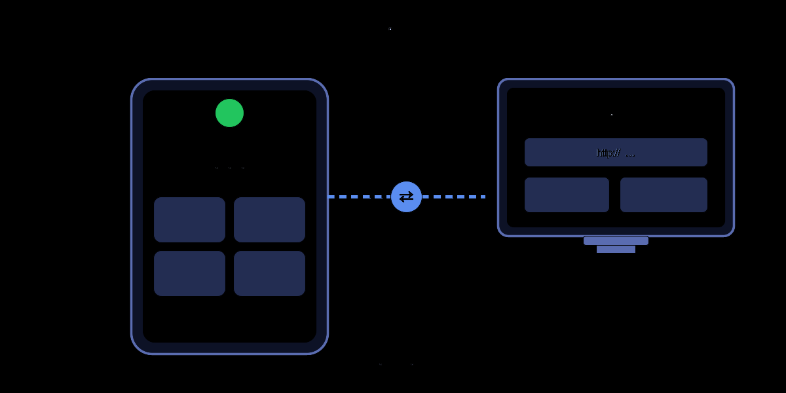
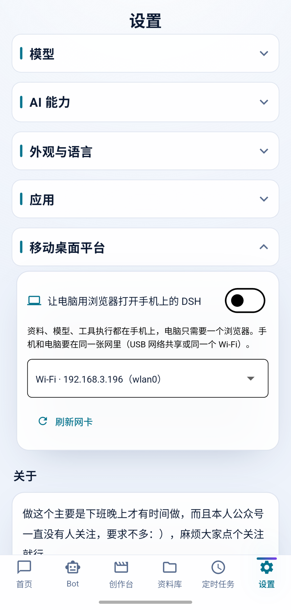
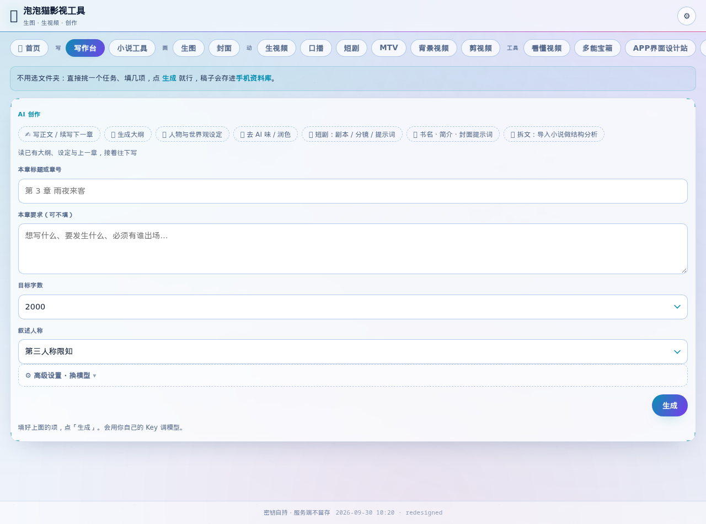
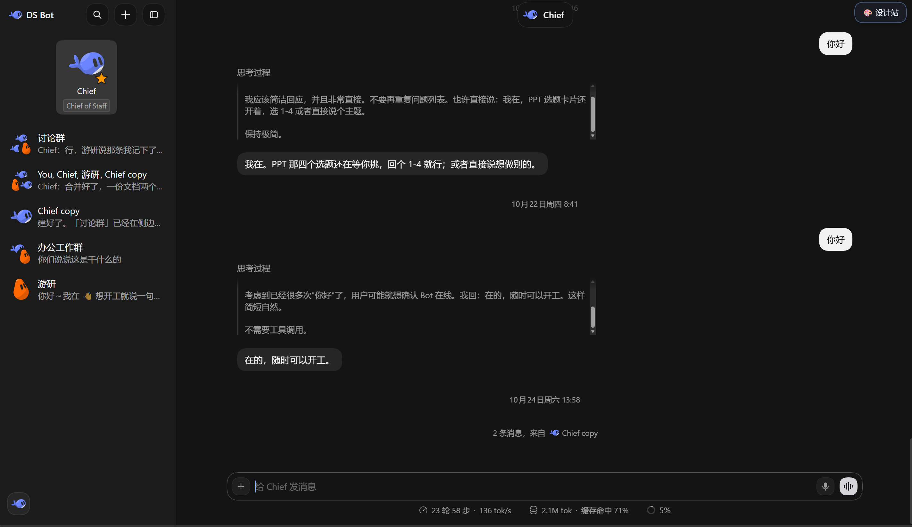
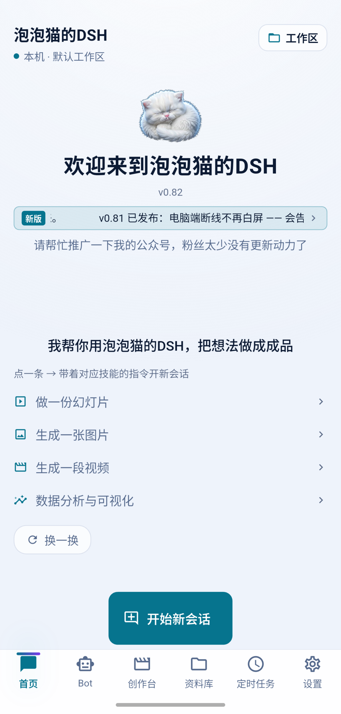
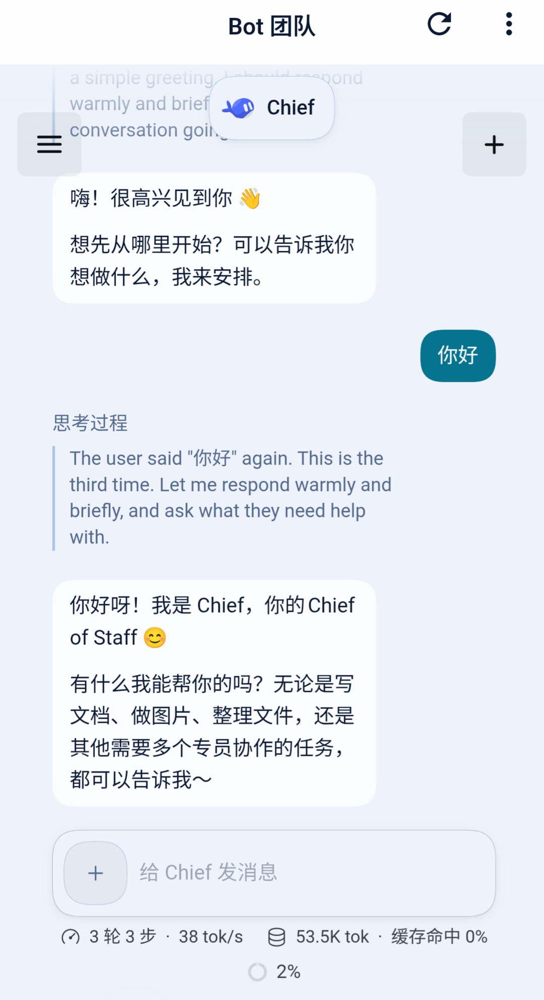
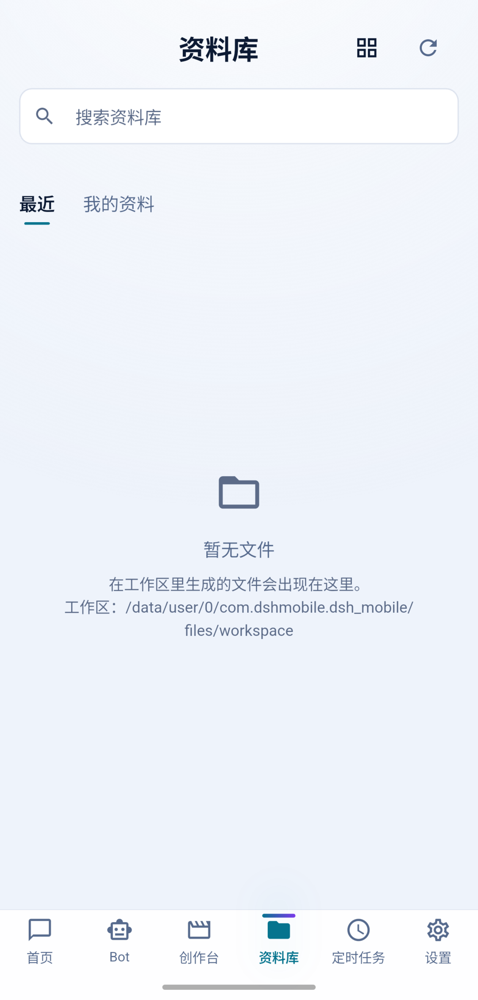
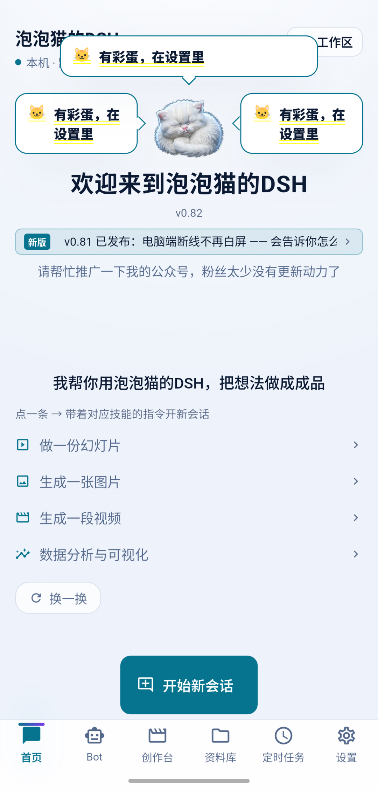

# Paopaocat · DeepSeek Harness Mobile

[中文](README.md) · [**English**](README.en.md) · [日本語](README.ja.md) · [한국어](README.ko.md)

> **This project is developed and maintained by one individual. It is not a DeepSeek official release, and DeepSeek does not endorse it.**
> But what it runs really is the DeepSeek Harness (DSH) engine itself — what this project does is carry that engine into Android untouched, and every agent capability comes from upstream. The word "third-party" here means the publisher is not the official one; it does not mean the project has nothing to do with upstream.
> "DeepSeek", "DeepSeek Harness" and "DSH" are trademarks or product names of DeepSeek, used here only to state the technical lineage accurately.

---

> paopaocat deepseek harness-mobile · v0.09 → v0.82, the whole history
>
> This is not a product introduction. I'm Paopaocat, the author of this app — from the idea on the 2nd to today, 33 days, 82 version bumps along the way. Today I've decided to open-source all of it, and I want to lay out every detour this project took and every hole it fell into.


---

## Contents

- [0. Prologue](#0-prologue)
- [1. Initiation: Why a Mobile Version](#1-initiation-why-a-mobile-version)
- [2. Architecture Overview](#2-architecture-overview)
- [3. Version History and the Pit Log (0.14 → 0.83)](#3-version-history-and-the-pit-log-014--083)
  - [3.1 0.09–0.14: The Feasibility Phase](#31-009014-the-feasibility-phase)
  - [3.2 0.15–0.23: The Wild Growth Phase](#32-015023-the-wild-growth-phase)
  - [3.3 0.26–0.34: Five Rounds on On-Device Models](#33-026034-five-rounds-on-on-device-models)
  - [3.4 0.35–0.73: The Consolidation Phase](#34-035073-the-consolidation-phase)
  - [3.5 0.74–0.76: The Chase for the Free Channel](#35-074076-the-chase-for-the-free-channel)
  - [3.6 0.77: Bot, Three Reversals](#36-077-bot-three-reversals)
  - [3.7 0.78: The P0 Campaign and Engineering Closure](#37-078-the-p0-campaign-and-engineering-closure)
  - [3.8 0.79: Paopaocat Assistant (phone-agent)](#38-079-paopaocat-assistant-phone-agent)
  - [3.9 0.80–0.81: The Mobile Desktop Platform](#39-080081-the-mobile-desktop-platform)
  - [3.10 0.82–0.83: Paying Debt, Gaining Speed](#310-082083-paying-debt-gaining-speed)
- [4. Focused Postmortems](#4-focused-postmortems)
  - [4.1 Paopaocat Assistant: "A Phone Driving a Phone", No Shizuku Needed](#41-paopaocat-assistant-a-phone-driving-a-phone-no-shizuku-needed)
  - [4.2 The Mobile Desktop Platform: Phone as Mobile Host](#42-the-mobile-desktop-platform-phone-as-mobile-host)
  - [4.3 The HarmonyOS Port: One Third of a Campaign](#43-the-harmonyos-port-one-third-of-a-campaign)
  - [4.4 The iOS Port: Why It Never Started](#44-the-ios-port-why-it-never-started)
- [5. Under the Hood](#5-under-the-hood)
  - [5.1 Embedding the Runtime](#51-embedding-the-runtime-47-mb-of-node-inside-an-apk)
  - [5.2 Bridge Protocol and Driving DSH](#52-bridge-protocol-and-driving-dsh)
  - [5.3 The Dart Layer](#53-the-dart-layer)
  - [5.4 What the UI Is Built From](#54-what-the-ui-is-built-from)
  - [5.5 The Native Layer](#55-the-native-layer)
  - [5.6 The Full Feature Inventory](#56-the-full-feature-inventory)
  - [5.7 Each Feature in Detail](#57-each-feature-in-detail)
- [6. Grading My Own Code](#6-grading-my-own-code)
- [7. Taking Stock of the Documentation](#7-taking-stock-of-the-documentation)
- [8. Compared with DSH Go, at the Bottom](#8-compared-with-dsh-go-at-the-bottom)
- [9. Closing](#9-closing)

---

## 0. Prologue

Three numbers first:

- **33 days** (project started 2026-10-02 → entered the 0.83 development cycle on 11-03).
- **89,031 lines of Dart** (tests excluded; the tests are another 25,369 lines), **12,310 lines of Node bridging and probes** (70 .mjs/.js files), **38 native files** (16 Kotlin + 8 Java + 14 ArkTS).
- **285 Markdown files** spread over the whole repo — 69 formal documents in docs/ (release notes for every version, root-cause records for every incident, three-source verification for every release), the other 216 sitting next to the code.

Three statements of position:

1. **Every line here, I can point you to the source for.** — a code path, a document filename. My own rule: do not write a conclusion you cannot trace.
2. **Defects are not hidden.** Chapter 6 is my list of bad reviews of my own code, ordered by "has it caused an incident / how easily will it cause one", not by "does it look wrong to me". Calling myself out is more respectable than being called out.
3. **Anything beyond the physical device, I mark it.** My project discipline is real-device verification first (every hole in those 33 days was caught on a real phone), but wherever this document draws a conclusion from reading code without reproducing it on device, I say so on the spot instead of passing it off as a measurement.

---

## 1. Initiation: Why a Mobile Version

### 1.1 One-Sentence Origin

Over drinks with a few friends one evening, the project was decided:

> "Does DSH have a mobile version? I've seen someone else ship a mobile version."  
> "But I want to build a native app."  
> "What I want is a mobile DSH that runs on its own."

**2026-10-02 08:29** — that day is the founding date of Paopaocat DSH Mobile.

Translated into technical language, the requirements were really three:

1. **Standalone.** Apart from the one step that calls the model API, everything runs locally on the phone. No dependence on any server, no pure web wrapper, no remote desktop.
2. **Complete capability.** Whatever the desktop DSH can do — reading and writing files, running tasks, calling tools, maintaining multi-turn context — the mobile version may not lose a single one. (The desktop DSH here is the DSH desktop project I packaged earlier, for Windows and macOS; it stopped being updated once Lao Liang released his desktop build.) Which means: no "implement a simplified Agent" of my own; the entire DSH runtime must be moved into the phone untouched.
3. **A UI modelled on a mature one (interface design is genuinely not my strength)**: aligned page by page against an 11-page design mock — the capsule input area on the task home page sits 87% down to the bottom, and those coordinates still live in `theme/dsh_tokens.dart` today.

### 1.2 The Room Where the Three Routes Were Decided

Before writing any code I laid three routes on the table, and I had each one's fatal flaw clear on day one:

**Route A: rewrite an agent framework natively in Go / Kotlin.**  
Fatal flaw: DSH's capability surface *is* its runtime ecosystem (MCP tools, skill scripts, plugins, the Python/Node toolbox). A rewrite means starting from scratch. That route is digging my own hole. Pass.

**Route B: the remote WebView approach.** The phone connects to a computer running DSH, and a WebView displays the web UI.  
Fatal flaw: it violates requirement 2 — it depends on a computer. Later, while building Bot in 0.77, I crashed on this approach and then flipped back to it; see 3.6. But at founding time it was never a candidate. Pass.

**Route C (chosen): carry the whole machine over.** Put the Node runtime (`libnode.so`) plus every DSH dependency (`dsh-runtime.zip`) into the APK as assets, unpack them into the app's private directory on first launch, and from then on run fully offline.  
The price is a 113 MB package (187 MB back then; delta updates and slimming ground it down since) and a 40–80 second unpack wait on first launch; what it buys is that **every time the desktop DSH advances, the mobile version only needs the runtime repackaged — not a line of core code changes**.

In hindsight, Route C is the only reason this project survived 33 days. It downgraded "develop an agent app" into "develop the shell of an agent app + do the runtime-carrying engineering properly". The former is a bottomless pit. The latter is a bounded problem.

### 1.3 Before 0.09: Feasibility Verification

Before real coding there was `docs/ANDROID-LOCAL-VERIFICATION.md`, recording what I verified about four platform obstacles; the matching packaging plan is in `docs/ANDROID-LOCAL-PACKAGING.md`, which logs 8 pitfalls. This stretch of history predates git (2026-10-05, init v0.14-preview), and it stayed alive on those two documents plus `docs/RELEASE-0.09.md` (my 10 pieces of measured feedback checked off one by one, plus 7 real bugs that would have wrecked the release if left alone).

The most valuable single verification: **can Android run a full Node?** The answer was to disguise the Termux node binary as `libnode.so` and stuff it into jniLibs (routing around Android's rule that only .so files may be *loaded*), paired with three shims (detail in 5.1). That approach has been in use from the day it was verified until now, never replaced.

---

## 2. Architecture Overview

### 2.1 Four Layers

```
┌────────────────────────────────────────────────────────────────────────────┐
│  UI layer (Flutter)                                                        │
│  app/lib/ui/ — pages, widgets, theme, i18n                                 │
├────────────────────────────────────────────────────────────────────────────┤
│  Domain layer (Dart)                                                       │
│  app/lib/protocol · state · storage · data · local                         │
│  ACP stdio client / model catalog / Keystore                               │
├────────────────────────────────────────────────────────────────────────────┤
│  Runtime layer (Node)                                                      │
│  libnode.so + dsh-runtime.zip → filesDir/dsh/                              │
│  DSH agent loop · MCP probes · skills · toolbox                            │
├────────────────────────────────────────────────────────────────────────────┤
│  Native layer (Android Kotlin / HarmonyOS ArkTS)                           │
│  unpack host · foreground service · Keystore · phone-agent · notifications │
└────────────────────────────────────────────────────────────────────────────┘
```

Scale (build artifacts excluded; 1,507 files across the project, minus .git / node_modules / build / .dart_tool / dist):

| Layer          | Language      | Files                                | Notes                     |
| -------------- | ------------- | ------------------------------------ | ------------------------- |
| UI + domain    | Dart          | 318 (lib 89,031 lines + test 25,369) | app/lib/                  |
| Runtime carrying | mjs/js/py/ps1 | 70 scripts (12,310 lines) + 55 py + 16 ps1 | install/, bridge/, probes/ |
| Runtime itself | Node          | packed as dsh-runtime.zip (v5, ~33 MB) | desktop DSH, as-is      |
| Native Android | Kotlin/Java   | 16 kt + 8 java                       | app/android/              |
| Native HarmonyOS | ArkTS/C++   | 14 ets + node_host.cpp 529 lines     | app/ohos/, ohos-node/     |
| Documentation  | Markdown      | 285 (docs/ 69 + 216 beside code)     | whole repo                |

### 2.2 The Full Journey of One Message

Take "tidy up this table for me":

1. **UI layer**: the user types in the input bar on `chat_page` and sends; the message enters the session model in the `state` layer.
2. **Domain layer**: `local/acp_client.dart` (the ACP stdio client — the key to multi-turn sessions, never seriously touched since the first version) encodes the request as JSON-RPC 2.0 and writes it into the stdio pipe connected to the DSH process.
3. **Runtime layer**: the DSH process (`node --require fsShim --require execShim dsh --profile acp …`) receives it and enters the agent loop — reading files, running tools, calling the model. Every step it produces along the way (agent_message_chunk / thought / tool_call / tool_call_update / usage_update) comes back out as an ACP update.
4. **Domain layer**: `acp_client.dart` normalizes the five update kinds into a single event stream, and the `state` layer drives partial UI repaints — streaming echo, collapsed thought process, tool-call cards, artifact cards are all driven by this one stream.
5. **Permission approval**: when a tool needs elevation, ACP sends `session/request_permission` and the Dart side pops an approval card. The user taps allow/deny and it travels back the same way.
6. **Artifact return**: files produced by tools land in the private workspace directory, and the library scans the workspace and files them automatically.

### 2.3 Why ACP Instead of Inventing a Protocol

`bridge/README.md` records the reasoning: ACP alone has `session/cancel`, `session/list`, `session/resume`, and `session/request_permission` — the only mechanism that can do approval on a phone. A homegrown protocol would either have to reinvent all four capabilities or cut them. Session interrupt/resume (one of the buttons users press most) hangs on `session/cancel` + `session/resume`.

### 2.4 Repository Map

```
dsh-mobile/
├── app/                  Flutter project (UI + domain layer + android/ + ohos/)
│   └── lib/{ui,protocol,state,storage,local,data,i18n}
├── install/              build pipeline + pile of verification scripts (148 files, see 5.1)
├── bridge/               PC-side WebSocket bridge (debugging during development, 6 .mjs)
├── probes/  fixtures/    ACP behavior probes and archived real frames (the basis of the bridge protocol)
├── runtime-plugins/      native DSH plugins (AnySearch web backend)
├── ohos-node/            the HarmonyOS embedded-Node battleground (C++/ArkTS/Dart patch mirror)
├── docs/                 288 files (69 md, the version history itself, see chapter 7)
├── design/  ui-review/   design assets and UI reviews
├── screenshots/          shots taken on real devices
└── signing-agc/          HarmonyOS signing material
```

Two "living fossils" worth explaining:

- **bridge/** is the legacy of the early "remote" route, still in use during development (convenient for poking the protocol from a PC); the app's production path doesn't use it.
- **probes/ + fixtures/** is the engineering investment I'm proudest of: `probes/acp-probe.mjs` measures the behavior of a real DSH, and the raw frames go into `fixtures/acp-probe-*.jsonl`. Every "measured behavior" line in the bridge protocol document points back to a specific jsonl line. Without that set of probes, all the later protocol work would have been guesswork.

---

## 3. Version History and the Pit Log (0.14 → 0.83)

This chapter is the main course of the book. 33 days, 267 commits, from 0.14 to 0.83. Every section is written as "goal → pit → real root cause → fix → what I learned". The original records of those pits are scattered across five places — git commit messages, `docs/RELEASE-*.md`, `docs/changelog-*.md`, `docs/需求台账.md`, and `app/lib/data/changelog.dart` (the in-app release notes). This is the first time they are assembled into one panorama.

A timeline overview first:

```
2026-10-03 ── 0.09 feasibility package (before git; evidence in RELEASE-0.09.md)
2026-10-05 ── git init · v0.14-preview (UI rebuilt against the 11-page mock)
2026-10-06 ── 0.15～0.23, nine releases in a row (0.18→0.23 within one day, incl. four languages)
2026-10-07~09 ── 0.24~0.34 five rounds on on-device models (see 3.3, the hardest stretch in the book)
2026-10-11~13 ── 0.61~0.73 full sync with desktop + release process set in stone
2026-10-14~16 ── 0.75/0.76 chasing the free channel + creation studio
2026-10-17~19 ── 0.77 Bot, three plan reversals (build numbers 78→117)
2026-10-20    ── 0.78 P0 campaign + delta update (not expanded here)
2026-10-21~25 ── 0.79 Paopaocat Assistant (phone-agent, see 4.1)
2026-10-26~30 ── 0.80/0.81 mobile desktop platform (see 4.2)
2026-10-31~11-03 ── 0.82 paying debt + 0.83 faster initialization
```

### 3.1 0.09–0.14: The Feasibility Phase

Kept alive by three documents: `RELEASE-0.09.md` (my 10 pieces of measured feedback checked off one by one, plus 7 real bugs that would have wrecked the release if left alone), `RELEASE-0.13.md` (end-to-end verification on an emulator, including "symptom before the fix → root cause → the exact evidence"), and `RELEASE-0.14.md` (analyze clean + 82 unit tests + end-to-end evidence captured on device).

The rules set in this stretch were worth more than the code:

- **Artifacts must come with a checksum.** From 0.09 on, every APK records its sha256 and it is printed in the release notes. The "three-source check" in 0.83 later (cross-checking the hash across GitHub Release + update.json + the WeChat article) is a natural extension of this rule.
- **If it hasn't run on a real device, say it hasn't.** HANDOFF.md has a paragraph: "⚠️ but it has never run on any arm64 device — please make that explicit when handing it over." In the preview phase nobody installs it; after open-sourcing, that's credibility.

### 3.2 0.15–0.23: The Wild Growth Phase

On 2026-10-06, within a single day: 0.18 → 0.19 → 0.20 → 0.21 → 0.22 → 0.23, each with a four-language README sync + changelog + screenshots. I wouldn't believe that pace today, but the git log says so in black and white.

The price of going wild showed up the same day: six `revert` commits in a row — I put down a single line, "don't push to the repo yet", and all four 0.23 READMEs plus the changelog came back out. **You can add 5 version numbers in a day; the release cadence has to listen to exactly one person.** That later hardened into the "four-step process rule" (see 3.3, ledger #24).

The substantive technical progress:

- **0.19, four languages**: UI in Chinese/English/Japanese/Korean; from then on every copy change is a change in four places (which is how the i18n count guard test climbed 1231→1833, and how it once broke: the expected value sat at 1833 and stopped following, see 0.76 commit 1dd53d5).
- **0.20, running large models locally on the phone**: a panorama of on-device models + multi-source download from ModelScope + local file import. This was the prelude to the five rounds in 3.3.
- **0.21, cloud/local split**: the model page split into "cloud models" + "on-device models", grouped by text/multimodal/graphics/video — which directly gave birth to the grouping architecture later.
- **0.22, selector root-cause fix**: the local model that was "visible but unselectable", fixed by catching that the process-config fingerprint failed to count `local` — note that this was only **half the fix**; the real root cause was caught in 0.24 (the persistence guard rejected `local/*` + the reload fell back to the first entry in the list). **A half fix is more dangerous than no fix**, because everyone believes it's already fixed.

### 3.3 0.26–0.34: Five Rounds on On-Device Models

This section deserves its own chapter. 9 versions, 5 rounds of rework, and every round's root cause came from a real-device log rather than a guess. The source material is mostly `docs/需求台账.md` #35~#50; here is the retrospective in time order.

**Round one (0.26): three real faults read out of a log.**  
I analyzed a real-device run log, which exposed:

1. The local model hit `exceed_context_size` on every sentence — root cause: I had hardcoded the context at 2048, while DSH's system prompt alone is about 7000 tokens. Default changed to 16384.
2. Tapping a row crashed with `Null check operator` — the on-device model page had no Material ancestor, so the InkWell ripple blew up. Wrapping the page in Scaffold fixed it.
3. The graphics engine failed to start — the `--model` argument had been added but the companion files hadn't been fully downloaded. Changed to deciding whole-package vs. split by **what the manifest declares**, refusing to start when companions are incomplete and saying exactly what's missing.

**Round two (0.28–0.30): four performance switches, and a big mine buried.**  
To gain speed I added four performance switches: flash-attn / KV cache q8_0 / cache-reuse / threads-batch. Alongside, some legitimate work: a litert-lm feasibility check (official Maven dependency + readelf confirming the .so is self-contained, no Bazel install), session cache reuse (keep the engine session and send only the delta), an NPU tier, and splitting latency into "first-token latency / output speed".  
I also wrote a compatible chat template for Gemma (`lib/local/loose_chat_templates.dart`): Gemma's official template only accepts "one leading system + strict user/assistant alternation", while DSH pushes multiple system messages separately — the actual send was `[system, system, user]`, which hit the template's hard validation and returned 400. I built a measured matrix of 5 message shapes × official/compatible templates.  
**The mine**: the `--flash-attn` argument was written wrong (`unknown value for --flash-attn: '--cache-type-k'`), so that entire switch group had never taken effect — while everyone assumed it was in use.

**Round three (0.31–0.32): the segfault fog.**  
0.31 fixed the argument syntax, and the switches ran for real for the first time — then **on Snapdragon 8 Elite / Armv9, CPU/GPU/NPU all segfaulted** (SIGSEGV, code=-11). Log evidence: the short self-check (27 tokens) passed every time; what always crashed were real long requests.  
0.32 first set the default back to CPU, and added "record the crash + persist it + auto-switch backend next time", a three-level fallback for model names, and self-healing in the data layer (an empty name gets filled back from the catalog and written back). I also fixed a real bug where `toJson` dropped `companions`.  
I used a **screenshot test** (render the page locally, produce an image) to diagnose the layout problem of "the model name is invisible".

**Round four (0.33): tearing down my own optimization.**  
After comparing three real-device logs, it was confirmed: the crashes had nothing to do with the backend — CPU segfaulted too. The culprit was exactly that group of performance switches from 0.28: they had never taken effect because of the argument bug, and the first time they truly ran (with the bug fixed) everything crashed. **0.33 removed all of them and went back to the 0.26 arguments that worked.**  
The lesson from this round went into the ledger: every step of a performance optimization needs evidence that "it is actually running", otherwise you think you're optimizing while you're only editing a config file.

**Round five (0.34): the real culprit behind empty replies.**  
Qwen3 also "replied empty", with `stopReason=max_tokens`. The trail: the speed test was fine (the app sends max_tokens=48 directly) → it doesn't go through DSH → the clamp on the DSH side → `maxTokens = contextWindow - used prompt - 4096 (safety margin)` → the overlay hardcoded the local model's `contextWindow` at 4096, the user prompt was 6822 tokens → available went negative → **maxTokens was forced to 1**.  
Fix: add a `contextSize` field to `LocalModelSpec` (default 16384), pass it at both spec-construction sites, and pin 16384 with an anti-regression test.


Five rounds down, on-device models went from "completely unusable" to "stable". The closing line of ledger #50 is my own wording: "the speed test was fine because the app sends max_tokens=48 directly and never passes through DSH's clamp" — **any "test passed" needs to be asked which chain it actually exercised**.

(On-device models were eventually abandoned because the optimization results were simply too poor; 0.82 tried the MNN engine with good results and I plan to attack it again in 0.83.)

### 3.4 0.35–0.73: The Consolidation Phase

Three threads run through this stretch:

1. **0.61~0.71, process set in stone**: 521 tests passing / 0 failing became the gate for cutting a build; zero-drift guards on the three language tables.
2. **0.73, full version alignment**: before this I was often developing across several computers, so the version numbers had been a mess; this time they were unified.
3. **Two typical small fixes in 0.61** (ledger #51/#52, recorded here because they show the "keep asking why" culture):
   - "after installing, it opens on the video page" — root cause: restoring the persisted `lastTab`. The fix philosophy: a cold start always goes home; only a Tab touched **within this process** is restored.
   - "on-device model says the service isn't up" — not one place on that litert-lm startup path wrote `lastError`, so the UI could only show nonsense.

### 3.5 0.74–0.76: The Chase for the Free Channel

The keyless free models are the most "running after upstream" feature in this project. Upstream changed its gate 5 times, and I chased it 5 times:

- 0.74: free channel returned 403 → root cause "the session id has to be timestamp-encoded" (a new upstream gate from 2026-10-13); the fix landed with a "regression test that bites" immediately after.
- 0.75: upstream's 5th change → switched to `/inference/v1`, and 403 got its own plain-language translation; simultaneously added the Pollinations channel on by default, delivering "chat without filling in a Key".
- 0.76: `input_modalities` parsing (marking which models can see images), model names following DeepSeek's official rename (V3/R1 → V4), and every model on the keyless channel counted as free.

Two engineering moves from this stretch deserve their own record:

- **`docs/免费模型-方案.md` contains four reasons for "why we don't build an IP pool"**. For a question like "should we do some grey-area optimization", writing down why not is more important than shipping it.
- **The culture of correcting facts**: commit `8721383` — "the ones missing ffmpeg were the 10-15 batch of 0.75 test builds; **the officially released 0.75 is fine** — corrected by measuring every package". When an earlier announcement turned out to be wrong, correct it publicly instead of leaving the wrong release note hanging there.

0.76 was also a big feature release: 20 problems fixed, 17 things added (including a PPT layout layer — "the real reason PPTs look plain is that the bullets layout has only one text box; changed to cards + a card wall"; a long-session assistant hint; the creation studio classified into 4 groups).

### 3.6 0.77: Bot, Three Reversals

0.77 has the densest build numbers of any release (78 → 117), and its main thread was "put the Bot team on the phone" — at the cost of **changing the technical approach three times for the same requirement**:

```
Plan 1 (build 78~80)   WebView loading the desktop Bot web page — "Bot service failed to start": --patch treated as a web app argument
Plan 2 (build 81~101)  drop the WebView, use the app's native chat page — the native version got built, but Bot capability was limited by the app sandbox
Plan 3 (build 102~117) back to the web page approach, then close the gaps step by step
Final (0.77 release)   the Bot page returns to the app's native chat page (settled after build 117)
```

Each of the three plans died once, and the death records are all in commit messages:

- "★ the real reason 'the session can't be created' — opencode-go is missing api (**my previous plan was wrong**)" (build 98)
- "★ the real reason 'agent keeps requesting to execute an operation' — no model configured means no overlay, and the permission preset is lost with it" (build 99)
- "'can't get in' + Bot has no model — two self-inflicted bugs" (build 105)
- "the real culprit behind the black screen — the Bot page's PopScope grabbed back-navigation on another tab and popped the root route" (build 117)
- "edge swipe causes a black screen lockup — the two back paths unified into 'go to background'" (build 116)

Two non-code artifacts worth recording:

- `docs/BOT-TEST.md` got a structure diagram of "the current implementation" at the top, plus a note that "the pit records above belong to the abandoned WebView approach and are easy to misread" — **documentation of an abandoned approach is not deleted, but it must be clearly marked as dead**.
- In the same period, 8 unit tests were added for Bot roster parsing — "this area had zero coverage before". Add tests where you crash a lot; that order is right.

### 3.7 0.78: The P0 Campaign and Engineering Closure

Five P0s within one day, all of them with "real root cause" level records:

| Build | Symptom                       | Real root cause                              |
| --- | ------------------------ | ----------------------------------- |
| 121 | a local MCP failing to start took the whole session down (real-device P0) | probe first; on failure, drop the MCP and retry |
| 122 | Bot page "went back in time" (UI state scrambled)     | a placeholder in a comment got hit by `replaceFirst`, injecting a syntax error into the whole block |
| 123 | local MCP probe never passed (6s timeout on device)  | the allowlist was missing Android system variables |
| 124 | file generated but the UI kept saying "processing"         | `running` was a bare field; changing it notified nobody |
| 125 | Bot page "reconnect" really did disconnect        | model switch restarted with a new port + navigation interception read the old address |

122 deserves a closer look: a placeholder inside comment text was hit by the string-replacement logic — **a comment is a string too, and text-manipulating code does not distinguish code from comments**. This kind of bug can't be prevented by review; it can only be prevented by a defensive convention like "format placeholders in a way that can't appear in natural text".

0.78 also shipped the delta update (build 126, homegrown DSHDELTA v1, 99 MB → 5 MB).

### 3.8 0.79: Paopaocat Assistant (phone-agent)

See the deep dive in 4.1. Timeline marker: tag `bot-native-v0.79` on 2026-10-21, then dense work on the bot-rework branch on 10-24~25, with 14 fix commits in one day (see the pit list in 4.1).

### 3.9 0.80–0.81: The Mobile Desktop Platform

See the deep dive in 4.2. Five days, 10-26~30, from "make DSH bind a network card" to "port forwarding" to "all three address elements fixed", plus the 431 incident and open-by-QR-code.

### 3.10 0.82–0.83: Paying Debt, Gaining Speed

**0.82 (released 2026-11-03, build 250)**: "fixed 6 old problems, changed 4 behaviors, added 5 things". The most valuable of the fixes:

> fix(0.82): MCP probe was missing the parent environment (the real root cause of **the three Office tools never being mounted**) + logs now readable via adb

The four words "never being mounted" mean this is a defect that existed from day one of launch and was only found when I went looking for it. Together with the 0.31 performance switches (never in effect) and the 0.22 selector (half fixed), it belongs to this project's three great "silent defects" — all of them correct, none of them working, and nobody would know unless a user filed a report. The 0.82 countermeasure was making the logs readable through `adb logcat`, giving silent defects an exposure channel.

There is also "Can't connect? Tap here to self-check": it really does connect once and then names the failing layer (Wi-Fi? service? address?) — this is the 0.81 mobile-desktop philosophy of "when it breaks, you can read why", extended to the whole app.

**0.83 (in progress)**: faster app initialization — probe concurrency 4→12, shorter timeouts, a cached fast path (`58259dc`). While writing this document I timed it on my own Snapdragon 8 Elite device: the 0.82 build goes from cold start to an interactive home page in about 15 seconds, far better than the 40~80 seconds recorded in the README — but that figure is the first-launch unpack scenario, so the two numbers don't contradict each other.

---

## 4. Focused Postmortems

### 4.1 Paopaocat Assistant: "A Phone Driving a Phone", No Shizuku Needed

**What it is**: a "screen assistant" built into the app that lets the agent operate your phone for you — price comparison, ticket lookup and flows like that, without you tapping through step by step. The name is simply "Paopaocat" (0.24 commit: screen assistant renamed "Paopaocat Assistant" + price-comparison/ticket-lookup flows + install-free pairing port).

**The core conflict it resolves**: for one Android app to tap through other apps on the user's behalf, the official path is an accessibility service (AccessibilityService), but that path is a bad experience (you have to go into system settings and enable it, it gets killed easily, its state goes out of sync); the better path is Shizuku (ADB shell-level permission), but that requires the user to install Shizuku first and pair it by hand — a turn-away threshold for ordinary users.

**The author's decision**: in 0.79 I simply **built Shizuku's core capability in** — the original commit `1148358`: "no Shizuku install — built-in wireless debugging pairing, self-built shell engine dex". The user only has to type a pairing code; the whole pairing flow happens inside the app. This is a textbook case of "turn a dependency into a feature": rather than teaching users to install Shizuku, implement what Shizuku does (wireless debugging pairing + a shell command channel) myself.

**Technical breakdown** (the evidence is all from the 14 fix commits of 2026-10-24~25; each one was dug out on a real device):

| Pit              | Root cause                        | Fix (original commit wording)                                                |
| -------------- | ------------------------------- | ------------------------------------------------------- |
| adb certificate generation failed     | R8 stripped BouncyCastle            | "keep the whole BouncyCastle package" (`c3ae0b7`)                      |
| engine killed when the shell exits | child process was attached to the shell session                 | "start the engine with setsid to detach it from the shell session" (`5025fdd`)                   |
| service enabled but judged disabled      | `isEnabled` only recognized the long-form ComponentName | "recognize the short-form ComponentName" (`60ac6a0`)                         |
| recording state forever false   | the MethodChannel return value was wrapped in a layer          | "phoneRecStatus uses invokeMethod<Object> to get the raw value" (`d0d902b`) |
| execution fails on the first step       | the recording flow didn't add the launch step automatically              | "recording adds the launch step automatically" (`649cc2c`)                            |
| virtual display can't be created        | the shell process used the wrong context              | "a shell process creating a virtual display must swap in com.android.shell's context" (`128a22b`) |
| launch starts the wrong target   | default resolution went to the launcher           | "launch now uses resolve-activity + am start -n" (`92ce188`)                   |
| engine won't start and self-heals poorly      | startup argument order was wrong                         | "--patch must come before --no-open + launcher argv ordering and override semantics"       |

**Architecture decision: accessibility → headless mode**. `eef6ecd`: "screen assistant switched to a pure background headless mode (accessibility abandoned)" + `9042a4a`: "background console — create a virtual display right in Settings→Apps, pull an app up, tap on the live picture". In other words the final form is: **a Shizuku-style shell channel + a virtual display (VirtualDisplay) + targeted injection**, and the app never touches the accessibility service. The target app runs on the virtual display while the main screen is completely undisturbed — which is the fundamental reason "Paopaocat" is cleaner than traditional automation tools.

**Why accessibility was abandoned** (three reasons recorded at the time): one, an accessibility service has to be switched on by the user in system settings, and the app cannot see its state itself; two, the UI information you get from the accessibility event stream is "meant for disability assistance", so automation has to guess at control semantics; three, domestic ROMs' background-killing policy toward accessibility is uncontrollable. The virtual display approach routes around all three.

**Leftovers**: before `4707ea3` the Shizuku channel was still there ("remove the 'authorize Shizuku' button" only happened on 10-25); the migration path for existing users is in the illustrated guide.

### 4.2 The Mobile Desktop Platform: Phone as Mobile Host



**Why this feature exists — the "mobile host" concept.**

At founding time this app's positioning was "put DSH into a phone". What 0.80 did was push the positioning one step further: **the phone is not just a container for DSH, the phone is your host.**

That line in the WeChat article is the product definition of the whole feature:

> Before, AI lived inside a computer, and the phone just looked at it through the network.  
> Now it's the other way round: **models, data, tools, your manuscripts — all of it lives in the phone.**  
> The computer (or even another phone) installs nothing: open a browser, type a URL, and you're connected.



Note the line of principle explanation in the settings page — it is not a feature description, it is an architecture declaration: **"Files, models and tool execution all live on the phone; the computer only needs a browser."**

What this concept means in practice for "mobile work": no file syncing, no session migration, no copying API Keys. You write and generate images on the computer's big screen while the compute and the data stay in the phone in your pocket. The computer is just a monitor plus a keyboard. If the phone is off or offline, "your working environment on the computer" disappears with it — **no cloud sessions, no cloud data; that is both the selling point and the privacy stance**.



**Five days, five pits in implementation** (2026-10-26~30, every one of them in the commit log):

1. **"Switch to port forwarding, stop making DSH bind the network card"** (the first version, before `f02dd48`): initially the Node HTTP service listened directly on the Wi-Fi network card — that route has two layers of trouble on Android, SELinux and lifecycle; changed to port forwarding on the app side, with DSH listening only on 127.0.0.1.
2. **"The computer can't open the URL the phone gave it — all three address elements fixed + the switch no longer restarts DSH"**: if any one of IP, port or token changed, the URL in the user's hands was dead. The fix was to converge all three into deterministic generation (network card chosen → IP fixed, port no longer changes across restarts, the password only changes on an explicit reset).
3. **"The real reason the Bot page won't open is 431"**: accumulated historical cookies blew up the request headers (HTTP 431 Request Header Fields Too Large). Cookie/header management in a web service needs a cap.
4. **"Add --trusted-host, fix the blanket 403 on /api"**: accessing from the computer, the self-signed certificate/Host check was blocking the API.
5. **"The design station entry URL must include index.html (a directory form returns 404)"**: how the static server handles directory paths.

0.81 closed three things: **when it breaks you can read why** (the browser is no longer a white screen; it states the reason and reconnects automatically when the phone recovers), **you can see the wait** (four-stage progress + seconds elapsed), and **less typing to open** (a new "open by QR code" — a QR code appears on the phone, the computer scans it and goes straight in). Along the way it fixed three 0.80 problems (a design-station startup failure dragging down the keep-alive service, 23 missing English/Japanese/Korean translations, the in-app release notes having only 5 entries).

**Security model**: a URL carrying a token (password) is equivalent to a key; changing networks or resetting the password invalidates the old address; management endpoints are forced onto loopback. This and the PC bridge's (bridge/) "pairing code + token hash + fingerprint pin" are two ends of the same philosophy.




### 4.3 The HarmonyOS Port: One Third of a Campaign

The state of the HarmonyOS line has to be stated **honestly**: the app itself (`app/ohos/`) is the official Flutter-for-HarmonyOS project shell — it compiles, installs and starts; but the deepest link in the chain (libnode.so + DSH) only has the Bot subset working on HarmonyOS. The evidence chain:

**The shell** (`app/ohos/`, 9 files + `signing-agc/`, 10 files): `HARMONYOS-NEXT-GO-NO-GO.md` (733 lines) is the record of every round of real-device testing since 0.74, with the conclusion gradually moving from GO to ROUTE-A-DOWNGRADE (the downgrade route) — `HARMONYOS-ROUTE-A-DOWNGRADE.md` records that downgrade decision: secure the Flutter shell first, attack the runtime separately.

**The runtime battle** (the `ohos-node/` directory, C++ 529 lines + ArkTS 1,032 lines + Dart patch mirror 3,239 lines): on 2026-10-29, on a real device (ADY-AL00, API 26) node v24.2.0 → the DSH web service → a WebView rendering the Bot UI came up. This route is an order of magnitude harder than Android, because HarmonyOS's sandbox policy differs from Android's systematically:

| Dimension                | Android                    | HarmonyOS                                                                                                                                     |
| ----------------- | -------------------------- | -------------------------------------------------------------------------------------------------------------------------------------- |
| Node startup           | node binary disguised as libnode.so, a separate process | **seccomp forbids fork/exec of arbitrary binaries → dlopen libnode.so + node::Start in-process** (`node_host.cpp`)                                                 |
| JIT               | normal                         | **W^X forbids PROT_EXEC → `--jitless`; jitless in turn forbids WASM → the bundled undici's llhttp crashes for sure → jitless-shim strips node:http's WebSocket + node-fetch takes over fetch** |
| io_uring          | normal                         | seccomp trap → `UV_USE_IO_URING=0` as the cure + a SIGSYS handler as the net (only sets x0=-1, leaves PC alone — copying "PC+=4" segfaults, explained specifically in the README)                            |
| CLI entry            | run bin.js directly                 | embedded scenario: `import.meta.main` is always undefined → bin.js exits silently with rc=0 → a dynamically generated wrapper calls `runCli()` explicitly                                                    |
| Readiness detection              | read the process's stdout                 | the host can't read the stdout of an in-process node → dup2 it to a file, and Dart polls for the readiness line                                                                                          |
| SharedPreferences | official plugin                       | no official implementation on HarmonyOS → `SharedPrefs.ets` implements the channel itself (proven by MissingPluginException on device)                                                                        |

Three things in `node_host.cpp` (529 lines) are what I'm proudest of in hindsight:

- **Crash handwriting**: w0~w8 all the way through, TW() appends to a trace file, so you can see at a glance which step killed the process — the only way to turn "an unobservable seccomp death" into a readable log.
- **ProbeMemory()**: an mmap probe item by item, answering "what exactly does seccomp forbid" instead of guessing.
- **The 92MB dlopen entirely on a background thread**: the lesson of the 2026-10-28 real-device ANR.

`verify/loader.c` is the move I like best: **when you have no device, use qemu-user + the Alpine musl loader to first verify "can libnode.so be dlopened / can V8 initialize"**, while honestly listing the three things this method cannot test (seccomp/SELinux/MethodChannel). Decoupling "does it run" from "device policy" is the standard play in platform porting.

**Unfinished list** (why I say only one third of the campaign): on the HarmonyOS side only the Bot subset works; the full app runtime (offline agent sessions, tool execution, the file system) has no equivalent HarmonyOS implementation; `SharedPrefs.ets` covers only a subset of Android's semantics. The principle of `DshNative.ets` is "every unimplemented method honestly calls notImplemented() and lets Dart degrade — never fake data" — so the functional boundary of the HarmonyOS build today is "honest degradation", not "fake completeness".

### 4.4 The iOS Port: Why It Never Started

Straight to the conclusion: **the iOS version was never started, and it won't be started in the short term**. This isn't a resourcing question, it's a hard platform constraint — take the difficulty of the 4.3 HarmonyOS route and multiply it by another factor:

1. **JIT**: iOS forbids writable-and-executable memory (W^X) for third-party apps, so V8's JIT cannot work the way it does on Android. HarmonyOS at least left a way to live via `--jitless` (interpreter mode is legal there); on iOS, whether a jitless Node passes review and whether its performance is acceptable are both open questions.
2. **Binary execution**: the iOS sandbox does not allow executing binaries not declared inside the app bundle, and the Android trick of "node disguised as libnode.so and loaded" has no direct equivalent on iOS — `dlopen` on your own .so is legal, but symbol export and in-process startup would have to be redesigned.
3. **Signing and distribution**: leaving App Store review aside (whether an app that "executes arbitrary scripts" can be listed at all is itself a question), even sideloading (AltStore/self-signing for 7 days) is a threshold for the target user.
4. **File system**: each app's sandbox on iOS is more closed, so "complete file system" — one of the README's core promises — is discounted on iOS by nature.


If it were ever done, the viable path would most likely be the "PRoot-style" or "remote host" route that DSH Go takes (see chapter 8) — **which is to say the iOS version would no longer be "carrying the whole machine over", and that amounts to admitting Route C doesn't hold on iOS**. Between the origin of the requirement (standalone, complete capability) and the platform constraints, iOS has no solution that satisfies both. That is the entire reason for not doing it. (There is also the matter of my own skill level.)

---

## 5. Under the Hood

### 5.1 Embedding the Runtime: 47 MB of Node Inside an APK

This is the single most central piece of engineering in the project, and the answers are scattered across the build pipeline in `install/` and the 8 pit records in `docs/ANDROID-LOCAL-PACKAGING.md`.

**Where Node comes from**: the Termux node binary (no cross-compiling of my own — Termux has already solved Android's linking problems). Four key moves:

1. **Disguise**: rename the node executable to `libnode.so` and put it in jniLibs — Android only allows *loading* an .so, not *executing* a binary shipped inside the app; but when `Process.start` is pointed at an .so file, the linker treats it as an ELF, and shebangs like `#!/usr/bin/env node` are routed around. **This is the cornerstone of the whole approach.**
2. **SONAME patching** (`install/normalize-runtime-libs.mjs`): Termux's library symlinks (libz.so.1 → libz.so) get lost on a Windows build machine. The script scans ELF strings and fills in the aliases — the comments record a regex bug in it: `{2,40}` missed 1-character library names, changed to `{1,40}`.
3. **Dependency closure** (`install/prepare-jnilibs.mjs`): **actually parse the ELF .dynamic/.dynstr sections to read DT_NEEDED**, collect dependencies recursively, and rewrite non-conforming references into conforming lib*.so names. Not by guessing extensions, by reading ELF.
4. **Path patch** (`install/patch-node-shell.mjs`): the node binary hardcodes Termux's shell path, and it won't run unless that is changed.

**Three runtime shims** (shipped inside dsh-runtime.zip, mounted with `node --require`):

- `android-fs-shim.cjs`: SELinux forbids hard links → when `fs.link` fails, degrade to a COPYFILE_EXCL copy based on the error code.
- `android-shim-flock.js`: bionic/musl has no flock → no-op (plenty of npm packages depend on flock directly).
- `android-shim-require-builtin.js`: getting at node's built-in modules requires `--expose-internals`.

**How runtime.zip was slimmed down** (`install/slim-runtime-zip.py`, 152 MB → ~33 MB): the header comment says "I read the code for every category; this is not a feeling that it should be fine". Examples: libreoffice-kit's resolveEngine throws (delete); @vscode/ripgrep can't resolve on this platform (delete); sharp has a wasm32 fallback (**must be kept**); node-pty must keep linux-arm64/pty.node. `--verify` checks each package's package.json entry point.

**First-launch flow**: MainActivity unpacks assets → first launch unpacks the runtime (about 40~80 seconds, `libnode.so` 47 MB + runtime.zip 33 MB) → a marker file decides the version → from then on, a launch unpacks nothing. `runtime.json` declares the runtime version (v5) + sha256, and an over-install is forced to refresh by incrementing the "runtime content version" (the 0.75 pit: the content version didn't bump, so an over-install kept the old runtime, `4dbe403`).

### 5.2 Bridge Protocol and Driving DSH

The app's production path (ACP stdio):

- `app/lib/local/acp_client.dart`: JSON-RPC 2.0 framed by readline newlines, with three-way dispatch for responses / server requests / notifications. This file has been alive since the first version and the UI rewrites never touched it — **a stable protocol layer is the precondition for a UI layer that dares to start over again and again**.
- The five ACP updates (agent_message_chunk/thought/tool_call/tool_call_update/usage_update) normalized into one event stream.
- Permission approval: ACP `session/request_permission` → the app pops an approval card → the answer travels back the same way.

The PC debug bridge (`bridge/`, 6 .mjs files, 1,584 lines total) turns the same ACP into a WebSocket service; the design points worth copying:

- **dsh auto-restart on crash**: exponential backoff 1s×2 capped at 30s, at most 8 times, broadcasting `bridge_status` throughout.  
  |  |  |  |  
  | --- | --- | --- |
- **Approval fallback**: `riskFlagsOf()` tags a command's risk with 6 regexes (rm -rf / curl|sh / .ssh|.env / git push --force / …); when nobody is subscribed it degrades to broadcasting to everyone — **so a background approval is never silently dropped** (comment at server.mjs:250-265).
- **Credential storage** (store.mjs:48-125): stores only `sha256(deviceToken)`; pairing codes are 6-digit CSPRNG, TTL 120s, single-use, 5 wrong attempts locks for 15 minutes; **atomic writes** (.part + rename) + **corruption isolation** (on a parse failure, rename the bad file to .corrupt so the original bytes survive). The comments reconstruct the full P0 incident chain of "read failed → treated as empty → written back → every device dropped".
- **Protocol evolution rule** (bridge-protocol.md §9): "v1 only adds; unknown type is ignored, not disconnected" — the protocol was designed for backward compatibility from day one.

Probe culture (`probes/`, 11 .mjs files, 1,690 lines): the header comment of `mock-acp-server.mjs` in its own words — "approval is the core capability of the objective; **it must not be verified by the luck of the model's decisions**". A real DSH only sends a permission request when the model chooses to escalate, so approval can't be tested reliably, hence the mock always sends `rm -rf ./dist` to exercise riskFlags. A deterministic mock beats a probabilistic real thing.

### 5.3 The Dart Layer

The lib/ layering (89,031 lines + 25,369 lines of tests):

```
lib/
├── main.dart        entry: not unpacked → SetupPage, ready → AppShell
├── local/           runtime wrapper (dsh_runtime.dart: spawn / overlay generation / credential injection)
│                    acp_client.dart (the stdio protocol end)
│                    loose_chat_templates.dart (Gemma-compatible templates)
│                    rotate_log.dart (rotation-pool log parsing, 6 unit tests)
├── protocol/        message and card models
├── state/           session/model state + broadcasts
├── storage/         persistence (SharedPreferences + files)
├── data/            model catalog / artifact parsing / changelog / easter_egg / usage
├── i18n/            four-language tables (tables/, entry counts pinned by guard tests)
└── ui/              pages + widgets + theme (see 5.4)
```

A few representative design decisions:

- **Overlay generation**: DSH's configuration isn't written into files directly; instead, an overlay is generated at every session start (model selection, permission mode, MCP declarations, environment variable injection) and layered on top of the runtime. The upside: the runtime directory stays read-only, user configuration can be discarded and rebuilt wholesale, and fixes for bugs like the 0.34 clamp have one concentrated place to land.
- **Rotation pool** (rotate_log.dart): the proxy that rotates multiple models is started with `--log`, and above the session input field the UI shows "rotation pool cat · using claude-sonnet this time". The parser has 6 unit tests, covering the pit that "an ISO timestamp in the log fools the regex" — **even the timestamp format the parser sees is tested**.
- **Usage accounting** (UsageStore): requests and character counts recorded per route, persisted to `<nodeHome>/usage.json`. The comment is explicit: "don't invent token counts — DSH doesn't push real usage yet; when it does, add the field and the UI won't need to change". **No fake data** is one of this project's red lines.
- **API Key**: only in Android Keystore (per the README privacy statement); sessions and outputs in the private directory; confirmation required before execution.

### 5.4 What the UI Is Built From

**Page structure** (from the 0.82 real-device semantics tree): 6 tabs at the bottom — Home / Bot / Creation Studio / Library / Scheduled Tasks / Settings. Home, top to bottom: the mascot cat (tappable, see the easter egg) → welcome area + version number → announcement bar (new-version badge + jump) → skill shortcuts (slides / image / video / data analysis, rotating via "shuffle") → the primary "Start new session" button.









**Theme system**:

- Three built-in themes: light / dark / pixel (custom is a placeholder, and the settings page says "not built yet" honestly — **a placeholder doesn't pretend to be real**), plus wallpaper selection.
- Token system: `theme/dsh_tokens.dart` defines colors/spacing/font sizes/radii, **including the mock coordinate system** (the element coordinates of the 11-page PDF live here; the first version was built by "aligning page by page against OCR coordinates"). Font sizes are unified into four steps 13/11/12/15 — root cause in ledger #11: "there were bare Text widgets falling back to the theme default 14 and then getting text scaling on top; in some places the font was absurdly large".
- Theme gate: 0.82 commit `fix(theme gate): two hardcoded radii changed to DshMetrics.radius` — radii and colors may not be hardcoded; they go through the gate.
- **Cross-end theme**: the Bot web version (design station) gets its colors from the Dart side compiling `DshColors` into CSS tokens (`d45288f`) — one token source shared by the Flutter and Web renderers.
- The light theme once had "input text is unreadable" (textTheme missing bodyLarge, build 85) — **every step of Material textTheme needs an explicit color**; whichever step is missing goes invisible in light mode.

**Component system** (`lib/ui/widgets/`):

- `input_bar.dart`: capsule input field + model button + attachment menu (camera/album/file/voice) + send.
- `message_stream.dart`: message stream / artifact cards / tool-call cards / attachment menu — streaming echo, collapsed thinking, tool cards all ride this one event stream.
- `mascot_speech.dart`: the bubble the mascot speaks (see below).
- `bottom_nav.dart` / `common.dart`: navigation plus empty states / capsules / file-type badges.
- Group containers: `DshCollapsibleSection` (collapsed by default) / `DshStaticSection` (always expanded) — the lesson of 0.30 (ledger #46): the model list was collapsed by default, causing "the model name is invisible"; since then, **groups with content use StaticSection and stay expanded; empty groups don't render**.

**i18n**: Chinese/English/Japanese/Korean, table-driven (`lib/i18n/tables/*_table_data.dart`), with entry counts pinned by guard tests (1231 → 1833). Every UI string goes through `context.tr('中文原文')` — **the Chinese source text is the key**, and the translation tables align on that key. 0.81 crashed once: 23 entries missing in English/Japanese/Korean; after that, zero drift on the language tables entered the build gate.

**Streaming rendering**: event-driven partial repaint (the message stream rebuilds the matching card per update type); thinking is collapsed by default (`dsh_thinking_mode=collapsed` persisted, and the settings page shows the words "persisted" — making the state transparent).

**Screenshot tests**: `test/ondevice_shot_test.dart` — render the page locally and produce an image to self-check the layout (introduced in 0.30). "Used the screenshot test to manufacture the 'empty name' scenario; the 0.31 fallback was able to show the factory name" — fix layout bugs with layout evidence.

**Easter egg** (`app/lib/data/easter_egg.dart` + `ui/widgets/mascot_speech.dart`):

- Tap the cat on the home page and it talks — the bubble appears left/top/right in turn, with a short vibration.
- **Tap 7 times in a row to unlock the real easter egg**: a long vibration + three bubbles (left/top/right) at once saying "There's an easter egg, in settings" → Settings gains a hidden "third-party keyless channel" entry under the model group.
- My own ruling, verbatim (header comment of easter_egg.dart): "the menu is: tap the cat 6 times and its left, top and right all pop bubbles". The final implementation is 7 — the 7th is a long vibration, the first 6 are short, so rhythmically "the 7th feels like a reward".
- Engineering details: tap window 1.2 seconds ("a little wider than a normal 'rapid tap', so people with slower fingers don't get cut off"); a failure to read/write the state is treated as unlocked (fail-safe; the easter egg must not crash the main flow); the four-language copy is at line 1192 of the i18n table; mascot_speech.dart:318 records a bubble-layout hole that "lay dormant for a long time and was only caught when tests were written for the easter egg in 0.75" — **the easter egg needs tests too**.



### 5.5 The Native Layer

**Android** (`app/android/`, 16 Kotlin files):

- `MainActivity.kt`: the host that unpacks assets + the MethodChannel bus (unpack mapping, runtime version, marker decision, shim overrides).
- Foreground service keep-alive: the "missed" problem for scheduled tasks is stated honestly in the README's known limitations ("subject to domestic ROM power-saving policy").
- phone-agent module (0.79): dynamic dex construction, BouncyCastle keep, virtual display management (detail in 4.1).
- FileProvider: attachments (camera → private directory; arbitrary files get their real path).

**HarmonyOS** (`app/ohos/` + `ohos-node/`): see 4.3, not repeated.

### 5.6 The Full Feature Inventory

Each entry names its implementation entry point (start reading the code here):

| Feature               | Entry point                                                      | Notes                                                                                                                       |
| ---------------- | ------------------------------------------------------- | ------------------------------------------------------------------------------------------------------------------------ |
| Sessions (stream/interrupt/resume)     | `lib/local/acp_client.dart` + ACP session/cancel/resume | multi-turn context                                                                                                                    |
| Tool-call approval           | ACP request_permission + approval card                            | risk hints                                                                                                                     |
| Attachments: camera/album/file/voice   | `ui/widgets/input_bar.dart`                             | speech synthesis built in since 0.73 (Chinese model downloaded on demand, 31.5 MB); recognition uses the system service                                                                                  |
| Cloud models, multiple vendors         | `lib/data/model_catalog.dart`                           | deepseek/command/longcat/mimo endpoints pre-filled                                                                                       |
| On-device models            | `lib/local/` + `ondevice_models_page`                   | llama.cpp + litert-lm dual engine, grouped as text/multimodal/graphics/video                                                                                 |
| Model rotation pool            | `lib/local/rotate_log.dart`                             | shows "who is being used this time" in the session                                                                                                             |
| Keyless free channel       | free models / keyless channel settings group                                          | upstream gate chase, see 3.5                                                                                                             |
| 321 experts / 22 divisions | Expert center                                                    | the switch really writes runtime config                                                                                                                |
| 24 skills (bundled)    | Creation studio + skill system                                              | image/video/slides/diagrams/front-end design/document handling/spreadsheets/translation/data analysis/novel-to-game… (detail in 5.7.2)                                                                     |
| Bot team           | Bot tab                                                 | on the phone since 0.77, three plan reversals                                                                                                          |
| Scheduled tasks             | Scheduled tasks tab                                                | daily/weekdays/weekly/once; foreground service keep-alive                                                                                                     |
| Library              | Library tab                                                 | two tabs (Recent / My files); scans the workspace and files things automatically                                                                                                  |
| Multiple workspace directories           | top-right "Workspace" on home                                               | parallel directories                                                                                                                     |
| Mobile desktop platform           | Settings→Apps→Mobile desktop platform                                            | see 4.2                                                                                                                    |
| Paopaocat Assistant            | home mascot / settings                                                | see 4.1                                                                                                                    |
| Check for updates + delta        | update.json + DSHDELTA v1                               | not expanded                                                                                                                      |
| Connection self-check             | 0.82 "Can't connect? Tap here to self-check"                                         | really connects once, layers the fault                                                                                                               |
| Themes/wallpaper/pixel theme       | Settings→Appearance                                                   | see 5.4                                                                                                                    |
| Four-language i18n          | `lib/i18n/`                                             | zh/en/ja/ko                                                                                                                     |
| Easter egg               | `lib/data/easter_egg.dart`                              | see 5.4                                                                                                                    |
| **Plugin installation**         | Settings→Plugins (placeholder page)                                              | **Not open. The reason is in the README: security checks and rollback are unfinished; deeper down it is a fit problem — desktop plugins assume a full Node environment and arbitrary file access, and the mobile sandbox discounts both, so hard-fitting them has a worse ROI than making the open standard (MCP) work. The plugin page states this honestly instead of pretending to be "coming soon"** |


## 6. Grading My Own Code

Ordered by "has it caused an incident / how easily will it", not by "does it look wrong to me". This chapter is a list of bad reviews: the strengths first (because the strengths are the precondition for the weaknesses existing), then the debt.

### 6.1 Strengths (the ones I think I can say out loud)

1. **Root-cause culture.** Of the 267 commits, nearly every fix carries the words "real root cause", and the root-cause descriptions survive review (the 0.34 maxTokens clamp, the 0.82 MCP parent environment, the 0.77 PopScope stealing back-navigation — every one of them can be pointed at in the code). Self-corrections like "my previous plan was wrong" appear in the ledger more than once.
2. **Probes + fixtures.** Protocol behavior is measured before it is implemented, and the raw frames are archived for review. The mocks are deterministic; no gambling on luck.
3. **Gate tests.** The bar for cutting a build: flutter analyze clean + the full test suite passing + zero drift on the three language tables + check-release.py fully green. The "regression tests that bite" (0.74 session id, 0.34's 16384, the easter egg's bubble layout) are all monuments erected on the crash site.
4. **A placeholder is a placeholder.** Unbuilt features (custom themes, plugins) say "not built yet" in the UI; no fake toggles, no fake progress bars. Ledger #15 in its own words: "when external files like VAE/T5 are missing, say so honestly — **no fake green light**".
5. **Comments carry the decision history.** The comments in mascot_speech.dart / easter_egg.dart / settings_tab.dart keep the ruling as written, the date, and why the other options didn't work. Whoever takes over six months later can read the *why*, not just the *what*.
6. **Atomic writes + corruption isolation** (bridge/store.mjs). The P0 incident chain is written into the comments, and that class of pit was fixed in one pass.
7. **ELF-level packaging correctness.** No guessing at extensions; DT_NEEDED is really parsed.
8. **Secure defaults.** Token stored only as a hash, CSPRNG pairing codes, admin endpoints on loopback, riskFlags never auto-allowed.

### 6.2 Weaknesses and Technical Debt (ordered by danger)

1. **[High · open-source blocker] Personal paths hardcoded in the source**: `bridge/src/bridge.mjs:37` hardcodes `D:/Programs/PaopaocatDSH/...`; `bridge/config.example.json`, `start-bridge.cmd`, `probes/acp-probe.mjs` and several install scripts likewise hardcode local directories (measured: 40-odd places across the repo). One more that smells: the TLS private key password `dsh-mobile-bridge` is written as a default value at `bridge/src/bridge.mjs:49`. **This must be scrubbed before open-sourcing**; see the open-source preparation checklist (《开源准备清单》) §1.1.
   > Correction (2026-11-04): after checking the objects of all 475 commits, `bridge/tls/*.pfx`, `*.pem`, `fingerprint.txt` and `bridge/data/devices.json` **never entered git history** (`.gitignore` excluded them from the first commit on); the credential material exists only in the local working tree.
2. **[High] Protocol declaration doesn't match the implementation**: `bridge-protocol.md` declares that `allow_session` supports command prefix matching; the implementation (server.mjs:197) only does whole-string equality. The protocol says uplink ≤64KiB and a dead connection after a 45s heartbeat, and the server validates neither. **Documentation promising more than the code delivers is the most ironic failure mode of document-driven development**.
3. **[Medium-high] The session table isn't cleaned up after a dsh restart**: old ACP sessionIds linger in the registry, and a prompt hitting session_not_found can only be caught by the error code.
4. **[Medium] install/ is an unreorganized development site**: about sixty percent of the 148 files are one-shot scripts named by round (`verify_009_*.py`, `fix13_*.py`, `check_round8.py`), mixed with `__pycache__/`, `.pyc` and the WeChat publishing tool. Open-sourcing requires reorganizing into three tiers: build pipeline / tools / archive.
5. **[Medium] Monolithic files**: `dsh_runtime.dart` 1,611 lines (download/unpack/overlay/channels/progress all in one file); `ui/pages/settings_tab.dart` 4,469 lines; `ui/pages/media_page.dart` 3,854 lines; `main.dart` 738 lines. The layering is clear at the directory level and has long been a mush at the file level.
6. **[Medium] Mirrored source copies inevitably drift**: `ohos-node/bridge/mainsrc-0.79/` is a snapshot copy of the 0.79 Dart source with no sync mechanism to the app/ main source.
7. **[Medium] Bot mode is unconditionally danger-full-access**: bot_server.dart always passes the standalone full-access patch + pins `DSH_PERMISSION_MODE=danger-full-access` in the env. It is a product decision I explicitly asked for (there's a comment), but after open-sourcing it is the default configuration most likely to be misused.
8. **[Low-medium] verifyToken writes to disk on every handshake** + multiple instances writing devices.json concurrently with no lock.
9. **[Low] Risk detection is pure regex**: 6 regexes are easy to evade (encoding/newlines/variable concatenation), and v1 has no device private-key signature challenge — the documentation already admits this.
10. **[Low] Gaps in the record**: the ledgers for 0.35~0.60, 26 versions in total, were never backfilled item by item. Once the continuity of a documentation system breaks, the seams stay black forever.

### 6.3 A Review of the Three Great "Silent Defects"

The most expensive class of bug in this project is not a crash, it is **"looks right but never worked"**:

- 0.28 performance switches (argument syntax wrong, never in effect, only exposed in 0.31)
- 0.22 selector fix (only half fixed; the real root cause was fixed in 0.24)
- the MCP parent environment before 0.82 (three Office tools never mounted)

What they share: **the failure is silent and the success is assumed**. There are three countermeasures too: make the logs readable through adb (0.82), make the probe really hit once (the 0.82 self-check philosophy), and, for "tests pass", ask whether it tested the real chain (the 0.34 lesson).

---

## 7. Taking Stock of the Documentation

Open-sourcing demands "count how many technical documents were produced", and this chapter is the ledger. `docs/` holds **288 files** in total, of which **69 are Markdown** (the other 219 are screenshots/assets/HTML WeChat drafts). Counting the whole repo, there are **285 Markdown files**: besides the 69 in docs/, 207 sit next to the code in app/ (page-level header comments are engineering documentation), one or two each in bridge/, ohos-node/ and install/, and four READMEs at the root.

### 7.1 The Ledger by Category

| Category                   | Count     | Representative files                                                                                                              |
| -------------------- | ------ | ----------------------------------------------------------------------------------------------------------------- |
| Release documents (RELEASE-*.md) | 11     | RELEASE-0.09 / 0.13 / 0.14 / 0.15 / 0.74~0.78 / 0.80 / 0.81                                                       |
| Changelogs (changelog-*.md) | 13     | 0.19~~0.23 / 0.61~~0.63 / 0.65~0.69                                                                               |
| Phase changes (CHANGES-*.md)   | 5      | CHANGES-2026-10-04 / 14 / 15 / 16 / 19                                                                            |
| Cycle documents (开发周期-*.md)      | 2      | 开发周期-0.82 / 0.83                                                                                                  |
| Engineering guides                 | 7      | BUILD / BUILD-LINUX / DEVELOPMENT / ANDROID-LOCAL-PACKAGING / ANDROID-LOCAL-VERIFICATION / DELTA-UPDATE / HANDOFF |
| HarmonyOS topic                 | 2      | HARMONYOS-NEXT-GO-NO-GO (733 lines) / HARMONYOS-ROUTE-A-DOWNGRADE                                                       |
| Audit and compliance                | 3      | AUDIT-2026-10-09 / KB-COMPLIANCE-2026-10-09 / W1-acp-findings                                                     |
| Design documents                 | 4      | 在线更新-方案 / 免费模型-方案 / PLAN-0.81 / model-routing-audit-0.11                                                          |
| Marketing copy (WeChat/Ku'an/illustrated)      | ~15    | 公众号-0.80-移动桌面平台 / 紧急更新-0.81 / 分发-酷安-0.81 / 使用说明 / 信息图文案-0.82                                                      |
| Ledgers and licensing                | 3      | 需求台账.md / 技能质量对比-0.71 / 第三方许可.md                                                                                  |
| Screenshot and asset directories              | 8 groups    | article-0.14 / article-assets / screenshots / shots / logs / probe / samples / 文案                                 |
| **Mojibake filenames** (GBK leftovers)  | 33 paths | 6 at the docs root (3 md + 3 html) + 27 screenshots in an asset directory — **must be renamed before open-sourcing**                                                           |


### 7.2 Grading This Documentation System Itself

**Strengths**: apart from the code, this documentation is the most valuable asset in the project — the behavior of any version can be traced back to at least one of the three records (RELEASE/changelog/ledger); the habit of recording root causes turns "falling into a pit" into an asset; the ledger keeps the requirement as originally worded, so requirement changes are never silent. Even if six months from now I forget why I changed something, the answer is still sitting in docs/.

**Problems**: naming conventions have drifted (RELEASE vs changelog vs release notes vs CHANGES vs cycle — five sets of names for one purpose); GBK mojibake filenames; the 0.35~0.60 gap; marketing copy living in the same directory as technical documentation. The direction after open-sourcing: version material under `releases/`, engineering material under `dev/`, marketing material moved out of docs.

---

## 8. Compared with DSH Go, at the Bottom

The subject first: **DSH Go** (github.com/ccch1mneyyy/dsh-Go, AGPL-3.0) is another project of the same kind — an Android client for the same upstream DSH engine, also Flutter + a native shell. It hit #1 on Trendshift's all-languages daily chart on 2026-10-30; today it has 8,634 stars and 408 forks, and its forum, QQ groups and community are far larger than mine. **Let me concede up front: in community, in product completeness, and in how presentable it looks to the outside, DSH Go is ahead. I'm not going to argue.**

This chapter answers exactly one question: given that both put DSH inside Android, where is each side's **underlying code** strong, and what does it cost? Not a feature-list comparison (that's what READMEs are for) — a comparison of technical choices.

### 8.1 The Core Divide: How the Runtime Is Carried

This is the root of every difference between the two projects.

**Paopaocat: carry the whole machine over (libnode embedded).** The Termux node binary is disguised as `libnode.so`, the DSH runtime is zipped as-is, the app unpacks it into a private directory at startup, and `node --require shim dsh --profile acp` pulls it up — **not one line of the engine changes**.

**DSH Go: a PRoot container.** Its own AGENTS.md says it plainly in the first paragraph — "a patched DSH engine runtime (running `dsh web` inside PRoot)". A full Ubuntu 24.04 rootfs + Node + an engine with 15 patches (`runtime/patches/` + `pins.json` pinning versions), running in a lightly containerized Linux environment ("no root, no Termux").

Its strengths first, and I won't hide where it convinces me:

- **It crushes me on environment completeness.** A full Ubuntu 24.04 rootfs means that beyond DSH you can run any Linux toolchain — shell scripts, git, Python, gcc, all there. That is what my route cannot give: I have only Node and the dependencies bundled with it; Linux capability beyond the DSH toolbox is a blank.
- **Its supply-chain engineering is the heaviest I've seen in a personal project.** Ubuntu packages go through the full gpgv trust chain (`build-runtime.sh` says "InRelease verified with gpgv" in black and white), npm lockfiles are pinned, ELF architectures are audited across the board (producing `build-report.json`, which records each .so's architecture and trimming), archives are reproducible. Doing this once is extremely expensive, and it deserves respect.
- **The proot binary comes from Termux's official deb**, the same upstream I use. Which means his "containerization" and my "carrying over" actually share the same starting point of understanding: to run Linux things on Android, Termux is the road that has been verified. The two routes fork from there.

| Dimension     | Paopaocat: libnode embedded        | DSH Go: PRoot                |
| ------ | --------------------- | --------------------------- |
| Engine changes   | **zero patches**, the desktop zip as-is    | 15 patches + pins.json pinning versions      |
| Environment completeness  | only Node and bundled dependencies         | **a full Linux environment** (higher capability ceiling)     |
| Performance     | native syscalls, no translation layer       | PRoot has syscall translation overhead        |
| Package size     | 113 MB (runtime 33 MB zip) | the whole rootfs inside the APK             |
| Upgrade path   | swap runtime.zip, engine upgrades at zero cost | swap rootfs + re-apply patches + pass pins checks |
| Depth of platform dependency | three shims + ELF packaging engineering    | the PRoot binary + rootfs assembly       |

### 8.2 Engine Version and Upgrade Cost

In this section I show my cards down to the bottom, including the one that works against me.

The objective facts first: **DSH Go pins a newer engine version than mine.** `runtime/locks/` locks `dsh-0.2.1-rc.4`, while I'm tracking `0.1.7-rc.2`. That number can't be fudged — on "how fresh the current feature surface is against upstream", he is one generation ahead of me, and that's a debt I owe in the next cycle.

But on the version gap, the two routes repay at completely different costs:

- **My cost of chasing a version is zero (at the "carrying" layer).** `dsh-runtime.zip` is the desktop DSH packed as-is; the three shim files haven't changed in four months. When the desktop DSH ships a version, I pack it, verify the hash, publish runtime.json, done. The 0.23 → 0.73 full sync was only possible because of this.
- **His cost of chasing a version is re-running the entire patch set.** 15 patches (route-guard, session-deletion, input-recovery, model-defaults… each one pinned to a behavior upstream changed), re-reviewed on every upstream update, with pins.json nailing patches to the DSH version — the design itself is professional (patches are auditable, versions reproducible; I admit it's good engineering), but its very existence says: **under the patch route, every upstream update is a small refactor**.

In one sentence: he is ahead of me on version today because he has paid a continuing maintenance tax for those 15 patches; I'm temporarily behind because my route lets me "catch up at zero cost at any moment" — and when I do, I won't be carrying a new tax. That's the cost of the two routes distributed differently along the time axis; not better or worse, but a trade-off.

### 8.3 Runtime Performance: That Middle-Layer Tax

Let me first credit DSH Go's effort: the boot-cache idea (during startup, a component-level fs cache over the read-only tree, bypassed once boot completes, `runtime/boot/boot-cache.mjs`) is a very precise strike at a real proot pain point; and the failure engineering of Direct mode is restrained too (opt-in, failures recorded per version, fake hard-link migration, a startup template allowlist, a fail-closed ELF parser, `DirectLaunch.kt` 371 lines of pure JVM and testable, with `DirectLaunchTest.kt` alongside).

**But this section is where I press my advantage**: my architecture simply doesn't have that tax.

- **Syscalls run directly.** No ptrace translation, no lstat traps; file-IO-heavy loads (the agent reading and writing the workspace, indexing the library, running npm scripts) go at native speed.
- **Native from the moment it starts.** My first-launch cost is a single unpack (a 33 MB zip); after that, every start involves zero unpacking and zero mounting. His every start goes through proot mounting and rootfs assembly.
- **No dual-path maintenance.** To avoid the proot tax he maintains two startup paths (PRoot as the main path + Direct as direct launch), and each has its own pits to repay (Direct gets killed by seccomp on some device models, so it is off by default with failures recorded per version). I have one path and haven't changed it in four months — **the single path is a simplicity I deliberately defend**.

The judgement has to be fair: boot-cache and Direct are the ransom he pays on the proot tax, and the more diligently the ransom is paid, the more it proves the tax is real. My route never owed that tax in the first place.

### 8.4 Package Size, Memory and First Launch

His strength first: DSH Go's runtime can be made "download the rootfs on first start" instead of packing it all into the APK, which is more flexible for distribution; and the full environment in the rootfs also means users don't wait for an app update to get some class of tooling.

My ledger:

- **113 MB package**, of which libnode.so is 47 MB + runtime.zip 33 MB, and the rest is Flutter and assets. The rootfs approach's package is the full weight of Ubuntu base + Node + CPython — the two numbers aren't in the same league.
- **Memory**: my runtime is a single Node process; his is proot + a full userland (process table, init, dynamic linking all inside), so resident memory is inherently higher.
- **A 40~80 second first-launch unpack is my honest weak spot** — 0.83 is repaying that debt (probe concurrency 12 + cached fast path; already down to the 15-second range on a real device). But it is a **one-time cost** that disappears once paid; proot's runtime overhead is a **continuing cost** that never gets paid off.

### 8.5 Protocol Layer and Session Lifecycle

This is the section most easily derailed by "counting layers", so let me lay out the facts fully first.

**Where DSH Go is strong:** `packages/dsh_client` (pure Dart, no Flutter dependency, 40-odd source files) is cleanly layered, and its carrier abstraction unifies local/remote/encrypted-tunnel transports behind one API — that's textbook interface design and I acknowledge it. Its protocol layer is HTTP POST `/api/*` + `/api/remote.mux` frame multiplexing (the `open/item/end/error/cancel` frame vocabulary), naturally suited to several clients watching at once. It also puts a **native capability bridge** between the engine and the app (`runtime/bridge/dsh-go-bridge`, with file picking, capability probing, limits, manifest and a whole set of native capabilities) — that isn't mere forwarding, it feeds Flutter's native capabilities back into the engine, and that piece is solidly built.

**Where I'm strong:**

- **ACP drives directly, the fullest session semantics.** The app and the DSH process are connected over stdio (JSON-RPC 2.0, newline-framed), and `session/cancel`, `session/resume` and `session/request_permission` — the three capabilities only ACP has — **all arrive natively, no translation**. The "stop generating" and "resume session" buttons users press most lean on exactly those.
- **The approval flow is engine-native.** `session/request_permission` runs in one line from engine to UI; he goes over an HTTP bridge, so semantics like `cancel`, `resync` and approval bookkeeping all have to be re-expressed in the bridge (his `carrier.dart` has a dedicated pending-approval bookkeeping layer) — **which is precisely the proof of what I said: the fewer middle layers, the less semantics has to be re-expressed**.
- **I don't use "layer count" as an argument.** If you insist on counting, he really is four layers ("Flutter ↔ client ↔ bridge ↔ dsh web inside proot") and I'm two ("Flutter ↔ ACP ↔ DSH"); but between my Flutter and the engine there is likewise a Kotlin MethodChannel (file preparation/path delivery) and three shims, so I'm not a vacuum-sealed two layers either. So I only argue on "whether the session semantics get paraphrased by a middle layer": my cancel/resume/approval are engine-native semantics arriving directly; his are paraphrased in a bridge. That's a factual difference, not a counting game.

### 8.6 Supply Chain and Reproducible Engineering

In this section I concede first and then make my case.

**Where he is strong (I'm not hiding it):** gpgv verification of Ubuntu's official repositories, sha256 pins and cross-checks for every deb, pinned npm lockfiles, full ELF architecture auditing, `build-report.json` recording trimming and warnings, reproducible archives (`build-runtime.sh` pulls the entire runtime from scratch with one script). That supply-chain hash chain is a regular-army configuration extremely rare in personal projects, and it deserves respect.

**Where I am strong (and I should be clear that it is "a different kind of strong"):** my strength is not in the *breadth* of the supply chain but in the *depth* of verification. `check-release.py` only trusts **bytes inside the package** — versionName, the size+sha256 of key assets by name, string signatures inside libapp.so — and that gate has twice stopped "all tests green but the package is broken" (0.57's patch commit landing later than the build, 0.75's ffmpeg .so being overwritten by the build). His hash chain guarantees "every input I asked for is correct"; my byte-level gate guarantees "the artifact I hand out is the same thing I tested" — he guards the supply-chain entrance, I guard the delivery exit. Two locks in two different places.

### 8.7 Remote Capability

**A concession**: DSH Go's `packages/dsh_remote` is real network engineering — a self-implemented Noise_IK_25519 encryption (golden vectors locking correctness), WebRTC DataChannel / LAN / P2P / TURN / WebSocket relay transports, replay protection. On the road of controlling a computer across networks, his underlying investment is clearly heavier than mine, and he is ahead on this item.

**My position**: the mobile desktop platform (0.80/0.81) uses direct connection within the same subnet (port forwarding on the app side + three fixed address elements + token) — simple, zero dependencies, low latency. This is a **deliberate not-doing**, not a couldn't-do:

- The user scenario for the mobile desktop platform is "out and about, the phone is the host", and the same Wi-Fi or USB tethering already covers the main scenario.
- Crossing networks means turning "the phone as host" into "the phone as cloud server" — the IP exposure surface, credential management and security model would all have to be redone from scratch. My privacy stance is "data never leaves the phone", and cross-network relay runs exactly against that stance.
- Same as the four reasons for "no IP pool", written in `docs/免费模型-方案.md`. **Knowing what not to do is worth as much as knowing what to do.**

### 8.8 Security Model

**His strengths first**: sensitive fields masked by default, input values never logged, dangerous operations confirmed one at a time (these live in its `redact` / `secret_mask` / dangerous-operation confirmation cards — concrete and pointable), the Noise_IK encrypted remote channel, sanitized screen reading for the screen-control subsystem. The security depth of his phone-control subsystem is finer than mine, and that's something to learn from.

**Where I'm strong is real too:**

- **Minimum credential surface**: the API Key lives only in Android Keystore (flutter_secure_storage) and is injected into the node process as an environment variable — not on the command line, not in the process list, not in a plaintext file; the bridge side stores tokens only as sha256.
- **Pairing is security**: 6-digit CSPRNG pairing codes, 120-second TTL, single-use, 5 wrong attempts locks for 15 minutes; admin endpoints forced onto loopback; TLS certificate fingerprint pinning — "no fingerprint, no connection" is a negative design written into the client code, with a dedicated integration test verifying "a wrong fingerprint must be rejected".
- **Approval is never silently waved through**: riskFlags is never auto-allowed, and with no subscribers it degrades to broadcasting to everyone rather than being dropped — **a background approval being silently discarded is more dangerous than an approval being annoying**.

On the security dimension, he is strong on the "surface" (the depth of the control subsystem), I'm strong on the "points" (the floor under credentials and approval). Not a ranking; each of us has somewhere to hold.

### 8.9 Engineering Infrastructure

| Dimension   | Paopaocat DSH Mobile                       | DSH Go                                                             |
| ---- | ------------------------------------ | ------------------------------------------------------------------ |
| State management | setState + self-broadcast (homegrown lightweight)                 | **Riverpod** (the standard answer, better testability)                                           |
| i18n | homegrown table-driven tr(), four languages, guard tests pin counts                | **the ARB standard pipeline** (100 .arb files) + generation check scripts                                   |
| CI   | none (the build gate is a local script matrix)                       | **ci.yml + pr-gate.yml** (automatic PR checks + targeted verification of the change surface)                        |
| Patch management | no patches (zero-drift policy)                           | **patches/ + pins.json** (patches pinned to engine version, auditable)                            |
| Documentation   | 285 md files (strong on history and root causes, weak on naming chaos)             | three docs/ taxonomies + bilingual (strong on structure and convention)                                         |
| Tests   | 25,369 lines (incl. screenshot tests/probes/mocks, but unevenly covered)        | per-package tests (dsh_client / dsh_remote / runtime each with dart test / node --test) |
| Community engineering | solo-project cadence (the four-step release process is person-to-person)                  | **no external PR policy + an issue channel** (defensive design for community scale)                           |
| License  | **MIT** (fork / commercial use / closed-source redistribution, just keep the copyright notice) | **AGPL-3.0** (derived works run as a network service must be open-sourced)                                     |

**My verdict**: on this section DSH Go is stronger overall and I won't argue — CI, the ARB pipeline, Riverpod, patch auditing, the PR gate: these are foundations built for many people collaborating, and after open-sourcing the first debt I owe is CI. But I should be clear about where I'm strong: **my strength is in the depth of verification, not the discipline of process**. A real-device-log-driven root-cause culture, probes/fixtures (measure protocol behavior before implementing, archive the raw frames for review), screenshot tests (fix layout bugs with layout evidence), the gate-script matrix (analyze + full tests + zero drift on three tables + check-release.py byte verification inside the package) — this is a set of weapons built for "one person + one real device", and it has twice stopped "all tests green but the package is broken". His engineering philosophy is optimized for collaboration; mine is optimized for traceability.

### 8.10 Documentation Engineering

This section expands the "Documentation" row of the previous table, because one line would be unfair to both sides.

**Where he is strong (no discounting):** `docs/` holds close to 190 files with a clear taxonomy — `design/` has thirty-odd design documents (delta update, media generation, native plugin protocol, phone control, rendering, cold start… each a complete design for one feature), `guide/` has 12 user guides in Chinese and English, `plugins/` has 20 plugin-development documents in Chinese and English, plus `testing/`, `forum/`, and roadmap, release, changelog on top. More importantly it ships **sync-checking scripts** (l10n copy and the bilingual guides both have check commands), so documentation isn't "written and left there", it's "changed and it complains". The degree of structuring in that documentation engineering — I acknowledge it, it's stronger than mine.

**Where I'm strong (not nothing either):** my 285 md files are strong on **history and root causes**, not on structure. The behavior of any version traces back to at least one of RELEASE/changelog/ledger; self-corrections like "my previous plan was wrong" in commit messages are something no amount of beautiful structure can grow. His documentation is like a planned city — clear roads, distinct districts; mine is like a field notebook — messy, but every page is a pit I actually fell into. **For "how do I get started fast", he wins; for "why was this decided back then", I win.**

### 8.11 Media Generation and the Plugin Ecosystem

These two areas were the easiest to miss in earlier comparisons; I'll add them, and acknowledge that the other side is working on them too.

**Media generation:** he has `runtime/media/dsh-media`, doing image and video generation with budget accounting (day-gate), a provider protocol, and integrity verification of generated artifacts (generated-digests) — leaning "engineered, billable, auditable". I have the creation studio, rewritten natively but going through **the same Agnes generation pipeline**, leaning "directly usable by a phone user": less typing (chip selection), interruptible (really kills the process), hard to get lost (marks on the reference-image round trip), and failures that show the generation script's own words. **His media stack's bookkeeping is finer than mine; my chain's phone-end polish is finer than his.** Different positioning, not the same contest.

**Plugin ecosystem:** he has `sdk/plugin-kit` (a plugin SDK + teaching skills) and a plugin marketplace — real money and real ecosystem investment, ahead of me. My plugin page **is still a placeholder** — the security checks and rollback mechanism aren't finished, so it says plainly that it isn't done rather than pretending to be "coming soon". But I'm not without a direction: I'm betting on **the open standard (MCP)**, building the ecosystem on a protocol rather than on a particular SDK. Today he leads on this; who's right long-term depends on whether MCP takes hold.

### 8.12 License: Two Different Promises to People Who Fork

Since I'm about to open-source, this belongs on the table, because it directly decides whether others "can take it and use it without worry".

- **Paopaocat: MIT.** One of the most permissive licenses. Others can modify it, use it commercially, re-release it closed-source — all fine, as long as the copyright notice stays. The reason is direct: I want this to be "forkable, changeable, takeable and carried forward", and I don't want to put any threshold in front of forkers. MIT's price is "if someone closes the source and modifies it, I can't stop them" — but for a project that is "one person + one real device", being taken up matters more than being protected.
- **DSH Go: AGPL-3.0.** Strong copyleft. The core obligation: if you run its (or derived) code as a network service, the parts you changed must be open-sourced too. For its goal of "becoming a platform with a community and contributors" that's a reasonable choice — AGPL prevents someone from taking its server-side improvements, closing them and freeloading. The price: anyone who wants to turn it into a closed-source commercial product is turned away.

In one sentence: MIT is "take it freely, just keep the name", AGPL-3.0 is "take it, but what you change comes back out". Both choices are right; they correspond to two intents for open source — I want reach, it wants community co-building. That doesn't make one more correct, but if you plan to fork one for secondary development or even commercial use, my threshold is lower, and I neither dodge that nor pretend modesty about it.

### 8.13 Conclusion: Two Routes, One River

Twelve dimensions pressed into one ledger:

| Dimension             | Who is stronger      | In one sentence                                                |
| -------------- | ------- | -------------------------------------------------- |
| Runtime carrying (fidelity/upgrade cost) | **Paopaocat** | Zero patches, zero drift, upgrade = swap the zip; under the patch route every upstream update is a small refactor                 |
| Engine freshness          | DSH Go  | 0.2.1-rc.4 vs my 0.1.7-rc.2 — a debt I owe, but catching up costs nothing            |
| Runtime performance           | **Paopaocat** | Native syscalls, no translation layer; the proot tax is real, and boot-cache/Direct are the proof |
| Package size and memory          | **Paopaocat** | 113 MB, a single Node process, vs the whole rootfs resident                    |
| Environment completeness          | DSH Go  | A full Linux toolchain, a higher capability ceiling                               |
| Protocol and session semantics        | **Paopaocat** | ACP's three unique capabilities arrive natively; cancel/resume/approval need no bridge paraphrase              |
| Supply-chain engineering          | DSH Go  | gpgv + sha256 pins + ELF audit + lockfiles               |
| Delivery verification           | **Paopaocat** | check-release.py's in-package byte gate stopped "green but broken" twice                 |
| Remote transport           | DSH Go  | WebRTC/TURN/Noise_IK, real network engineering                      |
| Security             | Split decision    | He's strong on control depth, I'm strong on the credential and approval floor                                   |
| Engineering infrastructure/community        | DSH Go  | CI/Riverpod/ARB/PR gate is regular-army configuration                        |
| Documentation             | Split decision    | He's strong on structure and convention, I'm strong on history and root causes                                    |
| Media generation           | Split decision    | He's strong on bookkeeping and auditing, I'm strong on phone-end experience                                    |
| Plugin ecosystem           | DSH Go  | plugin-kit + marketplace; I bet on the MCP open standard and am behind for now                    |

One honest word at the end: these two projects are the two banks of one river — but more accurately, **they are two routes**. DSH Go is the "platform engineering" school: turn the phone into a complete DSH workstation — rootfs, native bridge, plugin SDK, media stack, remote, documentation engineering, all of it — at the cost of the patch maintenance tax and the PRoot tax. Paopaocat is the "engine fidelity" school: carry the desktop engine into the phone untouched, trade zero patches for zero drift, trade a single process for lightness, at the cost of giving up the Linux environment and a capped capability ceiling.

If you want to study "how to drive the upgrade cost of a heavy-runtime app to zero", look at my install/ and the shims; if you want to study "how to turn a single-machine engine into a multi-end service platform", look at his runtime/bridge, packages/ and sdk/. If I were allowed to leave one thing for others to look at, I'd leave the shims — because those three files add up to under two hundred lines, yet they carry all the platform wisdom of the "carry the whole machine" route. But I also know what he leaves for others is that whole engineering foundation on which a thousand contributors can each do their own thing without colliding. **Neither of those can stand in for the other.**

---

## 9. Closing

**What this project is**: a complete DSH agent runtime (embedded Node + all dependencies) stuffed into Android untouched, depending on no server except for the one step that calls the model. The founding sentence was "what I want is a mobile DSH that runs on its own"; 33 days took it from the first line of code to 0.83.

**In one technical sentence**: carrying the whole machine, with zero engine patches. Termux node disguised as `libnode.so`, the DSH runtime zipped, and three shims (114 lines total) bridging the gulf between Android and glibc — however the desktop engine evolves, the phone just swaps a zip and keeps up, owing upstream no maintenance tax at all. Of all the architecture decisions in this book, this is the only one I'd call a moat, and it is the common source of the six advantages I claimed against DSH Go in chapter 8.

**Done well**: distinguishing idle timeouts from total timeouts, moving process ownership upward, atomic writes + bad-file isolation, measuring protocol behavior before implementing it (probes/fixtures), a real-device-log-driven root-cause culture, and a byte-level build gate that twice stopped "all green but the package is broken".

**Done badly**: four 3000+ line UI monoliths, 171 silent catches, releases signed with the debug key, no CI, five different naming conventions for documentation. Chapter 6 ordered them by incident risk; the pace for dealing with what lies beyond chapter 9 is in the preparation checklist.

**One last paragraph**: this project started from the sentence "does DSH have a mobile version?", and what carried it wasn't some clever design but **the fact that every crash left a record**. That is also what open-sourcing means here: those log files, ledgers and "my previous plan was wrong" lines in commit messages deserve to be seen more than the APK itself. May whoever picks this up next (quite possibly me) step in one fewer of these holes.

---

---

## Installation

- Real device, arm64, with permission to install unknown apps
- The first launch after installing unpacks the runtime (**40~80 seconds**, one time); after that it works offline
- A single-architecture package, arm64-v8a only; x86/armeabi devices are not supported

Downloads are in [Releases](https://github.com/zmm863-commits/paopaocat-deepseek-harness-mobile/releases); `update.json` is what the in-app "Check for updates" uses.

```sh
# verify the package
sha256sum paopaocat-preview-0.82-*-full-arm64-v8a.apk
```

---

## Quick Start

1. **Configure a model**: Settings → pick DeepSeek official / Command / LongCat / MiMo (endpoints pre-filled) → enter the Key → **fetch models** → tick them → **test and save** (it really sends one minimal conversation; only when that succeeds does it show ready)
2. **Start a session**: **Start new session** on home → type what you need → watch the streaming echo, tool-call cards and artifact cards; you can **interrupt/resume**
3. **Use experts and skills**: 321 experts / 22 divisions, with the switches really writing runtime config; 24 bundled skills (image, video, slides, diagrams, front-end design, document handling, spreadsheets, translation, data analysis, novel-to-game…)
4. **Collect files**: session output lands in the **library** automatically; the **workspace** supports several directories in parallel; if you need it on a schedule, create a task (daily / weekdays / weekly / once)
5. **Attachments**: camera / album / any file (given its real path, so the model can read it) / voice

---

## Security Boundaries

After open-sourcing this section has to be written clearly, so nobody takes it and does something they shouldn't.

- **Bot mode is full permission**: `bot_server.dart` hardcodes `DSH_PERMISSION_MODE=danger-full-access`; the model can read and write any file and run any command, **with no sandbox underneath**. That's the product decision behind "it really can get work done", but it's only advisable on your own phone.
- **Paopaocat Assistant goes over an ADB shell channel**: once paired, the engine runs with shell identity and can operate other apps. That 6-digit pairing code is a key — don't pass it around, don't pair on someone else's phone.
- **The bridge protocol's "risk detection" is 6 regexes**, they only hint and never block; getting around them is easy — it is not a security boundary, don't treat it as a line of defense.
- **The mobile desktop platform's password is a key**: whoever has `http://<ip>:<port>/?token=…` can operate your phone. Only turn it on inside a trusted network, and reset the password promptly afterwards.
- **The API Key lives only in Android Keystore**, injected into the node process as an environment variable; but it does enter the model's context, so weigh that yourself on a shared device.

## Known Limitations

- The background notification depends on the system's power-saving policy; some domestic ROMs kill the process, and missed tasks are marked "missed"
- arm64-v8a only, 113 MiB in one package
- The first launch (or after clearing data) has to unpack the runtime environment first, and it isn't ready until **40~80 seconds** pass
- The "mobile desktop platform" requires the phone and the computer to be on **the same network** (USB tethering or the same Wi-Fi); when the computer side drops, the page explains why and reconnects automatically
- Plugin installation is not open yet (the security checks and rollback mechanism have to be finished first; the Settings → Plugins page says so honestly)
- Voice **recognition** is not built in (quality depends on the device's recognition service); voice **synthesis** has shipped since 0.73 (Chinese model downloaded on demand, about 31.5 MB)
- The iOS version was never started and won't be started in the short term — hard platform constraints (no JIT, no executing binaries in the sandbox) conflict with "carry the whole machine" at the root. The HarmonyOS line only has the Bot subset working, and is marked unfinished as it stands

---

## Documentation

| Document | Contents |
|---|---|
| **[Open-source technical document](docs/开源技术文档.md)** | The whole v0.09 → v0.82 history (9 chapters): the room where the route was decided, the four-layer architecture, the pits and real root causes of every version, the focused postmortems, the technical deep dive, the code-quality self-assessment and the three "silent defects", and the thirteen-dimension comparison with a similar project |
| [Open-source preparation checklist](docs/开源准备清单.md) | The pre-release checklist, ordered by blocker level |
| [Open-source technical document · single-file edition](docs/开源技术文档-单文件.html) | The same document with images inlined; download it, double-click, and it works without relying on GitHub as an image host |

Three sections of the technical document I think are most worth reading:

- **§3.3 Five rounds on on-device models** — one feature fixed across five versions, and every round is "the failure is silent, the success is assumed".
- **§4.1 Paopaocat Assistant** — the eight real-device pits of doing without Shizuku, from R8 stripping BouncyCastle to the virtual display's `com.android.shell` context.
- **§8 Comparison with a similar project at the bottom** — thirteen dimensions, each one stating where the other is strong first, then where I'm strong, and finally what it costs.

---

## Follow

I build this alone after work, and the update pace depends entirely on whether anyone uses it. The WeChat account posts version updates, pit records, and some things that never made it into the documentation.


<sub>Scan with WeChat → pick the image from your album</sub>

---

## License

MIT — fork it, change it, use it commercially, re-release it closed-source; just keep the copyright notice.

Real-device screenshots, technical documentation and code share the same license. Third-party components mentioned here (Termux node, sherpa-onnx, ML Kit, BouncyCastle, etc.) each follow their original licenses; see [docs/第三方许可.md](docs/第三方许可.md).

### Disclaimer

This project is provided "as is", without warranty of any kind, express or implied. It is a tool that **can read and write files on your phone and execute commands**; what you use it for is up to you, and the consequences are yours as well.

The author is not an employee of DeepSeek, and this project is not an official one; but what it runs is the DSH engine itself, so there is a technical inheritance with upstream. This project contains and distributes no closed-source model weights. Third-party components remain the property of their respective authors; the license list is above.
