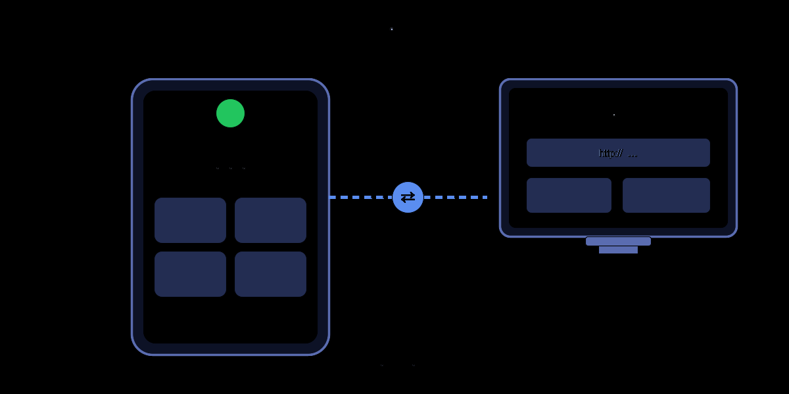
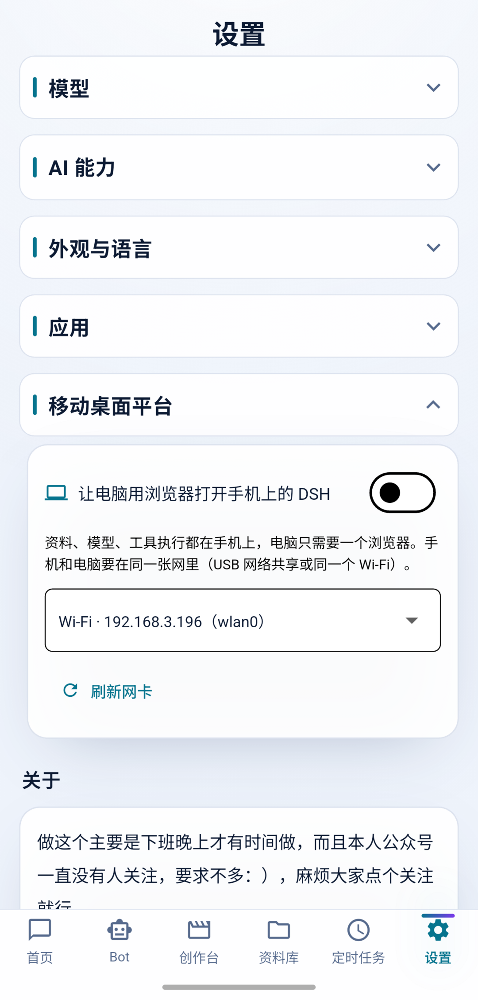
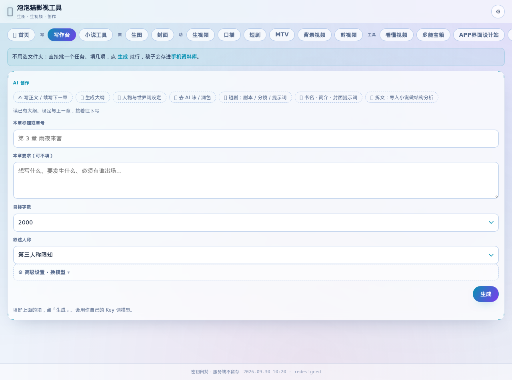
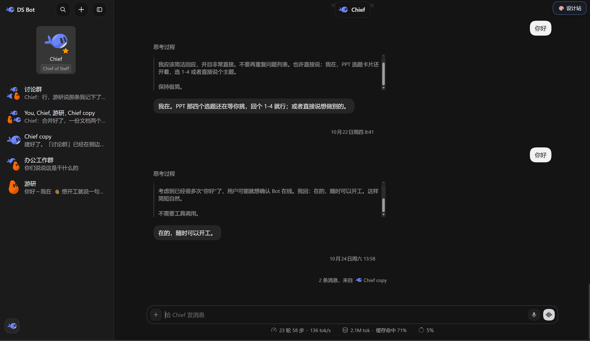
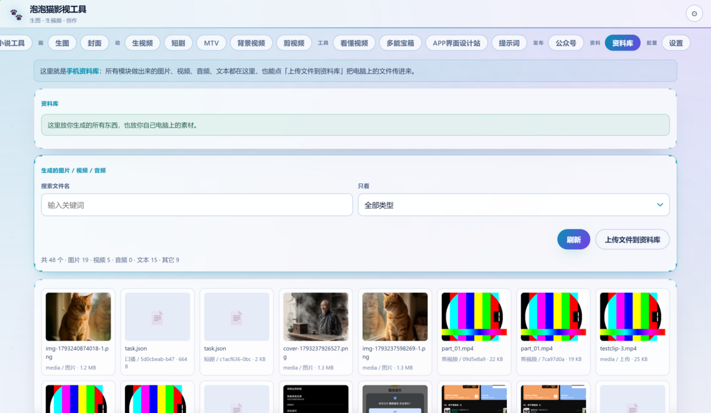
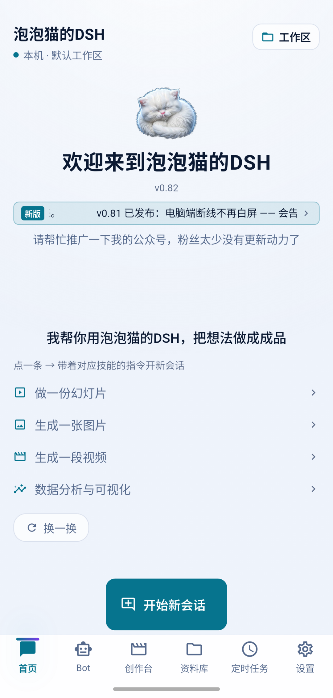
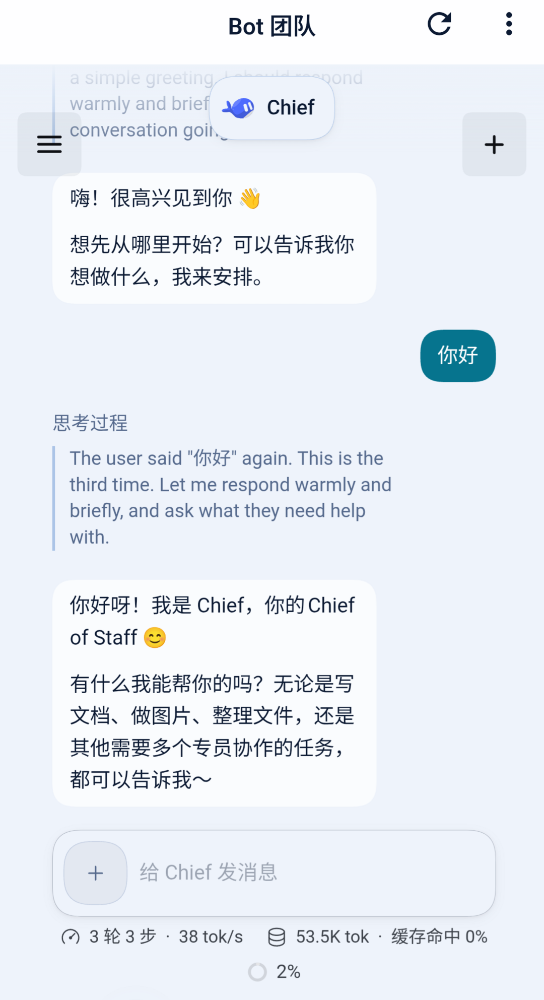
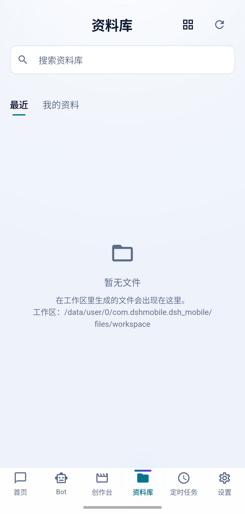
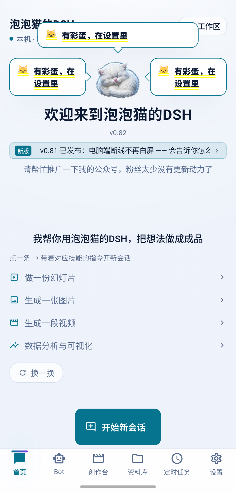

# 泡泡猫 · DeepSeek Harness モバイル版

[中文](README.md) · [English](README.en.md) · [**日本語**](README.ja.md) · [한국어](README.ko.md)

> **本プロジェクトは個人が開発・保守しているものであり、DeepSeek の公式リリースでも、DeepSeek が推奨するプロジェクトでもありません。**
> ただし、動いているのは確かに DeepSeek Harness（DSH）エンジンそのものだ——本プロジェクトがやっているのは、このエンジンをそのまま Android に運び込むことであり、エージェント能力はすべて上流に由来する。いわゆる「サードパーティ」とは、配布元が公式ではないという意味であって、上流と無関係という意味ではありません。
> 「DeepSeek」「DeepSeek Harness」「DSH」は深度求索の商標または製品名であり、ここでは技術的出自を正確に示すために用いている。

---

> paopaocat deepseek harness-mobile · v0.09 → v0.82 全史
>
> これは製品紹介ではない。私は泡泡猫、この App の作者だ——10月2日にアイデアが浮かんで立ち上げ、今日で33日、82バージョンの変遷を経た。今日、全面的なオープンソース化を決めた。このプロジェクトが回り道したところ、踏んだ穴を全部さらけ出そうと思う。


---

## 目次

- [0. 巻頭](#0-巻頭)
- [1. 立ち上げ：なぜモバイル版なのか](#1-立ち上げなぜモバイル版なのか)
- [2. システムアーキテクチャ概観](#2-システムアーキテクチャ概観)
- [3. バージョン進化史と失敗実録（0.14 → 0.83）](#3-バージョン進化史と失敗実録014--083)
  - [3.1 0.09〜0.14：実現可能性の検証期](#31-009014実現可能性の検証期)
  - [3.2 0.15〜0.23：野蛮な成長期](#32-015023野蛮な成長期)
  - [3.3 0.26〜0.34：ローカル大モデル五輪攻堅](#33-026034ローカル大モデル五輪攻堅)
  - [3.4 0.35〜0.73：機能の堆積期](#34-035073機能の堆積期)
  - [3.5 0.74〜0.76：無料チャネル追跡戦](#35-074076無料チャネル追跡戦)
  - [3.6 0.77：Bot 三度の方式転換](#36-077bot-三度の方式転換)
  - [3.7 0.78：P0 戦役と工学の収束](#37-078p0-戦役と工学の収束)
  - [3.8 0.79：泡泡猫アシスタント（phone-agent）](#38-079泡泡猫アシスタントphoneagent)
  - [3.9 0.80〜0.81：モバイルデスクトッププラットフォーム](#39-080081モバイルデスクトッププラットフォーム)
  - [3.10 0.82〜0.83：借金返済と高速化](#310-082083借金返済と高速化)
- [4. 個別振り返り](#4-個別振り返り)
  - [4.1 泡泡猫アシスタント：Shizuku を入れずに「スマホがスマホを操作する」](#41-泡泡猫アシスタントshizuku-を入れずにスマホがスマホを操作する)
  - [4.2 モバイルデスクトッププラットフォーム：スマホをモバイルホストにする](#42-モバイルデスクトッププラットフォームスマホをモバイルホストにする)
  - [4.3 HarmonyOS 移植：戦いの三分の一](#43-harmonyos-移植戦いの三分の一)
  - [4.4 iOS 移植：なぜやらないのか](#44-ios-移植なぜやらないのか)
- [5. 低レイヤ技術の解剖](#5-低レイヤ技術の解剖)
  - [5.1 ランタイム埋め込み：47 MB の Node を APK に詰める](#51-ランタイム埋め込み47-mb-の-node-を-apk-に詰める)
  - [5.2 ブリッジプロトコルと DSH ドライバ](#52-ブリッジプロトコルと-dsh-ドライバ)
  - [5.3 Dart 層](#53-dart-層)
  - [5.4 画面の構成要素](#54-画面の構成要素)
  - [5.5 ネイティブ層](#55-ネイティブ層)
  - [5.6 機能の全リスト](#56-機能の全リスト)
  - [5.7 各機能の詳細](#57-各機能の詳細)
- [6. コード品質の自己評価](#6-コード品質の自己評価)
- [7. ドキュメント資産の棚卸し](#7-ドキュメント資産の棚卸し)
- [8. DSH Go との低レイヤ比較](#8-dsh-go-との低レイヤ比較)
- [9. 総説](#9-総説)

---

## 0. 巻頭

まず三つの数字を：

- **33日**（2026-10-02 立ち上げ → 11-03 に 0.83 開発サイクルへ）。
- **89,031 行の Dart**（テストを除く。テストは別に 25,369 行）、**12,310 行の Node ブリッジとプローブ**（70 個の .mjs/.js）、**38 個のネイティブファイル**（16 Kotlin + 8 Java + 14 ArkTS）。
- **285 本の Markdown** がリポジトリ全体を覆っている——docs/ に正式ドキュメントが 69 本（各バージョンの更新説明、各事故の根本原因の記録、各リリースの三系統照合）、残り 216 本はコードのすぐ隣に貼ってある。

三つの立場表明：

1. **ここに書いたことの一つ一つは、自分で出典を指せる。**——コードパス、ドキュメントのファイル名。自分のルールは「出典を言えない結論は書かない」。
2. **欠点は隠さない**。第6章は自分自身のコードへのダメ出しリストで、「事故を起こしたか／どれくらい事故りやすいか」で並べている。「見ていて気に入らない」順ではない。自分を罵る方が、他人に罵られるより体裁がいい。
3. **実機の外での推測は明記する**。私のプロジェクト規律は実機検証優先（33日の穴はすべて実機で捕まえた）。本文中にコードから推測しただけで、まだ実機で再現していない結論があれば、その場で明言する。実測のふりはしない。

---

## 1. 立ち上げ：なぜモバイル版なのか

### 1.1 一言の起源

友人数人と夜に酒を飲みながら話していて、立ち上げが決まった：

> 「DSH にモバイル版はあるの？ 他所はもう出してるのを見たけど。」  
> 「でも自分はネイティブアプリを作りたい。」  
> 「欲しいのは独立して動くモバイル版 DSH だ。」

**2026-10-02 08:29**——この日が泡泡猫 DSH モバイル版の立ち上げ日だ。

技術の言葉に翻訳すると、要件は実は三つ：

1. **独立動作**：モデル API を叩くその一歩だけがネット接続で、それ以外はすべてスマホのローカル。サーバーに依存しない、完全な Web ラッパーは不可、リモートデスクトップもなし。
2. **完全な能力**：デスクトップ版 DSH（以前パッケージした DSH デスクトッププロジェクト。win と mac の両対応。老梁がデスクトップ版を出してからは更新されていない）にできること——ファイルの読み書き、タスク実行、ツール呼び出し、多ターン文脈の維持——モバイル版でも一つも欠かせない。つまり「簡易版 Agent を自作する」のではなく、DSH ランタイム一式をそのままスマホに運び込む必要がある。
3. **UI は成熟したソフトの画面を参照（自分の画面設計は本当に不得意）**：11ページのデザイン稿でページごとに突き合わせ、タスクのホーム画面のカプセル入力エリアは下端から 87% に貼り付け。この座標は今も `theme/dsh_tokens.dart` に残っている。

### 1.2 三つの路線の決断の現場

着手前に三つの道を並べ、それぞれの急所は開始日に洗い出していた：

**路線 A：Go / Kotlin で Agent フレームワークをネイティブに書き直す。**  
急所：DSH の能力面 = そのランタイム生態系（MCP ツール、スキルスクリプト、プラグイン、Python/Node ツールボックス）。書き直しは一から別物を作るのと同じ。この道は自分で穴を掘るだけ、pass。

**路線 B：WebView リモート方式。** スマホが DSH の動いている PC に接続し、WebView で Web UI を表示する。  
急所：要件2に違反——PC に依存する。後に 0.77 で Bot を作るとき、この方式で一度転んで戻ってきた（3.6節参照）。だが立ち上げ時点で候補ですらなかった、pass。

**路線 C（採用）：丸ごと運搬。** Node ランタイム（libnode.so）+ DSH の全依存（dsh-runtime.zip）をアセットとして APK に詰め、初回起動時にアプリ専用ディレクトリへ展開、以後は完全オフラインで動く。  
代償はパッケージ 113 MB（当時 187 MB、その後差分更新とスリム化でここまで削った）、初回起動 40〜80 秒の展開待ち。その代わりに得たのは**デスクトップ版 DSH が進化するたび、モバイル版はランタイムを再パッケージするだけで、コアコードを一行も変えなくていい**という性質。

後から見れば、路線 C こそがこのプロジェクトの33日を生き延びさせた唯一の理由だ。「Agent App を開発する」を「Agent App の殻を開発する + ランタイム運搬工学をちゃんとやる」に格下げした。前者は底なし沼、後者は有限の問題である。

### 1.3 0.09 以前：実現可能性の検証

正式なコーディング前に `docs/ANDROID-LOCAL-VERIFICATION.md` があり、四つのプラットフォーム障壁の検証結論が記録されている。対応するパッケージング方式は `docs/ANDROID-LOCAL-PACKAGING.md` に落ちていて、8つの穴踏みが書かれている。この時期は git 化（2026-10-05、init v0.14-preview）より前で、この二つのドキュメントと `docs/RELEASE-0.09.md`（自分の実測フィードバック10条の逐条照合 + 7つの「直さないとリリースで事故る」真のバグ）で延命していた。

中で最も価値の高い検証：**Android で完全な Node は動くのか？** 答えは Termux の node バイナリを `libnode.so` に偽装して jniLibs に詰める（Android が so しかロードを許さない制限を回避）、三つの shim を添える（後の 5.1 節で詳述）。この方式は検証した日から今まで使われ続け、一度も替えていません。

---

## 2. システムアーキテクチャ概観

### 2.1 四層構造

```
┌─────────────────────────────────────────────────────┐
│  UI 层（Flutter）                                     │
│  app/lib/ui/ — 页面、组件、主题、i18n                  │
├─────────────────────────────────────────────────────┤
│  领域层（Dart）                                       │
│  app/lib/protocol · state · storage · data · local   │
│  ACP stdio 客户端 / 模型仓库 / Keystore / 运行时封装  │
├─────────────────────────────────────────────────────┤
│  运行时层（Node）                                     │
│  libnode.so + dsh-runtime.zip → filesDir/dsh/        │
│  DSH Agent 循环 · MCP 探活 · 技能执行 · 工具箱        │
├─────────────────────────────────────────────────────┤
│  原生层（Android Kotlin / 鸿蒙 ArkTS）                │
│  解压宿主 · 前台服务 · Keystore · phone-agent · 通知  │
└─────────────────────────────────────────────────────┘
```

規模統計（build 成果物を含まず、プロジェクト全体 1,507 ファイル（.git / node_modules / build / .dart_tool / dist を除外））：

| 層          | 言語            | ファイル数                               | 説明                       |
| ---------- | ------------- | --------------------------------- | ------------------------ |
| UI + ドメイン    | Dart          | 318（lib 89,031 行 + test 25,369 行） | app/lib/                 |
| ランタイム運搬工学    | mjs/js/py/ps1 | 70 個のスクリプト（12,310 行）+ 55 py + 16 ps1  | install/、bridge/、probes/ |
| ランタイム本体      | Node          | dsh-runtime.zip としてパッケージ（v5、約 33 MB）   | デスクトップ版 DSH そのまま               |
| ネイティブ Android | Kotlin/Java   | 16 kt + 8 java                    | app/android/             |
| ネイティブ HarmonyOS       | ArkTS/C++     | 14 ets + node_host.cpp 529 行      | app/ohos/、ohos-node/     |
| ドキュメント         | Markdown      | 285（docs/ 69 + コード隣 216）           | リポジトリ全体                       |

### 2.2 一通のメッセージが実行される完全な旅

「この表を整理して」を例に：

1. **UI 層**：ユーザーが `chat_page` の入力欄で文字を打って送信、メッセージは `state` 層のセッションモデルへ。
2. **ドメイン層**：`local/acp_client.dart`（ACP stdio クライアント。多ターンセッションの要で、初版から大きくは動いていない）がリクエストを JSON-RPC 2.0 にエンコードし、DSH プロセスに繋がる stdio パイプへ書き込む。
3. **ランタイム層**：DSH プロセス（`node --require fsShim --require execShim dsh --profile acp …`）がリクエストを受け取り、Agent ループへ入る——ファイルを読み、ツールを走らせ、モデルを呼ぶ。途中で生じる各ステップ（agent_message_chunk / thought / tool_call / tool_call_update / usage_update）は ACP update の形で返ってくる。
4. **ドメイン層**：`acp_client.dart` が五種類の update を統一イベントストリームに正規化し、`state` 層が UI の部分再描画を駆動する——ストリーミング表示、思考過程の折りたたみ、ツール呼び出しカード、成果物カードは、すべてこの一本の流れで動いている。
5. **権限承認**：ツールが権限昇格を要求すると、ACP が `session/request_permission` を送り、Dart 側が承認カードを出す。ユーザーが許可/拒否を押すと、元の道を戻っていく。
6. **成果物の回流**：ツールが生んだファイルは専用ディレクトリのワークスペースに落ち、資料庫がワークスペースをスキャンして自動収納する。

### 2.3 なぜ ACP なのか、独自プロトコルを発明しないのか

`bridge/README.md` に判断根拠が残っている：ACP だけが `session/cancel`、`session/list`、`session/resume`、そしてモバイル側の承認を唯一実現できる `session/request_permission` を持つ。独自プロトコルはこの四つの能力を発明し直すか、切り捨てるかのどちらか。セッションの中断/継続（ユーザーが最もよく押すボタンの一つ）は `session/cancel` + `session/resume` で支えている。

### 2.4 プロジェクトディレクトリの地図

```
dsh-mobile/
├── app/                  Flutter 工程（UI + 领域层 + android/ + ohos/）
│   └── lib/{ui,protocol,state,storage,local,data,i18n}
├── install/              构建流水线 + 验证脚本堆（148 个文件，见 5.1）
├── bridge/               PC 侧 WebSocket 桥（开发期调试用，6 个 .mjs）
├── probes/  fixtures/    ACP 行为探针与实测帧存档（桥协议的实现依据）
├── runtime-plugins/      DSH 原生插件（AnySearch web 后端）
├── ohos-node/            鸿蒙侧内嵌 Node 攻坚现场（C++/ArkTS/Dart 补丁镜像）
├── docs/                 288 个文件（69 份 md，版本史本体，见第 7 章）
├── design/  ui-review/   设计资产与界面评审
├── screenshots/          真机实拍
└── signing-agc/          鸿蒙签名材料
```

特筆すべき「生きた化石」二つ：

- **bridge/** は初期「リモート方式」の遺産で、今も開発期に使っている（PC 上でプロトコルを叩くのが楽）。App の正式経路では使わない。
- **probes/ + fixtures/** は私が最も得意とする工学投資：`probes/acp-probe.mjs` が実物の DSH に対して挙動を実測し、生のフレームを `fixtures/acp-probe-*.jsonl` に保存する。ブリッジプロトコル文書の「実測された挙動」は、すべてどの jsonl の何行目かに指し戻せる。このプローブ群がなければ、以後のプロトコル層の作業はすべて当て推量だった。

---

## 3. バージョン進化史と失敗実録（0.14 → 0.83）

この章が本書のメインディッシュ。33日、267コミット、0.14 から 0.83 まで。各節は「目標 → 穴 → 真の根本原因 → 修正 → 何を学んだか」で書く。穴の一次記録は git commit message、`docs/RELEASE-*.md`、`docs/changelog-*.md`、`docs/需求台账.md`、`app/lib/data/changelog.dart`（アプリ内更新説明）の五箇所に散っており、ここで初めて全景をまとめる。

まずタイムラインの総覧：

```
2026-10-03 ── 0.09 可行性包（git 化之前，证据在 RELEASE-0.09.md）
2026-10-05 ── git init · v0.14-preview（界面照 11 页设计稿重做完）
2026-10-06 ── 0.15～0.23 九连发（一天之内 0.18→0.23，含四语化）
2026-10-07~09 ── 0.24~0.34 本地大模型五轮攻坚（见 3.3，全书最硬的一段）
2026-10-11~13 ── 0.61~0.73 桌面版全量同步 + 发布流程定型
2026-10-14~16 ── 0.75/0.76 免费通道追逐战 + 创作台
2026-10-17~19 ── 0.77 Bot 三次方案翻转（构建号 78→117）
2026-10-20    ── 0.78 P0 战役 + 差分更新（不展开）
2026-10-21~25 ── 0.79 泡泡猫助手（phone-agent，见第 4.1）
2026-10-26~30 ── 0.80/0.81 移动桌面平台（见 4.2）
2026-10-31~11-03 ── 0.82 还债 + 0.83 初始化提速
```

### 3.1 0.09〜0.14：実現可能性の検証期

三つのドキュメントで延命：`RELEASE-0.09.md`（実測フィードバック10条の逐条照合 + 7つの「直さないとリリースで事故る」真のバグ）、`RELEASE-0.13.md`（エミュレータでのエンドツーエンド検証、「修正前の症状 → 根本原因 → 証拠原文」を含む）、`RELEASE-0.14.md`（analyze ゼロ問題 + 82件の単体テスト + 実機でのエンドツーエンド証跡）。

この段階で決まった規律はコードより価値がある：

- **成果物には必ず検証値を付ける**。0.09 からすべての APK に sha256 を記録し、リリースノートに貼る。後に 0.83 の「三系統照合」（GitHub Release + update.json + 公众号のコピーの三方でハッシュを突き合わせる）は、この規律の自然な延長。
- **実機で走らせていなければ、走らせていないと明言する**。HANDOFF.md に「⚠️ ただし、これはどの arm64 端末でも走っていない——引き渡し時に必ずこの点を明示すること」という一節がある。プレビュー段階では入れ物に過ぎないが、オープンソース化後はこれが信用になる。

### 3.2 0.15〜0.23：野蛮な成長期

2026-10-06 の一日で 0.18 → 0.19 → 0.20 → 0.21 → 0.22 → 0.23、それぞれに README 四言語同期 + changelog + スクリーンショット。このペースは今の自分でも信じられないが、git log には白黒はっきり残っている。

野蛮の代償も同じ日に露呈した：`revert` コミット六連——「まずリポジトリには出さないで」と一言残して、0.23 の README 四本 + changelog を全部撤回。**バージョン番号は一日に5個増やせても、リリースのリズムは一人の人間が握らなければならない**。これは後に「四段階フローの規律」として固定化された（3.3 台帳 #24 参照）。

技術上の実質的な進展：

- **0.19 四言語化**：UI 言語が中/英/日/韓、以後は文言を変えるたびに四箇所を直す（後に i18n のカウントガードテストが 1231→1833 条に増えたのはこのためで、そのせいで「期待値が 1833 に止まったまま追随しない」ガード失効も起きた。0.76 のコミット 1dd53d5 参照）。
- **0.20 スマホのローカルで大モデルを動かす**：端末側モデルの全景リスト + ModelScope マルチソースダウンロード + ローカルファイル取り込み。これは 3.3 節五輪攻堅の前奏。
- **0.21 クラウド/ローカル分割**：モデルページを「クラウド大モデル」+「ローカル大モデル」に分割し、テキスト/マルチモーダル/画像/動画でグループ化——これが後のグループ化アーキテクチャを直接生んだ。
- **0.22 セレクタの根本原因修正**：「見えるが選べない」ローカルモデル。プロセス設定のフィンガープリントが local を数え漏らしていたのを修正——ただし**半分しか直っていない**。真の根本原因は 0.24 でようやく捕まえた（永続化ガードが `local/*` を弾く + 読み直し時にリスト先頭へフォールバックする）。**半分の修正は無修正より危険**。全員がもう直ったと思い込むからだ。

### 3.3 0.26〜0.34：ローカル大モデル五輪攻堅

この節は独立した章にする価値がある。9バージョン、5ラウンドの手戻り、どのラウンドの根本原因も実機ログから来ていて推測ではない。素材の主体は `docs/需求台账.md` #35〜#50、以下タイムラインで振り返る。

**第一ラウンド（0.26）：ログから三つの真の故障を読む。**  
実機の実行ログを分析し、露呈した：

1. ローカルモデルが毎回 `exceed_context_size` —— 根本原因はコンテキストを 2048 に決め打ちしていたこと。DSH はシステムプロンプトだけで約 7000 tokens ある。デフォルトを 16384 に変更。
2. 行タップでクラッシュ `Null check operator` —— ローカル大モデルのページに Material の祖先がなく、InkWell のリップルで即クラッシュ。ページを Scaffold で包んで解決。
3. 画像エンジンの起動失敗 —— `--model` 引数は足したが伴走ファイルが揃っていなかった。**マニフェスト宣言**で完全パッケージ/分割を判定するように変え、伴走ファイルが揃わない場合は起動を拒否して何が欠けているかを明示。

**第二ラウンド（0.28〜0.30）：性能スイッチ四連、大爆弾を仕込む。**  
高速化のために性能スイッチを四つ追加：flash-attn / KV cache q8_0 / cache-reuse / threads-batch。同時にまともな仕事もした：litert-lm の実現可能性検証（公式 Maven 依存 + readelf で .so が自己完結していることを確認、Bazel は入れない）、セッションキャッシュの再利用（エンジンセッションを残して差分だけ送る）、NPU 段、所要時間を「初回トークン遅延/出力速度」の二段に分解。  
さらに Gemma 用の互換対話テンプレートを書いた（`lib/local/loose_chat_templates.dart`）：Gemma の公式テンプレートは「先頭の system 1個 + 厳密な user/assistant 交互」しか受け付けないが、DSH は複数の system をそれぞれ push する——実際に送られる `[system, system, user]` がテンプレートの厳格検証に当たって 400。5種類のメッセージ形状 × 公式/互換テンプレートの実測マトリクスを作った。  
**爆弾**：`--flash-attn` の引数の書き方が間違っていた（`unknown value for --flash-attn: '--cache-type-k'`）。スイッチ群は一度も効いたことがなかった——しかも当時、全員が使えていると思っていた。

**第三ラウンド（0.31〜0.32）：セグメンテーション違反の霧。**  
0.31 で引数の書き方を直し、スイッチが初めて本当に動いた——そして**Snapdragon 8 Elite / Armv9 で CPU/GPU/NPU すべてセグメンテーション違反**（SIGSEGV、code=-11）。ログの証拠：短い自己診断（27 tokens）は毎回通る、落ちるのは必ず実際の長いリクエスト。  
0.32 でまずデフォルトを CPU に戻し、「クラッシュ記録 + 永続化 + 次回自動でバックエンド切替」、モデル名の三段フォールバック、データ層の自己修復（名前が空ならリスト名で補い、書き戻す）を追加。ついでに `toJson` が `companions` を落とす真のバグも直した。  
**スクリーンショットテスト**（自機でそのページをレンダリングして画像を出す）で「モデル名が見えない」というレイアウト問題を診断した。

**第四ラウンド（0.33）：自分の最適化を叩き潰す。**  
三回の実機ログ比較で確認：クラッシュはバックエンドと無関係、CPU でもセグメンテーション違反。真犯人は 0.28 の性能スイッチ群——引数バグで一度も効いておらず、引数を直して初めて本当に動いた瞬間に全線で落ちた。**0.33 ですべて削除、0.26 の動く基本引数に戻した。**  
このラウンドの教訓は台帳に書いた：性能最適化の各ステップには「本当に動いている」証拠が必要。さもないと最適化しているつもりで、実は設定ファイルを書き換えているだけになる。

**第五ラウンド（0.34）：空応答の真犯人。**  
Qwen3 も「空応答」、`stopReason=max_tokens`。調査経路：速度テストは正常（App が直接 max_tokens=48 を送る）→ DSH を通らない → DSH 側で clamp → `maxTokens = contextWindow - 使用済み prompt - 4096(安全余裕)` → overlay の local モデルの `contextWindow` が 4096 決め打ち、ユーザー prompt 6822 tokens → available が負 → **maxTokens が強制的に 1**。  
修正：`LocalModelSpec` に `contextSize` フィールドを追加（デフォルト 16384）、spec を組む二箇所で渡し、回帰防止テストで 16384 を固定。


五輪を終えて、ローカル大モデルは「全く使えない」から「安定」へ。台帳 #50 の締めの一文が私のそのままの言葉：「速度テストが正常なのは、App が直接 max_tokens=48 を送って DSH の clamp を通らないから」——**どんな「テスト通過」も、それが本当に実行する経路を見なければならない**。

（ローカル大モデルは結局、最適化の効果があまりに悪くて断念するしかなかった。0.82 版で MNN エンジンを試したら効果が良かったので、0.83 で再び攻堅する予定。）

### 3.4 0.35〜0.73：機能の堆積期

この区間の主線は三つ：

1. **0.61〜0.71 フローの固定化**：テスト 521 通過/0 失敗が出荷ゲートになる。三つの言語テーブルは 0 ドリフトのガード。
2. **0.73 バージョンの全量アラインメント**：以前は複数の PC で開発することが多く、バージョン番号が乱れていた。今回は統一した。
3. **0.61 の典型的な小修正二つ**（台帳 #51/#52、ここに記すのは「問い詰める文化」を示しているから）：
   - 「インストールして開くと映像ページが出る」——根本原因：永続化された `lastTab` の復元。修正哲学：コールドスタートは一律ホームへ、**今回のプロセス内**でタブを触った場合だけ復元する。
   - 「ローカル大モデルがサービス起動していないと表示される」——litert-lm の起動経路に `lastError` を書く場所が一箇所もなく、UI は無意味な文しか出せなかった。

### 3.5 0.74〜0.76：無料チャネル追跡戦

キー不要の無料モデルは、このプロジェクトで最も「上流を追いかける」機能。上流のゲートは5回変わり、5回追った：

- 0.74：無料チャネル 403 → 根本原因「セッション id はタイムスタンプエンコードでなければならない」（上流 2026-10-13 の新ゲート）。直した直後に「噛みつく回帰テスト」を一本追加。
- 0.75：上流5回目の変更 → `/inference/v1` へ変更、403 は専用の人間語に翻訳する。同時に Pollinations チャネルをデフォルト有効で追加し、「キーを入れなくても話せる」を実現。
- 0.76：`input_modalities` を解析（どのモデルが画像を見られるかを明示）、モデル名を DeepSeek 公式の改名に追随（V3/R1 → V4）、キー不要チャネルのモデルは一律無料扱い。

この区間の工学アクション二つは特記に値する：

- **`docs/免费模型-方案.md` に「なぜ IP プールをやらないか」の四つの理由を書いた**。「グレーな最適化をやるか」という問いには、やらない理由を書き残すことの方が、やることより重要。
- **事実訂正の文化**：`8721383` コミット——「ffmpeg が欠けていたのは 10-15 の 0.75 テストパッケージで、**正式リリースの 0.75 は正常**——パッケージごとに実測して訂正」。以前の告知が誤っていたと分かったら、公開で訂正する。誤ったバージョン説明をぶら下げたままにしない。

0.76 は同時に機能の大バージョン：20個の問題を修正、17項目を新規追加（PPT レイアウト層を含む——「PPT が素朴すぎる真因は bullets レイアウトにテキストボックスが一つしかないこと。カード + カードウォールに変更」、長セッション助手のヒント、創作台の4グループ分類）。

### 3.6 0.77：Bot 三度の方式転換

0.77 はビルド番号が最も密なバージョン（78 → 117）、主線は「Bot チームをスマホへ」、代償は**同じ要件で技術方式を三度乗り換えた**こと：

```
方案 1（构建号 78~80）  WebView 装桌面版 Bot 网页 ——「Bot 服务没能起来」：--patch 被当成 web app 参数
方案 2（构建号 81~101） 删掉 WebView，改用 App 原生聊天页 —— 原生方案做出来了，但 Bot 能力受限于 App 沙箱
方案 3（构建号 102~117）回到网页版方案，再逐步把短板补齐
最终（0.77 发布）       Bot 页回归 App 原生聊天页（构建号 117 之后定型）
```

三つの方式はそれぞれ一度死んでいて、死亡記録はすべて commit message に残っている：

- 「★『セッションが作れない』の真因 —— opencode-go に api が無い（**前バージョンの私の方式は間違い**）」（ビルド番号 98）
- 「★『agent リクエストの実行操作がずっと出る』の真因 —— モデル未設定なら overlay 無し、権限プリセットも一緒に消える」（ビルド番号 99）
- 「『入れない』+ Bot にモデル無し —— 二つの自傷バグ」（ビルド番号 105）
- 「黒画面の真犯人 —— Bot ページの PopScope が他のタブで戻る操作を奪い、ルートルートを弾き飛ばした」（ビルド番号 117）
- 「エッジスワイプで黒画面のまま固まる —— 二本の戻り経路を『バックグラウンドへ退避』に統一」（ビルド番号 116）

記録に値する非コードの成果物二つ：

- `docs/BOT-TEST.md` の冒頭に「現在の実装」の構造図を補い、「前段の穴踏み記録は廃止された WebView 方式に属し、読み違えやすい」と注記した——**廃止方式のドキュメントは消さないが、それが死んでいることをはっきり書かなければならない**。
- 期間中に Bot 名簿解析へ単体テストを8本追加——「この部分はこれまでゼロカバレッジ」。事故が多い場所にテストを足す、この順序は正しい。

### 3.7 0.78：P0 戦役と工学の収束

0.78 は一日で五つの P0、すべて「真の根本原因」レベルの記録がある：

| ビルド番号 | 症状                       | 真の根本原因                                 |
| --- | ------------------------ | ----------------------------------- |
| 121 | ローカル MCP が起動できずセッション全体が落ちる（実機 P0） | 先に生存確認、失敗したら MCP を外して再試行                    |
| 122 | Bot ページが「過去に戻る」（UI 状態の錯乱）     | コメント内のプレースホルダが `replaceFirst` にヒットし、その一区間の注入が構文エラーに |
| 123 | ローカル MCP の生存確認がずっと通らない（実機 6s タイムアウト）  | ホワイトリストに Android のシステム変数が漏れていた                  |
| 124 | ファイルは生成されたが UI はずっと「処理中」         | `running` が裸のフィールドで、変更しても誰にも通知されない             |
| 125 | Bot ページの「再接続」で本当に切断される        | モデル切替で再起動してポートが変わる + ナビゲーション傍受が古いアドレスを読む                 |

122 は個別に見る価値がある：コメントテキスト内のプレースホルダが文字列置換ロジックにヒットした——**コメントも文字列であり、テキストを処理するコードはコードとコメントを区別しない**。こういうバグは review では防げない。「プレースホルダには自然なテキストに現れ得ない形式を使う」といった防御的な約束でしか防げない。

0.78 では差分更新もリリース（ビルド番号 126、独自 DSHDELTA v1、99 MB → 5 MB）。

### 3.8 0.79：泡泡猫アシスタント（phone-agent）

4.1 の個別項目を参照。タイムライン上の位置：2026-10-21 にタグ `bot-native-v0.79` を打ち、10-24〜25 は bot-rework ブランチで集中的に開発、一日で 14 個の fix コミット（4.1 の穴リスト参照）。

### 3.9 0.80〜0.81：モバイルデスクトッププラットフォーム

4.2 の個別項目を参照。10-26〜30 の五日間、「DSH に NIC を束縛させる」から「ポート転送」へ、さらに「アドレス三要素の全固定」へ、加えて 431 事故と QR コードでの起動。

### 3.10 0.82〜0.83：借金返済と高速化

**0.82（2026-11-03 リリース、ビルド番号 250）**：「古い不具合を6個直し、挙動を4箇所変え、機能を5つ追加」。中で最も価値のある修正：

> fix(0.82): MCP 生存確認が親環境を漏らしていた（Office 三ツールが**一度もマウントされていなかった**真の根本原因）+ ログを adb から読めるように

「一度もマウントされていなかった」の一語は、これがローンチ初日から存在し、能動的な巡回でようやく見つかった欠陥だということを意味する。これは 0.31 の性能スイッチ（一度も有効化されず）、0.22 のセレクタ（半分しか直っていない）と並んで、このプロジェクトの三大「沈黙する欠陥」——どれも正しいのに、どれも効いていなくて、ユーザーが報告しなければ誰も知らない。0.82 の対策はログを `adb logcat` で読めるようにし、「沈黙する欠陥」に露出の経路を与えることだった。

もう一つが「繋がらない？ここをタップして自己診断」：本当に一度接続して、故障レイヤを言い切る（Wi-Fi？サービス？アドレス？）——これは 0.81 モバイルデスクトッププラットフォームの「切れても読んで分かる」哲学を App 全体に広げたもの。

**0.83（進行中）**：App 初期化の高速化——生存確認の並列度 4→12、タイムアウトを短縮、キャッシュのファストパスを追加（`58259dc`）。この文書を書いている時点で自分の Snapdragon 8 Elite 実機で計測した：0.82 パッケージのコールドスタートからホームが操作可能になるまで約15秒以内。README に記録した 40〜80 秒よりずっといい——ただしあれは展開を含む初回起動のシナリオで、二つの数字は矛盾しない。

---

## 4. 個別振り返り

### 4.1 泡泡猫アシスタント：Shizuku を入れずに「スマホがスマホを操作する」

**それが何か**：App に内蔵された「スクリーンアシスタント」で、Agent があなたの代わりにスマホを操作する——価格比較、チケット検索のような流れを、一歩ずつタップせずに済む。名前はそのまま「泡泡猫」（0.24 コミット：スクリーンアシスタントを「泡泡猫アシスタント」に改名 + 価格比較/チケット検索フロー + インストール不要のペアリングポート）。

**それが解く核心的な矛盾**：Android でアプリに他のアプリを代わりにタップさせる公式の道はアクセシビリティサービス（AccessibilityService）だが、その道はユーザー体験が悪い（システム設定に入ってサービスを有効化する必要、殺されやすい、状態が同期しない）。より良い道は Shizuku（ADB shell 級の権限）だが、ユーザーに Shizuku を入れさせて手動ペアリングさせる必要があり、一般ユーザーには門前払い級のハードル。

**作者の決断**：0.79 で Shizuku の中核能力を**内蔵**してしまった——`1148358` コミット原文：「Shizuku 不要 —— 無線デバッグのペアリングを内蔵、shell エンジン dex を自前構築」。ユーザーはペアリングコードを入れるだけで、ペアリングの流れは全部 App の中で完結する。これは「依存を機能に変える」典型な決断：ユーザーに Shizuku の入れ方を教えるより、Shizuku がやっていること（無線デバッグのペアリング + shell コマンドチャネル）を自分で実装し直す方がいい。

**技術の分解**（証拠はすべて 2026-10-24〜25 の 14 個の fix コミットから。一つ一つ実機で踏んだもの）：

| 穴              | 根本原因                              | 修正（コミット原文）                                                |
| -------------- | ------------------------------- | ------------------------------------------------------- |
| adb 証明書の生成失敗     | R8 が BouncyCastle を削った            | 「BouncyCastle をパッケージ全体 keep」（`c3ae0b7`）                      |
| エンジンが shell 終了と共に殺される | 子プロセスが shell セッションにぶら下がっていた                 | 「エンジン起動に setsid を追加して shell セッションから離脱」（`5025fdd`）                   |
| サービスは起動済みなのに未起動と判定      | `isEnabled` が長形式の ComponentName しか認識しない | 「短形式の ComponentName を認識」（`60ac6a0`）                         |
| 録画状態が永遠に false   | MethodChannel の戻り値が一層包まれていた          | 「phoneRecStatus を invokeMethod<Object> で生値取得」（`d0d902b`） |
| 実行の一歩目で失敗       | 録画フローが launch ステップを自動補完しない              | 「録画が launch ステップを自動補完」（`649cc2c`）                            |
| 仮想スクリーンが作れない        | shell プロセスが誤った context を使っていた              | 「shell プロセスで仮想スクリーンを作るには com.android.shell の context が必要」（`128a22b`） |
| launch の起動先が違う   | デフォルトで launcher に解決される           | 「launch を resolve-activity + am start -n に変更」（`92ce188`）   |
| エンジンが起動せず自己修復も困難      | 起動引数の順序が違う                         | 「--patch は --no-open より前 + launcher argv の順序重ね合わせの意味論」       |

**アーキテクチャの決断：アクセシビリティ → ヘッドレスモード**。`eef6ecd`：「スクリーンアシスタントを純粋なバックグラウンドのヘッドレスモードに変更（アクセシビリティを廃止）」+ `9042a4a`：「バックグラウンド操作台 —— 設定→アプリから直接仮想スクリーンを作り、App を起動し、リアルタイム画面でタップ」。つまり最終形態は：**Shizuku 式 shell チャネル + 仮想ディスプレイ（VirtualDisplay）+ 的を絞った注入**で、App はアクセシビリティサービスに一切触らない。仮想スクリーン上で対象 App が動き、メインスクリーンは全く邪魔されない——これが「泡泡猫」が従来の自動化ツールよりクリーンである根本理由。

**なぜアクセシビリティを捨てたか**（当時記録した三つの理由）：一、アクセシビリティサービスはユーザーがシステム設定で手動で有効化する必要があり、その状態を App 自身は見られない。二、アクセシビリティのイベントストリームから得られる UI 情報は「障害者支援向け」のもので、自動化に使うにはコントロールの意味を自分で推測しなければならない。三、中国製 ROM のバックグラウンドキル戦略は制御不能。仮想スクリーン方式はこの三つをすべて回避する。

**遺留**：`4707ea3` 以前は Shizuku チャネルも残っていた（「『Shizuku を認可する』ボタンを外す」のは 10-25 になってから）。既存ユーザーの移行経路は図版付きの説明にある。

### 4.2 モバイルデスクトッププラットフォーム：スマホをモバイルホストにする



**なぜこの機能を作ったのか——「モバイルホスト」という概念。**

立ち上げ時、この App の位置づけは「DSH をスマホに入れる」だった。0.80 がやったのはその位置づけをもう一歩押し進めること：**スマホは DSH の容器ではなく、スマホそのものがあなたのホストになる**。

公众号の記事のあの一文が、この機能全体のプロダクト定義：

> 以前は、AI はパソコンの中に住んでいて、スマホはネット越しにちょっと覗くだけだった。  
> 今は逆：**モデルも、データも、ツールも、あなたの原稿も、全部スマホの中に入っている。**  
> パソコン（あるいはもう一台のスマホ）は何もインストールしなくていい。ブラウザを開いて、URL を一つ入れるだけで繋がる。



設定ページのあの原理説明の行に注意——それは機能説明ではなくアーキテクチャ宣言：**「資料、モデル、ツールの実行はすべてスマホ上。パソコンに必要なのはブラウザだけ。」**

この概念の「モバイルワーク」に対する実際の意味：ファイルを同期しなくていい、セッションを移行しなくていい、API Key をコピーしなくていい。あなたはパソコンの大画面で原稿を書き、画像を生成し、計算資源とデータは全部ポケットの中のスマホにある。パソコンはディスプレイ + キーボードに過ぎない。スマホの電源が切れる/オフラインになれば、「パソコン上の作業環境」も消える——**クラウドのセッションもなく、クラウドのデータもない。これは売りであり、プライバシーの立場でもある**。



**実装上の五日五穴**（2026-10-26〜30、すべてコミット記録あり）：

1. **「ポート転送に変更し、DSH に NIC を束縛させない」**（`f02dd48` 以前の第一版）：当初は Node の HTTP サービスに Wi-Fi NIC を直接リッスンさせた——この道は Android では SELinux とライフサイクルの二層の穴があり、App 側のポート転送に変更し、DSH は 127.0.0.1 だけを聴くようにした。
2. **「パソコンからスマホの URL が開けない —— アドレス三要素を全固定 + スイッチで DSH を再起動しない」**：IP、ポート、token のどれか一つが変わると、ユーザーの手元の URL は無効になる。修正は三つとも決定論的な生成に収束させること（NIC 選定→IP 固定、ポートは再起動で変わらない、パスワードは明示的にリセットした時だけ変わる）。
3. **「Bot ページが開けない真因は 431」**：履歴クッキーがリクエストヘッダを膨らませた（HTTP 431 Request Header Fields Too Large）。Web サービスの Cookie/ヘッダ管理には上限が必要。
4. **「--trusted-host を追加、/api の全線 403 を修正」**：パソコン側からのアクセス時に自己署名証明書/Host 検証が API を弾いていた。
5. **「設計サイトの入口アドレスには index.html が必須（ディレクトリ形式は 404）」**：静的サービスのディレクトリパスの扱い。

0.81 の収束三項目：**切れても読んで分かる**（ブラウザは白画面ではなくなり、理由を説明し、スマホが復帰したら自動で繋ぎ直す）、**待つ間が見える**（四段階の進捗 + 待った秒数）、**開くときのタイピングを減らす**（「QR で開く」を追加——スマホに QR を出し、パソコンで読み取れば直行）。ついでに 0.80 の三つの問題も修正（設計サイトの起動失敗が保活サービスを巻き込む、英日韓の翻訳漏れ 23 条、アプリ内更新説明が 5 条だけ）。

**セキュリティモデル**：URL に token（パスワード）が付くのは鍵と等価で、ネットワークを変えるかパスワードをリセットすれば古いアドレスは無効になる。管理エンドポイントは loopback を強制。この点は PC ブリッジ（bridge/）の「ペアリングコード + token hash + フィンガープリント pin」と同じ哲学の両端の実装。





### 4.3 HarmonyOS 移植：戦いの三分の一

HarmonyOS 路線の現状は**正直**でなければならない：App 本体（`app/ohos/`）は Flutter 公式の HarmonyOS 化エンジニアリングシェルで、ビルドでき、インストールでき、起動できる。しかしランタイムという最も深い経路（libnode.so + DSH）は HarmonyOS 上では Bot サブセットしか通っていない。証拠の連鎖：

**エンジニアリングシェル**（`app/ohos/` 9 ファイル + `signing-agc/` 10 ファイル）：`HARMONYOS-NEXT-GO-NO-GO.md`（733 行）は 0.74 から毎ラウンドの実機テスト記録で、結論は次第に GO から ROUTE-A-DOWNGRADE（降級路線）へ移った——`HARMONYOS-ROUTE-A-DOWNGRADE.md` に降級の決断が記録されている：まず Flutter シェルが使えることを保証し、ランタイムは別途攻める。

**ランタイム攻堅**（`ohos-node/` ディレクトリ、C++ 529 行 + ArkTS 1,032 行 + Dart パッチミラー 3,239 行）：2026-10-29 実機 ADY-AL00 API 26 で node v24.2.0 → DSH web サービス → WebView で Bot 画面を描画まで通った。この道は Android より一桁難しい。HarmonyOS のサンドボックス戦略が Android と体系的に異なるから：

| 次元                | Android                    | HarmonyOS                                                                                                                                     |
| ----------------- | -------------------------- | -------------------------------------------------------------------------------------------------------------------------------------- |
| Node 起動           | node バイナリを libnode.so に偽装、独立プロセス | **seccomp が fork/exec 任意バイナリを禁止 → dlopen libnode.so + node::Start でプロセス内起動**（`node_host.cpp`）                                                 |
| JIT               | 通常                         | **W^X が PROT_EXEC を禁止 → `--jitless`。さらに jitless は WASM も禁止 → 内蔵 undici の llhttp が必ず落ちる → jitless-shim で node:http の WebSocket を分離 + node-fetch が fetch を引き取る** |
| io_uring          | 通常                         | seccomp trap → `UV_USE_IO_URING=0` で根治 + SIGSYS handler で兜（x0=-1 を設定するだけで PC は触らない——「PC+=4」を真似すると SIGSEGV になる。README で専門に説明している）                            |
| CLI 入口            | bin.js を直接実行                 | 埋め込みシナリオでは `import.meta.main` が常に undefined → bin.js が静かに終了し rc=0 → wrapper を動的生成して明示的に `runCli()`                                                    |
| 就緒検出              | プロセスの stdout を読む                 | プロセス内 node の stdout は宿主から読めない → ファイルへ dup2 し、Dart が就緒行をポーリング                                                                                          |
| SharedPreferences | 公式プラグイン                       | HarmonyOS に公式実装なし → `SharedPrefs.ets` でチャネルを自前実装（実機で MissingPluginException を実証）                                                                        |

`node_host.cpp`（529 行）には、後から振り返って自分が最も得意だと思う箇所が三つある：

- **クラッシュの筆跡**：w0〜w8 を全過程で TW() により trace ファイルへ追記し、プロセスがどのステップで死んだか一目で分かる——「観測不能な seccomp の死に方」を読めるログに変える唯一の方法。
- **ProbeMemory()**：項目ごとに mmap プローブし、「seccomp が結局何を禁じているのか」に答える。推測ではなく。
- **92MB の dlopen をすべてバックグラウンドスレッドで**：2026-10-28 の実機 ANR の教訓。

`verify/loader.c` は自分が一番好きな一手：**実機がないとき、qemu-user + Alpine musl loader で先に「libnode.so は dlopen できるか / V8 は初期化できるか」を検証する**。そしてこの方法では測れない三項目（seccomp/SELinux/MethodChannel）を正直に列挙する。「動くかどうか」と「実機のポリシー」を切り離す——これはプラットフォーム移植の標準の打ち方。

**未完成リスト**（なぜ三分の一しか終わっていないと言うのか）：HarmonyOS 側は現在 Bot サブセットしか通っていない。完全な App のランタイム（オフライン Agent セッション、ツール実行、ファイルシステム）には等価な HarmonyOS 実装がまだない。`SharedPrefs.ets` は Android のセマンティクスのサブセットしか覆っていない。`DshNative.ets` の原則は「未実装の method は一律正直に notImplemented() を返して Dart を降級させる、偽のデータを作らない」——だから HarmonyOS 版の機能境界は「正直な降級」であって「偽の完全」ではない。

### 4.4 iOS 移植：なぜやらないのか

結論から言う：**iOS 版は着手していないし、短期的にも着手しない**。これはリソースの問題ではなく、プラットフォームのハード制約の問題——4.3 の HarmonyOS の道の難易度にさらに係数を掛ける：

1. **JIT**：iOS は第三者アプリに書き込み可能かつ実行可能なメモリ（W^X）を禁じるので、V8 の JIT は Android のように正常に動けない。HarmonyOS はまだ `--jitless` という活路をくれた（インタプリタモードは合法）。iOS 上で jitless の Node が審査を通るか、性能が許容できるかは、すべて疑問符が付く。
2. **バイナリ実行**：iOS のサンドボックスはアプリバンドル内の未宣言バイナリの実行を許さない。Android の「node を libnode.so に偽装してロードする」手は iOS に直接の等価物がない——自分で持っている .so を `dlopen` するのは合法だが、シンボルのエクスポートとプロセス内起動を設計し直す必要がある。
3. **署名と配布**：App Store の審査を措いても（「任意のスクリプトを実行する」App がそもそも出せるのか自体が問題）、サイドロード（AltStore/自己署名7日）すら目標ユーザーにはハードル。
4. **ファイルシステム**：iOS は各 App のサンドボックスがより閉鎖的で、「完全なファイルシステム」という売り（README の中核的な約束の一つ）は iOS ではあらかじめ割り引かれる。


もし本当にやる日が来たら、実現可能な経路はおそらく DSH Go のような「PRoot 式」か「リモートホスト」路線（第8章参照）——**つまり iOS 版はもう「丸ごと運搬」にはならない。それは路線 C が iOS で成立しないことを認めるに等しい**。要件の原点（独立動作、完全な能力）とプラットフォーム制約の間で、iOS には両方を同時に満たす解がない。これがやらない理由の全部。（もちろん私の力量の問題でもある）

---

## 5. 低レイヤ技術の解剖

### 5.1 ランタイム埋め込み：47 MB の Node を APK に詰める

これはプロジェクト全体で最も核心的な工学で、答えは `install/` のビルドパイプラインと `docs/ANDROID-LOCAL-PACKAGING.md` の8つの穴踏み記録に散っている。

**Node はどこから来るか**：Termux の node バイナリ（自分でクロスコンパイルしない。Termux が Android のリンク問題をすでに解決してくれている）。四つの重要な動作：

1. **偽装**：node 実行ファイルを `libnode.so` に改名して jniLibs に入れる——Android はアプリが持つバイナリを「ロード」することしか許さず「実行」は許さない。しかし `Process.start` で so ファイルを起動すると、linker がそれを ELF として扱うので、`#!/usr/bin/env node` のような shebang は迂回される。**これが方式全体の基石**。
2. **SONAME 補完**（`install/normalize-runtime-libs.mjs`）：Termux のライブラリのシンボリックリンク（libz.so.1 → libz.so）が Windows のパッケージマシンで失われる。スクリプトが ELF の文字列を走査して別名を補う——コメントに正規表現のバグが記録されている：`{2,40}` だと 1 文字のライブラリ名を取りこぼすので `{1,40}` に変更。
3. **依存の閉包**（`install/prepare-jnilibs.mjs`）：**ELF の .dynamic/.dynstr セクションを実際に解析して DT_NEEDED を取る**。依存を再帰的に収集し、規約に合わない参照を lib*.so の規約名に書き換える。拡張子で推測せず、ELF を読む。
4. **パスのパッチ**（`install/patch-node-shell.mjs`）：node バイナリに Termux の shell パスがハードコードされていて、直さないと動かない。

**三つのランタイム shim**（dsh-runtime.zip と一緒に配布、`node --require` でマウント）：

- `android-fs-shim.cjs`：SELinux がハードリンクを禁じる → `fs.link` 失敗時にエラーコードで COPYFILE_EXCL コピーへ降級。
- `android-shim-flock.js`：bionic/musl に flock がない → no-op（多くの npm パッケージが flock に直接依存している）。
- `android-shim-require-builtin.js`：`--expose-internals` がないと node の組み込みモジュールが取れない。

**runtime.zip はどう痩せたか**（`install/slim-runtime-zip.py`、152 MB → 約 33 MB）：先頭コメントに「どの類もコードを読んで判断した。なんとなく大丈夫だろうではない」と書いてある。例：libreoffice-kit の resolveEngine は throw する（削除）。@vscode/ripgrep はこのプラットフォームで resolve できない（削除）。sharp は wasm32 のフォールバックがある（**必ず残す**）。node-pty は linux-arm64/pty.node を必ず残す。`--verify` がパッケージごとに package.json のエントリを検証する。

**初回起動フロー**：MainActivity が assets を展開 → 初回起動時にランタイムを展開（約 40〜80 秒、`libnode.so` 47 MB + runtime.zip 33 MB）→ マーカーファイルでバージョン判定 → 以後の起動は展開ゼロ。`runtime.json` がランタイムのバージョン（v5）+ sha256 を宣言し、上書きインストールは「実行環境内容のバージョン」をインクリメントして強制リフレッシュする（0.75 の穴：内容バージョンが上がらず、上書きインストールで新しいランタイムが取れなかった、`4dbe403`）。

### 5.2 ブリッジプロトコルと DSH ドライバ

App 内の正式経路（ACP stdio）：

- `app/lib/local/acp_client.dart`：readline の改行でフレーム分割する JSON-RPC 2.0。応答/サーバー要求/通知の三路に振り分ける。このファイルは第一版から今まで生きていて、UI の作り直しでも触っていない——**プロトコル層の安定が、UI 層が何度も作り直せる前提**。
- 五種類の ACP update（agent_message_chunk/thought/tool_call/tool_call_update/usage_update）を統一イベントストリームに正規化。
- 権限承認：ACP の `session/request_permission` → App が承認カードを表示 → 回答が元の道を戻る。

PC デバッグブリッジ（`bridge/`、6 個の .mjs で計 1,584 行）は同じ ACP を WebSocket サービスに変える。設計上、真似する価値のある点：

- **dsh のクラッシュで自動再起動**：指数バックオフ 1s×2、上限 30s、最大8回、全過程で `bridge_status` をブロードキャスト。  
  |  |  |  |  
  | --- | --- | --- |
- **承認のフォールバック**：`riskFlagsOf()` が6本の正規表現（rm -rf / curl|sh / .ssh|.env / git push --force / …）でコマンドにリスクを付ける。購読者がいないときは全網ブロードキャストに退化する——**バックグラウンドの承認が黙って捨てられるのを防ぐ**（server.mjs:250-265 のコメント）。
- **クレデンシャル保存**（store.mjs:48-125）：`sha256(deviceToken)` だけを保存。ペアリングコードは6桁の CSPRNG、TTL 120s、使い捨て、5回間違えたら15分ロック。**原子的書き込み**（.part + rename）+ **破損の隔離**（解析失敗時は壊れたファイルを .corrupt にリネームして元のバイト列を残す）。コメントが「読めない→空とみなす→書き戻す→全デバイスが落ちる」という P0 事故の連鎖を完全に再現している。
- **プロトコル進化のルール**（bridge-protocol.md §9）：「v1 は追加のみ、未知の type は無視して切断しない」——プロトコルは初日から後方互換のために設計されている。

プローブ文化（`probes/`、11 個の .mjs で計 1,690 行）：`mock-acp-server.mjs` の先頭コメント原文——「承認は objective の中核能力であり、**モデル判断の運に頼って検証してはならない**」。本物の DSH はモデルが自発的に権限昇格を要求した時しか権限リクエストを出さないので、承認を安定してテストできない。だから mock は必ず `rm -rf ./dist` を出して riskFlags を検証する。決定論的な mock は確率的な実物に勝る。

### 5.3 Dart 層

lib/ のレイヤ（89,031 行 + テスト 25,369 行）：

```
lib/
├── main.dart        入口：未解压→SetupPage，已就绪→AppShell
├── local/           运行时封装（dsh_runtime.dart：spawn/overlay 生成/凭据注入）
│                    acp_client.dart（stdio 协议端）
│                    loose_chat_templates.dart（Gemma 兼容模板）
│                    rotate_log.dart（轮换池日志解析，6 条单测）
├── protocol/        消息与卡片模型
├── state/           会话/模型状态 + 广播
├── storage/         持久化（SharedPreferences + 文件）
├── data/            模型目录/产物解析/changelog/easter_egg/usage
├── i18n/            四语表（tables/，守卫测试钉死条数）
└── ui/              页面 + widgets + theme（见 5.4）
```

代表的な設計判断いくつか：

- **overlay 生成**：DSH の設定はファイルを直接書き換えず、セッション起動のたびに overlay を一枚生成する（モデル選択、権限モード、MCP 宣言、環境変数の注入）。ランタイムの上に重ねる。利点：ランタイムディレクトリは読み取り専用、ユーザー設定は丸ごと捨ててやり直せる、0.34 のような clamp バグの修正点が集中する。
- **ローテーションプール**（rotate_log.dart）：マルチモデルローテーションのプロキシ起動に `--log` が付き、セッション入力欄の上に「ローテーションプール cat · 今回は claude-sonnet」と表示する。パーサには6本の単体テストがあり、「ログに ISO タイムスタンプが付くと正規表現が騙される」という穴をカバーしている——**パーサのタイムスタンプ形式までテストしている**。
- **使用量統計**（UsageStore）：route ごとにリクエスト回数と文字数を記録し、`<nodeHome>/usage.json` に落とす。コメントに「token 数は捏造しない——DSH は今のところ実使用量を push しないので、push されたらフィールドを足す。UI は変えなくていい」と明記。**偽データを作らない**はこのプロジェクトのレッドラインの一つ。
- **API Key**：Android Keystore にのみ保存（README のプライバシー声明）。セッションと成果物は専用ディレクトリに置き、実行前に確認を伴う。

### 5.4 画面の構成要素

**ページ構造**（0.82 実機セマンティクスツリーの実測）：下部6タブ——ホーム / Bot / 創作台 / 資料庫 / 定時タスク / 設定。ホームは上から：マスコットの猫（タップ可、イースターエッグ参照）→ ウェルカム領域 + バージョン番号 → お知らせ欄（新版バッジ + ジャンプ可）→ スキルのショートカット（スライド作成/画像生成/動画生成/データ分析、「入れ替え」でローテーション）→「新しいセッションを開始」メインボタン。









**テーマシステム**：

- 内蔵テーマ3種類：ライト / ダーク / ピクセル（カスタムはプレースホルダで、設定ページに「まだ作っていない」と正直に書いてある——**プレースホルダでも実物のふりをしない**）。加えて壁紙選択。
- token 体系：`theme/dsh_tokens.dart` が配色/間隔/文字サイズ/角丸を定義し、**デザイン稿の座標系を含む**（11ページ PDF の要素座標がここにあり、第一版は「OCR 座標でページごとに突き合わせる」やり方で作った）。文字サイズは 13/11/12/15 の4段階に統一——根本原因は台帳 #11：「裸の Text がテーマのデフォルト14で文字拡大と重なり、あちこちフォントが異常に大きい」。
- テーマゲート：0.82 コミット `fix(テーマゲート): ハードコードされた角丸二箇所を DshMetrics.radius に`——角丸/色はハードコード禁止、ゲートを通す。
- **クロスエンドテーマ**：Bot ウェブ版（設計サイト）の配色は Dart 側が `DshColors` を CSS トークンにコンパイルして注入する（`d45288f`）——同じ token 源を Flutter と Web の二つのレンダラが共有する。
- ライトテーマで「入力欄の文字が見えない」が出たことがある（textTheme に bodyLarge がない、ビルド番号 85）——**Material の textTheme はすべての段階に明示的に色を与えなければならない**。欠けた段階がライトで見えなくなる。

**コンポーネント体系**（`lib/ui/widgets/`）：

- `input_bar.dart`：カプセル入力欄 + モデルボタン + 添付メニュー（撮影/アルバム/ファイル/音声）+ 送信。
- `message_stream.dart`：メッセージストリーム / 成果物カード / ツール呼び出しカード / 添付メニュー——ストリーミング表示、思考過程の折りたたみ、ツールカードは全部この一本のイベントストリーム上にある。
- `mascot_speech.dart`：マスコットの泡泡（後述）。
- `bottom_nav.dart` / `common.dart`：ナビゲーションと空状態/カプセル/ファイル種別バッジ。
- グループコンテナ：`DshCollapsibleSection`（デフォルト折りたたみ）/ `DshStaticSection`（常時展開）——0.30 の教訓（台帳 #46）：モデルリストがデフォルト折りたたみで「モデル名が見えない」状態になった。以後、**中身のあるグループは StaticSection で常時展開、空のグループは描画しない**。

**i18n**：中/英/日/韓の四言語、テーブル駆動（`lib/i18n/tables/*_table_data.dart`）、項目数はガードテストで固定（1231 → 1833 条）。すべての UI 文字列は `context.tr('中文原文')` を通る——**中国語原文がそのまま key**、翻訳表は key で揃える。0.81 で一度事故った：英/日/韓の翻訳漏れ23条。以後、言語テーブル0ドリフトが出荷ゲートに入った。

**ストリーミング描画**：イベント駆動の部分再描画（メッセージストリームは update 種別ごとに対応カードを rebuild）、思考過程はデフォルト折りたたみ（`dsh_thinking_mode=collapsed` を永続化、設定ページに「永続化済み」の文字を表示——状態の透明化）。

**スクリーンショットテスト**：`test/ondevice_shot_test.dart`——自機でページをレンダリングして画像を出し、レイアウトを自己点検（0.30 導入）。「スクリーンショットテストで『空の name』のシナリオを作り、0.31 のフォールバックが出荷時の名前を表示できることを確認」——レイアウトのバグはレイアウトの証拠で直す。

**イースターエッグ**（`app/lib/data/easter_egg.dart` + `ui/widgets/mascot_speech.dart`）：

- ホームの猫を一度タップすると喋る——泡泡が左/上/右に順番に現れ、短い振動を伴う。
- **7回連続でタップすると真のイースターエッグが解錠**：長い振動 + 左/上/右の三つの泡泡が同時に「イースターエッグは設定にあります」と出す → 設定ページの「モデル」グループに隠し項目「サードパーティ製キー不要チャネル」が現れる。
- 私の確定案の原文（easter_egg.dart の先頭コメント）：「メニューは猫を6回連続でタップすると左上右に泡泡が出る」。最終実装は7回——7回目で長い振動、前6回は短い振動。リズムとして「7回目が報酬」に見える。
- 工学の詳細：連続タップの窓は1.2秒（「『連打』より少し広めに。指の反応が遅い人でも引っかからない」）。状態の読み書きに失敗したら未解錠として扱う（fail-safe、イースターエッグで主フローを落とさない）。四言語の文言は i18n テーブルの1192行目。mascot_speech.dart:318 に「長期間潜伏し、0.75 でイースターエッグにテストを書いた時にようやく捕まえた」気泡レイアウトの穴が記録されている——**イースターエッグにもテストが必要**。



### 5.5 ネイティブ層

**Android**（`app/android/`、16 個の Kotlin ファイル）：

- `MainActivity.kt`：assets 展開の宿主 + MethodChannel バス（展開マッピング、ランタイムバージョン、marker 判定、shim 上書き）。
- フォアグラウンドサービスの保活：定時タスクの「逃した」問題は README の既知の制限に正直に書いてある（「中国製 ROM の省電力戦略の影響を受ける」）。
- phone-agent モジュール（0.79）：dex の動的構築、BouncyCastle keep、仮想スクリーン管理（4.1 参照）。
- FileProvider：添付（撮影→専用ディレクトリ、任意ファイルには実パスを渡す）。

**HarmonyOS**（`app/ohos/` + `ohos-node/`）：4.3 参照、繰り返さない。

### 5.6 機能の全リスト

各項目に実装入口を注記（コードを読むならここから）：

| 機能               | 入口                                                      | 備考                                                                                                                       |
| ---------------- | ------------------------------------------------------- | ------------------------------------------------------------------------------------------------------------------------ |
| セッション（ストリーミング/中断/継続）     | `lib/local/acp_client.dart` + ACP session/cancel/resume | 多ターン文脈                                                                                                                    |
| ツール呼び出しの承認           | ACP request_permission + 承認カード                            | リスク提示                                                                                                                     |
| 添付：撮影/アルバム/ファイル/音声   | `ui/widgets/input_bar.dart`                             | 音声合成は 0.73 から内蔵（中国語モデルは必要時ダウンロード 31.5 MB）、認識はシステムサービス                                                                                  |
| クラウド大モデルのマルチベンダー         | `lib/data/model_catalog.dart`                           | deepseek/command/longcat/mimo のエンドポイントをプリフィル                                                                                       |
| ローカル大モデル            | `lib/local/` + `ondevice_models_page`                   | llama.cpp + litert-lm のデュアルエンジン、テキスト/マルチモーダル/画像/動画でグループ化                                                                                 |
| モデルローテーションプール            | `lib/local/rotate_log.dart`                             | セッション内に「今回は誰を使ったか」を表示                                                                                                             |
| キー不要の無料チャネル       | 無料モデル/キー不要チャネル設定グループ                                          | 上流ゲートの追跡戦は 3.5                                                                                                             |
| 専門家 321 名 / 22 分区 | 専門家センター                                                    | スイッチは実際にランタイム設定へ書く                                                                                                                |
| スキル 24 個（パッケージ同梱）    | 創作台 + スキルシステム                                              | 画像生成/動画生成/スライド/図表作成/フロントエンド設計/文書処理/表計算/翻訳/データ分析/小説のゲーム化…（5.7.2 参照）                                                                     |
| Bot チーム           | Bot tab                                                 | 0.77 でスマホへ、三度の方式転換                                                                                                          |
| 定時タスク             | 定時タスク tab                                                | 毎日/平日/毎週/1回のみ、フォアグラウンドサービスで保活                                                                                                     |
| 資料庫              | 資料庫 tab                                                 | 2タブ（最近/自分の資料）、ワークスペースをスキャンして自動収納                                                                                                  |
| ワークスペースの複数ディレクトリ           | ホーム右上「ワークスペース」                                               | 並列ディレクトリ                                                                                                                     |
| モバイルデスクトッププラットフォーム           | 設定→アプリ→モバイルデスクトッププラットフォーム                                            | 4.2 参照                                                                                                                    |
| 泡泡猫アシスタント            | ホームのマスコット/設定                                                | 4.1 参照                                                                                                                    |
| 更新チェック + 差分        | update.json + DSHDELTA v1                               | 詳細は省略                                                                                                                      |
| 接続の自己診断             | 0.82「繋がらない？ここをタップして自己診断」                                         | 本当に一度接続し、故障を階層化                                                                                                               |
| テーマ/壁紙/ピクセルテーマ       | 設定→外観                                                   | 5.4 参照                                                                                                                    |
| 四言語 i18n          | `lib/i18n/`                                             | 中英日韓                                                                                                                     |
| イースターエッグ               | `lib/data/easter_egg.dart`                              | 5.4 参照                                                                                                                    |
| **プラグインインストール**         | 設定→プラグイン（プレースホルダページ）                                              | **未開放。理由は README に書いてある：安全検証とロールバック機構が未完成。さらに深い層では適合の問題——デスクトップ版プラグインは完全な Node 環境と任意のファイルアクセスを前提にしており、モバイルのサンドボックスでは両方とも割引になる。無理に適合させる ROI は、開放標準（MCP）を通すことより低い。プラグインページは正直に説明し、「近日公開」のふりはしない** |


## 6. コード品質の自己評価

「事故を起こしたか／どれくらい事故りやすいか」で並べ、「見ていて気に入らない」順では並べない。この章はダメ出しリストで、まず長所を言い（長所は欠点の存在前提だから）、それから負債を並べる。

### 6.1 長所（対外的に話してよいと思うもの）

1. **根本原因の文化**。267 コミットのうち fix 系はほぼすべて「真の根本原因」の文字を伴い、しかも根本原因の記述は再検証に耐える（0.34 の maxTokens clamp、0.82 の MCP 親環境、0.77 の PopScope の戻る奪取——どれもコードから指せる）。台帳には「前バージョンの私の方式は間違い」という自己訂正が一度ならず現れる。
2. **プローブ + fixtures**。プロトコルの挙動はまず実測してから実装し、生フレームを保存して再検証できる。mock は決定論的で、運に賭けない。
3. **ゲートテスト**。出荷ゲート：flutter analyze ゼロ問題 + 全テスト通過 + 三つの言語テーブル0ドリフト + check-release.py 全部通過。「噛みつく回帰テスト」（0.74 のセッション id、0.34 の 16384、イースターエッグの気泡レイアウト）はみな事故現場にその場で立てた碑。
4. **プレースホルダはプレースホルダ**。未実装の機能（カスタムテーマ、プラグイン）は UI で正直に「まだ作っていない」と言い、偽のスイッチや偽のプログレスバーを出さない。台帳 #15 の原文：「VAE/T5 のような外部ファイルが欠けている時は正直に書き、**偽の青信号は出さない**」。
5. **コメントが意思決定史を運ぶ**。mascot_speech.dart / easter_egg.dart / settings_tab.dart のコメントには確定案の原文、日付、なぜ他の方式がダメだったかが残っている。半年後に引き継ぐ人が「なぜ」を読める。「何か」だけでなく。
6. **原子的書き込み + 破損隔離**（bridge/store.mjs）。P0 事故の連鎖をコメントに書き、同種の穴は一度で直し切る。
7. **ELF レベルのパッケージ正確性**。拡張子で推測せず、DT_NEEDED を実際に解析する。
8. **安全なデフォルト**。token はハッシュのみ保存、CSPRNG のペアリングコード、管理エンドポイントは loopback、riskFlags は決して自動許可しない。

### 6.2 欠点と技術的負債（危険度順）

1. **【高・オープンソースのブロッカー】ソースに個人パスがハードコード**：`bridge/src/bridge.mjs:37` に `D:/Programs/PaopaocatDSH/...` が直書き。`bridge/config.example.json`、`start-bridge.cmd`、`probes/acp-probe.mjs`、複数の install スクリプトも同様にローカルディレクトリを直書き（リポジトリ全体で実測40箇所以上）。もう一つ匂いの問題：TLS 秘密鍵のパスフレーズ `dsh-mobile-bridge` がデフォルト値として `bridge/src/bridge.mjs:49` に書かれている。**オープンソース前に必ず洗浄する**。「オープンソース準備チェックリスト」1.1 参照。
   > 訂正（2026-11-04）：475 コミットすべてのオブジェクトを照合した結果、`bridge/tls/*.pfx`、`*.pem`、`fingerprint.txt`、`bridge/data/devices.json` は**一度も git 履歴に入っていない**（`.gitignore` が初回コミット時から除外している）。クレデンシャル素材はローカルの作業領域にしか存在しない。
2. **【高】プロトコル宣言と実装の不一致**：`bridge-protocol.md` は `allow_session` がコマンドのプレフィックスマッチをサポートすると宣言しているが、実装（server.mjs:197）は全文字列一致のみ。プロトコルは上り ≤64KiB、45s のハートビートで死判定と言っているが、サーバー側はどちらも検証していない。**ドキュメントがコードより多くを約束している。これはドキュメント駆動開発の最も皮肉な失敗モード**。
3. **【中高】dsh 再起動後にセッションテーブルを掃除しない**：古い ACP sessionId がレジストリに残り、prompt が session_not_found に当たるのをエラーコードで受け止めるしかない。
4. **【中】install/ は整理されていない開発現場**：148 ファイルのうち約六割がラウンド名で命名された使い捨てスクリプト（`verify_009_*.py`、`fix13_*.py`、`check_round8.py`）で、`__pycache__/`、`.pyc`、公众号公開ツールが混在している。オープンソース化には「ビルドパイプライン/ツール/アーカイブ」の3段階への再整理が必要。
5. **【中】モノリスの大ファイル**：`dsh_runtime.dart` 1,611 行（ダウンロード/展開/overlay/チャネル/進捗が全部一ファイル）、`ui/pages/settings_tab.dart` 4,469 行、`ui/pages/media_page.dart` 3,854 行、`main.dart` 738 行。ディレクトリ単位のレイヤ分けは明確だが、ファイル単位はとっくに溶けている。
6. **【中】ソースのミラーコピーは必然的にドリフトする**：`ohos-node/bridge/mainsrc-0.79/` は 0.79 版 Dart ソースのスナップショットコピーで、app/ の主ソースと同期する仕組みがない。
7. **【中】Bot モードは無条件に danger-full-access**：bot_server.dart は独立した full-access patch を常に渡し、env で `DSH_PERMISSION_MODE=danger-full-access` を固定している。私が明確に要求したプロダクト判断（コメントあり）だが、オープンソース化後は最も誤用されやすいデフォルト設定になる。
8. **【低中】verifyToken がハンドシェイクごとに書き込み** + 複数インスタンスの devices.json 同時書き込みにロックがない。
9. **【低】リスク検出は純粋な正規表現**：6本の正規表現は迂回しやすい（エンコード/改行/変数連結）。v1 にはデバイス秘密鍵署名のチャレンジがない——ドキュメントはすでに認めている。
10. **【低】記録の断絶**：0.35〜0.60 の26バージョンの台帳が逐条で埋まっていない。ドキュメント体系の連続性が一度切れると、継ぎ目は永遠に黒いまま。

### 6.3 三大「沈黙する欠陥」の振り返り

このプロジェクトで最も高価なバグの類はクラッシュではなく、**「正しく見えるが一度も効いていない」**：

- 0.28 の性能スイッチ（引数の書き方が誤り、一度も効かず、0.31 でようやく露見）
- 0.22 のセレクタ修正（半分しか直っておらず、0.24 で真の根本原因を修正）
- 0.82 以前の MCP 親環境（Office 三ツールが一度もマウントされていない）

共通点：**失敗は静かで、成功は仮定される**。対策も三つ：ログを adb から読めるようにする（0.82）、生存確認は一度本当に叩く（0.82 の自己診断哲学）、「テスト通過」は本当の経路を測ったのか必ず問う（0.34 の教訓）。

---

## 7. ドキュメント資産の棚卸し

オープンソース化に当たって「技術ドキュメントをどれだけ生成したか」を数える必要があり、この章が台帳。`docs/` 下は合計 **288 ファイル**、うち Markdown は **69 本**（他に 219 本のスクリーンショット/素材/HTML の公众号稿などの資産）。リポジトリ全体で数えると Markdown は **285 本**：docs/ の 69 本以外に、207 本が app/ のコードの隣に貼られている（ページレベルの先頭コメントもエンジニアリングドキュメント）。bridge/、ohos-node/、install/ にそれぞれ1〜2本、ルートに README が4本。

### 7.1 分類台帳

| 分類                   | 数量     | 代表ファイル                                                                                                              |
| -------------------- | ------ | ----------------------------------------------------------------------------------------------------------------- |
| バージョンリリース文書（RELEASE-*.md） | 11     | RELEASE-0.09 / 0.13 / 0.14 / 0.15 / 0.74~0.78 / 0.80 / 0.81                                                       |
| 変更ログ（changelog-*.md） | 13     | 0.19~~0.23 / 0.61~~0.63 / 0.65~0.69                                                                               |
| 段階変更（CHANGES-*.md）   | 5      | CHANGES-2026-10-04 / 14 / 15 / 16 / 19                                                                            |
| 周期ドキュメント（開発周期-*.md）      | 2      | 開発周期-0.82 / 0.83                                                                                                  |
| エンジニアリングガイド                 | 7      | BUILD / BUILD-LINUX / DEVELOPMENT / ANDROID-LOCAL-PACKAGING / ANDROID-LOCAL-VERIFICATION / DELTA-UPDATE / HANDOFF |
| HarmonyOS 特集                 | 2      | HARMONYOS-NEXT-GO-NO-GO（733 行）/ HARMONYOS-ROUTE-A-DOWNGRADE                                                       |
| 監査とコンプライアンス                | 3      | AUDIT-2026-10-09 / KB-COMPLIANCE-2026-10-09 / W1-acp-findings                                                     |
| 方式ドキュメント                 | 4      | 在线更新-方案 / 免费模型-方案 / PLAN-0.81 / model-routing-audit-0.11                                                          |
| 運用コピー（公众号/酷安/画像付き）      | ~15    | 公众号-0.80-移动桌面平台 / 紧急更新-0.81 / 分发-酷安-0.81 / 使用说明 / 信息图文案-0.82                                                      |
| 台帳とライセンス                | 3      | 需求台账.md / 技能质量对比-0.71 / 第三方许可.md                                                                                  |
| スクリーンショットと素材ディレクトリ              | 8 組    | article-0.14 / article-assets / screenshots / shots / logs / probe / samples / 文案                                 |
| **文字化けファイル名**（GBK エンコードの残骸）  | 33 パス | docs ルート 6 個（md 3 + html 3）+ 素材ディレクトリ 27 枚のスクリーンショット——**オープンソース前に改名が必要**                                                           |


### 7.2 このドキュメント体系の自己評価

**長所**：このドキュメント群は、このプロジェクトでコード以外に最も価値のある資産——どのバージョンの挙動も、RELEASE/changelog/台帳の三箇所のうち少なくとも一つに指し戻せる。根本原因の記録の習慣が「穴踏み」を資産に変えた。台帳は要件の原文を残し、要件変更は静かに起きない。半年後に私がなぜこう変えたかを忘れても、docs/ に答えが残っている。

**問題**：命名の基準がドリフトしている（RELEASE vs changelog vs 更新説明 vs CHANGES vs 開発周期、五つの名前が一つの用途）、GBK の文字化けファイル名、0.35〜0.60 の断絶、運用コピーと技術ドキュメントが同じディレクトリに混在。オープンソース化後の整理方針：バージョン系は `releases/` に、工学系は `dev/` に統一、運用系は docs から出す。

---

## 8. DSH Go との低レイヤ比較

まず対象を明示する：**DSH Go**（github.com/ccch1mneyyy/dsh-Go、AGPL-3.0）はもう一つの同類プロジェクト——同じ上流 DSH エンジンの Android クライアントで、同じく Flutter + ネイティブシェル。2026-10-30 に Trendshift の全言語デイリー1位になり、現在 Star 8,634、Fork 408。フォーラム、QQ グループ、コミュニティの規模はいずれも私よりはるかに大きい。**先に認める：コミュニティでも、プロダクトの完成度でも、対外的な見栄えの良さでも、DSH Go がリードしている。私は強がらない。**

この章が答えるのは一つの問いだけ：同じく DSH を Android に入れるとして、両者の**低レイヤコード**はそれぞれどこが強く、代償は何か。機能リストは比べない（それは README の仕事）。比べるのは技術選定の分岐点。

### 8.1 最も核心的な分岐：ランタイムの載せ方

これが両プロジェクトのすべての差異の根源。

**泡泡猫：丸ごと運搬（libnode 内蔵）。** Termux の node バイナリを `libnode.so` に偽装し、DSH ランタイムをそのまま zip にし、App 起動後に専用ディレクトリへ展開、`node --require shim dsh --profile acp` で起動——**エンジンは一行も変えない**。

**DSH Go：PRoot コンテナ。** 自身の AGENTS.md の第一段落がはっきり書いている——「パッチを当てた DSH エンジンランタイム（PRoot 内で `dsh web` を実行）」。完全な Ubuntu 24.04 rootfs + Node + 15個のパッチを当てたエンジン（`runtime/patches/` + `pins.json` でバージョン固定）、軽量にコンテナ化された Linux 環境の上で動く（「Root 不要、Termux 不要」）。

先に彼の強いところを言う。認めるところは隠さない：

- **環境の完全度で圧倒。** 完全な Ubuntu 24.04 rootfs は、DSH 以外にも任意の Linux ツールチェーンが動くということ——shell スクリプト、git、Python、gcc が全部ある。これは私の路線では与えられない：私にあるのは Node と同梱依存だけで、DSH ツールボックスの外の Linux 能力は空白。
- **サプライチェーン工学は私が見てきた個人プロジェクトの中で最も重い。** Ubuntu パッケージは完全な gpgv 信頼チェーン検証を通し（`build-runtime.sh` の "InRelease verified with gpgv" が白黒はっきり書いてある）、npm のロックファイルを固定し、ELF の全量アーキテクチャ監査（`build-report.json` に各 so のアーキテクチャとトリムを記録）、再現可能なアーカイブ。これを一度やるコストは極めて高く、尊敬に値する。
- **proot バイナリは Termux 公式 deb 由来**で、私が使っているのと同じ上流。つまり彼の「コンテナ化」と私の「運搬」は、実は同じ認知の出発点を共有している：Android で Linux のものを動かすなら、Termux が検証済みの道だ。二つの道はこの分岐点で分かれる。

| 次元     | 泡泡猫：libnode 内蔵        | DSH Go：PRoot                |
| ------ | --------------------- | --------------------------- |
| エンジン改変   | **パッチゼロ**、デスクトップ版 zip そのまま    | 15 個のパッチ + pins.json でバージョン固定      |
| 環境完全度  | Node と同梱依存のみ         | **完全な Linux 環境**（能力の上限が高い）     |
| 性能     | ネイティブ syscall、翻訳層なし       | PRoot に syscall 翻訳のオーバーヘッド        |
| パッケージ     | 113 MB（ランタイム 33 MB zip） | rootfs を全量 APK に             |
| アップグレード経路   | runtime.zip を差し替え、エンジン更新はゼロコスト | rootfs 差し替え + パッチ再適用 + pins 検証 |
| プラットフォーム依存の深さ | 三つの shim + ELF パッケージ工学    | PRoot バイナリ + rootfs 組み立て       |

### 8.2 エンジンバージョンとアップグレードコスト

この節は手札を一番下まで見せる。私に不利な札も含めて。

まず客観的事実：**DSH Go が固定しているエンジンバージョンは私より新しい。** 彼の `runtime/locks/` には `dsh-0.2.1-rc.4`、私は `0.1.7-rc.2` を追っている。この一つの数字は曖昧にできない——「現在の機能面と上流の鮮度」では、相手は私より一世代先を行っている。これは次の周期で返すべき借金。

だがバージョン差という事実を返済するコストは、二つの路線で全く異なる：

- **私のバージョン追従コストはゼロ（「運搬」の層では）。** `dsh-runtime.zip` はデスクトップ版 DSH をそのままパッケージしたもので、shim の三ファイルは四ヶ月動いていない。デスクトップ版 DSH が新版を出したら、パッケージして、ハッシュを検証して、runtime.json を出す。それで終わり。0.23 → 0.73 の全量同期ができたのは、これがあったから。
- **彼のバージョン追従コストはパッチ集をもう一度通すこと。** 15個のパッチ（route-guard、session-deletion、input-recovery、model-defaults……どれも上流に変えられた挙動点に対応する）。上流が更新するたびに全部 review し直し、pins.json がパッチと DSH バージョンを固定する——この設計自体は非常にプロフェッショナル（パッチは監査可能、バージョンは再現可能。良い工学だと認める）。しかしその存在自体が示している：**パッチ路線では、上流の更新のたびに小さなリファクタリングが一度入る**。

一言：彼が今日バージョンで私より先にいるのは、15個のパッチに継続的な維持税を払っているから。私が一時的に遅れているのは、私の路線が「いつでもゼロコストで追いつける」から——追いついた瞬間、新しい税を背負わない。これは二つの路線の代償の時間軸上の分布の違いであって、優劣ではなく取捨。

### 8.3 実行性能：中間に挟まるあの税

まず DSH Go の努力を認める：boot-cache の考え方（起動段階で読み取り専用ツリーにコンポーネント単位の fs キャッシュを敷き、boot 完了後は直通、`runtime/boot/boot-cache.mjs`）は proot の痛点への非常に的確な打撃。Direct モードの失敗の工学も抑制が効いている（opt-in、バージョンごとに失敗を記録、偽ハードリンクの移行、起動テンプレートのホワイトリスト、fail-closed の ELF パーサ、`DirectLaunch.kt` 371 行の純 JVM でテスト可能、`DirectLaunchTest.kt` が同伴）。

**しかしこの節では自分の優位を強調する**：私のアーキテクチャにはこの税がそもそも存在しない。

- **syscall 直実行。** ptrace の翻訳も、lstat のトラップもない。ファイル IO 集約的な負荷（Agent のワークスペース読み書き、資料庫の索引付け、npm スクリプト実行）はネイティブ速度。
- **起動がそのままネイティブ。** 私の初回コストは一回の展開（33 MB zip）だけ。以後の起動は展開ゼロ、マウントゼロ。彼は起動のたびに proot のマウントと rootfs の組み立てを通る。
- **二重経路の維持がない。** 彼は proot 税を回避するために二本の起動経路（PRoot 主経路 + Direct 直起動）を維持し、それぞれに自分の穴を返している（Direct は一部機種で seccomp に殺され、デフォルト無効にしてバージョンごとに失敗を記録するしかない）。私には経路が一本しかなく、四ヶ月替えていない——**単一経路は私が意図的に守っている簡潔さ**。

判断は公正に：boot-cache と Direct は、彼が proot 税に払っている身代金だ。身代金を払う頻度が高いほど、この税が実在することを示している。私の路線は最初からこの税を負っていない。

### 8.4 パッケージ、メモリ、初回起動

まず彼の強み：DSH Go の runtime は「初回起動時に rootfs をダウンロード」にでき、APK に全部入れない選択肢があり、配布上より柔軟。rootfs 内の完全な環境は、ある種のツールのために App の更新を待たなくていいという意味でもある。

私の台帳：

- **パッケージ 113 MB**、うち libnode.so 47 MB + runtime.zip 33 MB、残りが Flutter とアセット。rootfs 方式のパッケージは Ubuntu base + Node + CPython の全量——二つの数字は桁が違う。
- **メモリ**：私のランタイムは単一の Node プロセス。彼は proot + 完全なユーザーランド（プロセステーブル、init、動的リンクが全部入っている）なので、常駐メモリは本質的に高い。
- **初回起動 40〜80 秒の展開は私の正直な短所**——0.83 でこの借金を返している（生存確認並列12 + キャッシュのファストパス、実機では既に15秒台まで短縮）。ただしこれは**一回性のコスト**で、返せば消える。proot の実行時オーバーヘッドは**持続的なコスト**で、返し終わらない。

### 8.5 プロトコル層とセッションのライフサイクル

この節は「層の数を数える」話に引っ張られやすいので、まず事実を全部並べる。

**DSH Go が強いところ：** `packages/dsh_client`（純 Dart、Flutter 依存なし、40 余のソースファイル）は階層がきれいで、carrier 抽象がローカル/リモート/暗号化トンネルの三つの伝送を一つの API に統合している——これは教科書級のインターフェース設計で、認める。プロトコル層は HTTP POST `/api/*` + `/api/remote.mux` のフレーム多重化（`open/item/end/error/cancel` というフレーム語彙）で、複数クライアントの同時閲覧に自然に適合する。さらにエンジンと App の間に**ネイティブ能力ブリッジ**（`runtime/bridge/dsh-go-bridge`、ファイル選択、能力検出、limits、manifest などの native capabilities 一式）を架けている——単なる転送ではなく、Flutter のネイティブ能力を逆方向にエンジンへ流し込んでいる。この部分の工学を彼はしっかりやっている。

**私が強いところ：**

- **ACP 直駆動、セッションのセマンティクスが最も揃っている。** App と DSH プロセスは stdio で直結（JSON-RPC 2.0 の改行フレーム分割）。`session/cancel`、`session/resume`、`session/request_permission` という ACP 独自の三能力が**すべてネイティブに直通**する。ユーザーが最もよく押す「生成停止」と「セッション再開」はこの二つの能力で支えられている。
- **承認フローがエンジンネイティブ。** `session/request_permission` がエンジンから UI まで一本の線。彼は HTTP ブリッジを通るので、`cancel`、`resync`、承認の記帳といったセマンティクスをブリッジ内で言い直さなければならない（彼の `carrier.dart` には pending approval bookkeeping という一式が専門にある）——**これはまさに私が言う「中間層が少ないほど、言い直すセマンティクスが少ない」を証明している**。
- **「層の数」を論拠にしない。** 数えろと言われれば、彼は確かに「Flutter ↔ クライアント ↔ ブリッジ ↔ proot 内の dsh web」の四層で、私は「Flutter ↔ ACP ↔ DSH」の二層。だが私の Flutter とエンジンの間にも Kotlin の MethodChannel（ファイル準備/パス受け渡し）と三つの shim が挟まっていて、真空の二層ではない。だから私は「セッションのセマンティクスが中間層で言い換えられているか」だけを論拠にする：私の cancel/resume/承認はエンジンのネイティブセマンティクスの直通、彼はブリッジ内で言い換えている——これは事実の差異であって、数を数える遊びではない。

### 8.6 サプライチェーンと再現可能な工学

この節は先に負けを認めてから挽回する。

**彼が強いところ（隠さない）：** gpgv で Ubuntu 公式リポジトリを検証、各 deb の sha256 を固定して cross-check、npm ロックファイルの固定、ELF の全量アーキテクチャ監査、`build-report.json` にトリムと警告を記録、再現可能なアーカイブ（`build-runtime.sh` 一本でゼロから runtime 全体を引っ張り出す）。このサプライチェーンのハッシュチェーンは、個人プロジェクトでは極めて稀な正規軍の装備で、尊敬に値する。

**私が強いところ（「別種の強さ」だと明言する）：** 私の強みはサプライチェーンの「広さ」ではなく、検証の「深さ」。`check-release.py` は**パッケージ内のバイト**しか見ない——versionName、重要アセットの名前ごとの size+sha256、libapp.so 内の文字列特徴。このゲートが二度「テストは全緑だがパッケージは壊れている」を止めた（0.57 はパッチコミットがパッケージ生成より遅れた、0.75 は ffmpeg の .so がビルドに上書きされた）。彼のハッシュチェーンは「欲しい入力がすべて正しい」ことを保証し、私のバイトレベルのゲートは「渡した成品がテストしたものと同じ」ことを保証する——彼はサプライチェーンの入口を守り、私は交付の出口を守る。鍵の位置が違う。

### 8.7 リモート能力

**認める**：DSH Go の `packages/dsh_remote` は正真正銘のネットワーク工学——Noise_IK_25519 の暗号を自前実装（golden vectors で正しさを固定）、WebRTC DataChannel / LAN / P2P / TURN / WebSocket リレーの多重伝送、リプレイ保護。ネット越しにパソコンを遠隔操作するこの道では、彼の低レイヤの投入は明らかに私より重い。この項目は彼がリード。

**私の立場**：モバイルデスクトッププラットフォーム（0.80/0.81）は同一セグメント直結（App 側ポート転送 + アドレス三要素固定 + token）で、シンプル、依存ゼロ、低遅延。これは**意識的な「やらない」**であって、「できなかった」ではない：

- モバイルデスクトッププラットフォームのユーザーシナリオは「外出先でスマホをホストにする」で、同じ Wi-Fi か USB テザリングで主シナリオは覆われる。
- ネットを越えるということは「スマホをホストにする」を「スマホをクラウドサーバーにする」に変えること——IP の露出面、クレデンシャル管理、セキュリティモデルを全部作り直す必要がある。私のプライバシー立場は「データはスマホから出さない」で、ネット越えの中継はまさにこの立場とぶつかる。
- 「IP プールをやらない」の四つの理由と同じく、`docs/免费模型-方案.md` に書いてある。**何をやらないかを知ることは、何をやるかを知ることと同じくらい価値がある。**

### 8.8 セキュリティモデル

**先に彼の強みを認める**：機密フィールドはデフォルトで禁止、入力値は決してログに残さない、危険な操作は毎回確認（これらは彼の `redact` / `secret_mask` / 危険操作確認カードに落ちていて、具体的で指し示せる）、Noise_IK の暗号化リモートチャネル、画面操作のマスキング読み取り——スマホ操作サブシステムのセキュリティの深層は私より細かい。これは学ぶべきもの。

**私の強いところも見かけ倒しではない：**

- **クレデンシャルの最小面**：API Key は Android Keystore（flutter_secure_storage）にのみ保存し、環境変数として node プロセスに注入する。コマンドラインに入れず、プロセスリストに入れず、平文ファイルに落とさない。ブリッジ側の token は sha256 のみ保存。
- **ペアリング即セキュリティ**：6桁の CSPRNG ペアリングコード、TTL 120秒、使い捨て、5回間違えたら15分ロック。管理エンドポイントは loopback 強制。TLS 証明書のフィンガープリント pin——「フィンガープリントがなければ接続拒否」はクライアントコードに書かれた否定的設計で、さらに「フィンガープリントが違えば必ず拒否」を検証する専用の統合テストもある。
- **承認は決して黙って通さない**：riskFlags は決して自動許可せず、購読者がいないときは全網ブロードキャストに退化する。捨てない——**バックグラウンドの承認が黙って捨てられる方が、承認が面倒なより危険**。

セキュリティという次元では、彼は「面」（操作サブシステムの深層）で強く、私は「点」（クレデンシャルと承認の一線）で強い。優劣はなく、それぞれ守るべき場所がある。

### 8.9 エンジニアリング基盤

| 次元   | 泡泡猫 DSH Mobile                       | DSH Go                                                             |
| ---- | ------------------------------------ | ------------------------------------------------------------------ |
| 状態管理 | setState + 自前ブロードキャスト（独自の軽量構成）                 | **Riverpod**（標準方式、テスタビリティが高い）                                           |
| i18n | 独自のテーブル駆動 tr()、四言語、ガードテストで条数固定                | **ARB 標準パイプライン**（100 個の .arb）+ 生成チェックスクリプト                                   |
| CI   | なし（出荷ゲートはローカルスクリプト行列）                       | **ci.yml + pr-gate.yml**（PR 自動チェック + 変更面の対象を絞った検証）                        |
| パッチ管理 | パッチなし（ゼロドリフト戦略）                           | **patches/ + pins.json**（パッチとエンジンバージョンを固定、監査可能）                            |
| ドキュメント   | 285 本の md（歴史と根本原因に強く、命名の混乱に弱い）             | docs/ の三つの分類体系 + 二言語（構造と規範に強い）                                         |
| テスト   | 25,369 行（スクリーンショットテスト/プローブ/mock を含むがカバレッジは不均一）        | パッケージ別テスト（dsh_client / dsh_remote / runtime がそれぞれ dart test / node --test） |
| コミュニティ工学 | 個人プロジェクトのリズム（四段階リリースフローは人間対人間）                  | **外部 PR を受け付けない方針 + issue チャネル**（コミュニティの規模化への防御的設計）                           |
| ライセンス  | **MIT**（fork / 商用 / クローズド再配布は自由、著作権表示のみ） | **AGPL-3.0**（派生作品をネットサービスとして動かすなら公開義務）                                     |

**私の判決**：この節は DSH Go が全体として強い。私は強がらない——CI、ARB パイプライン、Riverpod、パッチ監査、PR 準入ゲート、これらは多人数協働のために用意された土台で、オープンソース化後に私が負う最初の借金は CI。ただし私がどこで強いかは言い切る：**私の強みはプロセスの規範ではなく検証の深さにある**。実機ログ駆動の根本原因の文化、プローブ/fixtures（プロトコル挙動を先に実測してから実装、生フレームを保存して再検証可能）、スクリーンショットテスト（レイアウトのバグはレイアウトの証拠で直す）、ゲートスクリプト行列（analyze + 全量テスト + 三テーブル0ドリフト + check-release.py のパッケージ内バイト照合）——これは「一人 + 実機一台」のために用意した武器で、「テスト全緑だがパッケージは壊れている」事故を二度止めた。彼の工学哲学は協働可能性の最適化、私の工学哲学は追跡可能性の最適化。

### 8.10 ドキュメント工学

この節は前節の表の「ドキュメント」の行を展開する。一行だけでは双方に不公平だから。

**彼が強いところ（削らない）：** `docs/` 下に約 190 ファイルがあり、しかも明確な分類体系がある——`design/` に三十数篇の設計ドキュメント（差分更新、メディア生成、ネイティブプラグインプロトコル、スマホ操作、レンダリング、コールドスタート……各篇が一機能の完全な設計）、`guide/` に中英二言語のユーザーガイド12篇、`plugins/` に中英二言語のプラグイン開発ドキュメント20篇、`testing/`、`forum/`、さらに roadmap、release、changelog。さらに重要なのは**同期チェックスクリプト**を備えていること（l10n の文言、ガイドの中英同期にそれぞれ check コマンドがある）。ドキュメントは「書いて置いておく」ものではなく「変えたらエラーが出る」もの。このドキュメント工学の構造化の度合いは、認める、私より強い。

**私が強いところ（これも見かけ倒しではない）：** 私の285本の md は**歴史と根本原因**に強い。構造ではない。どのバージョンの挙動も、RELEASE/changelog/台帳の三箇所のうち少なくとも一つに指し戻せる。commit message の中の「前バージョンの私の方式は間違い」という自己訂正は、どんなに構造の美しいドキュメントからも生えてこないもの。彼のドキュメントは計画された都市のよう——道路は明確、区画は明確。私のは現場ノートのよう——乱雑だが、どのページも本当に踏んだ穴。**「どう素早く使い始めるか」では彼の勝ち、「なぜ当時そう決めたか」では私の勝ち。**

### 8.11 メディア生成とプラグイン生態系

この二つは以前の比較で最も漏れやすいので補足する。そして相手もやっていることを認める。

**メディア生成：** 彼には `runtime/media/dsh-media` があり、画像生成/動画生成を行い、予算記帳（day-gate）、provider プロトコル、生成物の完全性検証（generated-digests）を備える——「工学化、課金可能、監査可能」寄り。私は創作台があり、ネイティブに書き直しているが**同じ Agnes 生成パイプライン**を通る。「スマホユーザーが直接使う」寄り：タイピングが少ない（chips のクリック選択）、中断できる（本当にプロセスを kill）、迷わない（参照画像の往復にマークを付ける）、失敗時は生成スクリプトの原文を表示。**彼のメディアスタックの台帳は私より細かい。私のこの経路のスマホ側体験は彼より細かい。** 立ち位置が違い、同じ試合ではない。

**プラグイン生態系：** 彼には `sdk/plugin-kit`（プラグイン SDK + チュートリアル用スキル）とプラグインマーケットがあり、これは真剣な生態系投資で、私よりリードしている。私のプラグインページは**まだプレースホルダ**——安全検証とロールバック機構が未完成なら、やっていないと明言する。「近日公開」のふりはしない。だが方向がないわけではない：私は**開放標準（MCP）**に賭けている。生態系を特定の SDK ではなくプロトコルの上に築く。この部分は現時点で彼がリード。長期でどちらが正しいかは、MCP が気候を作れるか次第。

### 8.12 ライセンス：二つのプロジェクトの fork 者への異なる約束

オープンソース化する以上、これは台面に上げて話すべきこと。他人が「安心して使えるか」を直接決めるから。

- **泡泡猫：MIT。** 最も寛容なライセンスの一つ。他人が改変し、商用利用し、クローズドで再配布するのも自由。著作権表示の保持だけを求める。選んだ理由は直接的：私は「fork され、改変され、引き継がれる」ことを望んでいて、fork 者に一切のハードルを設けたくない。MIT の代償は「他人がクローズドで改変しても止められない」こと——だが「一人 + 実機一台」の私のプロジェクトには、使われることの方が守られることより重要。
- **DSH Go：AGPL-3.0。** 強いコピーレフト。中核の義務は：その（あるいは派生の）コードをネットサービスとして動かすなら、あなたが改変した部分もオープンソースにしなければならない。これは「コミュニティとコントリビュータを持つプラットフォームを作る」彼にとって合理的な選択——AGPL は他人がサーバー側の改良をただ乗りしてクローズドにするのを防げる。代償は：クローズドの商用製品に改造したい人が敬遠させられる。

一言：MIT は「勝手に持っていっていい、ただし名前は残して」、AGPL-3.0 は「使っていい、ただしあなたの改変も出して」。どちらの選択も正しく、対応するオープンソースの意図が二種類あるだけ——私が欲しいのは伝播、彼が欲しいのはコミュニティの共同構築。これは「どちらが正しい」にはならないが、もしあなたが fork して二次開発や商用を考えているなら、私のハードルはより低い。この点は回避も謙虚もしない。

### 8.13 結論：二つの路線、同じ川

十二の次元を一枚の総帳に圧縮する：

| 次元             | どちらが強い      | 一言                                                |
| -------------- | ------- | -------------------------------------------------- |
| ランタイムの載せ方（忠実度/アップグレードコスト） | **泡泡猫** | パッチゼロ、ドリフトゼロ、アップグレード = zip 差し替え。パッチ路線は上流更新のたびに小さなリファクタリング                 |
| エンジンの鮮度          | DSH Go  | 0.2.1-rc.4 vs 私の 0.1.7-rc.2。私の借金だが、追いつくのはゼロコスト            |
| 実行性能           | **泡泡猫** | ネイティブ syscall、翻訳層なし。proot 税は実在し、boot-cache/Direct がその証明 |
| パッケージとメモリ          | **泡泡猫** | 113 MB の単一 Node プロセス vs rootfs 全量常駐                    |
| 環境完全度          | DSH Go  | 完全な Linux ツールチェーン、能力の天井が高い                               |
| プロトコルとセッションのセマンティクス        | **泡泡猫** | ACP の三大独自能力がネイティブ直通、cancel/resume/承認をブリッジで言い換えない              |
| サプライチェーン工学          | DSH Go  | gpgv + sha256 pins + ELF audit + ロックファイル               |
| 交付検証           | **泡泡猫** | check-release.py のパッケージ内バイトゲート、二度「全緑の壊れパッケージ」を止めた                 |
| リモート伝送           | DSH Go  | WebRTC/TURN/Noise_IK の本物のネットワーク工学                      |
| セキュリティ             | それぞれの勝ち    | 彼は操作の深層、私はクレデンシャルと承認の一線                                   |
| エンジニアリング基盤/コミュニティ        | DSH Go  | CI/Riverpod/ARB/PR 準入は正規軍の装備                        |
| ドキュメント             | それぞれの勝ち    | 彼は構造と規範、私は歴史と根本原因                                    |
| メディア生成           | それぞれの勝ち    | 彼は台帳と監査、私はスマホ側の体験                                    |
| プラグイン生態系           | DSH Go  | plugin-kit + マーケット。私は MCP 開放標準に賭け、現状は遅れている                    |

最後に正直なことを言う：この二つのプロジェクトは同じ川の両岸——だがより正確には、**二つの路線**だ。DSH Go は「プラットフォーム工学派」：スマホを完全な DSH ワークステーションにする。rootfs、ネイティブブリッジ、プラグイン SDK、メディアスタック、リモート、ドキュメント工学、どれも要る。代償はパッチ維持税と PRoot 税。泡泡猫は「エンジン無改変派」：デスクトップエンジンをそのままスマホに運び、パッチゼロでドリフトゼロを、単一プロセスで軽量を買う。代償は Linux 環境を諦めること、能力の天井が限られること。

「重いランタイムの App のアップグレードコストをゼロに近づけるには」を研究したいなら、私の install/ と shim を見てほしい。「単機のエンジンを多端のサービスプラットフォームにするには」を研究したいなら、彼の runtime/bridge、packages/、sdk/ を見てほしい。もし一つだけ他人に見せるものを残せと言われたら、私は shim を残す——あの三つのファイルは合わせて二百行に満たないのに、「丸ごと運搬」路線のプラットフォームの知恵の全部を背負っているから。だが私も知っている、彼が人に見せるために残すものは、千人のコントリビュータがそれぞれ勝手にやって喧嘩しないための工学の土台一式だ。**この二つは、どちらもどちらかの代わりにならない。**

---

## 9. 総説

**このプロジェクトは何か**：DSH Agent ランタイム一式（内蔵 Node + 全依存）をそのまま Android に詰め込んだ。モデルを呼ぶ一歩以外はサーバーに依存しない。立ち上げ時の原話は「欲しいのは独立して動くモバイル版 DSH」、33日で最初の一行から 0.83 まで。

**技術的な身元を一言で**：エンジン無改変の丸ごと運搬。Termux の node を `libnode.so` に偽装し、DSH ランタイムを zip にし、三つの shim（合計114行）が Android と glibc の溝を埋める——デスクトップ版エンジンがどう進化しても、スマホ側は zip を差し替えればついていく。上流に維持税を一切負わない。これが本書のすべてのアーキテクチャ判断の中で、私が唯一「堀」と呼べるもの。そして第8章で DSH Go と比べたときの、こちら側六項目の優位の共通の源。

**よくできたこと**：アイドルタイムアウトと総タイムアウトの区別、プロセス所有権の上への移動、原子的書き込み + 壊れたファイルの隔離、プローブ/fixtures の先実測後実装、実機ログ駆動の根本原因の文化、出荷時のバイトレベルゲートが二度「全緑の壊れパッケージ」を止めたこと。

**よくできなかったこと**：3000行超の UI モノリスが四つ、171箇所の無言の catch、release が debug 署名、CI なし、ドキュメント命名が五系統に分裂。第6章で事故リスク順に並べ、第9章の外の処理のリズムは準備チェックリストにある。

**最後の一段**：このプロジェクトは「DSH にモバイル版はあるの」という一言から始まり、頼ったのはある賢い設計ではなく、**転ぶたびに記録を残したこと**。オープンソース化の意味もここにある：あの log ファイル、台帳、commit message の中の「前バージョンの私の方式は間違い」は、APK そのものより見られる価値がある。次に引き継ぐ人（おそらくまた私だ）が、これらの穴をもう一度踏みませんように。

---

---

## インストール

- 実機 arm64、未知のアプリのインストールを許可
- インストール後の初回起動でランタイムを展開（**40〜80 秒**、一回限り）。以後はオフラインで使える
- arm64-v8a 単一アーキテクチャのパッケージのみ、x86/armeabi 端末は非対応

ダウンロードは [Releases](https://github.com/zmm863-commits/paopaocat-deepseek-harness-mobile/releases)。`update.json` は App 内の「更新チェック」が使う。

```sh
# 校包体
sha256sum paopaocat-preview-0.82-*-full-arm64-v8a.apk
```

---

## クイックスタート

1. **モデル設定**：設定 → DeepSeek 公式 / Command / LongCat / MiMo を選ぶ（エンドポイントはプリフィル済み）→ Key を入力 → **モデル取得** → チェック → **テストして保存**（最小の対話を本当に一度叩き、通ったときだけ「準備完了」を表示）
2. **セッション開始**：ホームの **新しいセッションを開始** → 要件を入力 → ストリーミング表示、ツール呼び出しカード、成果物カードを見る。**中断/継続** 可
3. **専門家とスキルを使う**：321 名の専門家 / 22 分区、スイッチは実際にランタイム設定へ書く。24 個の同梱スキル（画像生成、動画生成、スライド、図表作成、フロントエンド設計、文書処理、表計算、翻訳、データ分析、小説のゲーム化…）
4. **ファイルを集める**：セッションの成果物は自動で **資料庫** へ。**ワークスペース** は複数ディレクトリの並列に対応。定時が必要ならタスクを作る（毎日 / 平日 / 毎週 / 1回のみ）
5. **添付**：撮影 / アルバム / 任意ファイル（実パスを渡せばモデルが読める）/ 音声

---

## セキュリティ境界

オープンソース化後はこの節をはっきり書かねばならない。誰かがやるべきでないことに使わないように。

- **Bot モードは完全な権限**：`bot_server.dart` が `DSH_PERMISSION_MODE=danger-full-access` を直書きし、モデルは任意のファイルを読み書きし、任意のコマンドを実行できる。**サンドボックスの兜はない**。これは「本当に仕事ができる」ためのプロダクト判断だが、自分のスマホでだけ使うことを勧める。
- **泡泡猫アシスタントは ADB shell チャネルを通る**：ペアリング後、エンジンは shell の身分で動き、他のアプリを操作できる。あの6桁のペアリングコードが鍵だ。他人に渡さず、他人のスマホでペアリングしないこと。
- **ブリッジプロトコルの「リスク検出」は6本の正規表現**で、提示だけで遮断はしない。迂回は容易——これはセキュリティ境界ではない。防線と見なさないこと。
- **モバイルデスクトッププラットフォームのパスワードが鍵**：`http://<ip>:<port>/?token=…` を手に入れた人はあなたのスマホを操作できる。信頼できるネットワークでのみ有効にし、使い終わったら速やかにパスワードをリセットすること。
- **API Key は Android Keystore にのみ保存**し、環境変数として node プロセスに注入する。ただしモデルのコンテキストにも入るので、共有端末では自分で判断してほしい。

## 既知の制限

- バックグラウンドの常駐通知はシステムの省電力戦略に依存し、一部の中国製 ROM はプロセスを殺す。逃したタスクには「逃した」と表示される
- arm64-v8a のみ、単一パッケージ 113 MiB
- 初回起動（またはデータ消去後）はランタイムの展開が必要で、**40〜80 秒待って**ようやく準備完了
- 「モバイルデスクトッププラットフォーム」はスマホとパソコンが**同じネットワーク**（USB テザリングか同じ Wi-Fi）にあることを要求する。パソコン側が切断するとページは説明を表示して自動再接続する
- プラグインインストールは未開放（先に安全検証とロールバック機構を完成させる必要がある。設定 → プラグインページに正直に書いてある）
- 音声**認識**は未内蔵（品質は端末側の認識サービス次第）、音声**合成**は 0.73 から1種類を同梱（中国語モデルは必要時ダウンロード、約 31.5 MB）
- iOS 版は着手していないし、短期的にも着手しない——プラットフォームのハード制約（JIT 禁止、サンドボックス内バイナリ実行の禁止）と「丸ごと運搬」の道が根のところで衝突する。HarmonyOS 路線は Bot サブセットしか通っておらず、未完成であることを正直に明記している

---

## ドキュメント

| ドキュメント | 内容 |
|---|---|
| **[オープンソース技術ドキュメント](docs/开源技术文档.md)** | v0.09 → v0.82 全史（9章）：立ち上げ決断の現場、四層アーキテクチャ、各バージョンで踏んだ穴と真の根本原因、個別項目振り返り、低レイヤ技術の解剖、コード品質の自己評価と三大「沈黙する欠陥」、同類プロジェクトとの十三次元比較 |
| [オープンソース準備チェックリスト](docs/开源准备清单.md) | 公開前の checklist、ブロッカー度で並べた |
| [オープンソース技術ドキュメント・単一ファイル版](docs/开源技术文档-单文件.html) | 同じドキュメント、画像を埋め込み、ダウンロードしてダブルクリックで見られる。GitHub の画像ホスティングに依存しない |

技術ドキュメントで私が最も読む価値があると思う三節：

- **§3.3 ローカル大モデル五輪攻堅** —— 一つの機能を五バージョン連続で直し、どのラウンドも「失敗は静かで、成功は仮定される」。
- **§4.1 泡泡猫アシスタント** —— Shizuku 不要の八つの実機の穴、R8 が BouncyCastle を削ったところから仮想スクリーンの `com.android.shell` context まで。
- **§8 同類プロジェクトとの低レイヤ比較** —— 十三の次元、各項目まず相手の強いところ、次に自分の強いところ、最後に代償を明示。

---

## フォロー

このプロジェクトは仕事の後に一人で作っている。更新のペースは使う人がいるかどうか次第。公众号ではバージョン更新、穴踏み実録、ドキュメントに書かなかったことを発信する。


<sub>WeChat でスキャン → アルバムから画像を選択</sub>

---

## License

MIT —— 自由に fork、改変、商用、クローズド再配布してよい。著作権表示を残すだけ。

実機スクリーンショット、技術ドキュメントもコードと同じライセンス。本文で言及した第三者コンポーネント（Termux node、sherpa-onnx、ML Kit、BouncyCastle など）はそれぞれ元のライセンスに従う。詳細は [docs/第三方许可.md](docs/第三方许可.md)。

### 免責

本プロジェクトは「現状」で提供され、明示的・暗示的な保証を一切伴わない。これは**あなたのスマホのファイルを読み書きし、コマンドを実行する**ツールで、何に使うかはあなたが決め、そこから生じる結果もあなたが負う。

作者は深度求索の社員ではなく、本プロジェクトも公式プロジェクトではない。ただし動作しているのは DSH エンジン本体であり、上流とは技術的な継承関係がある。本プロジェクトはクローズドなモデルの重みを含まず、配布もしない。第三者コンポーネントの権利は各作者に帰属し、ライセンス一覧は上記の通り。
