# 포포캣 · DeepSeek Harness 모바일판

[中文](README.md) · [English](README.en.md) · [日本語](README.ja.md) · [**한국어**](README.ko.md)

> **이 프로젝트는 개인이 개발하고 유지보수하며, DeepSeek의 공식 배포물이나 공인 프로젝트가 아닙니다.**
> 하지만 이 프로젝트가 돌리는 것은 틀림없이 DeepSeek Harness(DSH) 엔진 본체입니다. 이 프로젝트가 하는 일은 그 엔진을 한 글자도 고치지 않고 Android 안으로 옮겨 싣는 것이고, 모든 에이전트 능력은 업스트림에서 나옵니다. 이른바 「서드파티」라는 말은 배포 주체가 공식이 아니라는 뜻이지, 업스트림과 관계가 없다는 뜻이 아닙니다.
> 「DeepSeek」「DeepSeek Harness」「DSH」는 딥시크(DeepSeek)의 상표 또는 제품명이며, 여기서는 기술적 출처를 정확히 밝히기 위해 사용합니다.

---

> paopaocat deepseek harness-mobile · v0.09 → v0.82 전사
>
> 이건 제품 소개가 아닙니다. 저는 포포캣이고, 이 앱의 저자입니다. 2일에 아이디어가 떠올라 프로젝트를 시작한 날부터 오늘까지 33일, 그 사이 82번의 버전 갱신을 겪었습니다. 오늘 전면 오픈소스를 결심했고, 이 프로젝트가 돌아간 길과 밟아 버린 지뢰를 전부 여러분 앞에 꺼내놓으려 합니다.


---

## 목차

- [0. 머리말](#0-머리말)
- [1. 착수: 왜 모바일판을 만들었나](#1-착수-왜-모바일판을-만들었나)
- [2. 시스템 아키텍처 개요](#2-시스템-아키텍처-개요)
- [3. 버전 진화사와 시행착오 실록(0.14 → 0.83)](#3-버전-진화사와-시행착오-실록014--083)
  - [3.1 0.09～0.14: 가능성 검증기](#31-009014-가능성-검증기)
  - [3.2 0.15～0.23: 야만적 성장기](#32-015023-야만적-성장기)
  - [3.3 0.26～0.34: 로컬 대형 모델 5차 공방](#33-026034-로컬-대형-모델-5차-공방)
  - [3.4 0.35～0.73: 기능 침전기](#34-035073-기능-침전기)
  - [3.5 0.74～0.76: 무료 통로 추격전](#35-074076-무료-통로-추격전)
  - [3.6 0.77: Bot 세 번의 방안 전환](#36-077-bot-세-번의-방안-전환)
  - [3.7 0.78: P0 캠페인과 공정 마감](#37-078-p0-캠페인과-공정-마감)
  - [3.8 0.79: 포포캣 어시스턴트(phone-agent)](#38-079-포포캣-어시스턴트phone-agent)
  - [3.9 0.80～0.81: 모바일 데스크톱 플랫폼](#39-080081-모바일-데스크톱-플랫폼)
  - [3.10 0.82～0.83: 빚 갚기와 속도 올리기](#310-082083-빚-갚기와-속도-올리기)
- [4. 주제별 복기](#4-주제별-복기)
  - [4.1 포포캣 어시스턴트: Shizuku 설치 없이 「폰이 폰을 조작」](#41-포포캣-어시스턴트-shizuku-설치-없이-폰이-폰을-조작)
  - [4.2 모바일 데스크톱 플랫폼: 폰이 이동식 호스트가 되다](#42-모바일-데스크톱-플랫폼-폰이-이동식-호스트가-되다)
  - [4.3 하모니 이식: 3분의 1쯤 싸운 전쟁](#43-하모니-이식-3분의-1쯤-싸운-전쟁)
  - [4.4 iOS 이식: 왜 하지 않았나](#44-ios-이식-왜-하지-않았나)
- [5. 하부 구조 해부](#5-하부-구조-해부)
  - [5.1 런타임 임베딩: 47 MB의 Node를 APK에 밀어 넣기](#51-런타임-임베딩-47-mb의-node를-apk에-밀어-넣기)
  - [5.2 브리지 프로토콜과 DSH 구동](#52-브리지-프로토콜과-dsh-구동)
  - [5.3 Dart 계층](#53-dart-계층)
  - [5.4 인터페이스 구성 요소](#54-인터페이스-구성-요소)
  - [5.5 네이티브 계층](#55-네이티브-계층)
  - [5.6 기능 전체 목록](#56-기능-전체-목록)
  - [5.7 각 기능 상세](#57-각-기능-상세)
- [6. 코드 품질 자체 평가](#6-코드-품질-자체-평가)
- [7. 문서 자산 결산](#7-문서-자산-결산)
- [8. DSH Go와의 하부 구조 비교](#8-dsh-go와의-하부-구조-비교)
- [9. 총론](#9-총론)

---

## 0. 머리말

먼저 숫자 세 개부터 밝히겠습니다.

- **33일** (2026-10-02 착수 → 11-03 0.83 개발 사이클 진입).
- **Dart 89,031줄** (테스트 제외, 테스트는 별도로 25,369줄), **Node 브리지와 프로브 12,310줄** (70개 .mjs/.js), **네이티브 파일 38개** (Kotlin 16 + Java 8 + ArkTS 14).
- **Markdown 285부**가 저장소 전체에 깔려 있습니다. docs/ 안에 정식 문서 69부(매 버전의 업데이트 노트, 매 사고의 근본 원인 기록, 매 릴리스의 삼원 검증), 나머지 216부는 코드 옆에 붙어 있습니다.

세 가지 입장 선언:

1. **여기 적은 항목은 전부 제가 직접 출처를 짚을 수 있습니다.** 코드 경로, 문서 파일명. 제 규칙은 이렇습니다. 출처를 말할 수 없는 결론은 쓰지 않습니다.
2. **단점은 가리지 않습니다.** 6장은 제 코드에 대한 혹평 목록이고, 「사고가 난 적이 있는가 / 얼마나 쉽게 사고가 나는가」 순으로 정렬했습니다. 「보기 싫은가」 순이 아닙니다. 남에게 욕을 먹는 것보다 내가 내 코드를 욕하는 편이 체면이 섭니다.
3. **실기기가 아닌 지점의 추론은 밝힙니다.** 제 프로젝트 규율은 실기기 검증 우선입니다(33일 동안의 모든 지뢰는 실기기에서 잡았습니다). 다만 이 글에 코드에서 추론했으나 아직 실기기로 재현하지 못한 결론이 있으면 그 자리에서 밝히고, 실측인 척하지 않습니다.

---

## 1. 착수: 왜 모바일판을 만들었나

### 1.1 한 문장으로 된 기원

친구 몇 명과 밤에 술을 마시며 이야기하다 착수가 확정됐습니다.

> 「DSH 모바일판 있어? 다른 데는 이미 모바일판 냈는데.」  
> 「그런데 나는 네이티브 앱을 만들고 싶어.」  
> 「내가 원하는 건 독립 실행되는 모바일판 DSH야.」

**2026-10-02 08:29** — 이날이 포포캣 DSH 모바일판의 착수일입니다.

기술 언어로 번역하면 요구사항은 사실 세 가지입니다.

1. **독립 실행**: 모델 API를 호출하는 단계만 네트워크를 쓰고, 나머지는 전부 폰 로컬에서. 어떤 서버에도 의존하지 않고, 완전한 웹 껍데기도 아니고, 원격 데스크톱도 아닙니다.
2. **완전한 능력**: 데스크톱판 DSH(예전에 패키징했던 DSH 데스크톱 프로젝트로, win과 mac 양쪽을 지원합니다. 라오량이 데스크톱판을 낸 뒤로는 더 이상 업데이트되지 않습니다)가 하는 일 — 파일 읽고 쓰기, 작업 실행, 도구 호출, 다중 턴 컨텍스트 유지 — 을 모바일판에서 하나도 빼먹을 수 없습니다. 이는 곧 「간소화된 Agent를 직접 구현」해서는 안 된다는 뜻이고, DSH 런타임 전체를 한 글자도 고치지 않고 폰에 옮겨 넣어야 한다는 뜻입니다.
3. **인터페이스는 성숙한 소프트웨어 UI를 참고 (제 UI 디자인 실력은 정말 형편없습니다)**: 11페이지 디자인 시안을 페이지마다 대조했고, 작업 홈의 캡슐 입력 영역은 바닥에서 87%에 붙였습니다. 이 좌표들은 지금도 `theme/dsh_tokens.dart`에 남아 있습니다.

### 1.2 세 갈래 길의 결정 현장

손을 대기 전에 세 갈래를 놓고, 각자의 급소는 첫날에 이미 정리해 두었습니다.

**노선 A: Go / Kotlin으로 Agent 프레임워크를 네이티브 재작성한다.**  
급소: DSH의 능력면 = 런타임 생태계(MCP 도구, 스킬 스크립트, 플러그인, Python/Node 툴박스)입니다. 재작성은 밥상을 새로 차리는 일과 같습니다. 이 길은 제 발밑에 구덩이를 파는 짓이라 pass.

**노선 B: WebView 원격 방식.** 폰이 DSH를 돌리는 PC에 접속해 WebView로 웹 UI를 보여줍니다.  
급소: 요구사항 2를 위반합니다 — PC에 의존합니다. 나중에 0.77에서 Bot을 만들 때 이 방식으로 갔다가 되돌아온 이력이 있습니다(3.6절 참조). 하지만 착수 시점에 이건 후보도 아니었습니다. pass.

**노선 C(선정): 통째로 옮기기.** Node 런타임(libnode.so) + DSH 전체 의존성(dsh-runtime.zip)을 자산으로 APK에 밀어 넣고, 첫 실행 때 앱 전용 디렉터리에 풀어놓은 뒤 완전히 오프라인으로 돌립니다.  
대가는 패키지 113 MB(당시 187 MB였고, 이후 차분 업데이트와 슬림화로 계속 깎아 내렸습니다), 첫 실행 시 40~80초 압축 해제 대기입니다. 대신 얻는 것은 **데스크톱판 DSH가 진화할 때마다 모바일판은 런타임만 다시 패키징하면 되고, 핵심 코드 한 줄도 고칠 필요가 없다**는 점입니다.

돌아보면 노선 C는 이 프로젝트가 33일 버틴 유일한 이유입니다. 「Agent 앱 개발」을 「Agent 앱의 껍데기 개발 + 런타임 이송 공사」로 등급을 낮춘 것입니다. 전자는 밑 빠진 독이고, 후자는 한계가 분명한 문제입니다.

### 1.3 0.09 이전: 가능성 검증

정식 코딩 전에 `docs/ANDROID-LOCAL-VERIFICATION.md` 한 부가 있었고, 네 가지 플랫폼 장벽의 검증 결론을 기록했습니다. 대응하는 패키징 방안은 `docs/ANDROID-LOCAL-PACKAGING.md`에 남았고, 거기에 시행착오 8개가 적혀 있습니다. 이 구간의 역사는 git화(2026-10-05, init v0.14-preview) 이전이라 이 두 문서와 `docs/RELEASE-0.09.md`(제 실측 피드백 10건 일대일 대조 + 「고치지 않으면 릴리스가 뒤집히는」 진짜 버그 7개)로 목숨을 이어갔습니다.

그중 가장 값진 검증 하나: **Android에서 온전한 Node를 돌릴 수 있는가?** 답은 Termux의 node 바이너리를 `libnode.so`로 위장해 jniLibs에 밀어 넣는 것이었습니다(Android가 so만 로드하도록 제한하는 것을 우회). 여기에 shim 세 개를 붙였습니다(뒤 5.1절에서 자세히). 이 방식은 검증하던 날부터 지금까지 한 번도 바꾸지 않았습니다.

---

## 2. 시스템 아키텍처 개요

### 2.1 4계층 구조

```
┌─────────────────────────────────────────────────────┐
│  UI 层（Flutter）                                     │
│  app/lib/ui/ — 页面、组件、主题、i18n                  │
├─────────────────────────────────────────────────────┤
│  领域层（Dart）                                       │
│  app/lib/protocol · state · storage · data · local   │
│  ACP stdio 客户端 / 模型仓库 / Keystore / 运行时封装  │
├─────────────────────────────────────────────────────┤
│  运行时层（Node）                                     │
│  libnode.so + dsh-runtime.zip → filesDir/dsh/        │
│  DSH Agent 循环 · MCP 探活 · 技能执行 · 工具箱        │
├─────────────────────────────────────────────────────┤
│  原生层（Android Kotlin / 鸿蒙 ArkTS）                │
│  解压宿主 · 前台服务 · Keystore · phone-agent · 通知  │
└─────────────────────────────────────────────────────┘
```

규모 통계(build 산출물 제외, 전체 프로젝트 1,507개 파일(.git / node_modules / build / .dart_tool / dist 제외)):

| 계층          | 언어            | 파일 수                               | 설명                       |
| ---------- | ------------- | --------------------------------- | ------------------------ |
| UI + 도메인    | Dart          | 318 (lib 89,031줄 + test 25,369줄) | app/lib/                 |
| 런타임 이송 공사    | mjs/js/py/ps1 | 스크립트 70개(12,310줄) + py 55 + ps1 16  | install/, bridge/, probes/ |
| 런타임 본체      | Node          | dsh-runtime.zip으로 패키징(v5, 약 33 MB)   | 데스크톱판 DSH 원본               |
| 네이티브 Android | Kotlin/Java   | kt 16 + java 8                    | app/android/             |
| 네이티브 하모니       | ArkTS/C++     | ets 14 + node_host.cpp 529줄      | app/ohos/, ohos-node/     |
| 문서         | Markdown      | 285 (docs/ 69 + 코드 옆 216)           | 저장소 전체                       |

### 2.2 메시지 한 건의 실행 전체 여정

「이 표 좀 정리해줘」를 예로 듭니다.

1. **UI 계층**: 사용자가 `chat_page` 입력창에 타이핑해 보내면, 메시지는 `state` 계층의 세션 모델로 들어갑니다.
2. **도메인 계층**: `local/acp_client.dart`(ACP stdio 클라이언트, 다중 턴 세션의 핵심이며 첫 버전부터 크게 손대지 않았습니다)가 요청을 JSON-RPC 2.0으로 인코딩해, DSH 프로세스와 연결된 stdio 파이프에 씁니다.
3. **런타임 계층**: DSH 프로세스(`node --require fsShim --require execShim dsh --profile acp …`)가 요청을 받아 Agent 루프로 들어갑니다 — 파일 읽기, 도구 실행, 모델 호출. 이 과정의 매 단계(agent_message_chunk / thought / tool_call / tool_call_update / usage_update)가 ACP update 형태로 되돌아 나옵니다.
4. **도메인 계층**: `acp_client.dart`가 다섯 종류의 update를 하나의 이벤트 스트림으로 정규화하고, `state` 계층이 UI 부분 리페인트를 구동합니다 — 스트리밍 에코, 사고 과정 접기, 도구 호출 카드, 산출물 카드 모두 이 하나의 스트림이 밀고 있습니다.
5. **권한 승인**: 도구가 권한 상향을 요구하면 ACP가 `session/request_permission`을 보내고 Dart 쪽에서 승인 카드를 띄웁니다. 사용자가 허용/거절을 누르면 같은 경로로 되돌아갑니다.
6. **산출물 회수**: 도구가 만든 파일은 전용 디렉터리 워크스페이스에 떨어지고, 자료실이 워크스페이스를 스캔해 자동으로 수납합니다.

### 2.3 왜 ACP이고, 왜 직접 프로토콜을 발명하지 않았나

`bridge/README.md`에 판단 근거가 남아 있습니다. ACP에만 있는 `session/cancel`, `session/list`, `session/resume`, 그리고 모바일 쪽 승인을 가능하게 하는 유일한 수단 `session/request_permission`. 자체 프로토콜을 만들면 이 네 가지 능력을 다시 발명하거나 잘라내야 합니다. 세션 중단/재개(사용자가 가장 많이 누르는 버튼 중 하나)는 `session/cancel` + `session/resume`이 떠받치고 있습니다.

### 2.4 프로젝트 디렉터리 지도

```
dsh-mobile/
├── app/                  Flutter 工程（UI + 领域层 + android/ + ohos/）
│   └── lib/{ui,protocol,state,storage,local,data,i18n}
├── install/              构建流水线 + 验证脚本堆（148 个文件，见 5.1）
├── bridge/               PC 侧 WebSocket 桥（开发期调试用，6 个 .mjs）
├── probes/  fixtures/    ACP 行为探针与实测帧存档（桥协议的实现依据）
├── runtime-plugins/      DSH 原生插件（AnySearch web 后端）
├── ohos-node/            鸿蒙侧内嵌 Node 攻坚现场（C++/ArkTS/Dart 补丁镜像）
├── docs/                 288 个文件（69 份 md，版本史本体，见第 7 章）
├── design/  ui-review/   设计资产与界面评审
├── screenshots/          真机实拍
└── signing-agc/          鸿蒙签名材料
```

설명할 만한 「살아 있는 화석」 두 개:

- **bridge/** 는 초기 「원격 방식」의 유산인데, 지금도 개발 중에 씁니다(PC에서 프로토콜 조정이 편합니다). 앱의 정식 경로는 이걸 쓰지 않습니다.
- **probes/ + fixtures/** 는 제가 가장 자랑하는 공학 투자입니다. `probes/acp-probe.mjs`가 실제 DSH에 대해 동작을 실측하고 원본 프레임을 `fixtures/acp-probe-*.jsonl`에 저장합니다. 브리지 프로토콜 문서의 모든 「실측 동작」은 jsonl의 특정 줄로 되짚을 수 있습니다. 이 프로브 세트가 없었다면 이후의 모든 프로토콜 계층 작업은 추측이었을 겁니다.

---

## 3. 버전 진화사와 시행착오 실록(0.14 → 0.83)

이 장이 책의 메인 요리입니다. 33일, 커밋 267개, 0.14에서 0.83까지. 각 절은 「목표 → 지뢰 → 진짜 근본 원인 → 수정 → 배운 것」 순으로 씁니다. 지뢰의 원본 기록은 git commit message, `docs/RELEASE-*.md`, `docs/changelog-*.md`, `docs/需求台账.md`, `app/lib/data/changelog.dart`(앱 내 업데이트 노트) 다섯 곳에 흩어져 있고, 여기서 처음으로 전경을 한 번에 정리합니다.

먼저 타임라인 개요:

```
2026-10-03 ── 0.09 可行性包（git 化之前，证据在 RELEASE-0.09.md）
2026-10-05 ── git init · v0.14-preview（界面照 11 页设计稿重做完）
2026-10-06 ── 0.15～0.23 九连发（一天之内 0.18→0.23，含四语化）
2026-10-07~09 ── 0.24~0.34 本地大模型五轮攻坚（见 3.3，全书最硬的一段）
2026-10-11~13 ── 0.61~0.73 桌面版全量同步 + 发布流程定型
2026-10-14~16 ── 0.75/0.76 免费通道追逐战 + 创作台
2026-10-17~19 ── 0.77 Bot 三次方案翻转（构建号 78→117）
2026-10-20    ── 0.78 P0 战役 + 差分更新（不展开）
2026-10-21~25 ── 0.79 泡泡猫助手（phone-agent，见第 4.1）
2026-10-26~30 ── 0.80/0.81 移动桌面平台（见 4.2）
2026-10-31~11-03 ── 0.82 还债 + 0.83 初始化提速
```

### 3.1 0.09～0.14: 가능성 검증기

문서 세 부로 목숨을 이어갔습니다. `RELEASE-0.09.md`(제 실측 피드백 10건 일대일 대조 + 「고치지 않으면 릴리스가 뒤집히는」 진짜 버그 7개), `RELEASE-0.13.md`(에뮬레이터 단대단 검증, 「수정 전 증상 → 근본 원인 → 증거 원문」 포함), `RELEASE-0.14.md`(analyze 무결점 + 단위 테스트 82건 + 기기 단대단 증거 확보).

이 구간에서 정한 규칙이 코드보다 값집니다.

- **산출물에는 반드시 검증값을 붙인다**. 0.09부터 모든 APK에 sha256을 기록하고 릴리스 노트에 붙였습니다. 훗날 0.83의 「삼원 회고」(GitHub Release + update.json + 위챗 공식 계정 원고 세 곳의 해시 대조)는 이 규칙의 자연스러운 연장입니다.
- **실기기에서 돌려보지 않았으면 돌려보지 않았다고 명시한다**. HANDOFF.md에 「⚠️ 하지만 어떤 arm64 기기에서도 돌려본 적이 없습니다 — 인도할 때 이 점을 분명히 해 주세요」라는 구절이 있습니다. 프리뷰 단계에서는 아무도 신경 쓰지 않지만, 오픈소스 이후에는 이것이 신용입니다.

### 3.2 0.15～0.23: 야만적 성장기

2026-10-06 하루 만에 0.18 → 0.19 → 0.20 → 0.21 → 0.22 → 0.23. 각 버전마다 README 4개 언어 동기화 + changelog + 스크린샷을 붙였습니다. 이 속도는 지금의 제가 봐도 믿기지 않지만, git log에 흑백으로 남아 있습니다.

야만의 대가도 같은 날 드러났습니다. `revert` 커밋 6연타 — 저는 「일단 저장소에 올리지 마」라고 한마디 던지고, 0.23의 README 4부 + changelog를 전부 되돌렸습니다. **버전 번호는 하루에 5개를 올릴 수 있어도, 릴리스 리듬은 한 사람의 말을 들어야 합니다**. 이 규칙은 나중에 「4단계 절차 규칙」으로 고정됩니다(3.3절 대장 #24 참조).

기술적으로 실질적인 진전:

- **0.19 4개 언어화**: UI 언어가 중/영/일/한이 되었고, 이후 문구를 고칠 때마다 네 곳을 고쳐야 합니다(나중에 i18n 개수 가드 테스트가 1231→1833건으로 늘어난 것도 이 때문이고, 그 때문에 「기대값이 1833에 멈춰 따라가지 못한」 가드 실패도 겪었습니다. 0.76 커밋 1dd53d5 참조).
- **0.20 폰 로컬에서 대형 모델 실행**: 온디바이스 모델 전경 목록 + ModelScope 다중 소스 다운로드 + 로컬 파일 가져오기. 3.3절 5차 공방의 전주입니다.
- **0.21 클라우드/로컬 분리**: 모델 페이지를 「클라우드 대형 모델」+「로컬 대형 모델」로 쪼개고, 텍스트/멀티모달/그래픽/비디오로 그룹화 — 뒤의 그룹 아키텍처를 곧바로 낳았습니다.
- **0.22 선택기 근본 원인 수정**: 「보이는데 선택이 안 되는」 로컬 모델. 프로세스 설정 지문에서 local을 빠뜨린 것을 고쳤습니다 — 다만 이건 **절반만 고친 것**이고, 진짜 근본 원인은 0.24에서야 잡았습니다(저장 가드가 `local/*`를 막고 + 다시 읽을 때 목록 첫 항목으로 되돌아감). **절반의 수정은 안 고친 것보다 위험합니다**. 모두가 이미 고쳐졌다고 믿기 때문입니다.

### 3.3 0.26～0.34: 로컬 대형 모델 5차 공방

이 절은 따로 한 장을 할애할 값이 있습니다. 9개 버전, 5차 재작업, 매 차수의 근본 원인은 추측이 아니라 실기기 로그에서 나왔습니다. 소재 본체는 `docs/需求台账.md` #35~#50이고, 아래는 시간순 복기입니다.

**1차(0.26): 로그에서 진짜 장애 세 개를 읽어냈다.**  
실기기 실행 로그 한 부를 분석해 드러난 것:

1. 로컬 모델이 매 문장마다 `exceed_context_size` — 근본 원인은 제가 컨텍스트를 2048로 박아둔 것이었고, DSH는 시스템 프롬프트만 약 7000 tokens입니다. 기본값을 16384로 변경.
2. 행 클릭 시 크래시 `Null check operator` — 로컬 대형 모델 페이지에 Material 조상이 없어서 InkWell 물결이 그대로 죽었습니다. 페이지를 Scaffold로 감싸 해결.
3. 그래픽 엔진 시작 실패 — `--model` 파라미터는 넣었는데 동반 파일이 다 내려받히지 않았습니다. **목록 선언**을 기준으로 단일 패키지/분할 패키지를 판정하고, 동반 파일이 불완전하면 시작을 거부하며 무엇이 빠졌는지 밝히도록 변경.

**2차(0.28～0.30): 성능 스위치 4연타, 큰 지뢰를 심다.**  
속도를 위해 성능 스위치 네 개를 넣었습니다: flash-attn / KV cache q8_0 / cache-reuse / threads-batch. 동시에 제대로 된 일도 몇 가지 했습니다: litert-lm 가능성 검증(공식 Maven 의존성 + readelf로 .so 자기 완결성 확인, Bazel은 설치하지 않음), 세션 캐시 재사용(엔진 세션을 남겨두고 증분만 전송), NPU 단계, 소요 시간을 「첫 토큰 지연/출력 속도」 두 구간으로 분해.  
Gemma용 호환 대화 템플릿(`lib/local/loose_chat_templates.dart`)도 작성했습니다. Gemma 공식 템플릿은 「첫 system 하나 + 엄격한 user/assistant 교대」만 인정하는데, DSH는 system을 여러 개 각각 push합니다 — 실제로 나가는 `[system, system, user]`가 템플릿 하드 검증 400에 부딪혔습니다. 메시지 형태 5종 × 공식/호환 템플릿 실측 매트릭스를 만들었습니다.  
**지뢰**: `--flash-attn` 파라미터 표기가 틀려서(`unknown value for --flash-attn: '--cache-type-k'`) 스위치 그룹 전체가 한 번도 적용된 적이 없었습니다 — 그런데 당시엔 모두가 쓰고 있다고 믿었습니다.

**3차(0.31～0.32): 세그멘테이션 폴트의 안개.**  
0.31에서 파라미터 표기를 고쳐 스위치가 처음으로 실제 작동했습니다 — 그러고는 **스냅드래곤 8 Elite / Armv9에서 CPU/GPU/NPU 전부 세그멘테이션 폴트**(SIGSEGV, code=-11)가 났습니다. 로그 증거: 짧은 자가 점검(27 tokens)은 매번 통과했고, 죽는 것은 항상 실제 긴 요청이었습니다.  
0.32에서는 우선 기본값을 CPU로 되돌리고, 「크래시 기록+저장+다음 시작 시 백엔드 자동 교체」, 모델명 3단 폴백, 데이터 계층 자가 치유(빈 이름을 목록 이름으로 되메우고 되쓰기)를 넣었습니다. 덤으로 `toJson`이 `companions`를 빠뜨린 진짜 버그도 고쳤습니다.  
**스크린샷 테스트**(이 PC에서 해당 페이지를 렌더링해 이미지로 뽑기)로 「모델명이 안 보인다」는 조판 문제를 진단했습니다.

**4차(0.33): 내 최적화를 내가 무너뜨리다.**  
실기기 로그 세 번을 비교해 확인했습니다. 크래시는 백엔드와 무관하고 CPU에서도 세그폴트가 납니다. 진범은 0.28의 성능 스위치 그룹이었습니다 — 파라미터 버그 때문에 한 번도 적용되지 않다가, 파라미터를 고친 뒤 처음 실제로 돌자 전부 죽었습니다. **0.33에서 전부 제거하고 0.26의 돌아가는 기본 파라미터로 복귀.**  
이 차수의 교훈은 대장에 이렇게 적었습니다. 성능 최적화의 매 단계에는 「이게 정말 돌고 있다」는 증거가 필요합니다. 아니면 최적화한다고 믿는 동안 실제로는 설정 파일만 고치고 있는 것입니다.

**5차(0.34): 빈 응답의 진범.**  
Qwen3도 「빈 응답」이고 `stopReason=max_tokens`입니다. 추적 경로: 속도 측정은 정상(App이 직접 max_tokens=48 전송) → DSH를 거치지 않음 → DSH 쪽 clamp → `maxTokens = contextWindow - 사용된 prompt - 4096(안전 여유)` → overlay에서 local 모델의 `contextWindow`가 4096으로 박혀 있음, 사용자 prompt 6822 tokens → available이 음수 → **maxTokens가 1로 강제됨**.  
수정: `LocalModelSpec`에 `contextSize` 필드 추가(기본 16384), spec을 만드는 두 곳에서 전달, 회귀 방지 테스트로 16384를 못 박음.


5차를 끝내고 로컬 대형 모델은 「완전히 못 씀」에서 「안정」까지 왔습니다. 대장 #50 말미의 그 문장은 제 원문입니다: 「속도 측정이 정상인 것은 App이 max_tokens=48을 직접 보내 DSH의 clamp를 거치지 않기 때문」 — **어떤 「테스트 통과」든 그것이 실제로 타는 경로를 봐야 합니다**.

(로컬 대형 모델은 결국 최적화 효과가 너무 나빠서 포기할 수밖에 없었습니다. 0.82에서 MNN 엔진을 시험해 효과가 괜찮았고, 0.83에서 다시 공략할 예정입니다.)

### 3.4 0.35～0.73: 기능 침전기

이 구간의 주된 줄기는 세 가지입니다.

1. **0.61~0.71 절차 고정**: 테스트 521 통과/0 실패가 패키징 문턱이 되었고, 언어 표 세 장 0 드리프트 가드.
2. **0.73 버전 전면 정렬**: 그전에는 여러 PC에서 개발하는 일이 잦아 버전 번호가 늘 어수선했는데, 이번에 통일했습니다.
3. **0.61의 대표적인 소소한 수정 두 건**(대장 #51/#52, 「추궁 문화」를 보여주기에 여기 적습니다):
   - 「설치하고 열었더니 영상 페이지가 뜬다」 — 근본 원인: 영속화된 `lastTab` 복원. 수정 철학: 콜드 스타트는 무조건 홈으로, **이번 프로세스 안에서** 탭을 건드렸을 때만 복원.
   - 「로컬 대형 모델이 서비스가 안 떴다고 나온다」 — litert-lm 쪽 시작 경로 한 곳에 `lastError`를 전혀 쓰지 않아서, UI가 헛소리만 보여줄 수밖에 없었습니다.

### 3.5 0.74～0.76: 무료 통로 추격전

키 없는 무료 모델은 이 프로젝트에서 가장 「업스트림을 쫓아다니는」 기능입니다. 업스트림 게이트가 5번 바뀌었고, 5번 쫓았습니다:

- 0.74: 무료 통로 403 → 근본 원인 「세션 id가 타임스탬프 인코딩이어야 함」(업스트림 2026-10-13 신규 게이트), 고친 직후 「물어뜯는 회귀 테스트」를 하나 추가.
- 0.75: 업스트림 5번째 변경 → `/inference/v1`로 전환, 403은 사람 말로 한 줄 번역; 동시에 Pollinations 통로를 기본 활성화해 「Key를 채우지 않아도 대화된다」를 이행.
- 0.76: `input_modalities` 해석(어느 모델이 이미지를 볼 수 있는지 표시), 모델명을 DeepSeek 공식 개명에 맞춰 변경(V3/R1 → V4), 키 없는 통로의 모델은 일괄 무료로 계산.

이 구간의 공학적 행동 두 가지는 따로 적을 값이 있습니다.

- **`docs/免费模型-方案.md`에 「왜 IP 풀을 만들지 않는가」의 이유 네 가지를 적었습니다**. 「회색 최적화를 할 것인가」 같은 질문에는, 하지 않는 이유를 적어두는 것이 만들어 두는 것보다 중요합니다.
- **사실 정정 문화**: `8721383` 커밋 — 「ffmpeg가 빠진 것은 10-15의 0.75 테스트 패키지이고, **정식 배포된 0.75는 정상입니다** — 패키지별 실측 정정」. 앞선 공지가 틀렸음을 발견하면, 틀린 버전 설명을 계속 걸어두지 않고 공개적으로 정정합니다.

0.76은 동시에 기능 대버전입니다. 문제 20개 수정, 17개 신규(PPT 조판 계층 포함 — 「PPT가 너무 밋밋한 진짜 이유는 bullets 레이아웃에 텍스트 상자가 하나뿐이기 때문이고, 카드 + 카드 월로 바꿨습니다」; 장세션 도우미 프롬프트; 창작대 4그룹 분류).

### 3.6 0.77: Bot 세 번의 방안 전환

0.77은 빌드 번호가 가장 빽빽한 버전(78 → 117)이고, 주된 줄기는 「Bot 팀을 폰에 올리기」, 대가는 **같은 요구사항에 기술 방안을 세 번 갈아치운 것**입니다:

```
方案 1（构建号 78~80）  WebView 装桌面版 Bot 网页 ——「Bot 服务没能起来」：--patch 被当成 web app 参数
方案 2（构建号 81~101） 删掉 WebView，改用 App 原生聊天页 —— 原生方案做出来了，但 Bot 能力受限于 App 沙箱
方案 3（构建号 102~117）回到网页版方案，再逐步把短板补齐
最终（0.77 发布）       Bot 页回归 App 原生聊天页（构建号 117 之后定型）
```

세 방안은 각각 한 번씩 죽었고, 사망 기록은 모두 commit message에 있습니다:

- 「★『세션이 만들어지지 않는다』의 진짜 이유 — opencode-go에 api가 없음(**제 지난 버전 방안이 틀렸습니다**)」(빌드 번호 98)
- 「★『계속 agent가 작업 실행을 요청합니다』의 진짜 이유 — 모델을 설정하지 않으면 overlay가 없고, 권한 프리셋까지 함께 사라짐」(빌드 번호 99)
- 「『들어가지지 않음』+ Bot에 모델 없음 — 자해 버그 두 개」(빌드 번호 105)
- 「블랙스크린의 진범 — Bot 페이지의 PopScope가 다른 탭에서 뒤로가기를 가로채 루트 라우트를 날려버림」(빌드 번호 117)
- 「가장자리 스와이프로 블랙스크린에 잠김 — 두 개의 뒤로가기 경로를 『백그라운드로 물러나기』로 통일」(빌드 번호 116)

기록할 값이 있는 비코드 산출물 두 가지:

- `docs/BOT-TEST.md` 서두에 「현재 구현」 구조도를 보강하고, 「앞부분의 시행착오 기록은 폐기된 WebView 방안에 속하니 헷갈리기 쉽다」고 명시했습니다 — **폐기된 방안의 문서는 지우지 않되, 그것이 이미 죽었다는 점을 분명히 표시해야 합니다**.
- 그동안 Bot 명부 파싱에 단위 테스트 8건을 추가했습니다 — 「이 부분은 이전에 커버리지가 0이었습니다」. 자주 뒤집히는 곳에 테스트를 붙이는 순서는 맞습니다.

### 3.7 0.78: P0 캠페인과 공정 마감

0.78은 하루에 P0 다섯 건, 전부 「진짜 근본 원인」 수준의 기록이 있습니다:

| 빌드 번호 | 증상                       | 진짜 근본 원인                                 |
| --- | ------------------------ | ----------------------------------- |
| 121 | 로컬 MCP가 안 떠서 세션 전체가 무너짐(실기기 P0) | 먼저 활성 확인, 실패하면 MCP를 빼고 재시도                    |
| 122 | Bot 페이지가 「과거로 돌아감」(UI 상태 꼬임)     | 주석 안의 자리표시자가 `replaceFirst`에 걸려, 코드 블록 전체에 문법 오류가 주입됨 |
| 123 | 로컬 MCP 활성 확인이 계속 실패(실기기 6s 타임아웃)  | 화이트리스트에서 Android 시스템 변수가 빠짐                  |
| 124 | 파일은 생성됐는데 UI가 계속 「처리 중」         | `running`이 맨 필드라, 바꿔도 아무에게도 알리지 않음             |
| 125 | Bot 페이지 「다시 연결」이 진짜로 한 번 끊김        | 모델 교체 시 재시작하며 포트 변경 + 내비게이션 가로채기가 옛 주소를 읽음                 |

122는 따로 볼 값이 있습니다. 주석 텍스트 안의 자리표시자가 문자열 치환 로직에 걸렸습니다 — **주석도 문자열이고, 텍스트를 다루는 코드는 코드와 주석을 구분하지 않습니다**. 이런 종류의 버그는 리뷰로 막을 수 없고, 「자리표시자는 자연스러운 텍스트에 절대 나타날 수 없는 형식을 쓴다」 같은 방어적 관례에만 기댈 수 있습니다.

0.78에는 차분 업데이트도 출시됐습니다(빌드 번호 126, 자체 개발 DSHDELTA v1, 99 MB → 5 MB).

### 3.8 0.79: 포포캣 어시스턴트(phone-agent)

자세한 내용은 4.1 전용 절을 보십시오. 시간선 위치: 2026-10-21에 태그 `bot-native-v0.79`, 10-24~25에 bot-rework 브랜치에서 집중 개발, 하루에 fix 커밋 14건(4.1의 지뢰 목록 참조).

### 3.9 0.80～0.81: 모바일 데스크톱 플랫폼

자세한 내용은 4.2 전용 절을 보십시오. 10-26~30 닷새 동안, 「DSH를 네트워크 카드에 묶기」에서 「포트 포워딩」으로, 다시 「주소 세 가지 전부 고정」으로, 거기에 431 사고와 QR 열기까지.

### 3.10 0.82～0.83: 빚 갚기와 속도 올리기

**0.82(2026-11-03 배포, 빌드 번호 250)**: 「묵은 문제 6개 수정, 동작 4곳 변경, 기능 5가지 추가」. 그중 가장 값진 수정:

> fix(0.82): MCP 활성 확인이 부모 환경을 빠뜨림(Office 세 도구가 **한 번도 붙은 적 없는** 진짜 근본 원인) + 로그를 adb로 읽을 수 있게

「한 번도 붙은 적 없다」는 네 글자는, 서비스 첫날부터 존재했으나 능동 점검을 돌리고 나서야 발견된 결함이라는 뜻입니다. 이것은 0.31의 성능 스위치(한 번도 적용 안 됨), 0.22의 선택기(절반만 수정)와 함께 이 프로젝트의 3대 「침묵 결함」으로 꼽힙니다 — 전부 맞는데 아무 효과가 없고, 사용자가 장애를 신고하지 않으면 아무도 모릅니다. 0.82의 대책은 로그를 `adb logcat`으로 읽을 수 있게 만들어, 「침묵 결함」에 노출 통로를 만들어 준 것입니다.

그 밖에 「연결이 안 되나요? 여기를 눌러 자가 점검」이 있습니다. 정말로 한 번 연결해 보고, 고장 계층을 명확히 말해 줍니다(Wi-Fi? 서비스? 주소?). 0.81 모바일 데스크톱 플랫폼의 「끊겨도 알아볼 수 있다」 철학을 앱 전체로 확장한 것입니다.

**0.83(진행 중)**: 앱 초기화 가속 — 활성 확인 동시 실행 4→12, 타임아웃 단축, 캐시 빠른 경로 추가(`58259dc`). 이 문서를 쓰면서 제 스냅드래곤 8 Elite 실기기에서 시간을 쟀습니다. 0.82 패키지의 콜드 스타트에서 홈이 조작 가능해지기까지 약 15초 이내로, README에 기록된 40~80초보다 훨씬 좋습니다 — 다만 그건 압축 해제 첫 실행 시나리오이고, 두 숫자는 모순되지 않습니다.

---

## 4. 주제별 복기

### 4.1 포포캣 어시스턴트: Shizuku 설치 없이 「폰이 폰을 조작」

**무엇인가**: 앱에 내장된 「화면 어시스턴트」로, Agent가 대신 폰을 조작하게 합니다 — 가격 비교, 표 조회 같은 흐름을 사용자가 한 단계씩 누르지 않아도 됩니다. 이름은 그대로 「포포캣」(0.24 커밋: 화면 어시스턴트를 「포포캣 어시스턴트」로 개명 + 가격 비교/표 조회 흐름 + 무설치 페어링 포트).

**해결한 핵심 모순**: Android에서 한 앱이 사용자를 대신해 다른 앱을 누르게 하려면 공식 경로는 접근성 서비스(AccessibilityService)인데, 그 길은 사용자 경험이 나쁩니다(시스템 설정에 들어가 서비스를 켜야 하고, 잘 죽고, 상태가 동기화되지 않습니다). 더 나은 경로는 Shizuku(ADB shell 수준 권한)지만, 사용자가 먼저 Shizuku를 설치하고 수동으로 페어링해야 합니다 — 일반 사용자에게는 포기하게 만드는 문턱입니다.

**저자의 결정**: 0.79에서 Shizuku의 핵심 능력을 아예 **내장**했습니다 — `1148358` 커밋 원문: 「Shizuku 설치 불필요 — 무선 디버깅 페어링 내장, shell 엔진 dex 자체 구축」. 사용자는 페어링 코드만 입력하면 되고, 페어링 과정은 전부 앱 안에서 끝납니다. 이것은 「의존성을 기능으로 바꾼」 전형적인 결정입니다. 사용자에게 Shizuku를 설치하라고 가르치는 대신, Shizuku가 하는 일(무선 디버깅 페어링 + shell 명령 통로)을 직접 구현한 것입니다.

**기술 해부**(증거는 전부 2026-10-24~25의 fix 커밋 14건에서 나왔고, 하나하나가 실기기에서 밟힌 것입니다):

| 지뢰              | 근본 원인                              | 수정법(커밋 원문)                                                |
| -------------- | ------------------------------- | ------------------------------------------------------- |
| adb 인증서 생성 실패     | R8이 BouncyCastle을 잘라냄            | 「BouncyCastle 전체 패키지 keep」( `c3ae0b7`)                      |
| 엔진이 shell 종료와 함께 죽음 | 자식 프로세스가 shell 세션에 매달림                 | 「엔진 시작에 setsid 추가해 shell 세션에서 분리」(`5025fdd`)                   |
| 서비스는 켜졌는데 미작동으로 판정      | `isEnabled`가 긴 형식 ComponentName만 인정 | 「짧은 형식 ComponentName 인정」(`60ac6a0`)                         |
| 녹화 상태가 항상 false   | MethodChannel 반환값이 한 겹 감싸짐          | 「phoneRecStatus는 invokeMethod<Object>로 원시값 취득」(`d0d902b`) |
| 실행 첫 단계에서 실패       | 녹화 흐름이 launch 단계를 자동 보충하지 않음              | 「녹화 시 launch 단계 자동 보충」(`649cc2c`)                            |
| 가상 화면이 만들어지지 않음        | shell 프로세스가 잘못된 context 사용              | 「shell 프로세스의 가상 화면 생성은 com.android.shell의 context로 교체」(`128a22b`) |
| launch가 잘못된 대상으로 시작   | 기본 resolve가 launcher로 감           | 「launch를 resolve-activity + am start -n으로 변경」(`92ce188`)   |
| 엔진이 안 뜨고 자가 치유가 어려움      | 시작 파라미터 순서 오류                         | 「--patch는 --no-open 앞에 와야 함 + launcher argv 순서 누적 의미」       |

**아키텍처 결정: 접근성 → 헤드리스 모드**. `eef6ecd`: 「화면 어시스턴트를 순수 백그라운드 헤드리스 모드로 변경(접근성 폐기)」 + `9042a4a`: 「백그라운드 조작대 — 설정→앱에서 바로 가상 화면 생성, 앱 띄우기, 실시간 화면 클릭」. 즉 최종 형태는 **Shizuku식 shell 통로 + 가상 디스플레이(VirtualDisplay) + 지정 주입**이고, 앱은 접근성 서비스를 아예 건드리지 않습니다. 가상 화면에서 대상 앱이 돌고, 메인 화면은 전혀 방해받지 않습니다 — 「포포캣」이 전통적인 자동화 도구보다 깔끔한 근본 이유입니다.

**왜 접근성을 포기했나**(당시 기록한 세 가지 이유): 첫째, 접근성 서비스는 사용자가 시스템 설정에서 직접 켜야 하고 그 상태를 앱이 스스로 볼 수 없습니다. 둘째, 접근성 이벤트 스트림으로 얻는 UI 정보는 「장애 보조용」이라 자동화를 하려면 컨트롤 의미를 스스로 추측해야 합니다. 셋째, 중국산 ROM의 접근성 백그라운드 킬 정책은 통제할 수 없습니다. 가상 화면 방식은 이 세 문제를 전부 우회합니다.

**잔여**: `4707ea3` 이전까지 Shizuku 통로가 남아 있었습니다(「『Shizuku 권한 부여하러 가기』 버튼 제거」는 10-25에야 했습니다). 기존 사용자의 이전 경로는 도해 설명에 있습니다.

### 4.2 모바일 데스크톱 플랫폼: 폰이 이동식 호스트가 되다

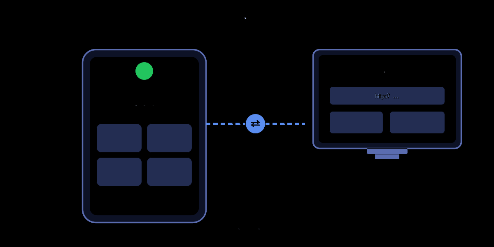

**왜 이 기능을 만들었나 — 「이동식 호스트」라는 개념.**

착수 당시 이 앱의 정체성은 「DSH를 폰에 넣는다」였고, 0.80이 한 일은 그 정체성을 한 걸음 더 밀어붙인 것입니다: **폰은 DSH의 용기가 아니라, 폰이 곧 당신의 호스트입니다**.

위챗 공식 계정 원고의 그 문장이 이 기능 전체의 제품 정의입니다:

> 예전에는 AI가 컴퓨터 안에 살았고, 폰은 네트워크 너머로 한 번 들여다보는 창이었습니다.  
> 이제는 반대입니다. **모델, 데이터, 도구, 당신의 원고까지 전부 폰 안에 들어갑니다.**  
> 컴퓨터(심지어 다른 폰)는 아무것도 설치할 필요 없이, 브라우저를 열고 주소 하나를 입력하면 접속됩니다.

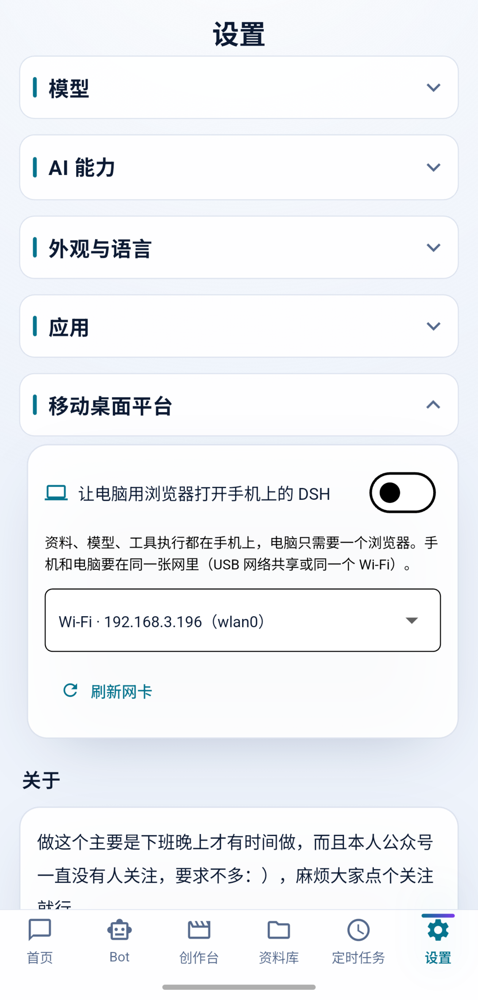

설정 페이지의 그 원리 설명 줄을 보십시오. 그것은 기능 설명이 아니라 아키텍처 선언입니다: **「자료, 모델, 도구 실행이 모두 폰에 있고, 컴퓨터에는 브라우저 하나만 있으면 됩니다.」**

이 개념이 「이동식 사무」에 갖는 실제 의미: 파일을 동기화할 필요가 없고, 세션을 이전할 필요가 없고, API Key를 복사할 필요가 없습니다. 당신이 컴퓨터 큰 화면에서 원고를 쓰고 이미지를 만들 때, 연산력과 데이터는 전부 주머니 속 그 폰에 있습니다. 컴퓨터는 그저 모니터 + 키보드입니다. 폰이 꺼지거나 오프라인이 되면 「컴퓨터 위의 작업 환경」도 함께 사라집니다 — **클라우드 세션도 없고 클라우드 데이터도 없습니다. 이것은 동시에 세일즈 포인트이자 프라이버시 입장입니다**.

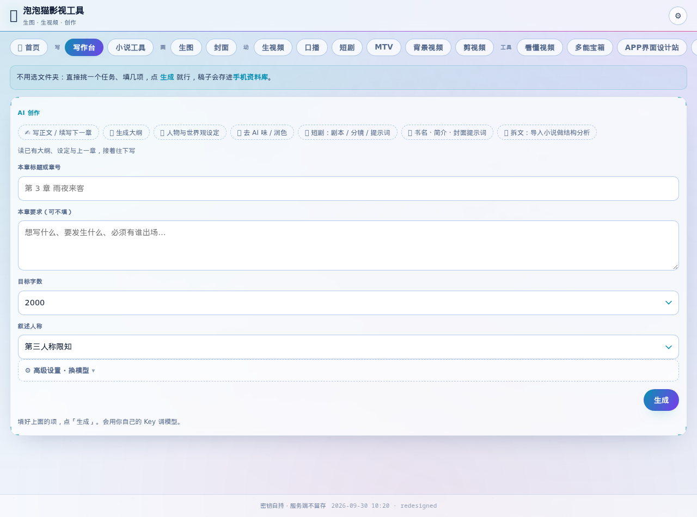

**구현의 닷새, 다섯 개의 지뢰**(2026-10-26~30, 전부 커밋 기록 있음):

1. **「포트 포워딩으로 전환, DSH를 더 이상 네트워크 카드에 묶지 않기」**(`f02dd48` 이전 첫 버전): 처음에는 Node의 HTTP 서비스가 Wi-Fi 네트워크 카드를 직접 리슨하게 했습니다 — 이 길은 Android에서 SELinux와 생명주기 두 겹의 지뢰가 있어서, 앱 쪽 포트 포워딩으로 바꾸고 DSH는 127.0.0.1만 듣게 했습니다.
2. **「컴퓨터에서 폰이 준 주소가 안 열림 — 주소 세 가지 전부 고정 + 스위치가 더 이상 DSH를 재시작하지 않음」**: IP, 포트, token 세 가지 중 하나라도 바뀌면 사용자 손에 있는 URL이 죽습니다. 수정법은 세 가지를 전부 결정적 생성으로 수렴시키는 것(네트워크 카드 선택→IP 고정, 포트는 재시작과 무관, 비밀번호는 명시적 재설정 때만 변경).
3. **「Bot 페이지가 안 열리는 진짜 이유는 431」**: 누적된 쿠키가 요청 헤더를 터뜨림(HTTP 431 Request Header Fields Too Large). 웹 서비스의 Cookie/헤더 관리에는 상한이 있어야 합니다.
4. **「--trusted-host 추가, /api 전면 403 수정」**: 컴퓨터 쪽에서 접근할 때 자체 서명 인증서/Host 검증이 API를 막았습니다.
5. **「디자인 사이트 진입 주소에는 반드시 index.html을 붙여야 함(디렉터리 형식은 404)」**: 정적 서비스의 디렉터리 경로 처리.

0.81은 세 가지로 마감했습니다: **끊겨도 알아볼 수 있다**(브라우저가 더 이상 흰 화면이 아니라 이유를 설명하고, 폰이 복구되면 자동으로 다시 연결), **기다리는 동안 보인다**(4단계 진행 + 기다린 초 수), **열 때 타이핑이 적다**(「QR로 열기」 신규 — 폰에 QR 코드가 뜨고 컴퓨터에서 스캔하면 바로 진입). 덤으로 0.80의 문제 세 곳도 고쳤습니다(디자인 사이트 시작 실패가 상주 서비스까지 끌고 감, 영/일/한 누락 번역 23건, 앱 내 업데이트 노트가 5건뿐).

**보안 모델**: URL에 token(비밀번호)이 붙는 것은 열쇠와 같습니다. 네트워크를 바꾸거나 비밀번호를 재설정하면 옛 주소는 즉시 무효입니다. 관리 엔드포인트는 loopback을 강제합니다. 이 점은 PC 브리지(bridge/)의 「페어링 코드 + token hash + 지문 pin」과 같은 철학의 양 끝 구현입니다.

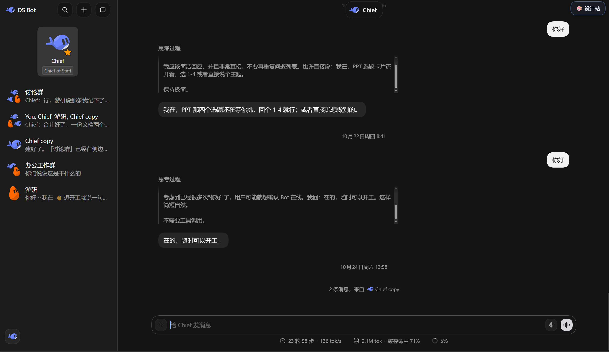

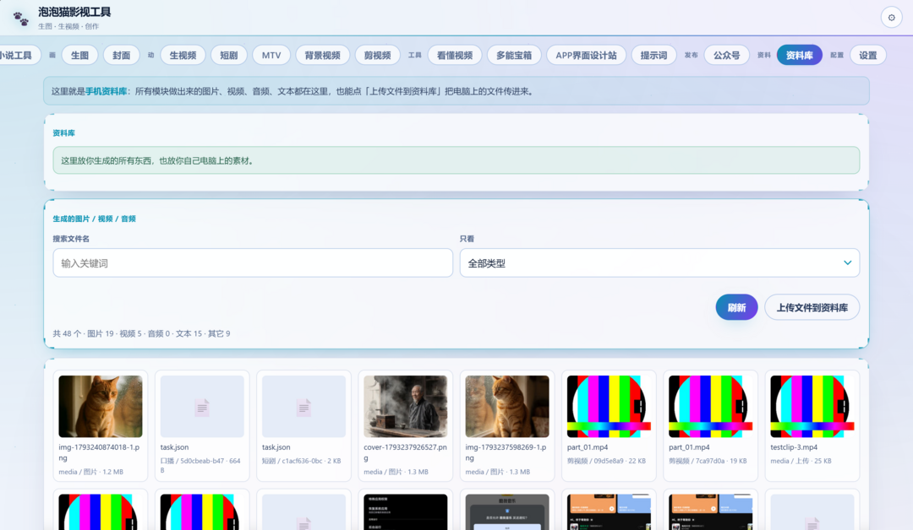

### 4.3 하모니 이식: 3분의 1쯤 싸운 전쟁

하모니 노선의 현황은 **정직**해야 합니다. 앱 본체(`app/ohos/`)는 Flutter 공식 하모니화 프로젝트 껍데기로, 빌드되고 설치되고 뜹니다. 그러나 런타임이라는 가장 깊은 사슬(libnode.so + DSH)은 하모니에서 Bot 부분집합만 뚫렸습니다. 증거 사슬:

**프로젝트 껍데기**(`app/ohos/` 9개 파일 + `signing-agc/` 10개 파일): `HARMONYOS-NEXT-GO-NO-GO.md`(733줄)는 0.74부터 매 차수 실기기 테스트 기록이고, 결론이 GO에서 ROUTE-A-DOWNGRADE(다운그레이드 노선)로 점진적으로 이동했습니다 — `HARMONYOS-ROUTE-A-DOWNGRADE.md`에 다운그레이드 결정이 기록돼 있습니다. 먼저 Flutter 껍데기를 쓸 수 있게 보장하고, 런타임은 따로 공략한다.

**런타임 공방**(`ohos-node/` 디렉터리, C++ 529줄 + ArkTS 1,032줄 + Dart 패치 미러 3,239줄): 2026-10-29 실기기 ADY-AL00 API 26에서 node v24.2.0 → DSH web 서비스 → WebView 렌더링 Bot UI까지 통과했습니다. 이 길은 Android보다 한 자릿수 어렵습니다. 하모니의 샌드박스 정책이 Android와 체계적으로 다르기 때문입니다:

| 차원                | Android                    | 하모니                                                                                                                                     |
| ----------------- | -------------------------- | -------------------------------------------------------------------------------------------------------------------------------------- |
| Node 시작           | node 바이너리를 libnode.so로 위장, 독립 프로세스 | **seccomp가 임의 바이너리 fork/exec 금지 → dlopen libnode.so + node::Start 프로세스 내 시작**(`node_host.cpp`)                                                 |
| JIT               | 정상                         | **W^X가 PROT_EXEC 금지 → `--jitless`; jitless는 다시 WASM을 금지 → 내장 undici의 llhttp가 반드시 죽음 → jitless-shim이 node:http의 WebSocket을 뜯어내고 node-fetch가 fetch를 인수** |
| io_uring          | 정상                         | seccomp trap → `UV_USE_IO_URING=0`으로 근절 + SIGSYS handler 안전망(x0=-1만 설정하고 PC는 건드리지 않음 — 「PC+=4」를 그대로 베끼면 SIGSEGV, README에서 따로 설명)                            |
| CLI 진입점            | bin.js 직접 실행                 | 임베드 환경에서 `import.meta.main`이 항상 undefined → bin.js가 조용히 rc=0으로 종료 → wrapper를 동적 생성해 명시적 `runCli()`                                                    |
| 준비 감지              | 프로세스 stdout 읽기                 | 프로세스 내 node의 stdout을 호스트가 읽을 수 없음 → dup2로 파일에 쓰고, Dart가 준비 줄을 폴링                                                                                          |
| SharedPreferences | 공식 플러그인                       | 하모니에 공식 구현 없음 → `SharedPrefs.ets`로 통로 자체 구현(실기기 MissingPluginException 실증)                                                                        |

`node_host.cpp`(529줄)에는 제가 돌아보며 가장 뿌듯한 지점이 세 곳 있습니다:

- **크래시 필적**: w0~w8 전 구간을 TW()로 trace 파일에 추가 기록해, 프로세스가 어느 단계에서 죽었는지 한눈에 보입니다 — 「관측 불가능한 seccomp 사망 방식」을 읽을 수 있는 로그로 바꾸는 유일한 방법입니다.
- **ProbeMemory()**: 항목별 mmap 프로브로 「seccomp가 도대체 무엇을 금지하는가」에 답합니다. 추측하지 않습니다.
- **92MB dlopen 전부 백그라운드 스레드**: 2026-10-28 실기기 ANR의 교훈입니다.

`verify/loader.c`는 제가 가장 좋아하는 수입니다: **실기기가 없을 때 qemu-user + Alpine musl loader로 먼저 「libnode.so가 dlopen되는가 / V8이 초기화되는가」를 검증**하고, 이 방법으로 측정할 수 없는 세 항목(seccomp/SELinux/MethodChannel)을 정직하게 나열했습니다. 「돌아가는가」와 「실기기 정책」을 분리하는 것이 플랫폼 이식의 표준 타법입니다.

**미완 목록**(왜 3분의 1만 싸웠다고 하는가): 하모니 쪽은 현재 Bot 부분집합만 통과했습니다. 전체 앱의 런타임(오프라인 Agent 세션, 도구 실행, 파일 시스템)에는 대등한 하모니 구현이 없습니다. `SharedPrefs.ets`는 Android 의미론의 일부만 덮습니다. `DshNative.ets`의 원칙은 「미구현 method는 일괄 정직하게 notImplemented()로 Dart를 다운그레이드시키고, 가짜 데이터를 만들지 않는다」입니다 — 그래서 하모니 패키지의 현재 기능 경계는 「가짜 완전체」가 아니라 「정직한 다운그레이드」입니다.

### 4.4 iOS 이식: 왜 하지 않았나

결론부터 말하면 **iOS판은 착수하지 않았고, 단기간에 착수하지도 않을 것입니다**. 자원 문제가 아니라 플랫폼의 강한 제약 문제입니다 — 4.3의 하모니 길 난이도에 계수를 하나 더 곱해야 합니다:

1. **JIT**: iOS는 서드파티 앱에 쓰기 가능+실행 가능 메모리(W^X)를 금지하므로, V8의 JIT는 Android처럼 정상 동작할 수 없습니다. 하모니는 그래도 `--jitless`라는활로(인터프리터 모드가 합법)를 줬지만, iOS에서 jitless Node가 심사를 통과할 수 있는지, 성능이 감당 가능한지 모두 물음표입니다.
2. **바이너리 실행**: iOS 샌드박스는 앱 번들 안에 선언되지 않은 바이너리 실행을 허용하지 않습니다. Android의 「node를 libnode.so로 위장해 로드」 방식에는 iOS에서 직접적 등가물이 없습니다 — `dlopen`으로 자체 .so를 여는 것은 합법이지만, 심볼 export와 프로세스 내 시작을 다시 설계해야 합니다.
3. **서명과 배포**: App Store 심사는 논외로 치고(「임의 스크립트를 실행」하는 앱이 애초에 심사를 통과할 수 있는지가 문제입니다), 사이드로딩(AltStore/7일 자체 서명)조차 목표 사용자에게는 문턱입니다.
4. **파일 시스템**: iOS는 앱마다 샌드박스가 더 폐쇄적이라, 「완전한 파일 시스템」이라는 세일즈 포인트(README의 핵심 약속 중 하나)가 iOS에서는 선천적으로 할인됩니다.


만약 언젠가 정말 한다면, 실행 가능한 경로는 대개 DSH Go 같은 「PRoot식」 또는 「원격 호스트」 노선일 것입니다(8장 참조) — **즉 iOS판은 더 이상 「통째로 옮기기」가 아니게 되고, 그것은 노선 C가 iOS에서 성립하지 않음을 인정하는 것과 같습니다**. 요구의 원점(독립 실행, 완전한 능력)과 플랫폼 제약 사이에서 iOS는 둘을 동시에 만족하는 해가 없습니다. 이것이 하지 않는 이유의 전부입니다. (물론 제 실력 문제도 있습니다)

---

## 5. 하부 구조 해부

### 5.1 런타임 임베딩: 47 MB의 Node를 APK에 밀어 넣기

이것이 프로젝트 전체에서 가장 핵심적인 공사이고, 답은 `install/`의 빌드 파이프라인과 `docs/ANDROID-LOCAL-PACKAGING.md`의 시행착오 8건 기록에 흩어져 있습니다.

**Node는 어디서 오는가**: Termux의 node 바이너리입니다(직접 크로스 컴파일하지 않습니다. Termux가 Android의 링크 문제를 이미 해결해 두었습니다). 네 가지 핵심 동작:

1. **위장**: node 실행 파일의 이름을 `libnode.so`로 바꿔 jniLibs에 넣습니다 — Android는 so를 「로드」하는 것만 허용하고 앱에 포함된 바이너리를 「실행」하는 것은 허용하지 않습니다. 그런데 `Process.start`로 so 파일을 실행하면 linker가 ELF로 처리하므로, `#!/usr/bin/env node` 같은 shebang이 우회됩니다. **이것이 방안 전체의 주춧돌입니다**.
2. **SONAME 보충**(`install/normalize-runtime-libs.mjs`): Termux의 라이브러리 심볼릭 링크(libz.so.1 → libz.so)가 Windows 패키징 머신에서 사라집니다. 스크립트가 ELF 문자열을 스캔해 별칭을 보충합니다 — 주석에 정규식 버그 하나가 기록돼 있습니다. `{2,40}`이 1글자 라이브러리 이름을 놓쳐서 `{1,40}`으로 고쳤습니다.
3. **의존성 클로저**(`install/prepare-jnilibs.mjs`): **ELF의 .dynamic/.dynstr 세그먼트를 진짜로 파싱해 DT_NEEDED를 얻고**, 의존성을 재귀 수집하며, 규격에 맞지 않는 참조를 lib*.so 규격 이름으로 재작성합니다. 확장자를 추측하지 않고 ELF를 읽습니다.
4. **경로 패치**(`install/patch-node-shell.mjs`): node 바이너리에 Termux의 shell 경로가 하드코딩되어 있어, 고치지 않으면 실행되지 않습니다.

**런타임 shim 세 개**(dsh-runtime.zip에 동봉되어 `node --require`로 장착):

- `android-fs-shim.cjs`: SELinux가 하드링크를 금지 → `fs.link` 실패 시 오류 코드에 따라 COPYFILE_EXCL 복사로 다운그레이드.
- `android-shim-flock.js`: bionic/musl에는 flock이 없음 → no-op(많은 npm 패키지가 flock에 직접 의존합니다).
- `android-shim-require-builtin.js`: node 내장 모듈을 얻으려면 `--expose-internals`가 필요합니다.

**runtime.zip을 어떻게 줄였나**(`install/slim-runtime-zip.py`, 152 MB → 약 33 MB): 서두 주석에 「모든 분류는 코드를 읽고 판단했고, 느낌상 괜찮을 것 같다고 한 것이 아니다」라고 적혀 있습니다. 예: libreoffice-kit의 resolveEngine은 throw합니다(삭제); @vscode/ripgrep은 이 플랫폼에서 resolve되지 않습니다(삭제); sharp에는 wasm32 폴백이 있습니다(**반드시 보존**); node-pty는 linux-arm64/pty.node를 반드시 보존해야 합니다. `--verify`가 패키지마다 package.json 엔트리를 검증합니다.

**첫 실행 흐름**: MainActivity가 assets를 푼다 → 첫 실행 때 런타임 압축을 해제한다(약 40~80초, `libnode.so` 47 MB + runtime.zip 33 MB) → 표식 파일로 버전을 판정한다 → 이후 시작은 압축 해제 0회. `runtime.json`이 런타임 버전(v5) + sha256을 선언하고, 덮어쓰기 설치 시에는 「실행 환경 내용 버전」을 올려 강제 갱신합니다(0.75의 지뢰: 내용 버전을 올리지 않으면 덮어쓰기 설치에서 새 런타임을 받지 못함, `4dbe403`).

### 5.2 브리지 프로토콜과 DSH 구동

앱 내부의 정식 경로(ACP stdio):

- `app/lib/local/acp_client.dart`: readline 개행 프레이밍의 JSON-RPC 2.0, 응답/서버 요청/알림 삼로 분배. 이 파일은 첫 버전부터 지금까지 살아 있고, UI를 다시 만들 때도 건드리지 않았습니다 — **프로토콜 계층의 안정성이 UI 계층이 반복해서 갈아엎을 수 있는 전제입니다**.
- 다섯 종류의 ACP update(agent_message_chunk/thought/tool_call/tool_call_update/usage_update)를 하나의 이벤트 스트림으로 정규화.
- 권한 승인: ACP `session/request_permission` → 앱이 승인 카드를 띄움 → 응답이 같은 경로로 반환.

PC 디버그 브리지(`bridge/`, 6개 .mjs 총 1,584줄)는 같은 ACP를 WebSocket 서비스로 바꿉니다. 설계에서 베낄 만한 점:

- **dsh 크래시 시 자동 재시작**: 지수 백오프 1s×2, 상한 30s, 최대 8회, 전 구간 `bridge_status` 방송.  
  |  |  |  |  
  | --- | --- | --- |
- **승인 안전망**: `riskFlagsOf()`가 정규식 6개(rm -rf / curl|sh / .ssh|.env / git push --force / …)로 명령에 위험 표시를 붙입니다. 구독자가 없으면 전 채널 방송으로 퇴화합니다 — **백그라운드 승인이 조용히 버려지는 것을 막습니다**(server.mjs:250-265 주석).
- **자격 증명 저장**(store.mjs:48-125): `sha256(deviceToken)`만 저장. 페어링 코드 6자리 CSPRNG, TTL 120s, 일회용, 5회 틀리면 15분 잠금. **원자적 쓰기**(.part + rename) + **손상 격리**(파싱 실패 시 깨진 파일을 .corrupt로 rename해 원본 바이트를 보존). 주석에는 「잘못 읽음→빈 것으로 취급→되쓰기→기기 전부 오프라인」의 P0 사고 사슬이 그대로 복원돼 있습니다.
- **프로토콜 진화 규칙**(bridge-protocol.md §9): 「v1은 덧셈만, 모르는 type은 무시하고 연결을 끊지 않는다」 — 프로토콜이 첫날부터 하위 호환을 염두에 두고 설계됐습니다.

프로브 문화(`probes/`, 11개 .mjs 총 1,690줄): `mock-acp-server.mjs` 서두 주석 원문 — 「승인은 objective의 핵심 능력이며, **모델 결정의 운에 맡겨 검증할 수 없습니다**」. 실제 DSH는 모델이 스스로 권한 상향을 요청할 때만 권한 요청을 보내므로 승인을 안정적으로 테스트할 수 없습니다. 그래서 mock은 반드시 `rm -rf ./dist`를 보내 riskFlags를 검증합니다. 결정적인 mock이 확률적인 실제보다 낫습니다.

### 5.3 Dart 계층

lib/ 계층 구조(89,031줄 + 테스트 25,369줄):

```
lib/
├── main.dart        入口：未解压→SetupPage，已就绪→AppShell
├── local/           运行时封装（dsh_runtime.dart：spawn/overlay 生成/凭据注入）
│                    acp_client.dart（stdio 协议端）
│                    loose_chat_templates.dart（Gemma 兼容模板）
│                    rotate_log.dart（轮换池日志解析，6 条单测）
├── protocol/        消息与卡片模型
├── state/           会话/模型状态 + 广播
├── storage/         持久化（SharedPreferences + 文件）
├── data/            模型目录/产物解析/changelog/easter_egg/usage
├── i18n/            四语表（tables/，守卫测试钉死条数）
└── ui/              页面 + widgets + theme（见 5.4）
```

대표적인 설계 결정 몇 가지:

- **overlay 생성**: DSH 설정은 파일을 직접 고치지 않고, 세션을 시작할 때마다 overlay 한 부를 생성합니다(모델 선택, 권한 모드, MCP 선언, 환경 변수 주입). 장점: 런타임 디렉터리는 읽기 전용, 사용자 설정은 통째로 버리고 다시 시작 가능, 0.34 같은 clamp 버그의 수정 지점이 한 곳에 모입니다.
- **로테이션 풀**(rotate_log.dart): 다중 모델 로테이션 프록시 시작 시 `--log`를 붙이고, 세션 입력창 위에 「로테이션 풀 cat · 이번에는 claude-sonnet」을 표시합니다. 파서에는 단위 테스트 6건이 있고, 「로그에 ISO 타임스탬프가 붙으면 정규식이 속는다」는 함정까지 덮습니다 — **파서의 타임스탬프 형식까지 테스트했습니다**.
- **사용량 통계**(UsageStore): route별 요청 횟수와 문자 수를 기록해 `<nodeHome>/usage.json`에 저장합니다. 주석에 「token 수를 지어내지 않는다 — DSH는 현재 실제 사용량을 보고하지 않으며, 보고하기 시작하면 필드를 추가하면 되고 UI는 고칠 필요가 없다」고 명시했습니다. **가짜 데이터를 만들지 않는 것**은 이 프로젝트의 레드라인 중 하나입니다.
- **API Key**: Android Keystore에만 저장(README 프라이버시 선언), 세션과 산출물은 전용 디렉터리에, 실행 전 확인 필요.

### 5.4 인터페이스 구성 요소

**페이지 구조**(0.82 실기기 시맨틱 트리 실측): 하단 6개 탭 — 홈 / Bot / 창작대 / 자료실 / 예약 작업 / 설정. 홈은 위에서 아래로: 마스코트 고양이(클릭 가능, 이스터에그 참조) → 환영 영역 + 버전 번호 → 공지판(새 버전 배지 + 이동 가능) → 스킬 바로가기(슬라이드 제작/이미지 생성/영상 생성/데이터 분석, 「다른 것 보기」로 로테이션) → 「새 세션 시작」 주 버튼.

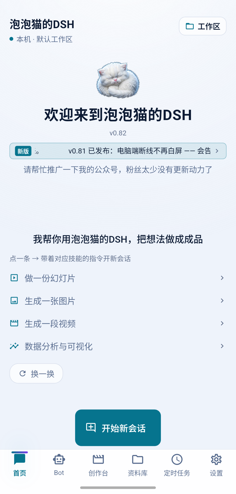

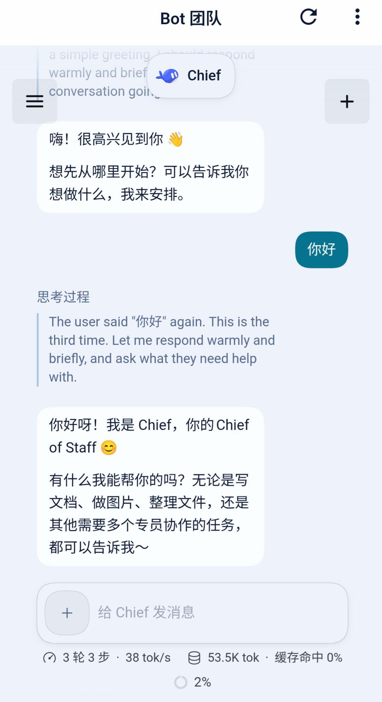

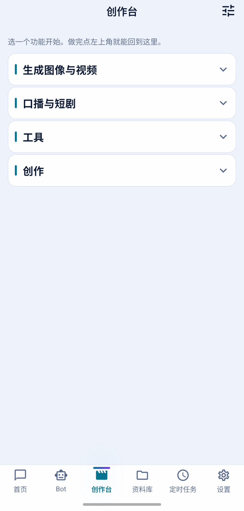

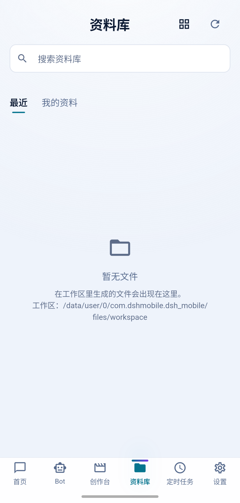

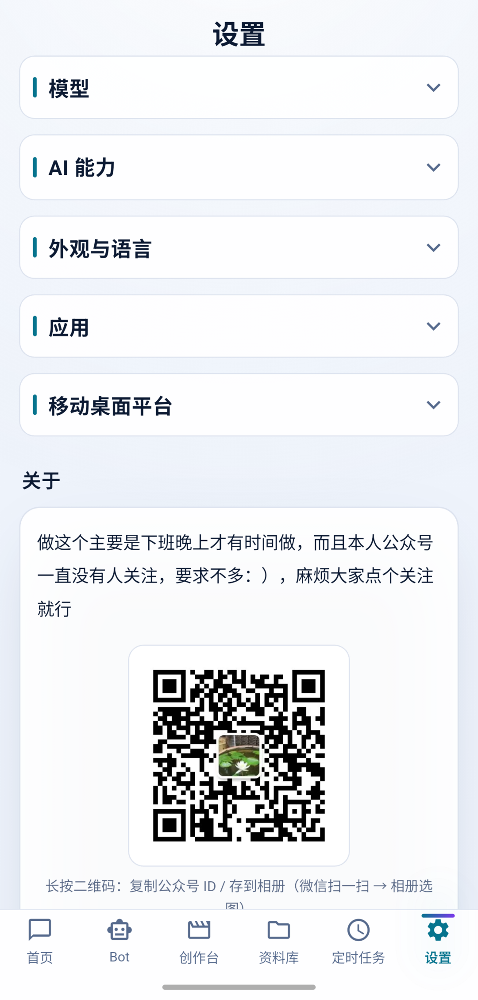

**테마 시스템**:

- 내장 테마 세 단계: 라이트 / 다크 / 픽셀(사용자 정의는 자리표시자이고, 설정 페이지에 「아직 안 만들었습니다」라고 그대로 적었습니다 — **자리표시자는 진짜인 척하지 않습니다**), 여기에 배경화면 선택.
- token 체계: `theme/dsh_tokens.dart`가 색상/간격/글자 크기/모서리 반경을 정의하고, **디자인 시안 좌표계를 포함**합니다(11페이지 PDF의 요소 좌표가 여기 저장돼 있고, 첫 버전은 「OCR 좌표로 페이지마다 대조」해 만들었습니다). 글자 크기는 13/11/12/15 네 단계로 통일했습니다 — 근본 원인은 대장 #11: 「맨 Text가 테마 기본값 14를 타고 거기에 텍스트 스케일이 겹쳐서, 어떤 곳은 글자가 어마어마하게 커짐」.
- 테마 게이트: 0.82 커밋 `fix(테마 게이트): 하드코딩된 모서리 반경 두 곳을 DshMetrics.radius로` — 모서리 반경/색상은 하드코딩 금지, 게이트를 통과해야 합니다.
- **교차 테마**: Bot 웹 버전(디자인 사이트)의 색상은 Dart 쪽에서 `DshColors`를 CSS 토큰으로 컴파일해 주입합니다(`d45288f`) — 같은 token 소스를 Flutter와 Web 두 렌더링 단이 공유합니다.
- 라이트 테마에서 「입력창 글자가 안 보임」 사고가 있었습니다(textTheme에 bodyLarge 누락, 빌드 번호 85) — **Material textTheme의 모든 단계에 색을 명시해야 하고, 빠진 단계는 라이트에서 투명해집니다**.

**컴포넌트 체계**(`lib/ui/widgets/`):

- `input_bar.dart`: 캡슐 입력창 + 모델 버튼 + 첨부 메뉴(사진/앨범/파일/음성) + 전송.
- `message_stream.dart`: 메시지 스트림 / 산출물 카드 / 도구 호출 카드 / 첨부 메뉴 — 스트리밍 에코, 사고 과정 접기, 도구 카드가 모두 이 하나의 이벤트 스트림 위에 있습니다.
- `mascot_speech.dart`: 마스코트 버블(아래 참조).
- `bottom_nav.dart` / `common.dart`: 내비게이션과 빈 상태/캡슐/파일 형식 배지.
- 그룹 컨테이너: `DshCollapsibleSection`(기본 접힘) / `DshStaticSection`(상시 펼침) — 0.30의 교훈(대장 #46): 모델 목록이 기본 접힘 때문에 「모델명이 안 보이는」 사고가 났고, 이후 **내용이 있는 그룹은 StaticSection으로 상시 펼치고, 빈 그룹은 렌더링하지 않습니다**.

**i18n**: 중/영/일/한 네 언어, 표 기반(`lib/i18n/tables/*_table_data.dart`), 항목 수는 가드 테스트가 못 박습니다(1231 → 1833건). 모든 UI 문자열은 `context.tr('中文原文')`를 탑니다 — **중국어 원문이 곧 key**이고, 번역 표가 key로 정렬됩니다. 0.81에서 한 번 뒤집혔습니다: 영/일/한 누락 번역 23건, 이후 언어 표 0 드리프트가 패키징 문턱에 들어갔습니다.

**스트리밍 렌더링**: 이벤트 기반 부분 리페인트(메시지 스트림이 update 타입별로 해당 카드를 rebuild), 사고 과정은 기본 접힘(`dsh_thinking_mode=collapsed` 저장, 설정 페이지에 「저장됨」 문구 표시 — 상태 투명화).

**스크린샷 테스트**: `test/ondevice_shot_test.dart` — 이 PC에서 페이지를 렌더링해 이미지를 뽑아 조판을 자체 점검(0.30 도입). 「스크린샷 테스트로 『빈 name』 시나리오를 만들어, 0.31의 폴백이 출하 이름을 표시하는지 확인」 — 조판 버그는 조판 증거로 고칩니다.

**이스터에그**(`app/lib/data/easter_egg.dart` + `ui/widgets/mascot_speech.dart`):

- 홈의 고양이를 한 번 누르면 말을 합니다 — 버블이 왼쪽/위/오른쪽에 번갈아 나타나며 짧은 진동이 동반됩니다.
- **7번 연속 클릭하면 진짜 이스터에그 해금**: 긴 진동 + 왼쪽/위/오른쪽 버블 세 개가 동시에 「이스터에그가 있어요, 설정에」를 띄움 → 설정 페이지 「모델」 그룹에 숨겨진 「서드파티 키 없는 통로」 진입점이 나타납니다.
- 제 결정 원문(easter_egg.dart 서두 주석): 「메뉴는 고양이를 6번 연속 클릭하면 좌상우에 버블이 모두 뜬다」. 최종 구현은 7번입니다 — 7번째에 긴 진동, 앞 6번은 짧은 진동, 리듬상 「7번째가 보상처럼」 느껴지게.
- 공학 디테일: 연속 클릭 창 1.2초(「『연속 클릭』보다 조금 넓게, 손 반응이 느린 사람도 막히지 않도록」); 상태 읽기/쓰기 실패는 미해금으로 처리(fail-safe, 이스터에그 때문에 메인 흐름이 죽지 않도록); 4개 언어 문구는 i18n 표 1192행; mascot_speech.dart:318에 「오래 잠복해 있다가 0.75에서 이스터에그 테스트를 쓰면서 잡힌」 버블 레이아웃 구멍이 기록돼 있습니다 — **이스터에그에도 테스트가 필요합니다**.

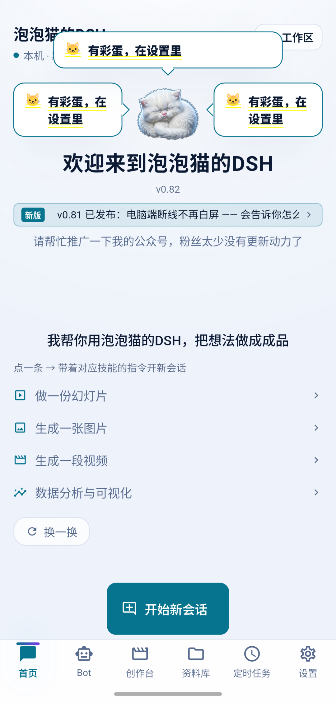

### 5.5 네이티브 계층

**Android**(`app/android/`, Kotlin 파일 16개):

- `MainActivity.kt`: assets 압축 해제 호스트 + MethodChannel 버스(압축 해제 매핑, 런타임 버전, marker 판정, shim 덮어쓰기).
- 포그라운드 서비스 상주: 예약 작업의 「놓친 작업」 문제는 README의 알려진 제한에 그대로 적혀 있습니다(「중국산 ROM의 절전 정책 영향을 받음」).
- phone-agent 모듈(0.79): dex 동적 빌드, BouncyCastle keep, 가상 화면 관리(자세한 내용은 4.1).
- FileProvider: 첨부(사진 촬영→전용 디렉터리, 임의 파일은 실제 경로 제공).

**하모니**(`app/ohos/` + `ohos-node/`): 4.3 참조, 중복 설명 생략.

### 5.6 기능 전체 목록

각 항목에 구현 진입점을 표기합니다(코드를 읽을 때 여기서 시작하십시오):

| 기능               | 진입점                                                      | 비고                                                                                                                       |
| ---------------- | ------------------------------------------------------- | ------------------------------------------------------------------------------------------------------------------------ |
| 세션(스트리밍/중단/재개)     | `lib/local/acp_client.dart` + ACP session/cancel/resume | 다중 턴 컨텍스트                                                                                                                    |
| 도구 호출 승인           | ACP request_permission + 승인 카드                            | 위험 표시                                                                                                                     |
| 첨부: 사진/앨범/파일/음성   | `ui/widgets/input_bar.dart`                             | 음성 합성은 0.73부터 내장(중국어 모델 필요 시 다운로드 31.5 MB); 인식은 시스템 서비스 사용                                                                                  |
| 클라우드 대형 모델 다중 벤더         | `lib/data/model_catalog.dart`                           | deepseek/command/longcat/mimo 엔드포인트 프리필                                                                                       |
| 로컬 대형 모델            | `lib/local/` + `ondevice_models_page`                   | llama.cpp + litert-lm 듀얼 엔진, 텍스트/멀티모달/그래픽/비디오 그룹                                                                                 |
| 모델 로테이션 풀            | `lib/local/rotate_log.dart`                             | 세션 내 「이번엔 누구를 썼는지」 표시                                                                                                             |
| 키 없는 무료 통로       | 무료 모델/키 없는 통로 설정 그룹                                          | 업스트림 게이트 추격전은 3.5 참조                                                                                                             |
| 전문가 321명 / 22개 분과 | 전문가 센터                                                    | 스위치가 런타임 설정에 실제로 기록됨                                                                                                                |
| 스킬 24개(패키지 내장)    | 창작대 + 스킬 시스템                                              | 이미지 생성/영상 생성/슬라이드/차트 그리기/프런트엔드 디자인/문서 처리/표/번역/데이터 분석/소설 게임화…(자세한 내용은 5.7.2)                                                                     |
| Bot 팀           | Bot tab                                                 | 0.77에 폰에 올라옴, 방안 세 번 전환                                                                                                          |
| 예약 작업             | 예약 작업 tab                                                | 매일/평일/매주/1회만; 포그라운드 서비스 상주                                                                                                     |
| 자료실              | 자료실 tab                                                 | 두 탭(최근/내 자료), 워크스페이스 스캔 자동 수납                                                                                                  |
| 워크스페이스 다중 디렉터리           | 홈 오른쪽 위 「워크스페이스」                                               | 병렬 디렉터리                                                                                                                     |
| 모바일 데스크톱 플랫폼           | 설정→앱→모바일 데스크톱 플랫폼                                            | 4.2 참조                                                                                                                    |
| 포포캣 어시스턴트            | 홈 마스코트/설정                                                | 4.1 참조                                                                                                                    |
| 업데이트 확인 + 차분        | update.json + DSHDELTA v1                               | 생략                                                                                                                      |
| 연결 자가 점검             | 0.82 「연결이 안 되나요? 여기를 눌러 자가 점검」                                         | 정말로 한 번 연결, 고장 계층화                                                                                                               |
| 테마/배경화면/픽셀 테마       | 설정→외관                                                   | 5.4 참조                                                                                                                    |
| 4개 언어 i18n          | `lib/i18n/`                                             | 중/영/일/한                                                                                                                     |
| 이스터에그               | `lib/data/easter_egg.dart`                              | 5.4 참조                                                                                                                    |
| **플러그인 설치**         | 설정→플러그인(자리표시자 페이지)                                              | **미개방. 이유는 README에 적혀 있습니다: 보안 검증과 롤백 메커니즘이 완성되지 않았습니다; 더 깊은 층은 적응 문제입니다 — 데스크톱판 플러그인은 완전한 Node 환경과 임의 파일 접근을 전제하는데, 모바일 샌드박스는 둘 다 제약을 받아, 억지로 맞추는 ROI가 개방 표준(MCP)을 뚫는 것보다 낮습니다. 플러그인 페이지는 정직하게 설명하고 「곧 출시」인 척하지 않습니다** |


## 6. 코드 품질 자체 평가

「사고가 난 적이 있는가 / 얼마나 쉽게 사고가 나는가」 순으로 정렬했고, 「보기 싫은가」 순이 아닙니다. 이 장은 혹평 목록이므로, 장점을 먼저 말하고(장점은 단점이 존재하는 전제이므로) 빚을 나열합니다.

### 6.1 장점(외부에 말해도 된다고 생각하는 것)

1. **근본 원인 문화**. 커밋 267개 중 fix류는 거의 전부 「진짜 근본 원인」이라는 표현을 달고 있고, 그 근본 원인 서술은 재검증을 견딥니다(0.34의 maxTokens clamp, 0.82의 MCP 부모 환경, 0.77의 PopScope 뒤로가기 가로채기 — 하나하나 코드에서 짚을 수 있습니다). 대장에 「제 지난 버전 방안이 틀렸습니다」 같은 자기 정정이 한 번 이상 등장합니다.
2. **프로브 + fixtures**. 프로토콜 동작을 먼저 실측한 뒤 구현하고, 원본 프레임이 보관되어 재검증할 수 있습니다. mock은 결정적이며 운에 걸지 않습니다.
3. **게이트 테스트**. 패키징 문턱: flutter analyze 무결점 + 전체 테스트 통과 + 언어 표 세 장 0 드리프트 + check-release.py 전부 통과. 「물어뜯는 회귀 테스트」(0.74의 세션 id, 0.34의 16384, 이스터에그의 버블 레이아웃)는 모두 사고 현장에 그 자리에서 세운 비석입니다.
4. **자리표시자는 자리표시자답게**. 안 만든 기능(사용자 정의 테마, 플러그인)은 UI에서 「아직 안 만들었습니다」라고 그대로 말하고, 가짜 스위치나 가짜 진행 바를 주지 않습니다. 대장 #15 원문: 「VAE/T5 같은 외부 파일이 없으면 그대로 명시하고, **가짜 초록불을 주지 않는다**」.
5. **주석이 결정사를 담는다**. mascot_speech.dart / easter_egg.dart / settings_tab.dart의 주석에는 결정 원문, 날짜, 왜 다른 방안이 안 되는지가 남아 있습니다. 반년 뒤에 인수하는 사람이 「무엇」이 아니라 「왜」를 읽을 수 있습니다.
6. **원자적 쓰기 + 손상 격리**(bridge/store.mjs). P0 사고 사슬을 주석에 적어두고, 같은 종류의 지뢰는 한 번에 다 고칩니다.
7. **ELF 수준 패키징 정확성**. 확장자를 추측하지 않고 DT_NEEDED를 진짜로 파싱합니다.
8. **안전한 기본값**. token은 해시만 저장, CSPRNG 페어링 코드, 관리 엔드포인트 loopback, riskFlags는 절대 자동 허용하지 않음.

### 6.2 단점과 기술 부채(위험도 순)

1. **【높음·오픈소스 차단 항목】 소스에 개인 경로 하드코딩**: `bridge/src/bridge.mjs:37`에 `D:/Programs/PaopaocatDSH/...`가 박혀 있습니다. `bridge/config.example.json`, `start-bridge.cmd`, `probes/acp-probe.mjs`, 여러 install 스크립트도 마찬가지로 로컬 머신 디렉터리를 하드코딩했습니다(실측 저장소 전체 40여 곳). 냄새 나는 문제가 하나 더 있습니다. TLS 개인 키 비밀번호 `dsh-mobile-bridge`가 기본값으로 `bridge/src/bridge.mjs:49`에 적혀 있습니다. **오픈소스 전에 반드시 세탁해야 합니다**. 《오픈소스 준비 체크리스트》1.1 참조.
   > 정정(2026-11-04): 커밋 475개 전체의 객체를 대조한 결과, `bridge/tls/*.pfx`, `*.pem`, `fingerprint.txt`, `bridge/data/devices.json`은 **git 이력에 들어간 적이 없음**을 확인했습니다(`.gitignore`가 첫 커밋부터 제외). 자격 증명 자료는 로컬 작업 영역에만 존재합니다.
2. **【높음】 프로토콜 선언과 구현 불일치**: `bridge-protocol.md`는 `allow_session`이 명령 접두사 매칭을 지원한다고 선언하지만, 구현(server.mjs:197)은 전체 문자열 일치만 합니다. 프로토콜은 업링크 ≤64KiB, 45s 하트비트로 사망 판정이라고 하는데 서버는 둘 다 검증하지 않습니다. **문서가 코드보다 많은 약속을 쓴 것 — 문서 주도 개발의 가장 아이러니한 실패 모드입니다**.
3. **【중상】 dsh 재시작 후 세션 표 미정리**: 옛 ACP sessionId가 레지스트리에 남아, prompt가 session_not_found에 부딪히면 오류 코드 안전망에만 기댈 수 있습니다.
4. **【중】 install/은 정리되지 않은 개발 현장**: 148개 파일 중 약 6할이 차수별로 이름 붙인 일회용 스크립트(`verify_009_*.py`, `fix13_*.py`, `check_round8.py`)이고, `__pycache__/`, `.pyc`, 위챗 공식 계정 발행 도구가 섞여 있습니다. 오픈소스 시 「빌드 파이프라인/도구/보관」 세 단계로 재정리해야 합니다.
5. **【중】 단일 거대 파일**: `dsh_runtime.dart` 1,611줄(다운로드/압축 해제/overlay/통로/진행률이 전부 한 파일), `ui/pages/settings_tab.dart` 4,469줄, `ui/pages/media_page.dart` 3,854줄, `main.dart` 738줄. 계층은 디렉터리 수준에서는 선명한데, 파일 수준에서는 오래전에 흐려졌습니다.
6. **【중】 소스 미러 사본은 반드시 드리프트한다**: `ohos-node/bridge/mainsrc-0.79/`는 0.79판 Dart 소스의 스냅숏 사본이고, app/ 주 소스와 동기화 메커니즘이 없습니다.
7. **【중】 Bot 모드는 무조건 danger-full-access**: bot_server.dart가 독립 full-access 패치를 항상 전달하고 + env에 `DSH_PERMISSION_MODE=danger-full-access`를 박아둡니다. 제가 명시적으로 요구한 제품 결정이지만(주석 있음), 오픈소스 이후 가장 오용되기 쉬운 기본 설정입니다.
8. **【하중】 verifyToken이 핸드셰이크마다 디스크 기록** + 다중 인스턴스가 devices.json에 무락으로 동시 기록.
9. **【낮음】 위험 감지는 순수 정규식**: 정규식 6개는 우회하기 쉽고(인코딩/개행/변수 연결), v1에는 기기 개인 키 서명 챌린지가 없습니다 — 문서에서 이미 인정한 부분입니다.
10. **【낮음】 기록 단절**: 0.35~0.60의 버전 26개는 대장에 항목별로 채워지지 않았습니다. 문서 체계의 연속성이 한 번 끊기면, 이음매는 영원히 검은 채로 남습니다.

### 6.3 3대 「침묵 결함」 복기

이 프로젝트에서 가장 비싼 종류의 버그는 크래시가 아니라, **「맞아 보이는데 한 번도 적용된 적 없는 것」**입니다:

- 0.28 성능 스위치(파라미터 표기 오류, 한 번도 적용 안 됨, 0.31에서야 드러남)
- 0.22 선택기 수정(절반만 수정, 0.24에서야 진짜 근본 원인 수정)
- 0.82 이전의 MCP 부모 환경(Office 세 도구가 한 번도 붙은 적 없음)

공통점: **실패는 조용하고, 성공은 가정된다**. 대책도 세 가지입니다: 로그를 adb로 읽을 수 있게(0.82), 활성 확인은 반드시 한 번 실제로 때려보기(0.82 자가 점검 철학), 「테스트 통과」는 그것이 진짜 경로를 테스트한 것인지 물어보기(0.34의 교훈).

---

## 7. 문서 자산 결산

오픈소스는 「기술 문서를 얼마나 생성했는가」를 요구하고, 이 장이 그 장부입니다. `docs/` 아래 총 **288개 파일**, 그중 Markdown **69부**(그 밖에 스크린샷/소재/HTML 위챗 공식 계정 원고 등 자산 219부). 저장소 전체 기준으로는 Markdown 총 **285부**입니다. docs/의 69부 외에 207부가 app/ 코드 옆에 붙어 있고(페이지 수준 서두 주석이 곧 공학 문서입니다), bridge/, ohos-node/, install/에 각각 한두 부, 루트에 README 네 부.

### 7.1 분류 장부

| 분류                   | 수량     | 대표 파일                                                                                                              |
| -------------------- | ------ | ----------------------------------------------------------------------------------------------------------------- |
| 버전 릴리스 문서(RELEASE-*.md) | 11     | RELEASE-0.09 / 0.13 / 0.14 / 0.15 / 0.74~0.78 / 0.80 / 0.81                                                       |
| 변경 로그(changelog-*.md) | 13     | 0.19~~0.23 / 0.61~~0.63 / 0.65~0.69                                                                               |
| 단계 변경(CHANGES-*.md)   | 5      | CHANGES-2026-10-04 / 14 / 15 / 16 / 19                                                                            |
| 주기 문서(开发周期-*.md)      | 2      | 开发周期-0.82 / 0.83                                                                                                  |
| 공학 가이드                 | 7      | BUILD / BUILD-LINUX / DEVELOPMENT / ANDROID-LOCAL-PACKAGING / ANDROID-LOCAL-VERIFICATION / DELTA-UPDATE / HANDOFF |
| 하모니 특집                 | 2      | HARMONYOS-NEXT-GO-NO-GO(733줄) / HARMONYOS-ROUTE-A-DOWNGRADE                                                       |
| 감사와 컴플라이언스                | 3      | AUDIT-2026-10-09 / KB-COMPLIANCE-2026-10-09 / W1-acp-findings                                                     |
| 방안 문서                 | 4      | 在线更新-方案 / 免费模型-方案 / PLAN-0.81 / model-routing-audit-0.11                                                          |
| 운영 원고(위챗 공식 계정/쿠안/도해)      | ~15    | 公众号-0.80-移动桌面平台 / 紧急更新-0.81 / 分发-酷安-0.81 / 使用说明 / 信息图文案-0.82                                                      |
| 대장과 라이선스                | 3      | 需求台账.md / 技能质量对比-0.71 / 第三方许可.md                                                                                  |
| 스크린샷과 소재 디렉터리              | 8군    | article-0.14 / article-assets / screenshots / shots / logs / probe / samples / 文案                                 |
| **깨진 파일명**(GBK 인코딩 잔재)  | 33개 경로 | docs 루트 6개(md 3 + html 3) + 소재 디렉터리 스크린샷 27장 — **오픈소스 전 이름 변경 필요**                                                           |


### 7.2 이 문서 체계의 자기 평가

**장점**: 이 문서 체계는 제 프로젝트에서 코드를 제외하면 가장 값진 자산입니다 — 어떤 버전의 동작이든 RELEASE/changelog/대장 세 곳 중 최소 한 곳으로 되짚을 수 있습니다. 근본 원인 기록 습관이 「시행착오」를 자산으로 바꿨습니다. 대장이 요구 원문을 보존하므로 요구 변경이 조용히 지나가지 않습니다. 반년 뒤에 제가 왜 그렇게 고쳤는지 잊어도, docs/에 답이 남아 있습니다.

**문제**: 명명 기준의 드리프트(RELEASE vs changelog vs 업데이트 노트 vs CHANGES vs 개발 주기, 다섯 세트 이름이 한 가지 용도); GBK 깨진 파일명; 0.35~0.60 단절; 운영 원고와 기술 문서가 한 디렉터리에 혼거. 오픈소스 이후 정리 방향: 버전류는 `releases/`로 통일, 공학류는 `dev/`로 통일, 운영류는 docs 밖으로 이동.

---

## 8. DSH Go와의 하부 구조 비교

먼저 대상부터 밝히겠습니다. **DSH Go**(github.com/ccch1mneyyy/dsh-Go, AGPL-3.0)는 또 다른 동종 프로젝트입니다 — 같은 업스트림 DSH 엔진의 Android 클라이언트이고, 역시 Flutter + 네이티브 껍데기입니다. 2026-10-30에 Trendshift 전체 언어 일간 1위를 했고, 현재 Star 8,634, Fork 408이며, 포럼·QQ 그룹·커뮤니티 규모가 모두 저보다 훨씬 큽니다. **먼저 인정합니다. 커뮤니티로도, 제품 완성도로도, 대외적으로 보여지는 체면으로도 DSH Go가 앞서고, 저는 억지 부리지 않겠습니다.**

이 장은 질문 하나에만 답합니다. 같은 DSH를 Android에 넣을 때, 양쪽의 **하부 코드**가 각각 어디가 강하고 대가는 무엇인가. 기능 목록은 비교하지 않습니다(그건 README의 일입니다). 비교 대상은 기술 선택의 분기입니다.

### 8.1 가장 핵심적인 분기: 런타임 적재

이것이 두 프로젝트의 모든 차이의 뿌리입니다.

**포포캣: 통째로 옮기기(libnode 내장).** Termux의 node 바이너리를 `libnode.so`로 위장하고, DSH 런타임을 그대로 zip으로 묶어, 앱이 시작하면 전용 디렉터리에 풀고 `node --require shim dsh --profile acp`로 띄웁니다 — **엔진은 한 줄도 고치지 않습니다**.

**DSH Go: PRoot 컨테이너.** 그쪽 AGENTS.md 첫 단락에 분명히 적혀 있습니다 — 「패치를 적용한 DSH 엔진 런타임(PRoot 안에서 `dsh web` 실행)」. 완전한 Ubuntu 24.04 rootfs + Node + 패치 15개를 적용한 엔진(`runtime/patches/` + `pins.json`으로 버전 고정)을, 경량 컨테이너화된 Linux 환경에서 돌립니다(「Root 불필요, Termux 불필요」).

먼저 그쪽이 어디가 강한지, 제가 인정하는 부분을 숨기지 않겠습니다:

- **환경 완전성은 압도적입니다.** 완전한 Ubuntu 24.04 rootfs는 DSH 외에도 임의의 Linux 툴체인을 돌릴 수 있다는 뜻입니다 — shell 스크립트, git, Python, gcc가 다 있습니다. 제 노선이 줄 수 없는 것입니다. 저는 Node와 동봉 의존성뿐이고, DSH 툴박스 밖의 Linux 능력은 공백입니다.
- **공급망 공학은 제가 본 개인 프로젝트 중 가장 무겁습니다.** Ubuntu 패키지가 완전한 gpgv 신뢰 사슬 검증을 거치고(`build-runtime.sh`의 "InRelease verified with gpgv"가 흑백으로 적혀 있습니다), npm lockfile이 못 박혀 있고, ELF 전량 아키텍처 감사(산출물 `build-report.json`에 모든 so의 아키텍처와 트리밍 기록), 재현 가능한 아카이브. 이런 체계를 한 번 만드는 비용은 매우 높고, 존경할 만합니다.
- **proot 바이너리는 Termux 공식 deb에서 옵니다.** 저와 같은 업스트림을 씁니다. 즉 그쪽의 「컨테이너화」와 제 「이송」은 사실 같은 인식 출발점을 공유합니다. Android에서 Linux를 돌리는 일에는 Termux가 검증된 길입니다. 두 길은 이 갈림목에서 갈라집니다.

| 차원     | 포포캣: libnode 내장        | DSH Go: PRoot                |
| ------ | --------------------- | --------------------------- |
| 엔진 변경   | **패치 0**, 데스크톱판 zip 원본    | 패치 15개 + pins.json 버전 고정      |
| 환경 완전성  | Node와 동봉 의존성만         | **완전한 Linux 환경**(능력 상한이 더 높음)     |
| 성능     | 네이티브 syscall, 변환 계층 없음       | PRoot에 syscall 변환 오버헤드        |
| 패키지     | 113 MB(런타임 33 MB zip) | rootfs 전량을 APK에 포함             |
| 업그레이드 경로   | runtime.zip 교체, 엔진 업그레이드 비용 0 | rootfs 교체 + 패치 재적용 + pins 검증 |
| 플랫폼 의존 깊이 | shim 세 개 + ELF 패키징 공학    | PRoot 바이너리 + rootfs 조립       |

### 8.2 엔진 버전과 업그레이드 비용

이 절에서는 제 패를 끝까지 깝니다. 저에게 불리한 패까지 포함해서.

객관적 사실부터: **DSH Go가 고정한 엔진 버전이 제 것보다 최신입니다.** 그쪽 `runtime/locks/`에 잠긴 것은 `dsh-0.2.1-rc.4`이고, 저는 지금 `0.1.7-rc.2`를 따라가고 있습니다. 이 숫자 하나는 얼버무릴 수 없습니다 — 「현재 기능면과 업스트림 신선도」로는 상대가 제 한 세대 앞서 있고, 이는 다음 주기에 제가 갚아야 할 빚입니다.

다만 버전 차이라는 문제를 갚는 비용은 두 노선이 전혀 다릅니다:

- **제가 버전을 따라가는 비용은 0입니다(「이송」계층에서).** `dsh-runtime.zip`은 데스크톱판 DSH를 그대로 패키징한 것이고, shim 세 파일은 넉 달째 건드리지 않았습니다. 데스크톱판 DSH가 새 버전을 내면, 저는 패키징하고, 해시를 검증하고, runtime.json을 내면 끝입니다. 0.23 → 0.73 전면 동기화를 해낼 수 있었던 것도 전부 이것 덕분입니다.
- **그쪽이 버전을 따라가는 비용은 패치 세트를 다시 한 번 통과하는 것입니다.** 패치 15개(route-guard, session-deletion, input-recovery, model-defaults…… 하나하나가 업스트림이 바꾼 동작 지점에 대응합니다)는 업스트림이 갱신될 때마다 전부 다시 리뷰해야 하고, pins.json이 패치와 DSH 버전을 못 박습니다 — 이 설계 자체는 매우 전문적이고(패치 감사 가능, 버전 재현 가능, 좋은 공학이라고 인정합니다), 그 존재 자체가 말해 줍니다: **패치 노선에서는 업스트림 업데이트가 매번 작은 규모의 재구축입니다**.

한 문장으로: 그쪽이 오늘 버전에서 앞선 것은 그 15개 패치에 대한 지속적 유지보수 세금을 냈기 때문이고, 제가 잠시 뒤처진 것은 제 노선이 「언제든 비용 0으로 따라잡을 수 있게」 해 주기 때문입니다 — 따라잡는 그 순간, 저는 새로운 세금을 떠안지 않습니다. 이것은 두 노선의 대가가 시간축에서 다르게 분포한 것이지, 우열이 아니라 취사선택입니다.

### 8.3 실행 성능: 중간에 붙는 세금

먼저 DSH Go의 노력을 인정합니다. boot-cache 발상(시작 단계에서 읽기 전용 트리를 컴포넌트 단위 fs 캐시로 만들고, boot 완료 후 직통, `runtime/boot/boot-cache.mjs`)은 proot의 통점을 매우 정확하게 때린 것입니다. Direct 모드의 실패 공학도 절제되어 있습니다(opt-in, 버전별 실패 기록, 가짜 하드링크 마이그레이션, 시작 템플릿 화이트리스트, fail-closed ELF 파서, `DirectLaunch.kt` 371줄 순수 JVM으로 테스트 가능, `DirectLaunchTest.kt` 동반).

**하지만 이 절에서는 제 우위를 강조하겠습니다**: 제 아키텍처에는 그 세금 층이 아예 없습니다.

- **syscall 직행.** ptrace 변환이 없고, lstat 함정도 없으며, 파일 IO 집약 부하(Agent의 워크스페이스 읽기/쓰기, 자료실 인덱싱, npm 스크립트 실행)는 그대로 네이티브 속도입니다.
- **시작이 곧 네이티브.** 제 첫 실행 비용은 압축 해제 한 번(33 MB zip)뿐이고, 이후 매 시작은 압축 해제 0, 마운트 0입니다. 그쪽은 매 시작마다 proot 마운트와 rootfs 조립을 거칩니다.
- **이중 경로 유지보수가 없습니다.** 그쪽은 proot 세금을 우회하려고 시작 경로를 두 세트(PRoot 주 경로 + Direct 직행) 유지하고, 각 세트마다 자기 지뢰를 갚아야 합니다(Direct는 일부 기종에서 seccomp에 죽어서 기본 비활성, 버전별 실패 기록). 저는 경로가 하나뿐이고 넉 달째 바꾸지 않았습니다 — **단일 경로는 제가 의도적으로 지킨 간결함입니다**.

판단은 공정해야 합니다. boot-cache와 Direct는 그쪽이 proot 세금에 바친 몸값이고, 몸값을 자주 바칠수록 그 세금이 실재한다는 증거가 됩니다. 제 노선은 처음부터 이 세금을 빚지지 않았습니다.

### 8.4 패키지, 메모리, 첫 실행

먼저 그쪽의 강점: DSH Go의 runtime은 「첫 시작 시 rootfs 다운로드」로 만들 수 있어 APK에 전부 넣지 않아도 되고, 배포가 더 유연합니다. rootfs 안의 완전한 환경은 사용자가 특정 도구 때문에 앱 업데이트를 따로 기다리지 않아도 된다는 뜻이기도 합니다.

제 장부:

- **패키지 113 MB**, 그중 libnode.so 47 MB + runtime.zip 33 MB, 나머지는 Flutter와 자산. rootfs 방안의 패키지는 Ubuntu base + Node + CPython 전량입니다 — 두 숫자는 자릿수가 다릅니다.
- **메모리**: 제 런타임은 단일 Node 프로세스이고, 그쪽은 proot + 완전한 유저랜드(프로세스 표, init, 동적 링크가 전부 안에 있습니다)라 상주 메모리가 본질적으로 더 높습니다.
- **첫 실행 40~80초 압축 해제는 제 정직한 약점입니다** — 0.83이 이 빚을 갚는 중입니다(활성 확인 동시 12 + 캐시 빠른 경로, 실기기에서 이미 15초 수준으로 눌렀습니다). 다만 이것은 **일회성 비용**이라 갚으면 없어지고, proot의 실행기 오버헤드는 **지속적 비용**이라 갚아도 끝나지 않습니다.

### 8.5 프로토콜 계층과 세션 생명주기

이 절은 「계층 수 세기」에 끌려가기 쉬워서, 사실을 먼저 전부 늘어놓겠습니다.

**DSH Go가 강한 점:** `packages/dsh_client`(순수 Dart, Flutter 의존성 없음, 소스 파일 40여 개)는 계층이 깔끔하고, carrier 추상화가 로컬/원격/암호화 터널 세 가지 전송을 하나의 API로 통일합니다 — 교과서급 인터페이스 설계이고, 인정합니다. 프로토콜 계층은 HTTP POST `/api/*` + `/api/remote.mux` 프레임 다중화(`open/item/end/error/cancel` 프레임 어휘)라 다중 클라이언트 동시 시청에 자연스럽게 맞습니다. 엔진과 앱 사이에 **네이티브 능력 브리지**(`runtime/bridge/dsh-go-bridge`, 파일 선택, 능력 탐지, limits, manifest 등 일습의 native capabilities 포함)를 놓았습니다 — 단순 전달이 아니라 Flutter 네이티브 능력을 역방향으로 엔진에 먹이는 것이고, 이 공학은 매우 실하게 했습니다.

**제가 강한 점:**

- **ACP 직구동, 세션 의미론이 가장 완전합니다.** 앱과 DSH 프로세스가 stdio로 직결되고(JSON-RPC 2.0 개행 프레이밍), `session/cancel`, `session/resume`, `session/request_permission` 세 가지 ACP 고유 능력이 **전부 네이티브로 직행**합니다. 사용자가 가장 많이 누르는 「생성 중지」와 「세션 재개」가 이 두 능력에 기대고 있습니다.
- **승인 흐름이 엔진 네이티브입니다.** `session/request_permission`이 엔진에서 UI까지 한 줄로 이어집니다. 그쪽은 HTTP 브리지를 거치므로 `cancel`, `resync`, 승인 장부 같은 의미론을 브리지 안에서 다시 표현해야 합니다(그쪽 `carrier.dart`에 pending approval bookkeeping 체계가 따로 있습니다) — **이것이야말로 제가 말한 「중간 계층이 적을수록 다시 표현할 의미론도 적다」의 증거입니다**.
- **「계층 수」를 논거로 삼지 않습니다.** 억지로 세면 그쪽은 「Flutter ↔ 클라이언트 ↔ 브리지 ↔ proot 안의 dsh web」 네 층이고 저는 「Flutter ↔ ACP ↔ DSH」 두 층입니다. 하지만 제 Flutter와 엔진 사이에도 Kotlin MethodChannel(파일 준비/경로 전달)과 shim 세 개가 끼어 있으니, 진공의 두 층이 아닙니다. 그래서 저는 「세션 의미론이 중간 계층에 의해 전달(재서술)되었는가」만 논거로 씁니다. 제 cancel/resume/승인은 엔진 네이티브 의미론이 직행하고, 그쪽은 브리지 안에서 재서술됩니다 — 이것은 사실 차이이고, 숫자 세기 게임이 아닙니다.

### 8.6 공급망과 재현 가능 공학

이 절은 먼저 인정하고 나서 변명을 찾겠습니다.

**그쪽이 강한 점(숨기지 않습니다):** gpgv로 Ubuntu 공식 저장소 검증, 모든 deb의 sha256 고정 및 cross-check, npm lockfile 고정, ELF 전량 아키텍처 감사, `build-report.json`에 트리밍과 경고 기록, 재현 가능 아카이브(`build-runtime.sh` 스크립트 한 부로 runtime 전체를 제로에서 뽑아냄). 이 공급망 해시 사슬은 개인 프로젝트에서는 극히 드문 정규군 편성이고, 존경할 만합니다.

**제가 강한 점(「다른 종류의 강함」임을 분명히 하겠습니다):** 제 강점은 공급망의 「넓이」가 아니라 검증의 「깊이」입니다. `check-release.py`는 **패키지 내부 바이트**만 인정합니다 — versionName, 핵심 assets의 이름별 size+sha256, libapp.so 안의 문자열 특징. 이 관문이 두 번 「테스트는 전부 초록인데 패키지가 깨진」 사고를 막았습니다(0.57의 패치 커밋이 패키징보다 늦음, 0.75의 ffmpeg .so가 빌드에 덮어써짐). 그쪽의 해시 사슬은 「내가 원하는 모든 입력이 맞다」를 보장하고, 제 바이트 수준 게이트는 「넘긴 완성품과 테스트한 그것이 같은 물건이다」를 보장합니다 — 그쪽은 공급망 입구를 지키고, 저는 인도 출구를 지킵니다. 서로 다른 위치의 자물쇠입니다.

### 8.7 원격 능력

**인정**: DSH Go의 `packages/dsh_remote`는 실전 네트워크 공학입니다 — 자체 구현 Noise_IK_25519 암호화(golden vectors로 정확성 고정), WebRTC DataChannel / LAN / P2P / TURN / WebSocket 릴레이 다중 전송, 재전송 방지. 크로스 네트워크로 컴퓨터를 원격 조작하는 이 길에서 그쪽의 하부 투자는 분명히 저보다 무겁고, 이 항목은 그쪽이 앞섭니다.

**제 입장**: 모바일 데스크톱 플랫폼(0.80/0.81)은 같은 네트워크 대역 직결(앱 쪽 포트 포워딩 + 주소 삼요소 고정 + token)로 갑니다. 단순하고, 의존성이 없고, 지연이 낮습니다. 이것은 **의식적인 「하지 않음」**이지, 못 한 것이 아닙니다:

- 모바일 데스크톱 플랫폼의 사용자 시나리오는 「외출 중 폰을 호스트로」이고, 같은 Wi-Fi나 USB 테더링이 주 시나리오를 이미 덮습니다.
- 크로스 네트워크는 「폰을 호스트로」를 「폰을 클라우드 서버로」 바꾸는 일입니다 — IP 노출면, 자격 증명 관리, 보안 모델을 전부 다시 설계해야 합니다. 제 프라이버시 입장은 「데이터는 폰을 떠나지 않는다」이고, 크로스 네트워크 릴레이는 정확히 이 입장과 충돌합니다.
- 「IP 풀을 만들지 않는」 네 가지 이유와 마찬가지로, `docs/免费模型-方案.md`에 적어 두었습니다. **무엇을 하지 않을지 아는 것은 무엇을 할지 아는 것만큼 값집니다.**

### 8.8 보안 모델

**먼저 그쪽의 강점을 인정합니다**: 민감 필드 기본 금지, 입력값은 절대 로그에 남기지 않음, 위험 작업은 매번 확인(이것들은 그쪽의 `redact` / `secret_mask` / 위험 작업 확인 카드에 구현돼 있고, 구체적이며 지목 가능합니다), Noise_IK 암호화 원격 통로, 화면 조작의 비식별 읽기 — 폰 조작 서브시스템의 보안 종심은 저보다 세밀합니다. 배워야 할 부분입니다.

**제가 강한 점도 허투루 말하는 것이 아닙니다:**

- **자격 증명 최소면**: API Key는 Android Keystore(flutter_secure_storage)에만 저장되고, 환경 변수로 node 프로세스에 주입되며, 명령줄에도, 프로세스 목록에도, 평문 파일에도 남지 않습니다. 브리지 쪽 token은 sha256만 저장합니다.
- **페어링이 곧 보안**: 6자리 CSPRNG 페어링 코드, TTL 120초, 일회용, 5회 틀리면 15분 잠금; 관리 엔드포인트 loopback 강제; TLS 인증서 지문 pin — 「지문이 없으면 연결을 거부한다」는 클라이언트 코드에 박힌 부정적 설계이고, 「지문이 틀리면 반드시 거부해야 한다」를 검증하는 통합 테스트도 따로 있습니다.
- **승인은 절대 조용히 통과시키지 않음**: riskFlags는 절대 자동 허용하지 않고, 구독자가 없으면 버리지 않고 전 채널 방송으로 퇴화합니다 — **백그라운드 승인이 조용히 버려지는 것이 승인이 번거로운 것보다 위험합니다**.

보안이라는 차원에서 그쪽은 「면」(조작 서브시스템의 종심)이 강하고 저는 「점」(자격 증명과 승인의 바닥선)이 강합니다. 우열이 아니라 각자 지켜야 할 자리가 있습니다.

### 8.9 공학 기반

| 차원   | 포포캣 DSH Mobile                       | DSH Go                                                             |
| ---- | ------------------------------------ | ------------------------------------------------------------------ |
| 상태 관리 | setState + 자체 브로드캐스트(자체 경량)                 | **Riverpod**(표준 방안, 테스트 가능성 더 좋음)                                           |
| i18n | 자체 표 기반 tr(), 네 언어, 가드 테스트가 항목 수 고정                | **ARB 표준 파이프라인**(.arb 100개) + 생성 검사 스크립트                                   |
| CI   | 없음(패키징 게이트는 로컬 스크립트 매트릭스)                       | **ci.yml + pr-gate.yml**(PR 자동 검사 + 변경면 지향 검증)                        |
| 패치 관리 | 패치 없음(제로 드리프트 전략)                           | **patches/ + pins.json**(패치와 엔진 버전 고정, 감사 가능)                            |
| 문서   | md 285부(역사와 근본 원인에 강하고, 명명 혼란에 약함)             | docs/ 세 세트 분류 체계 + 이중 언어(구조와 규범에 강함)                                         |
| 테스트   | 25,369줄(스크린샷 테스트/프로브/mock 포함, 커버리지는 불균등)        | 패키지별 테스트(dsh_client / dsh_remote / runtime 각각 dart test / node --test) |
| 커뮤니티 공학 | 개인 프로젝트 리듬(4단계 릴리스 절차는 사람 대 사람)                  | **외부 PR 미수용 정책 + issue 통로**(커뮤니티 규모화에 대한 방어적 설계)                           |
| 라이선스  | **MIT**(마음대로 fork / 상용 / 클로즈드 재배포, 저작권 고지만 유지) | **AGPL-3.0**(파생물을 네트워크 서비스로 운영하면 소스 공개 의무)                                     |

**제 판정**: 이 절은 DSH Go가 전체적으로 더 강하고, 저는 억지 부리지 않겠습니다 — CI, ARB 파이프라인, Riverpod, 패치 감사, PR 진입 게이트, 이런 것들은 다인 협업을 위한 지반이고, 오픈소스 이후 제가 갚을 첫 빚이 CI입니다. 다만 제가 어디가 강한지는 분명히 하겠습니다. **제 강점은 검증의 깊이이지 프로세스의 규범이 아닙니다**. 실기기 로그가 이끄는 근본 원인 문화, 프로브/fixtures(프로토콜 동작을 먼저 실측한 뒤 구현, 원본 프레임 보관으로 재검증), 스크린샷 테스트(조판 버그를 조판 증거로 수정), 게이트 스크립트 매트릭스(analyze + 전체 테스트 + 세 표 0 드리프트 + check-release.py 패키지 내부 바이트 대조) — 이 체계는 「한 사람 + 실기기 한 대」를 위한 무기이고, 「테스트는 전부 초록인데 패키지가 깨진」 사고를 두 번 막았습니다. 그쪽의 공학 철학은 협업 가능성을 위한 최적화이고, 제 공학 철학은 추적 가능성을 위한 최적화입니다.

### 8.10 문서 공학

이 절은 앞 절 표의 「문서」 행을 펼치는 것입니다. 한 줄로 쓰면 양쪽 모두에게 불공평하기 때문입니다.

**그쪽이 강한 점(축소하지 않습니다):** `docs/` 아래 파일이 190개에 가깝고, 분류 체계가 명확합니다 — `design/` 설계 문서 30여 편(차분 업데이트, 미디어 생성, 네이티브 플러그인 프로토콜, 폰 조작, 렌더링, 콜드 스타트…… 한 편이 한 기능의 완전한 설계), `guide/` 중영 이중 언어 사용자 가이드 12편, `plugins/` 중영 이중 언어 플러그인 개발 문서 20편, `testing/`, `forum/`, 그 밖에 roadmap, release, changelog. 더 중요한 것은 **동기화 검사 스크립트**를 갖췄다는 점입니다(l10n 문구, 가이드 중영 동기화에 check 명령이 있습니다). 문서가 「써서 놓아두는 것」이 아니라 「고치면 오류가 나는 것」입니다. 이 문서 공학의 구조화 수준은 인정합니다. 저보다 강합니다.

**제가 강한 점(이것도 허투루가 아닙니다):** 제 md 285부는 **역사와 근본 원인**에 강하고, 구조에 강하지 않습니다. 어떤 버전의 동작이든 RELEASE/changelog/대장 세 곳 중 최소 한 곳으로 되짚을 수 있고, commit message의 「제 지난 버전 방안이 틀렸습니다」 같은 자기 정정은 구조가 아무리 예쁜 문서에서도 자라나지 않는 것입니다. 그쪽 문서는 잘 계획된 도시 같습니다 — 도로가 선명하고 구역이 명확합니다. 제 문서는 현장 수첩 같습니다 — 어지럽지만, 모든 페이지가 실제로 밟은 지뢰입니다. **「빨리 익히는 법」을 향하면 그쪽이 이기고, 「왜 그때 그렇게 결정했는가」를 향하면 제가 이깁니다.**

### 8.11 미디어 생성과 플러그인 생태계

이 두 영역은 앞선 비교에서 가장 놓치기 쉬운 부분이라 제가 보충하고, 상대도 하고 있다는 점을 인정합니다.

**미디어 생성:** 그쪽에는 `runtime/media/dsh-media`가 있어 이미지/영상 생성을 하고, 예산 장부(day-gate), provider 프로토콜, 생성 산출물의 완전성 검증(generated-digests)을 갖췄습니다 — 「공학화, 과금 가능, 감사 가능」 쪽입니다. 저는 창작대가 있고, 네이티브로 다시 썼지만 **같은 Agnes 생성 파이프라인**을 탑니다 — 「폰 사용자가 바로 쓰는 것」 쪽입니다: 타이핑이 적고(chips 선택), 중단 가능(프로세스를 실제로 kill), 길을 잃지 않고(참조 이미지 왕복에 표시), 실패 시 생성 스크립트 원문을 보여줍니다. **그쪽의 이 미디어 스택은 장부를 저보다 세밀하게 했고, 제 이 사슬은 폰 쪽 경험을 그쪽보다 세밀하게 다듬었습니다.** 정체성이 다르고, 같은 경기가 아닙니다.

**플러그인 생태계:** 그쪽에는 `sdk/plugin-kit`(플러그인 SDK + 교육 스킬)과 플러그인 마켓이 있습니다. 진짜 금과 은을 들인 생태계 투자이고, 저보다 앞섭니다. 제 플러그인 페이지는 **아직 자리표시자**입니다 — 보안 검증과 롤백 메커니즘을 다 만들지 못했으니, 안 만들었다고 그대로 말하고 「곧 출시」인 척하지 않습니다. 다만 방향이 없는 것은 아닙니다. 저는 **개방 표준(MCP)**에 걸었습니다. 생태계를 특정 SDK가 아니라 프로토콜 위에 세우는 것입니다. 지금은 그쪽이 앞서고, 장기적으로 누가 맞는지는 MCP가 세를 얻을 수 있는지에 달렸습니다.

### 8.12 라이선스: fork하는 사람에게 두 프로젝트가 하는 서로 다른 약속

오픈소스를 준비하는 이상, 이 문제는 탁자 위에 올려야 합니다. 다른 사람이 「마음 놓고 가져다 써도 되는가」를 직접 결정하기 때문입니다.

- **포포캣: MIT.** 가장 관대한 라이선스 중 하나입니다. 다른 사람이 가져다 고치고, 상용으로 쓰고, 클로즈드로 재배포해도 됩니다. 저작권 고지만 유지하면 됩니다. 고른 이유는 직접적입니다. 제가 원하는 것은 「fork되고, 고쳐지고, 이어서 만들어지는 것」이고, fork하는 사람에게 어떤 문턱도 두고 싶지 않습니다. MIT의 대가는 「남이 클로즈드로 고쳐도 내가 막을 수 없다」입니다 — 그래도 「한 사람 + 실기기 한 대」 프로젝트인 저에게는 보호받는 것보다 가져다 쓰이는 것이 더 중요합니다.
- **DSH Go: AGPL-3.0.** 강한 Copyleft. 핵심 의무는 이것입니다. 그쪽 코드(또는 파생물)를 네트워크 서비스로 돌리면, 당신이 고친 부분도 공개해야 합니다. 「커뮤니티와 기여자가 있는 플랫폼을 만들겠다」는 그쪽 목표에는 합리적인 선택입니다 — AGPL은 남이 그쪽 서버 개선을 공짜로 가져다 클로즈드로 만드는 것을 막습니다. 대가는 클로즈드 상용 제품으로 개조하려는 사람이 발을 빼게 된다는 것입니다.

한 문장으로: MIT는 「마음대로 가져가되 이름은 남겨라」, AGPL-3.0은 「가져다 써도 되지만 네가 고친 것도 내놔라」. 두 선택 모두 옳고, 각각 두 가지 오픈소스 의도에 대응합니다 — 저는 전파를 원하고, 그쪽은 커뮤니티 공동 구축을 원합니다. 이것이 「누가 더 옳다」는 아니지만, 만약 당신이 하나를 fork해 2차 개발 내지 상용화를 할 생각이라면 제 문턱이 더 낮습니다. 이 점은 회피하지도, 겸손 떨지도 않겠습니다.

### 8.13 결론: 두 노선, 같은 강

열두 개 차원을 한 장의 총장부로 압축합니다:

| 차원             | 누가 강함      | 한 문장                                                |
| -------------- | ------- | -------------------------------------------------- |
| 런타임 적재(보존/업그레이드 비용) | **포포캣** | 패치 0, 드리프트 0, 업그레이드=zip 교체; 패치 노선은 업스트림 갱신마다 소규모 재구축                 |
| 엔진 신선도          | DSH Go  | 0.2.1-rc.4 vs 제 0.1.7-rc.2, 제가 진 빚이지만 따라잡는 비용은 0            |
| 실행 성능           | **포포캣** | 네이티브 syscall, 변환 계층 없음; proot 세금은 실재하고 boot-cache/Direct가 그 증거 |
| 패키지와 메모리          | **포포캣** | 113 MB 단일 Node 프로세스 vs rootfs 전량 상주                    |
| 환경 완전성          | DSH Go  | 완전한 Linux 툴체인, 능력 천장이 더 높음                               |
| 프로토콜과 세션 의미론        | **포포캣** | ACP 3대 고유 능력 네이티브 직행, cancel/resume/승인을 브리지에서 재서술하지 않음              |
| 공급망 공학          | DSH Go  | gpgv + sha256 pins + ELF audit + lockfile               |
| 인도 검증           | **포포캣** | check-release.py 패키지 내부 바이트 게이트, 「전부 초록인 깨진 패키지」를 두 번 차단                 |
| 원격 전송           | DSH Go  | WebRTC/TURN/Noise_IK 실전 네트워크 공학                      |
| 보안             | 각자 승부    | 그쪽은 조작 종심, 저는 자격 증명과 승인 바닥선                                   |
| 공학 기반/커뮤니티        | DSH Go  | CI/Riverpod/ARB/PR 진입은 정규군 편성                        |
| 문서             | 각자 승부    | 그쪽은 구조와 규범, 저는 역사와 근본 원인                                    |
| 미디어 생성           | 각자 승부    | 그쪽은 장부와 감사, 저는 폰 쪽 경험                                    |
| 플러그인 생태계           | DSH Go  | plugin-kit + 마켓, 저는 MCP 개방 표준에 걸었고 현재 뒤처짐                    |

마지막으로 솔직하게: 이 두 프로젝트는 같은 강의 양안입니다 — 하지만 더 정확히 말하면 **두 개의 노선**입니다. DSH Go는 「플랫폼 공학파」입니다. 폰을 완전한 DSH 워크스테이션으로 만들고, rootfs, 네이티브 브리지, 플러그인 SDK, 미디어 스택, 원격, 문서 공학까지 전부 원합니다. 대가는 패치 유지보수 세금과 PRoot 세금입니다. 포포캣은 「엔진 보존파」입니다. 데스크톱 엔진을 한 글자도 고치지 않고 폰에 옮기고, 패치 0으로 드리프트 0을 사고, 단일 프로세스로 경량을 삽니다. 대가는 Linux 환경을 포기하고 능력 상한이 제한되는 것입니다.

「무거운 런타임 앱의 업그레이드 비용을 0으로 만드는 법」을 연구하려면 제 install/과 shim을 보십시오. 「단일 기기 엔진을 다중 엔드 서비스 플랫폼으로 만드는 법」을 연구하려면 그쪽의 runtime/bridge, packages/, sdk/를 보십시오. 남에게 보여줄 것을 하나만 남기라면 저는 shim을 남기겠습니다 — 그 세 파일을 합쳐도 이백 줄이 안 되는데, 「통째로 옮기기」 노선의 플랫폼 지혜를 전부 담고 있기 때문입니다. 하지만 저도 압니다. 그쪽이 남에게 보여줄 것은, 기여자 천 명이 각자 자기 일을 해도 서로 싸우지 않게 만드는 그 공학 지반 전체입니다. **이 두 가지는 서로를 대신할 수 없습니다.**

---

## 9. 총론

**이 프로젝트는 무엇인가**: DSH Agent 런타임 일습(내장 Node + 전체 의존성)을 한 글자도 고치지 않고 Android에 밀어 넣었고, 모델을 호출하는 단계 외에는 어떤 서버에도 의존하지 않습니다. 착수 원문은 「내가 원하는 건 독립 실행되는 모바일판 DSH야」였고, 33일 만에 첫 줄에서 0.83까지 왔습니다.

**기술 정체성 한 문장**: 엔진 패치 0의 통째로 옮기기. Termux node를 `libnode.so`로 위장하고, DSH 런타임을 zip으로 묶고, shim 세 개(합계 114줄)로 Android와 glibc의 골을 메웁니다 — 데스크톱판 엔진이 어떻게 진화하든, 폰 쪽은 zip만 바꾸면 따라가고, 업스트림에 어떤 유지보수 세금도 빚지지 않습니다. 이것은 이 책의 모든 아키텍처 결정 중 제가 유일하게 「해자」라고 부를 수 있는 항목이고, 8장에서 DSH Go와 비교할 때 제 쪽 여섯 가지 우위의 공통 출처입니다.

**잘한 것**: 유휴 타임아웃과 총 타임아웃의 구분, 프로세스 소유권 상향, 원자적 쓰기+깨진 파일 격리, 프로브/fixtures로 먼저 실측하고 구현, 실기기 로그가 이끄는 근본 원인 문화, 패키징 바이트 수준 게이트가 두 번 「전부 초록인 깨진 패키지」를 차단.

**못한 것**: 3000줄 넘는 UI 거석 네 개, 조용한 catch 171곳, release에 debug 서명, CI 없음, 문서 명명 다섯 세트 기준. 6장에서 사고 위험 순으로 정렬했고, 9장 밖의 처리 리듬은 준비 체크리스트에 있습니다.

**마지막 문단**: 이 프로젝트는 「DSH 모바일판 있어?」라는 그 한마디에서 시작해, 어떤 영리한 설계가 아니라 **매번 뒤집힐 때마다 기록을 남긴 것**으로 여기까지 왔습니다. 오픈소스의 의미도 여기 있습니다. 그 log 파일, 대장, commit message 속 「제 지난 버전 방안이 틀렸습니다」는 APK 자체보다 볼 값이 있습니다. 다음에 이걸 인수할 사람(아마도 다시 저)이 이 지뢰들을 한 번 덜 밟기를 바랍니다.

---

---

## 설치

- 실기기 arm64, 알 수 없는 앱 설치 허용
- 설치 후 첫 시작 시 런타임 압축을 해제합니다(**40~80초**, 일회성), 이후로는 오프라인 사용 가능
- arm64-v8a 단일 아키텍처 패키지만, x86/armeabi 기기는 호환되지 않음

다운로드는 [Releases](https://github.com/zmm863-commits/paopaocat-deepseek-harness-mobile/releases) 참조; `update.json`은 앱 내 「업데이트 확인」이 사용합니다.

```sh
# 校包体
sha256sum paopaocat-preview-0.82-*-full-arm64-v8a.apk
```

---

## 빠른 시작

1. **모델 설정**: 설정 → DeepSeek 공식 / Command / LongCat / MiMo 선택(엔드포인트 프리필) → Key 입력 → **모델 가져오기** → 체크 → **테스트 후 저장**(실제로 최소 대화를 한 번 때려보고, 통과해야 「준비됨」이 표시됩니다)
2. **세션 열기**: 홈 **새 세션 시작** → 요구사항 입력 → 스트리밍 에코, 도구 호출 카드, 산출물 카드 확인; **중단/재개** 가능
3. **전문가와 스킬 사용**: 전문가 321명 / 분과 22개, 스위치가 런타임 설정에 실제로 기록됨; 동봉 스킬 24개(이미지 생성, 영상 생성, 슬라이드, 차트, 프런트엔드 디자인, 문서 처리, 표, 번역, 데이터 분석, 소설 게임화…)
4. **파일 회수**: 세션 산출물은 자동으로 **자료실**로; **워크스페이스**는 다중 디렉터리 병렬 지원; 예약이 필요하면 작업 생성(매일 / 평일 / 매주 / 1회만)
5. **첨부**: 사진 촬영 / 앨범 / 임의 파일(실제 경로를 주면 모델이 읽을 수 있음) / 음성

---

## 보안 경계

오픈소스 이후에는 이 단락을 분명히 써야 합니다. 누군가 이걸 가지고 하면 안 되는 일을 하지 않도록.

- **Bot 모드는 완전 권한**: `bot_server.dart`가 `DSH_PERMISSION_MODE=danger-full-access`를 박아두었고, 모델이 임의 파일을 읽고 쓰고 임의 명령을 실행할 수 있으며, **샌드박스 안전망이 없습니다**. 「정말로 일을 해낸다」를 위한 제품 결정이지만, 자기 폰에서만 쓰기를 권합니다.
- **포포캣 어시스턴트는 ADB shell 통로를 탑니다**: 페어링 후 엔진이 shell 신분으로 돌아 다른 앱을 조작할 수 있습니다. 그 6자리 페어링 코드가 곧 열쇠이니, 외부에 흘리지 말고 남의 폰에서 페어링하지 마십시오.
- **브리지 프로토콜의 「위험 감지」는 정규식 6개**이고, 알림만 할 뿐 차단하지 않으며, 우회가 매우 쉽습니다 — 보안 경계가 아니니 방어선으로 여기지 마십시오.
- **모바일 데스크톱 플랫폼의 비밀번호가 곧 열쇠입니다**: `http://<ip>:<port>/?token=…`를 손에 넣은 사람은 당신의 폰을 조작할 수 있습니다. 신뢰할 수 있는 네트워크에서만 열고, 쓰고 나면 즉시 비밀번호를 재설정하십시오.
- **API Key는 Android Keystore에만 저장**되고 환경 변수로 node 프로세스에 주입됩니다. 다만 모델 컨텍스트에 들어가므로, 공유 기기에서는 스스로 판단하십시오.

## 알려진 제한

- 백그라운드 상주 알림은 시스템 절전 정책에 의존하고, 일부 중국산 ROM은 프로세스를 죽이며, 놓친 작업은 「놓침」으로 표시됩니다
- arm64-v8a만, 단일 패키지 113 MiB
- 첫 시작(또는 데이터 삭제 후)에는 실행 환경 압축을 먼저 풀어야 하고, **40~80초 기다려야** 준비 완료입니다
- 「모바일 데스크톱 플랫폼」은 폰과 컴퓨터가 **같은 네트워크**(USB 테더링 또는 같은 Wi-Fi)에 있어야 합니다; 컴퓨터 쪽이 끊기면 페이지가 설명을 표시하고 자동으로 다시 연결합니다
- 플러그인 설치는 아직 미개방(보안 검증과 롤백 메커니즘을 먼저 마쳐야 하며, 설정 → 플러그인 페이지에 그대로 설명돼 있습니다)
- 음성 **인식**은 내장되지 않았습니다(품질은 기기 인식 서비스에 달렸습니다); 음성 **합성**은 0.73부터 한 단계 내장(중국어 모델 필요 시 다운로드, 약 31.5 MB)
- iOS판은 착수하지 않았고 단기간에 착수하지도 않습니다 — 플랫폼의 강한 제약(JIT 금지, 샌드박스 내 바이너리 실행 금지)이 「통째로 옮기기」와 뿌리에서 충돌합니다. 하모니 노선은 Bot 부분집합만 뚫렸고, 미완으로 그대로 표기합니다

---

## 문서

| 문서 | 내용 |
|---|---|
| **[오픈소스 기술 문서](docs/开源技术文档.md)** | v0.09 → v0.82 전사(9장): 착수 결정 현장, 4계층 아키텍처, 매 버전의 시행착오와 진짜 근본 원인, 전용 복기, 하부 기술 해부, 코드 품질 자체 평가와 3대 「침묵 결함」, 동종 프로젝트와의 13차원 비교 |
| [오픈소스 준비 체크리스트](docs/开源准备清单.md) | 배포 전 checklist, 차단 등급 순 정렬 |
| [오픈소스 기술 문서·단일 파일판](docs/开源技术文档-单文件.html) | 같은 문서, 이미지 내장, 내려받아 더블클릭하면 열림, GitHub 이미지 호스팅에 의존하지 않음 |

기술 문서에서 제가 가장 볼 만하다고 생각하는 세 절:

- **§3.3 로컬 대형 모델 5차 공방** —— 한 기능을 다섯 버전 연속 고쳤고, 매 차수가 「실패는 조용하고, 성공은 가정된다」.
- **§4.1 포포캣 어시스턴트** —— Shizuku 설치 없이 넘은 실기기 지뢰 여덟 개, R8이 BouncyCastle을 잘라낸 것부터 가상 화면의 `com.android.shell` context까지.
- **§8 동종 프로젝트와의 하부 비교** —— 열세 차원, 각 항목마다 먼저 상대가 어디가 강한지 말하고, 다음에 내가 어디가 강한지 말하고, 마지막에 대가를 분명히 밝힘.

---

## 팔로우

이 프로젝트는 제가 퇴근 후 혼자 만든 것이고, 업데이트 리듬은 전적으로 쓰는 사람이 있는지에 달렸습니다. 위챗 공식 계정에는 버전 업데이트, 시행착오 실록, 그리고 문서에 쓰지 않은 몇 가지를 올립니다.


<sub>위챗 스캔 → 앨범에서 이미지 선택</sub>

---

## License

MIT — 마음대로 fork, 수정, 상용, 클로즈드 재배포. 저작권 고지만 유지하면 됩니다.

실기기 스크린샷, 기술 문서는 코드와 같은 라이선스입니다. 본문에 언급된 서드파티 컴포넌트(Termux node, sherpa-onnx, ML Kit, BouncyCastle 등)는 각자의 원 라이선스를 따르며, 자세한 내용은 [docs/第三方许可.md](docs/第三方许可.md)를 참조하십시오.

### 면책

이 프로젝트는 「있는 그대로」 제공되며, 명시적이든 묵시적이든 어떤 보증도 하지 않습니다. 이것은 **당신의 폰 파일을 읽고 쓰고 명령을 실행할 수 있는** 도구이고, 무엇에 쓸지는 당신이 정하며, 그로 인한 결과도 당신이 집니다.

저자는 딥시크(DeepSeek)의 직원이 아니고, 이 프로젝트도 공식 프로젝트가 아닙니다. 다만 DSH 엔진 본체를 실행하며, 업스트림과 기술적 계승 관계가 있습니다. 이 프로젝트는 어떤 클로즈드 모델 가중치도 포함하거나 배포하지 않습니다. 서드파티 컴포넌트의 권리는 각 저자에게 있으며, 라이선스 목록은 위와 같습니다.
