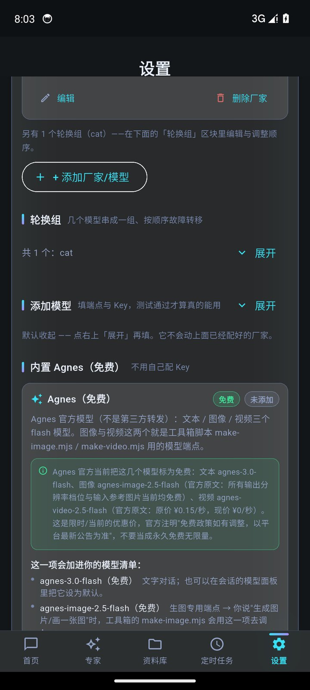
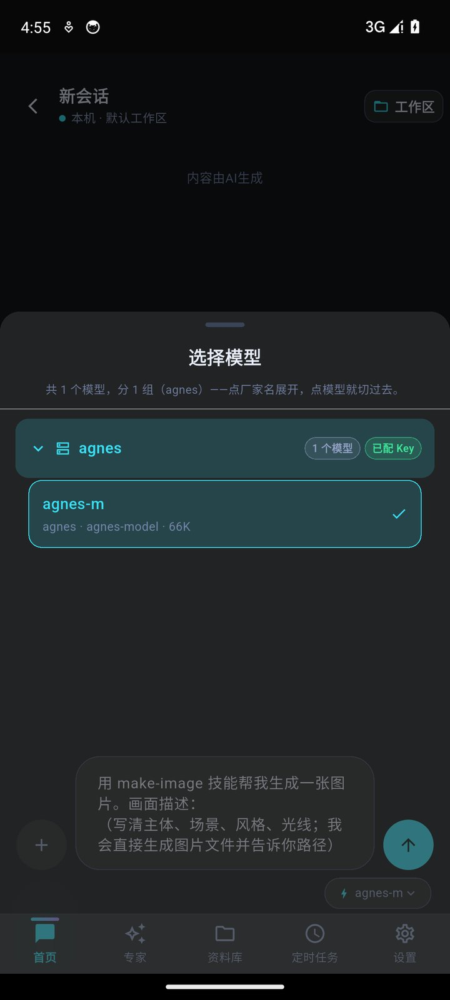
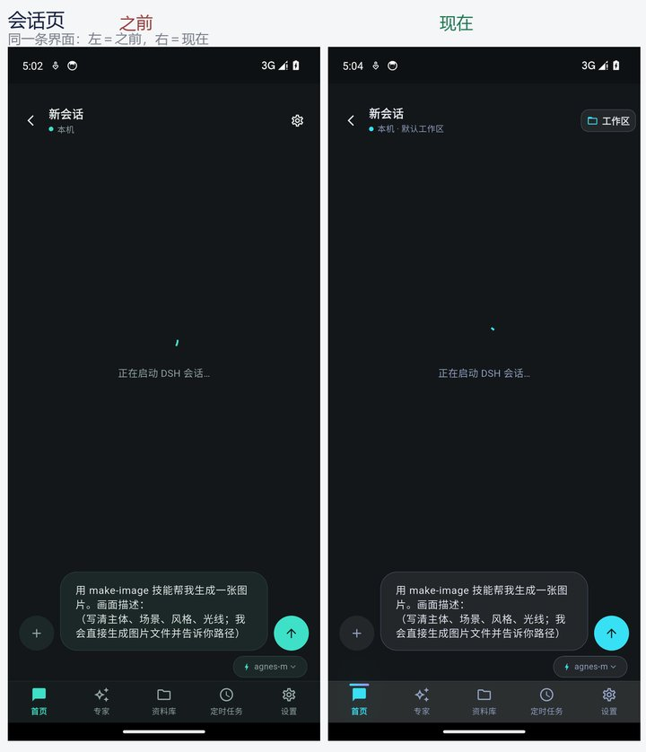
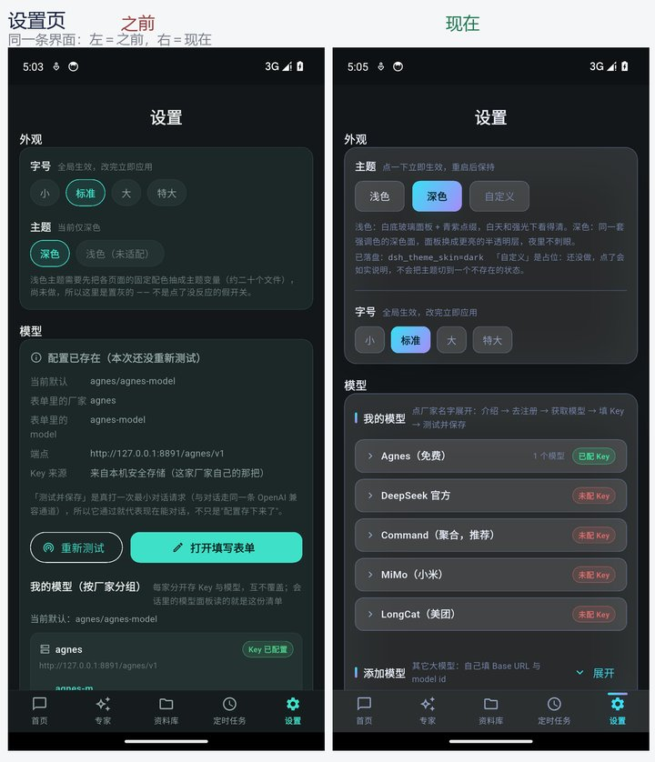
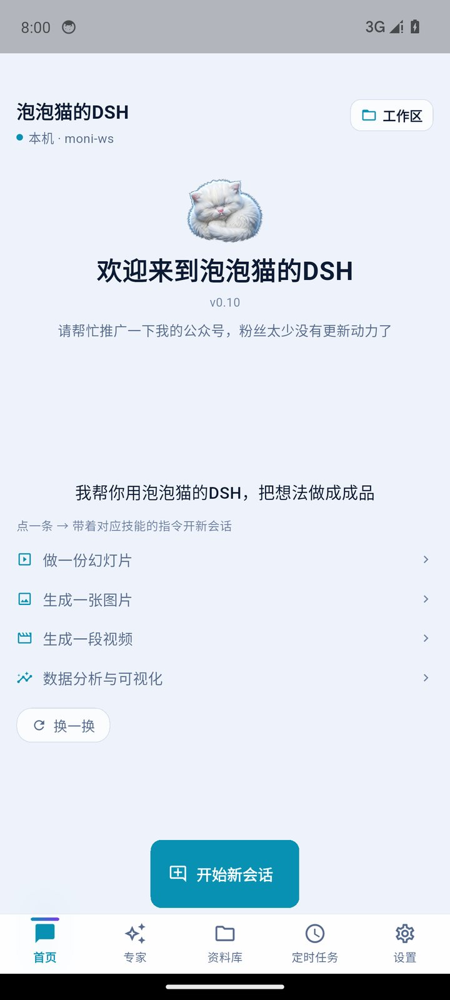
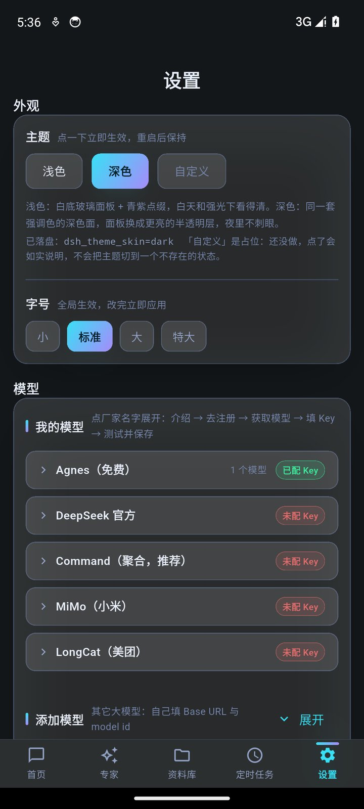
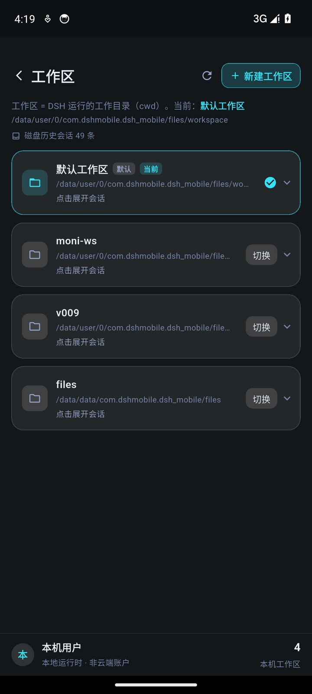
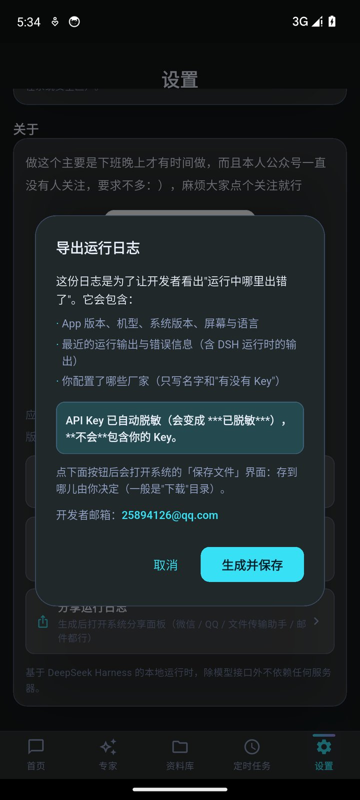

# paopaocat deepseek harness-mobile

> 手机上的 DeepSeek Harness —— 把整套 DSH 运行时装进 Android，完整能力、完整文件系统，全部在你自己的手机里。除了调模型那一步，不依赖任何服务器。



## 它是什么

DSH 是一套能在本机跑起来的 AI Agent 运行时，能读写文件、执行任务、调用工具、维护多轮上下文。

这个 App 做的是：**把一整套 DSH 运行时原封不动塞进 Android 应用**——内嵌 Node 运行时与全部依赖（`libnode.so` 约 47 MB + `dsh-runtime.zip` 约 33 MB），首次启动自动解压到应用私有目录，之后**完全离线运行**（只有与模型对话时才联网）。

它不是网页套壳，也不是远程桌面。关掉网络，它的界面、历史、文件都还在你自己的手机上。

- 包体：`paopaocat-preview-0.81-20261030-full-arm64-v8a.apk` · **113.0 MiB** · arm64-v8a · minSdk 24
- 最新版下载：见 [Releases](https://github.com/zmm863-commits/paopaocat-deepseek-harness-mobile/releases)；`update.json` 供 App 内「检查更新」使用
- 内核：Flutter + Node · 321 名专家 / 22 分区 · **23 个技能**（生图、生视频、幻灯片、画图表、前端设计、文档协作、文档处理、表格整理、翻译润色、数据分析、小说改游戏…）
- 隐私：API Key 只存 Android Keystore，会话与产出在私有目录，执行前需你确认

## 安装

- 真机 arm64，允许安装未知应用
- 安装后首次启动会解压运行时（约 30 秒），之后即可离线使用
- 仅 arm64-v8a 单架构包，x86/armeabi 设备不兼容

```sh
# 校包体
sha256sum paopaocat-preview-0.81-20261030-full-arm64-v8a.apk
# 预期: 42d46a1d80add944614cc5d1b627056d7d17baabdbdd7fa38023165181f403de
```

## 快速开始

1. **配模型**：设置 → 选 DeepSeek 官方 / Command / LongCat / MiMo（端点已预填）→ 填 Key → **获取模型** → 勾选 → **测试并保存**（会真打一次最小对话，通了才显示已就绪）
2. **开会话**：首页 **开始新会话** → 输入需求 → 看流式回显、工具调用卡片、产物卡片；可 **中断/继续**
3. **用专家与技能**：专家中心开需要的专家（开关真写运行时配置）→ 回会话提需求；也可直接让模型“帮我生成一个技能”
4. **收文件**：会话产出自动进 **资料库** → **工作区** 多目录并行；需定时则建任务（每天/工作日/每周/仅一次），到点自跑（依赖常驻通知，受国产 ROM 省电策略影响可能标“已错过”）
5. **附件**：拍照（系统相机→私有目录）/ 相册选图视频 / 任意文件（给真实路径可被模型读取）/ 语音（调系统识别，质量取决于本机服务）

## 更新日志

每个版本的改动、校验值与下载，都在 [Releases](https://github.com/zmm863-commits/paopaocat-deepseek-harness-mobile/releases) 里。

**0.81（本版）**：电脑访问收口 —— 断了看得懂（浏览器不再是白屏，会说明原因、手机恢复后自动连回来）、
等的时候看得见（四段进度 + 已等秒数）、打开少打字（新增「扫码打开」）。顺带修掉 0.80 的三处问题：
设计站启动失败会连累保活服务、英/日/韩界面漏翻 23 条、App 内 0.80 更新说明只有 5 条。

**0.80**：「移动桌面平台」上线 —— 手机当主机，电脑一个浏览器就能用。
设计站同步改造：写作台免选文件夹、全面板可自选厂家 + 模型、封面可直接出图；并下架了跑不通的口播。

## 已知限制

- 后台常驻通知依赖系统省电策略，部分国产 ROM 会杀进程，错过的任务会标“已错过”
- 仅 arm64-v8a，单包 113.0 MiB
- 首次启动（或清过数据后）要先解包运行环境，**等 40~80 秒**才算就绪
- 「移动桌面平台」要求手机和电脑在**同一张网**（USB 网络共享或同一个 Wi-Fi）；电脑端断线时页面会显示说明并自动重连
- 插件安装暂未开放（需先做完安全校验与回滚机制，设置 → 插件页已如实说明）
- 语音**识别**未内置（质量取决于本机识别服务）；语音**合成**自 0.73 起自带一档（中文模型按需下载，约 31.5 MB）

## 截图

| | | | |
|---|---|---|---|
|  |  |  |  |
|  |  |  |  |

*本文所有截图均来自真机实拍，未做美化（由 `紧急更新.html` 内 10 张 base64 导出，节选 8 张 720 系列作商店主图）。*

## 相关

- 桌面版：`dshpack-017`（Win/macOS）
- 预览图文稿：`公众号-泡泡猫DSH预览版.md` / `紧急更新.html`
- 反馈：GitHub Issues（仓库建好后）

## License

MIT
