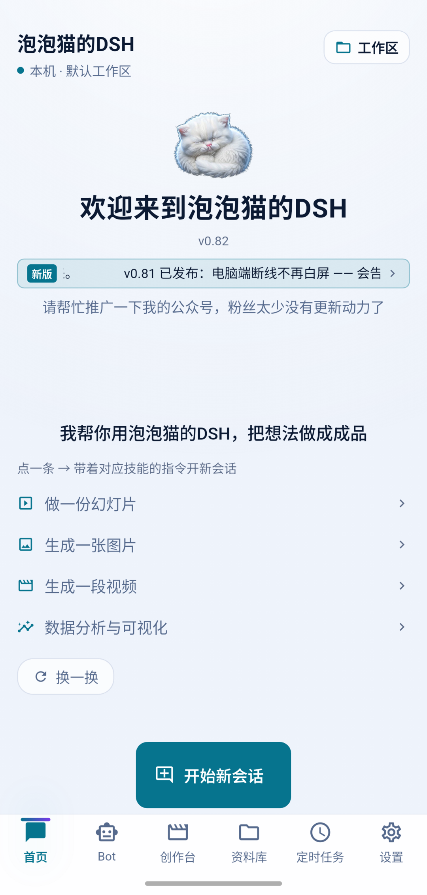
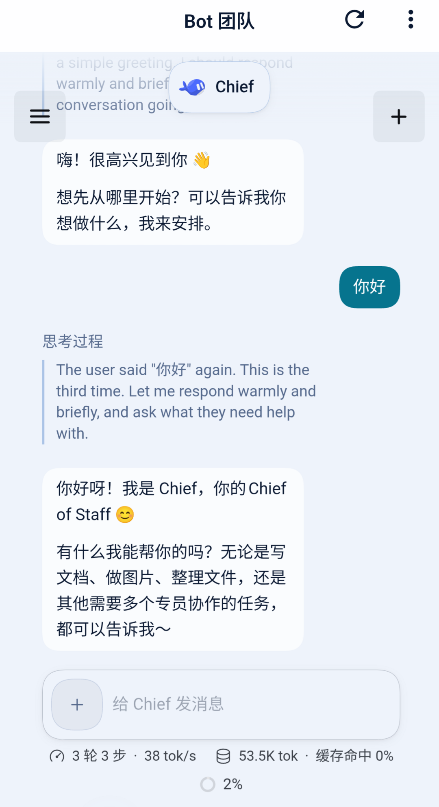
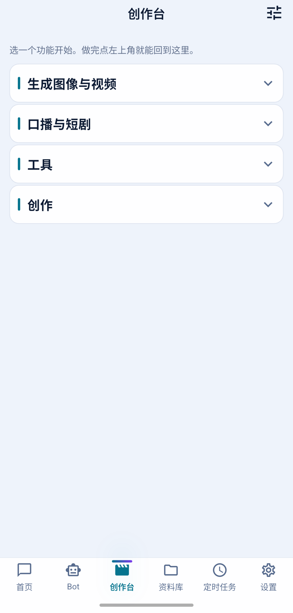
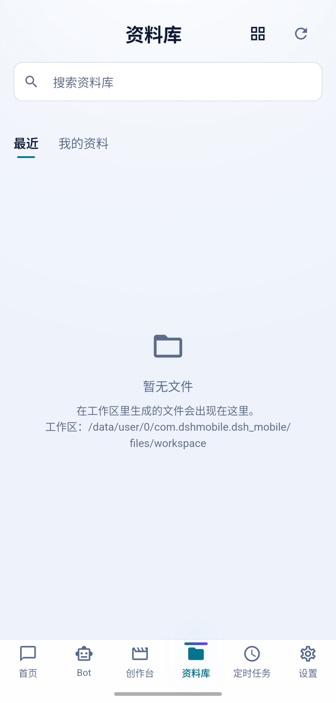
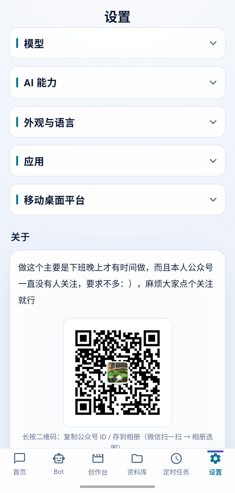
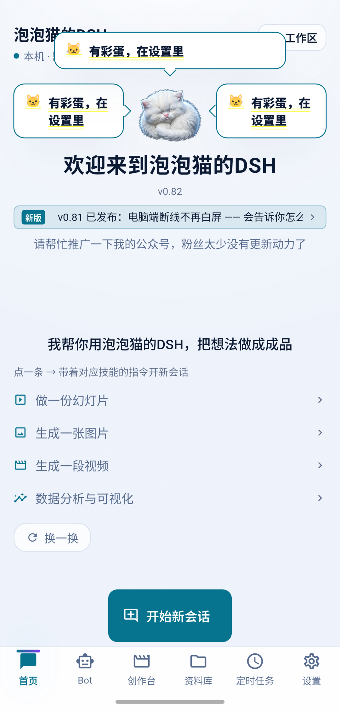

# 泡泡猫 · DeepSeek Harness 手机版

> 把一整套 DeepSeek Harness（DSH）智能体运行时原封不动搬进 Android。
> 除了调模型那一步，不依赖任何服务器。手机断网，技能、专家、记忆、工具调用全都在。

<p align="center">
  
  
  
</p>

**一句话技术身份**：引擎零补丁的整机搬运。Termux 的 node 二进制伪装成 `libnode.so`，DSH 运行时打 zip 当资产塞进 APK，首启解压到私有目录，之后完全离线跑。三个 shim（合计 114 行）填平 Android 与 glibc 的沟壑——**桌面版引擎怎么演进，手机端换个 zip 就跟上，不欠上游任何维护税**。

| | |
|---|---|
| 包体 | 113 MB（`libnode.so` 47 MB + `dsh-runtime.zip` 33 MB） |
| 架构 | Flutter + 内嵌 Node · arm64-v8a · minSdk 24 |
| 引擎改动 | **零补丁**，桌面版 DSH 原样打包 |
| 通信 | ACP over stdio（JSON-RPC 2.0），不是 HTTP 套壳 |
| 规模 | 89,031 行 Dart（测试另 25,369 行）· 267 个提交 · 285 份文档 |
| 许可 | MIT |

## 目录

- [为什么做这个](#为什么做这个)
- [一行命令的旅程：架构](#一行命令的旅程架构)
- [三个 shim 就是全部平台智慧](#三个-shim-就是全部平台智慧)
- [界面](#界面)
- [和同类项目的分野](#和同类项目的分野)
- [安装](#安装)
- [快速开始](#快速开始)
- [已知限制](#已知限制)
- [文档](#文档)
- [关注](#关注)

---

## 为什么做这个

起点是一句原话：**「DSH 有没有手机版？」** 答案是「没有」，于是自己做。

要求只有一条，也是最难的一条：**独立运行**。不是遥控电脑的客户端，不是网页套壳，是把整个引擎搬进手机。

动手前摆过三条路：

| 路线 | 做法 | 死穴 |
|---|---|---|
| A | 用 Go / Kotlin 原生重写一个 Agent 框架 | 重写等于另起炉灶，桌面版每次演进都要双线跟进 |
| B | WebView 远程方案，手机连跑着 DSH 的电脑 | 依赖电脑，不是「手机版」是「遥控器」 |
| **C（选定）** | **整机搬运**：Node 伪装成 libnode.so + DSH 运行时打 zip | 包体大、首启要解压 40~80 秒 |

选 C 的理由事后看是唯一对的：它把「开发一个 Agent App」降级成了「开发一个壳 + 做好运行时搬运工程」。前者是无底洞，后者是有限问题。

**33 天，82 个版本号**。版本号涨得比功能快，是因为一条规矩：只要产物给过用户一次，下次改动版本号 +1，不省号。

---

## 一行命令的旅程：架构

```
┌──────────────────────────────────────────────────────┐
│  UI 层（Flutter）                                      │
│  app/lib/ui/ — 页面、组件、主题、四语 i18n               │
├──────────────────────────────────────────────────────┤
│  领域层（Dart）                                        │
│  protocol · state · storage · data · local            │
│  ACP stdio 客户端 / 模型仓库 / Keystore / 运行时封装     │
├──────────────────────────────────────────────────────┤
│  运行时层（Node）                                      │
│  libnode.so + dsh-runtime.zip → filesDir/dsh/         │
│  DSH Agent 循环 · MCP 探活 · 技能执行 · 工具箱          │
├──────────────────────────────────────────────────────┤
│  原生层（Android Kotlin / 鸿蒙 ArkTS）                 │
│  解压宿主 · 前台服务 · Keystore · phone-agent · 通知    │
└──────────────────────────────────────────────────────┘
```

用户在输入栏敲一句话，走的是这条链：

1. **UI 层** → 消息进 `state` 层的会话模型
2. **领域层** → `local/acp_client.dart` 编码成 JSON-RPC 2.0，写进与 DSH 进程相连的 stdio 管道
3. **运行时层** → DSH 进程（`node --require fsShim --require execShim dsh --profile acp …`）进入 Agent 循环
4. **回程** → `agent_message_chunk` / `thought` / `tool_call` / `tool_call_update` / `usage_update` 五种 update 归一化成统一事件流，驱动 UI 局部重绘
5. **审批** → 工具要提权时发 `session/request_permission`，Dart 侧弹审批卡，用户点允许/拒绝原路返回
6. **产物** → 落在私有目录工作区，资料库扫描自动收纳

**为什么是 ACP 而不是自研协议**：ACP 独有 `session/cancel`、`session/list`、`session/resume`，以及唯一能做手机端审批的 `session/request_permission`。自研协议要么把这四个能力重新发明一遍，要么砍掉它们。用户点得最多的「停止生成」和「恢复会话」，就是靠 `session/cancel` + `session/resume` 撑起来的。

整条链路只有两层：**Flutter ↔ ACP ↔ DSH**。没有 HTTP 桥，没有中间层替你把 cancel / resume / 审批重新表达一遍。

---

## 三个 shim 就是全部平台智慧

Android 和标准 Linux 之间有几道沟，整机搬运的全部难点就在填这几道沟：

| shim | 解决什么 |
|---|---|
| `android-fs-shim.cjs` | SELinux 禁硬链接 → `fs.link` 失败时按错误码降级为 `COPYFILE_EXCL` 复制 |
| `android-shim-flock.js` | bionic/musl 没有 `flock` → no-op（很多 npm 包直接依赖它） |
| `android-shim-require-builtin.js` | 配合 `--expose-internals` 才能拿到 node 内置模块 |

加起来 **114 行，四个月没改过**。如果只让留一个给别人看的东西，我留这三个文件。

打包侧同样有三件真功夫：`normalize-runtime-libs.mjs` 补 SONAME 别名（Termux 的符号链接在 Windows 打包机上会丢）、`prepare-jnilibs.mjs` **真解析 ELF 的 .dynamic/.dynstr 取 DT_NEEDED** 递归收依赖（不猜扩展名）、`slim-runtime-zip.py` 把 152 MB 瘦到 33 MB 且逐包校验入口。

---

## 界面

<p align="center">
  
  
  
</p>

底部 6 个 tab：**首页 / Bot / 创作台 / 资料库 / 定时任务 / 设置**。

值得一提的几个：

- **Bot 团队**：WebView 打开手机本机跑着的 `dsh web`（含 ds-bot 插件）。刻意不重写界面——体验目标就是「和桌面版一样」，只有用同一套前端才可能一样。首次启动 10~25 秒，如实显示进度与最后一行日志，不做假动画。
- **创作台**：生图 / 生视频 / 修图 / 口播 / 短剧 / 作品六个模式。多厂家适配（Agnes / OpenAI / 豆包 / 硅基流动 / MiniMax / 通义万相），**档位从厂家矩阵取、不写死**——这家没有的那一项直接不显示。
- **泡泡猫助手**：免装 Shizuku。用手机「无线调试」的 6 位配对码，AI 在一块看不见的虚拟屏里替你操作手机，主屏完全不受干扰。
- **移动桌面平台**：手机当主机，电脑浏览器当屏幕。算力和数据全在口袋里，电脑只是显示器 + 键盘。
- **彩蛋**：首页那只猫连点 7 下（左上右三个泡泡）。

---

## 和同类项目的分野

社区里另一个同类项目走的是 **PRoot 容器**路线：完整 Ubuntu rootfs + 打过 15 个补丁的引擎，跑在容器化的 Linux 环境里。它的环境完整度、供应链工程、CI 基建都比我重，值得尊敬。

两条路线各拿走一样对方拿不走的东西：

| 维度 | 本项目（libnode 内嵌） | PRoot 容器路线 |
|---|---|---|
| 引擎改动 | **零补丁**，桌面版 zip 原样 | 15 个补丁 + pins.json 钉版本 |
| 环境完整度 | 只有 Node 与随包依赖 | **完整 Linux 环境**，能力天花板更高 |
| 性能 | 原生 syscall，无转译层 | 有 syscall 转译开销 |
| 升级路径 | 换 runtime.zip，零成本 | 换 rootfs + 重打补丁 |
| 包体 | 113 MB 单 Node 进程 | rootfs 全量常驻 |

一句话：**它赢了广度（能跑任意 Linux 工具链），我赢了零成本升级和会话直驱**。想研究「怎么把重运行时 App 的升级成本降到零」，看本项目的 `install/` 和三个 shim。

完整的十三维对比（含协议层、供应链、安全模型、文档工程、媒体栈、插件生态、许可证 MIT vs AGPL-3.0）写在 [技术文档 §8](docs/开源技术文档.md)。

---

## 安装

- 真机 arm64，允许安装未知应用
- 安装后首次启动会解压运行时（**40~80 秒**，一次性），之后即可离线使用
- 仅 arm64-v8a 单架构包，x86/armeabi 设备不兼容

下载见 [Releases](https://github.com/zmm863-commits/paopaocat-deepseek-harness-mobile/releases)；`update.json` 供 App 内「检查更新」使用。

```sh
# 校包体
sha256sum paopaocat-preview-0.82-*-full-arm64-v8a.apk
```

---

## 快速开始

1. **配模型**：设置 → 选 DeepSeek 官方 / Command / LongCat / MiMo（端点已预填）→ 填 Key → **获取模型** → 勾选 → **测试并保存**（会真打一次最小对话，通了才显示已就绪）
2. **开会话**：首页 **开始新会话** → 输入需求 → 看流式回显、工具调用卡片、产物卡片；可 **中断/继续**
3. **用专家与技能**：321 名专家 / 22 个分区，开关真写运行时配置；24 个随包技能（生图、生视频、幻灯片、画图表、前端设计、文档处理、表格、翻译、数据分析、小说改游戏…）
4. **收文件**：会话产出自动进 **资料库**；**工作区** 支持多目录并行；需定时则建任务（每天 / 工作日 / 每周 / 仅一次）
5. **附件**：拍照 / 相册 / 任意文件（给真实路径可被模型读取）/ 语音

---

## 已知限制

- 后台常驻通知依赖系统省电策略，部分国产 ROM 会杀进程，错过的任务会标「已错过」
- 仅 arm64-v8a，单包 113 MiB
- 首次启动（或清过数据后）要先解包运行环境，**等 40~80 秒**才算就绪
- 「移动桌面平台」要求手机和电脑在**同一张网**（USB 网络共享或同一个 Wi-Fi）；电脑端断线时页面会显示说明并自动重连
- 插件安装暂未开放（需先做完安全校验与回滚机制，设置 → 插件页已如实说明）
- 语音**识别**未内置（质量取决于本机识别服务）；语音**合成**自 0.73 起自带一档（中文模型按需下载，约 31.5 MB）
- iOS 版没有启动，短期内也不会启动——平台硬约束（禁 JIT、禁沙箱内执行二进制）和「整机搬运」这条路在根上冲突。鸿蒙线只打通了 Bot 子集，如实标注未完成

---

## 文档

| 文档 | 内容 |
|---|---|
| **[开源技术文档](docs/开源技术文档.md)** | v0.09 → v0.82 全史（9 章）：立项决策现场、四层架构、每个版本踩过的坑与真根因、专项复盘、底层技术剖析、代码质量自评与三大「沉默缺陷」、与同类项目的十三维对比 |
| [开源准备清单](docs/开源准备清单.md) | 发布前 checklist，按阻塞级别排序 |

技术文档里我认为最值得看的三节：

- **§3.3 本地大模型五轮攻坚** —— 一个功能连修五个版本，每一轮都是「失败是静默的，成功是假设的」。
- **§4.1 泡泡猫助手** —— 免装 Shizuku 的八个真机坑，从 R8 裁掉 BouncyCastle 到虚拟屏的 `com.android.shell` context。
- **§8 与同类项目的底层对比** —— 十三个维度，每条先讲对方强在哪，再讲我强在哪，最后说清代价。

---

## 关注

这个项目是我下班之后一个人做的，更新节奏全看有没有人用。公众号里会发版本更新、踩坑实录和一些没写进文档的东西。

<p align="center">
  
</p>

<p align="center"><sub>微信扫一扫 → 相册选图</sub></p>

---

## License

MIT —— 随便 fork、改、商用、闭源再发布，保留版权声明即可。

真机截图、技术文档与代码同许可。文中提到的第三方组件（Termux node、sherpa-onnx、ML Kit、BouncyCastle 等）各自遵循其原始许可，详见 [docs/第三方许可.md](docs/第三方许可.md)。
