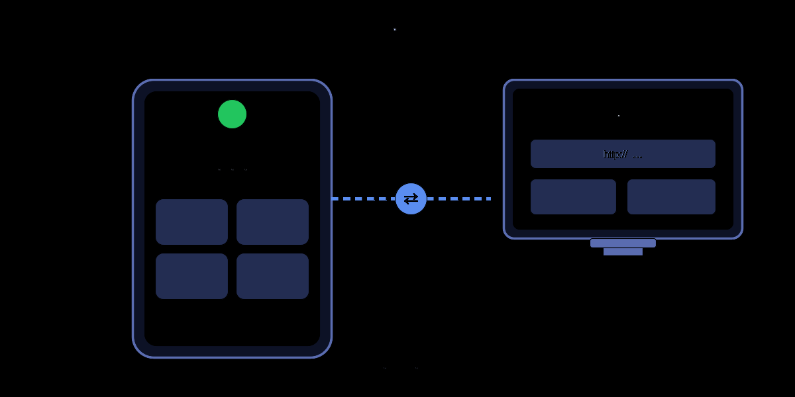
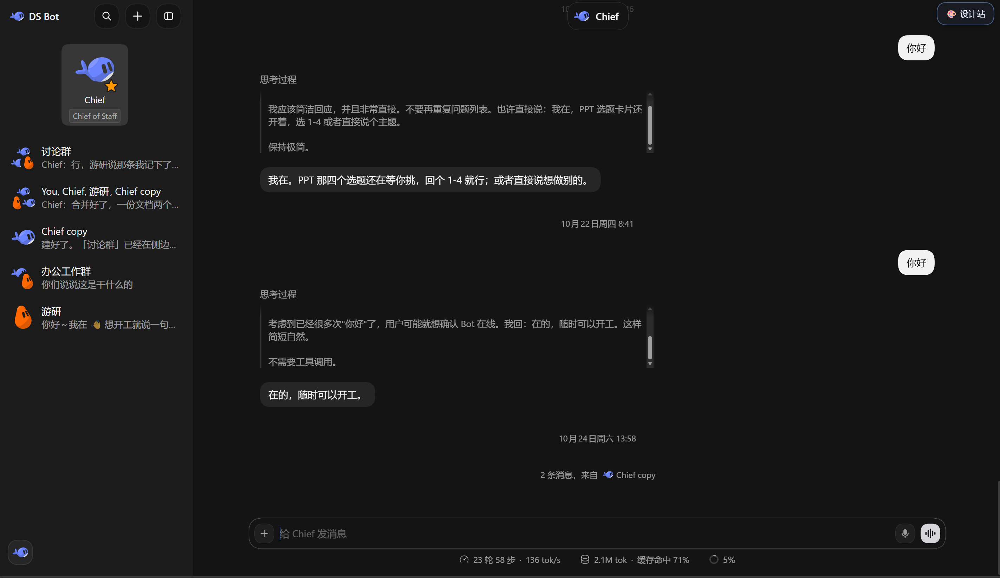
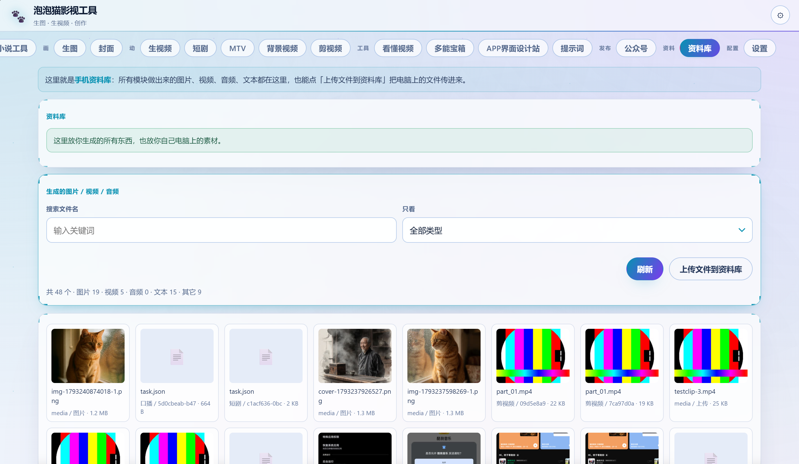
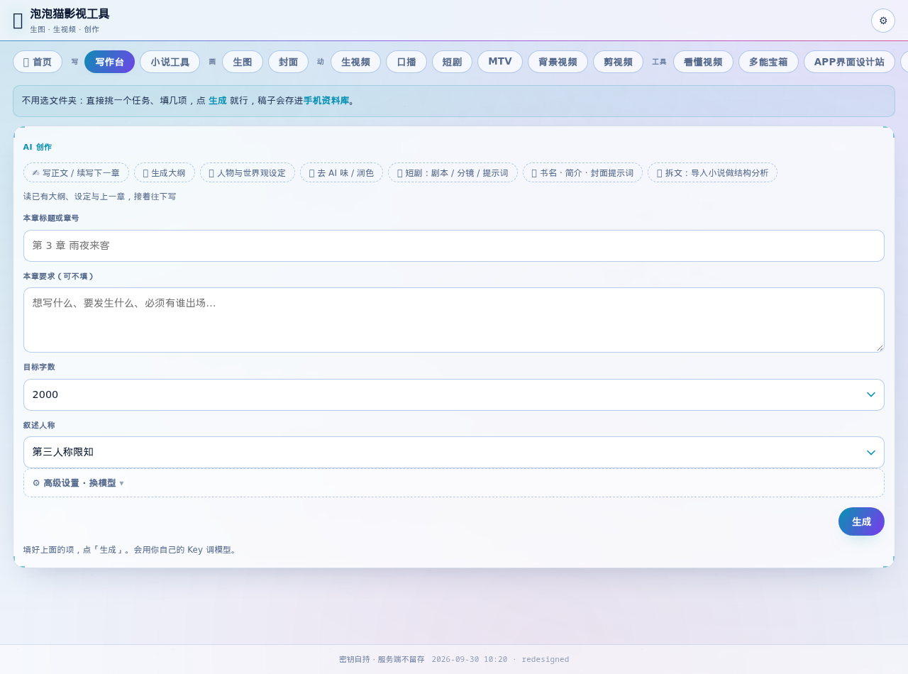

# 你的手机，就是一台随身电脑

> 泡泡猫 DSH 0.80 · 全新功能「移动桌面平台」

---

出门在外，总有这种尴尬：

想用电脑上那些好用的 AI 工具，可身边只有一部手机。
文件在电脑里、模型在电脑里、写了一半的稿子也在电脑里——
人却不在电脑旁边。

这一版，我们把这件事彻底解决了。

**让手机变成那台电脑，电脑变成一块屏幕。**

---

## 这是什么？

一句话：**「移动桌面平台」——手机当主机，浏览器当显示器。**

以前，AI 是住在电脑里的，手机只是隔着网看它一眼。

现在反过来：**模型、数据、工具、你的稿子，全装进手机里。** 电脑（甚至另一台手机）不用装任何东西，打开浏览器、输一个网址，就接上来了。

*左边是手机：模型、数据、工具、稿子全在里面。右边是电脑：只是一块屏幕。中间那根线，就是「同一张 Wi-Fi」。*

---

## 三步上手，零门槛

**第一步**：打开手机 App，进「设置」。

**第二步**：找到「**移动桌面平台**」，打开开关。

**第三步**：它给你一个网址，去电脑浏览器打开 —— 完事。

> 网址里带一串口令，那相当于钥匙，**别发给别人**就行。

之后电脑上会出来一整套工具：写稿、生图、生视频、做封面、剪视频……全都能在电脑上点，**但真正在跑的是你手机里的 AI**。

---

## 你的手机里，其实早就住着一整套办公环境

很多人不知道：手机 App 里本来就有一套完整的东西在跑。
「移动桌面平台」做的事，是**把这套东西搬到你眼前的大屏幕上**，不用你重新学一遍。

**① Bot 页 —— 你的 AI 团队就住在手机里**

这是手机 App 的 Bot 页。左边是团队成员：Chief（你的幕僚长）、游研、办公工作群……你可以建自己的 Bot、拉群、派活。

注意右上角那个 **「🎨 设计站」按钮** —— 点它就是移动桌面平台。手机上点进得去，电脑上开网址也进得去，**是同一个地方**。

*图里 Chief 正在回话：「PPT 那四个选题还在等你挑，回个 1-4 就行」—— 它记得你上次聊到哪，随时能接着干。*

**② 资料库 —— 48 个文件，真的都在手机里**

这是移动桌面平台的资料库页面（电脑上打开的样子）。看这行统计，最能说明问题：

> **共 48 个 · 图片 19 · 视频 5 · 音频 0 · 文本 15 · 其它 9**

生成的猫、做好的封面、剪好的片段、导出的文稿——**全都存在你手机里**，一张都没上传到别人服务器。

电脑连上来，看到的就是这一柜子东西，直接能用。想在电脑上放个文件进来？点「上传文件到资料库」就行。

---

## 电脑连上后，能干什么

*这是电脑连上手机后看到的界面（写作台）。不用选文件夹、不用装软件，点开就能写，稿子自动存回手机。*

写小说、生图、生视频、做封面、剪视频、看懂视频、做公众号……
这些功能以前手机上都讲过，不重复了。

**这一版的重点不是「多了什么功能」，而是：**
**这些功能，现在能在大屏幕上用了，而且算力还是你手机出的。**

---

## 为什么值得你用它

**① 东西跟着你走，不跟着电脑走**

你在手机上配的模型、传的资料、生成的图，全在手机里。
换台电脑、去趟外地，接着用，不用重新配。

**② 电脑彻底减负**

电脑上不用装 App、不用配环境、不用登录一堆账号。
一台裸机、一个浏览器，就够了。

**③ 一台手机，全家共用**

同一张 Wi-Fi 下，谁都能用浏览器连上来。
手机是你的，工作台是共享的。

**④ 隐私在你自己手里**

模型、Key、数据都存在你自己手机里，不经第三方服务器。
你的东西，始终是你自己的。

---

## 一句话记住它

> **把 AI 装进口袋，走到哪，办公环境就跟到哪。**

这就是「移动桌面平台」—— 让你的手机，真正变成一台随身的 AI 电脑。

---

*公众号：泡泡猫（ID：paopaocat888）*
*新功能试用中，欢迎来聊聊你的用法。*

---

<!--
  配图清单（发布时按序插入，共 4 张）：
  1. 01-概念图-手机当主机.png        —— 示意图（已生成）
  2. 03-Bot团队页.png                —— 手机 Bot 页实拍（用户提供）
  3. 04-资料库.png                   —— 移动桌面平台资料库实拍（用户提供）
  4. 02-电脑端界面-写作台.png        —— 电脑浏览器连上后的实拍
-->
