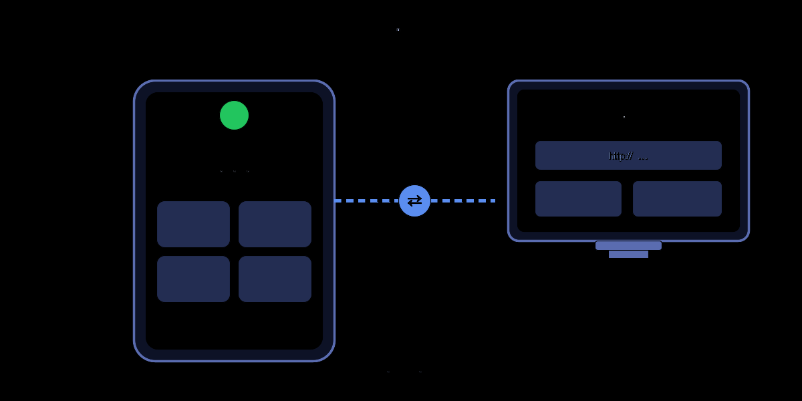
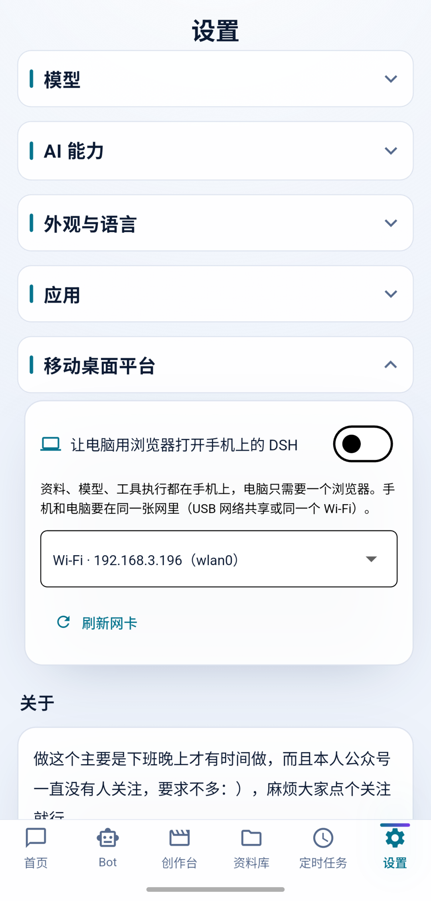
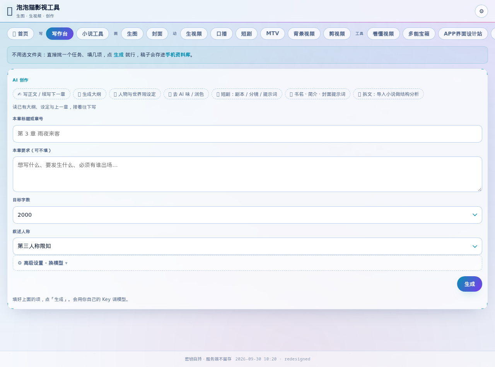
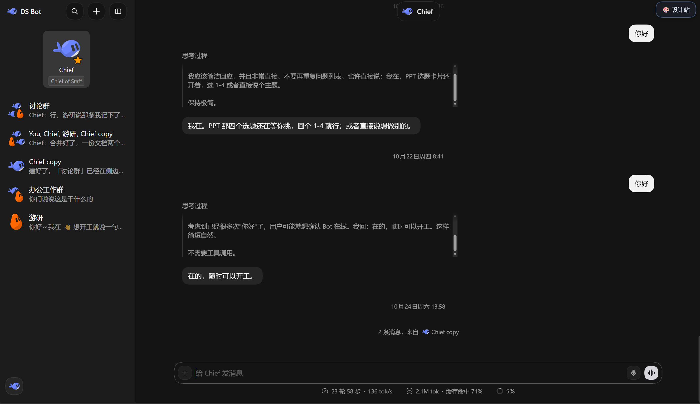
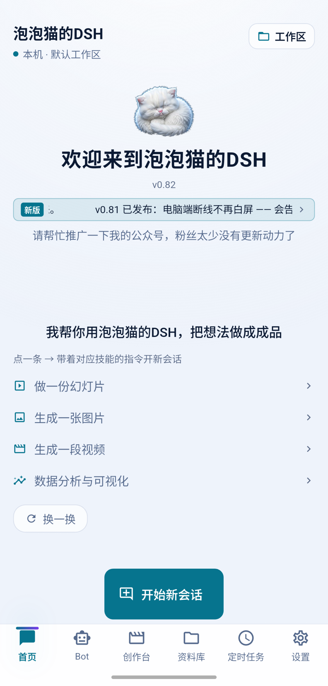
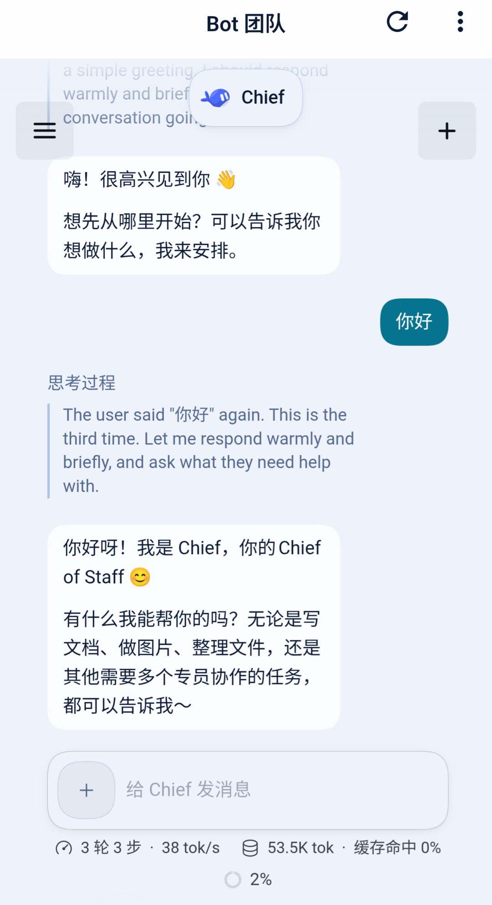
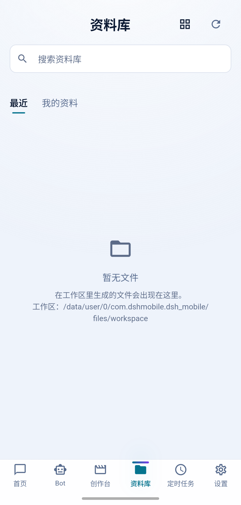
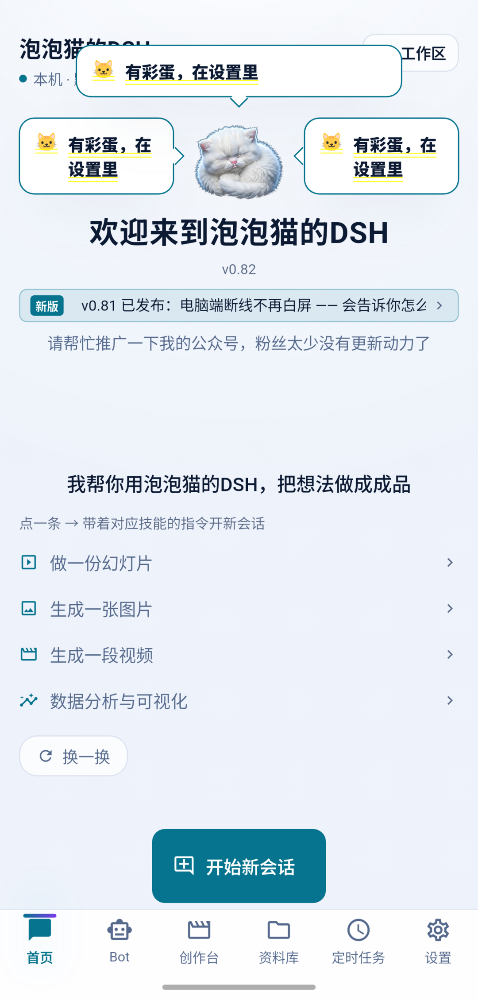

# 泡泡猫 DSH Mobile 开源技术文档

> **本项目是第三方开源项目，与 DeepSeek（深度求索）官方没有任何关系。**
> 「DeepSeek」「DeepSeek Harness」「DSH」是各自权利人的商标或产品名，这里只用来说明本项目跑的是哪套引擎。


> paopaocat deepseek harness-mobile · v0.09 → v0.82 全史
>
> 这不是产品介绍。我是泡泡猫，这个 App 的作者——从2号有想法立项到今天33天，经历了82个版本的更迭。今天决定彻底全量开源，希望把这个项目走的弯路和走过的坑给大家全部亮出来。


---

## 目录

- [0. 卷首](#0-卷首)
- [1. 立项：为什么要做手机版](#1-立项为什么要做手机版)
- [2. 系统架构总览](#2-系统架构总览)
- [3. 版本演进史与踩坑实录（0.14 → 0.83）](#3-版本演进史与踩坑实录014--083)
  - [3.1 0.09～0.14：可行性验证期](#31-009014可行性验证期)
  - [3.2 0.15～0.23：野蛮生长期](#32-015023野蛮生长期)
  - [3.3 0.26～0.34：本地大模型五轮攻坚](#33-026034本地大模型五轮攻坚)
  - [3.4 0.35～0.73：功能沉淀期](#34-035073功能沉淀期)
  - [3.5 0.74～0.76：免费通道追逐战](#35-074076免费通道追逐战)
  - [3.6 0.77：Bot 三次方案翻转](#36-077bot-三次方案翻转)
  - [3.7 0.78：P0 战役与工程收口](#37-078p0-战役与工程收口)
  - [3.8 0.79：泡泡猫助手（phone-agent）](#38-079泡泡猫助手phone-agent)
  - [3.9 0.80～0.81：移动桌面平台](#39-080081移动桌面平台)
  - [3.10 0.82～0.83：还债与提速](#310-082083还债与提速)
- [4. 专项复盘](#4-专项复盘)
  - [4.1 泡泡猫助手：免装 Shizuku 的"手机操作手机"](#41-泡泡猫助手免装-shizuku-的手机操作手机)
  - [4.2 移动桌面平台：手机作为移动主机](#42-移动桌面平台手机作为移动主机)
  - [4.3 鸿蒙移植：打了三分之一的仗](#43-鸿蒙移植打了三分之一的仗)
  - [4.4 iOS 移植：为什么没做](#44-ios-移植为什么没做)
- [5. 底层技术剖析](#5-底层技术剖析)
  - [5.1 运行时嵌入](#51-运行时嵌入)
  - [5.2 桥接协议与 DSH 驱动](#52-桥接协议与-dsh-驱动)
  - [5.3 Dart 层](#53-dart-层)
  - [5.4 界面构造元素](#54-界面构造元素)
  - [5.5 原生层](#55-原生层)
  - [5.6 功能全清单](#56-功能全清单)
  - [5.7 各项功能详解](#57-各项功能详解)
- [6. 代码质量自评](#6-代码质量自评)
- [7. 文档资产盘点](#7-文档资产盘点)
- [8. 与 DSH Go 的底层对比](#8-与-dsh-go-的底层对比)
- [9. 综述](#9-综述)

---

## 0. 卷首

先交代三个数字：

- **33 天**（2026-10-02 立项 → 11-03 进入 0.83 开发周期）。
- **89,031 行 Dart**（不含测试，测试另有 25,369 行），**12,310 行 Node 桥接与探针**（70 个 .mjs/.js），**38 个原生文件**（16 Kotlin + 8 Java + 14 ArkTS）。
- **285 份 Markdown** 铺满整个仓库——docs/ 里 69 份正式文档（每一版的更新说明、每一场事故的根因记录、每一次发布的三源校验），其余 216 份贴在代码旁边。

三个立场声明：

1. **这里写的每一条，我自己都能指认出处。**——代码路径、文档文件名。我自己的规矩是：说不清出处的结论不写。
2. **缺点不遮掩**。第 6 章是我对自己代码的差评清单，按"出过事故没有 / 多容易出事故"排序，不按"看着不顺眼"排序。骂自己比被人骂体面。
3. **真机之外的推断我会标明**。我的项目纪律是真机验证优先（33 天里的每个坑都是真机抓的），但凡本文有从代码推断、还没上真机复现的结论，我当场说清，不冒充实测。

---

## 1. 立项：为什么要做手机版

### 1.1 一句话起源

和几个朋友晚上喝酒聊天，确立了立项：

> 「DSH 有没有手机版，我看到别人家已经出了手机版。」  
> 「可是我想开发原生 app。」  
> 「我要的是独立运行的手机版 DSH。」

**2026-10-02 08:29**——这一天就是泡泡猫 DSH 手机版的立项日。

翻译成技术语言，需求其实是三条：

1. **独立运行**：除了调模型 API 那一步联网，其他全部在手机本地。不依赖任何服务器，不能完全网页套壳，没有远程桌面。
2. **完整能力**：桌面版 DSH（以前打包的一个DSH桌面项目，win和mac双端。老梁发布桌面版后就不再更新了） 能干的——读写文件、执行任务、调工具、维护多轮上下文——手机版一样都不能少。这意味着不能自己"实现一个简化版 Agent"，必须把整套 DSH 运行时原封不动搬进手机。
3. **界面参考成熟的软件界面 （我界面设计实在不在行）**：用11 页设计稿逐页对齐，任务首页胶囊输入区贴底 87%，这些坐标至今还在 `theme/dsh_tokens.dart` 里。

### 1.2 三条路线的决策现场

动手之前摆过三条路，各自的死穴在开工那天就想清楚了：

**路线 A：用 Go / Kotlin 原生重写一个 Agent 框架。**  
死穴：DSH 的能力面 = 它的运行时生态（MCP 工具、技能脚本、插件、Python/Node 工具箱）。重写等于另起炉灶。这条路是给自己挖坑，pass。

**路线 B：WebView 远程方案。** 手机连一台跑着 DSH 的电脑，WebView 显示 Web 界面。  
死穴：违反第 2 条需求——它依赖电脑。后来 0.77 做 Bot 时在这个方案上翻过车又翻回来，见 3.6 节。但立项时它就不是候选，pass。

**路线 C（选定）：整机搬运。** 把 Node 运行时（libnode.so）+ DSH 全部依赖（dsh-runtime.zip）当资产塞进 APK，首启解压到应用私有目录，之后完全离线跑。  
代价是包体 113 MB（当时 187 MB，后来差分更新与瘦身一路压下来）、首启 40～80 秒解压等待；换来的是**桌面版 DSH 每次演进，手机版只需要重新打包运行时，一行核心代码不用改**。

事后看，路线 C 是这个项目 33 天能活下来的唯一原因。它把"开发一个 Agent App"降级成了"开发一个 Agent App 的壳 + 做好运行时搬运工程"。前者是无底洞，后者是有限问题。

### 1.3 0.09 之前：可行性验证

正式编码前有一份 `docs/ANDROID-LOCAL-VERIFICATION.md`，记录了四个平台障碍的验证结论；对应的打包方案落在 `docs/ANDROID-LOCAL-PACKAGING.md`，里面记了 8 个踩坑。这段历史在 git 化（2026-10-05，init v0.14-preview）之前，靠这两份文档和 `docs/RELEASE-0.09.md`（我实测反馈 10 条逐条对照 + 7 个"不修就会发版翻车"的真 bug）续命。

其中最有含金量的一个验证：**Android 能不能跑完整的 Node？** 答案是把 Termux 的 node 二进制伪装成 `libnode.so` 塞进 jniLibs（绕过 Android 只允许加载 so 的限制），配上三个 shim（后面 5.1 节细讲）。这个方案从验证那天起用到现在，没换过。

---

## 2. 系统架构总览

### 2.1 四层结构

```
┌─────────────────────────────────────────────────────┐
│  UI 层（Flutter）                                     │
│  app/lib/ui/ — 页面、组件、主题、i18n                  │
├─────────────────────────────────────────────────────┤
│  领域层（Dart）                                       │
│  app/lib/protocol · state · storage · data · local   │
│  ACP stdio 客户端 / 模型仓库 / Keystore / 运行时封装  │
├─────────────────────────────────────────────────────┤
│  运行时层（Node）                                     │
│  libnode.so + dsh-runtime.zip → filesDir/dsh/        │
│  DSH Agent 循环 · MCP 探活 · 技能执行 · 工具箱        │
├─────────────────────────────────────────────────────┤
│  原生层（Android Kotlin / 鸿蒙 ArkTS）                │
│  解压宿主 · 前台服务 · Keystore · phone-agent · 通知  │
└─────────────────────────────────────────────────────┘
```

规模统计（不含 build 产物，全项目 1,507 个文件（排除 .git / node_modules / build / .dart_tool / dist））：

| 层          | 语言            | 文件数                               | 说明                       |
| ---------- | ------------- | --------------------------------- | ------------------------ |
| UI + 领域    | Dart          | 318（lib 89,031 行 + test 25,369 行） | app/lib/                 |
| 运行时搬运工程    | mjs/js/py/ps1 | 70 个脚本（12,310 行）+ 55 py + 16 ps1  | install/、bridge/、probes/ |
| 运行时本体      | Node          | 打包为 dsh-runtime.zip（v5，约 33 MB）   | 桌面版 DSH 原样               |
| 原生 Android | Kotlin/Java   | 16 kt + 8 java                    | app/android/             |
| 原生鸿蒙       | ArkTS/C++     | 14 ets + node_host.cpp 529 行      | app/ohos/、ohos-node/     |
| 文档         | Markdown      | 285（docs/ 69 + 代码旁 216）           | 全仓                       |

### 2.2 一条消息的执行完整旅程

以"帮我把这个表整理一下"为例：

1. **UI 层**：用户在 `chat_page` 的输入栏敲字发送，消息进 `state` 层的会话模型。
2. **领域层**：`local/acp_client.dart`（ACP stdio 客户端，多轮会话的关键，从第一版起就没大动过）把请求编码成 JSON-RPC 2.0，写进与 DSH 进程相连的 stdio 管道。
3. **运行时层**：DSH 进程（`node --require fsShim --require execShim dsh --profile acp …`）收到请求，进入 Agent 循环——读文件、跑工具、调模型。过程中产生的每一步（agent_message_chunk / thought / tool_call / tool_call_update / usage_update）以 ACP update 的形式往回吐。
4. **领域层**：`acp_client.dart` 五种 update 归一化成统一事件流，`state` 层驱动 UI 局部重绘——流式回显、思考过程折叠、工具调用卡片、产物卡片都是这一条流驱动的。
5. **权限审批**：工具要提权时，ACP 发 `session/request_permission`，Dart 侧弹审批卡。用户点允许/拒绝，原路返回。
6. **产物回流**：工具产出的文件落在私有目录工作区，资料库扫描工作区自动收纳。

### 2.3 为什么是 ACP 而不是自己发明协议

`bridge/README.md` 里记了决策依据：ACP 独有 `session/cancel`、`session/list`、`session/resume`，以及唯一能做手机端审批的 `session/request_permission`。自研协议要么把这四个能力重新发明一遍，要么砍掉它们。会话中断/继续（用户点得最多的按钮之一）就是靠 `session/cancel` + `session/resume` 撑起来的。

### 2.4 工程目录地图

```
dsh-mobile/
├── app/                  Flutter 工程（UI + 领域层 + android/ + ohos/）
│   └── lib/{ui,protocol,state,storage,local,data,i18n}
├── install/              构建流水线 + 验证脚本堆（148 个文件，见 5.1）
├── bridge/               PC 侧 WebSocket 桥（开发期调试用，6 个 .mjs）
├── probes/  fixtures/    ACP 行为探针与实测帧存档（桥协议的实现依据）
├── runtime-plugins/      DSH 原生插件（AnySearch web 后端）
├── ohos-node/            鸿蒙侧内嵌 Node 攻坚现场（C++/ArkTS/Dart 补丁镜像）
├── docs/                 288 个文件（69 份 md，版本史本体，见第 7 章）
├── design/  ui-review/   设计资产与界面评审
├── screenshots/          真机实拍
└── signing-agc/          鸿蒙签名材料
```

值得说明的两个"活化石"：

- **bridge/** 是早期"远程方案"的遗产，现在开发期还在用（PC 上调协议方便），App 正式链路不用它。
- **probes/ + fixtures/** 是我最得意的一处工程投资：`probes/acp-probe.mjs` 对真实 DSH 做行为实测，原始帧存进 `fixtures/acp-probe-*.jsonl`。桥协议文档里每一条"实测行为"都能指回某一行 jsonl。没有这组探针，后面所有协议层工作都是在猜。

---

## 3. 版本演进史与踩坑实录（0.14 → 0.83）

这一章是全书的主菜。33 天、267 个提交、从 0.14 到 0.83。每一节按"目标 → 坑 → 真根因 → 修复 → 学到什么"写。坑的原始记录分布在 git commit message、`docs/RELEASE-*.md`、`docs/changelog-*.md`、`docs/需求台账.md` 和 `app/lib/data/changelog.dart`（App 内更新说明）五处，这里做第一次全景汇总。

先给时间线总览：

```
2026-10-03 ── 0.09 可行性包（git 化之前，证据在 RELEASE-0.09.md）
2026-10-05 ── git init · v0.14-preview（界面照 11 页设计稿重做完）
2026-10-06 ── 0.15～0.23 九连发（一天之内 0.18→0.23，含四语化）
2026-10-07~09 ── 0.24~0.34 本地大模型五轮攻坚（见 3.3，全书最硬的一段）
2026-10-11~13 ── 0.61~0.73 桌面版全量同步 + 发布流程定型
2026-10-14~16 ── 0.75/0.76 免费通道追逐战 + 创作台
2026-10-17~19 ── 0.77 Bot 三次方案翻转（构建号 78→117）
2026-10-20    ── 0.78 P0 战役 + 差分更新（不展开）
2026-10-21~25 ── 0.79 泡泡猫助手（phone-agent，见第 4.1）
2026-10-26~30 ── 0.80/0.81 移动桌面平台（见 4.2）
2026-10-31~11-03 ── 0.82 还债 + 0.83 初始化提速
```

### 3.1 0.09～0.14：可行性验证期

靠三份文档续命：`RELEASE-0.09.md`（我实测反馈 10 条逐条对照 + 7 个"不修就会发版翻车"的真 bug）、`RELEASE-0.13.md`（模拟器端到端验证，含"修前症状 → 根因 → 证据原文"）、`RELEASE-0.14.md`（analyze 零问题 + 82 条单测 + 设备上端到端取证）。

这一段定下来的规矩比代码值钱：

- **产物必须给校验值**。从 0.09 起每个 APK 都记 sha256，发布说明里贴出来。后来 0.83 的"三源回查"（GitHub Release + update.json + 公众号文案三方核对哈希）就是这条规矩的自然延伸。
- **真机没跑过就明说没跑过**。HANDOFF.md 里有一段"⚠️ 但它没在任何 arm64 设备上跑过——交付时请明确这一点"。预览版阶段不装，开源之后这就是信誉。

### 3.2 0.15～0.23：野蛮生长期

2026-10-06 一天之内 0.18 → 0.19 → 0.20 → 0.21 → 0.22 → 0.23，每个都有 README 四语同步 + changelog + 截图。这节奏放到今天我自己都不敢信，但 git log 白纸黑字。

野蛮的代价也在同一天暴露：`revert` 提交六连——我撂下一句"先不要发仓库"，0.23 的 README 四份 + changelog 全部撤回。**版本号可以一天加 5 个，发布节奏必须听一个人的**。这条后来固化成"四步流程规矩"（见 3.3 台账 #24）。

技术上的实质进展：

- **0.19 四语化**：界面语言中/英/日/韩，从此每次改文案都是四处改（后来 i18n 计数守卫测试 1231→1833 条就是这么涨的，也因此出过"期望值停在 1833 没跟上"的守卫失灵，见 0.76 提交 1dd53d5）。
- **0.20 手机本地跑大模型**：端侧模型全景清单 + ModelScope 多源下载 + 本地文件导入。这是 3.3 节五轮攻坚的前奏。
- **0.21 云端/本地拆分**：模型页拆成「云端大模型」+「本地大模型」，按文本/多模态/图形/视频分组——直接催生了后面的分组架构。
- **0.22 选择器根因修复**："看得到、选不动"的本地模型，修了进程配置指纹漏算 local——注意只是**修了一半**，真根因在 0.24 才抓到（落盘守卫拦掉 `local/*` + 重读时回落成清单第一条）。**一半修复比不修更危险**，因为所有人都以为已经修好了。

### 3.3 0.26～0.34：本地大模型五轮攻坚

这一节值得单独成章。9 个版本、5 轮返工，每一轮的根因都来自真机日志而不是猜测。素材主体是 `docs/需求台账.md` #35~#50，以下按时间线复盘。

**第一轮（0.26）：日志里读出三个真故障。**  
我对一份真机运行日志进行分析，暴露：

1. 本地模型每句话都 `exceed_context_size` —— 根因是我把上下文写死 2048，而 DSH 光系统提示就约 7000 tokens。默认改 16384。
2. 点行崩溃 `Null check operator` —— 本地大模型页没有 Material 祖先，InkWell 水波纹直接崩。页面包 Scaffold 解决。
3. 图形引擎启动失败 —— `--model` 参数加了但伴生文件没下齐。改成按**清单声明**判整包/拆分，伴生不齐拒绝启动并说清缺哪些。

**第二轮（0.28～0.30）：性能开关四连，埋下大雷。**  
为了提速加了四个性能开关：flash-attn / KV cache q8_0 / cache-reuse / threads-batch。同时做了几件正经事：litert-lm 可行性验证（官方 Maven 依赖 + readelf 确认 .so 自包含，不装 Bazel）、会话缓存复用（引擎会话留着只发增量）、NPU 档、耗时拆"首字延迟/输出速度"两段。  
还给 Gemma 写了兼容对话模板（`lib/local/loose_chat_templates.dart`）：Gemma 官方模板只认"首条 system + 严格 user/assistant 交替"，而 DSH 会把多条 system 各自 push——实发 `[system, system, user]` 撞模板硬校验 400。做了 5 种消息形状 × 官方/兼容模板的实测矩阵。  
**雷**：`--flash-attn` 参数写法错了（`unknown value for --flash-attn: '--cache-type-k'`），整个开关组从没生效过——而当时所有人都以为在用。

**第三轮（0.31～0.32）：段错误迷雾。**  
0.31 修好参数写法，开关第一次真正跑起来——然后**在骁龙 8 Elite / Armv9 上 CPU/GPU/NPU 全段错误**（SIGSEGV，code=-11）。日志证据：短自检（27 tokens）每次都过，崩的总是真实长请求。  
0.32 先把默认改回 CPU，并加了"崩溃记录+落盘+下次自动换后端"、模型名三级兜底、数据层自愈（空名字用清单名补回并回写）。顺手修了 `toJson` 漏 `companions` 的真 bug。  
用**截图测试**（本机渲染该页出图）诊断"模型名看不到"的排版问题。

**第四轮（0.33）：推倒自己的优化。**  
三次真机日志对比后确认：崩溃与后端无关，CPU 也段错误。真凶就是 0.28 那组性能开关——它们因参数 bug 从未生效，修好参数后第一次真正运行就全线崩溃。**0.33 全部移除，回到 0.26 能跑的基础参数。**  
这一轮的教训我写在了台账里：性能优化的每一步都要有"它真的在跑"的证据，否则你以为自己在优化，其实只是在改配置文件。

**第五轮（0.34）：空回复真凶。**  
Qwen3 也"空回复"，`stopReason=max_tokens`。排查路径：测速正常（App 直发 max_tokens=48）→ 不经过 DSH → DSH 侧 clamp → `maxTokens = contextWindow - 已用 prompt - 4096(安全余量)` → overlay 里 local 模型的 `contextWindow` 写死 4096，用户 prompt 6822 tokens → available 为负 → **maxTokens 强制成 1**。  
修复：`LocalModelSpec` 加 `contextSize` 字段（默认 16384），两处建 spec 时传入，并加防回归测试钉住 16384。


五轮打完，本地大模型从"完全不能用"到"稳"。台账 #50 结尾那句话是我的原话："测速正常是因为 App 直接发 max_tokens=48 不经过 DSH 的 clamp"——**任何"测试通过"都要看它真正执行的链路**。

（本地大模型最后因为优化效果实在太差，只好放弃；0.82 版试过 MNN 引擎效果不错，打算 0.83 版本再次攻坚。）

### 3.4 0.35～0.73：功能沉淀期

这段的主线是三件事：

1. **0.61~0.71 流程定型**：测试 521 通过/0 失败成为出包门槛；三张语言表 0 漂移守卫。
2. **0.73 版本全量对齐**：之前经常在多台电脑上开发，版本号一直比较乱，这次统一了版本号。
3. **0.61 的两个典型小修**（台账 #51/#52，记录在此因为它们体现了"追问文化"）：
   - "安装以后打开的是影视页面"——根因：恢复持久化的 `lastTab`。修复哲学：冷启动一律回首页，只有**本次进程内**动过 Tab 才恢复。
   - "本地大模型显示服务没起来"——litert-lm 那条启动路径一处都没写 `lastError`，界面只能显示废话。

### 3.5 0.74～0.76：免费通道追逐战

免 Key 免费模型是这个项目最"追着上游跑"的功能。上游门禁变了 5 次，追了 5 次：

- 0.74：免费通道 403 → 根因"会话 id 必须是时间戳编码"（上游 2026-10-13 新门禁），修完立刻加了一条"会咬人的回归测试"。
- 0.75：上游第 5 次变动 → 改走 `/inference/v1`，403 专翻一条人话；同时新增 Pollinations 通道默认开启，兑现"不用填 Key 就能聊"。
- 0.76：`解析 input_modalities`（标出哪条模型能看图）、模型名跟着 DeepSeek 官方改名（V3/R1 → V4）、免 Key 通道里的模型一律算免费。

这段的两个工程动作值得单独记：

- **`docs/免费模型-方案.md` 里写了"为什么不做 IP 池"的四条理由**。对"要不要做灰色优化"这种问题，把不做的原因写下来比做出来更重要。
- **事实订正文化**：`8721383` 提交——"缺 ffmpeg 的是 10-15 那批 0.75 测试包，**正式发布的 0.75 是好的**——逐包实测订正"。发现之前的公告错了，公开订正而不是让错误版本说明继续挂着。

0.76 同时是功能大版本：修好 20 个问题、新增 17 项（含 PPT 排版层——"PPT 太朴素的真因是 bullets 版式只有一个文本框，改成卡片 + 卡片墙"；长会话助手提示；创作台按 4 组分类）。

### 3.6 0.77：Bot 三次方案翻转

0.77 是构建号最密的一版（78 → 117），主线是"Bot 团队上手机"，代价是**同一个需求换了三次技术方案**：

```
方案 1（构建号 78~80）  WebView 装桌面版 Bot 网页 ——「Bot 服务没能起来」：--patch 被当成 web app 参数
方案 2（构建号 81~101） 删掉 WebView，改用 App 原生聊天页 —— 原生方案做出来了，但 Bot 能力受限于 App 沙箱
方案 3（构建号 102~117）回到网页版方案，再逐步把短板补齐
最终（0.77 发布）       Bot 页回归 App 原生聊天页（构建号 117 之后定型）
```

三个方案各死过一次，死亡记录都在 commit message 里：

- 「★『会话建不起来』的真因 —— opencode-go 缺 api（**我上一版的方案是错的**）」（构建号 98）
- 「★『一直出现 agent 请求执行操作』的真因 —— 没配模型就没 overlay，权限预设一起丢」（构建号 99）
- 「『进去不』+ Bot 无模型 —— 两个自伤 bug」（构建号 105）
- 「黑屏真凶 —— Bot 页的 PopScope 在别的页签上抢到返回，把根路由弹掉了」（构建号 117）
- 「边缘滑动导致黑屏锁死 —— 两条返回路径统一成『退到后台』」（构建号 116）

值得记录的两个非代码产物：

- `docs/BOT-TEST.md` 开头补了"现在的实现"结构图，并且注明"前面的踩坑记录属于已废弃的 WebView 方案，容易看串"——**废弃方案的文档不删，但必须标清楚它已经死了**。
- 期间给 Bot 名册解析补了 8 个单测——"这块之前零覆盖"。翻车多的地方补测试，这个顺序是对的。

### 3.7 0.78：P0 战役与工程收口

0.78 一天之内五个 P0，全部有"真根因"级别的记录：

| 构建号 | 症状                       | 真根因                                 |
| --- | ------------------------ | ----------------------------------- |
| 121 | 本地 MCP 起不来把整个会话带崩（真机 P0） | 先探活、失败就去掉 MCP 重试                    |
| 122 | Bot 页面"回到过去"（界面状态错乱）     | 注释里的占位符被 `replaceFirst` 命中，整段注入语法错误 |
| 123 | 本地 MCP 探活一直不过（真机 6s 超时）  | 白名单漏了 Android 系统变量                  |
| 124 | 文件生成了但界面一直"正在处理"         | `running` 是裸字段，改了不通知任何人             |
| 125 | Bot 页"重新连接"是真断了一次        | 切模型重启换端口 + 拦截导航读旧地址                 |

122 那个值得单独看一眼：注释文本里的占位符被字符串替换逻辑命中——**注释也是字符串，处理文本的代码不区分代码和注释**。这类 bug 没法靠 review 防，只能靠"占位符用不可能出现在自然文本里的格式"这种防御性约定。

0.78 还有差分更新上线（构建号 126，自研 DSHDELTA v1，99 MB → 5 MB）。

### 3.8 0.79：泡泡猫助手（phone-agent）

详见 4.1 专项。时间线定位：2026-10-21 打 tag `bot-native-v0.79`，10-24~25 在 bot-rework 分支上密集开发，一天之内 14 个 fix 提交（见 4.1 的坑清单）。

### 3.9 0.80～0.81：移动桌面平台

详见 4.2 专项。10-26~30 五天，从"让 DSH 绑网卡"到"端口转发"到"地址三样全固定"，外加 431 事故和扫码打开。

### 3.10 0.82～0.83：还债与提速

**0.82（2026-11-03 发布，构建号 250）**："修 6 个老毛病、改 4 处行为、新增 5 样功能"。其中最有价值的一修：

> fix(0.82): MCP 探活漏了父环境（Office 三工具**从没挂上**的真根因）+ 日志可 adb 读

"从没挂上"四个字意味着这是一个从上线第一天就存在、直到主动巡检才发现的缺陷。它和 0.31 的性能开关（从未生效）、0.22 的选择器（只修一半）并列为这个项目三大"沉默缺陷"——都对，但都没生效，用户不报障就没人知道。0.82 的对策是把日志做到 `adb logcat` 可读，让"沉默缺陷"有暴露通道。

另有「连不上？点这里自检」：真的连一次，把故障层说清楚（Wi-Fi？服务？地址？）——这是把 0.81 移动桌面平台的"断了看得懂"哲学推广到全 App。

**0.83（进行中）**：App 初始化提速——探活并发 4→12、超时收短、加缓存快速路径（`58259dc`）。写这份文档时我在自己的骁龙 8 Elite 真机上掐了表：0.82 包冷启动到首页可交互约 15 秒内，比 README 记录的 40~80 秒好很多——但那是解压首启场景，两个数字不矛盾。

---

## 4. 专项复盘

### 4.1 泡泡猫助手：免装 Shizuku 的"手机操作手机"

**它是什么**：App 里内置的一个"屏幕助手"，能让 Agent 替你操作手机——比价、查票这类流程，不用你一步步点。名字就叫「泡泡猫」（0.24 提交：屏幕助手改名「泡泡猫助手」+ 比价/查票流程 + 免装配对端口）。

**它解决的核心矛盾**：Android 想让一个 App 替用户点别的 App，官方路径是无障碍服务（AccessibilityService），但那条路用户体验差（要进系统设置开服务、容易被杀、状态不同步）；更好的路径是 Shizuku（ADB shell 级权限），但要求用户先装 Shizuku 并手动配对——对普通用户是劝退级门槛。

**作者决策**：0.79 干脆把 Shizuku 的核心能力**内置**——`1148358` 提交原文："免装 Shizuku —— 内置无线调试配对，自建 shell 引擎 dex"。用户只需要填配对码，配对流程全在 App 里走完。这是一次"把依赖变成功能"的典型决策：与其教用户装 Shizuku，不如把 Shizuku 干的事（无线调试配对 + shell 命令通道）自己实现一遍。

**技术拆解**（证据全部来自 2026-10-24~25 的 14 个 fix 提交，一条一条都是真机踩出来的）：

| 坑              | 根因                              | 修法（提交原文）                                                |
| -------------- | ------------------------------- | ------------------------------------------------------- |
| adb 证书生成失败     | R8 把 BouncyCastle 裁了            | "BouncyCastle 加整包 keep"（`c3ae0b7`）                      |
| 引擎随 shell 退出被杀 | 子进程挂在 shell 会话上                 | "引擎启动加 setsid 脱离 shell 会话"（`5025fdd`）                   |
| 服务已开但判未开启      | `isEnabled` 只认长格式 ComponentName | "认短格式 ComponentName"（`60ac6a0`）                         |
| 录制状态永远 false   | MethodChannel 返回值被包了一层          | "phoneRecStatus 用 invokeMethod<Object> 取原始值"（`d0d902b`） |
| 执行第一步就失败       | 录制流程没自动补 launch 步骤              | "录制自动补 launch 步骤"（`649cc2c`）                            |
| 虚拟屏建不出来        | shell 进程用错 context              | "shell 进程建虚拟屏要换 com.android.shell 的 context"（`128a22b`） |
| launch 启动错目标   | 默认 resolve 到 launcher           | "launch 改用 resolve-activity + am start -n"（`92ce188`）   |
| 引擎起不来自愈困难      | 启动参数顺序错                         | "--patch 必须在 --no-open 之前 + launcher argv 顺序叠加语义"       |

**架构决策：无障碍 → 无头模式**。`eef6ecd`："屏幕助手改成纯后台无头模式（废弃无障碍）"+ `9042a4a`："后台操作台 —— 设置→应用里直接建虚拟屏、拉 App、实时画面点击"。也就是说最终形态是：**Shizuku 式 shell 通道 + 虚拟显示（VirtualDisplay）+ 定向注入**，App 根本不碰无障碍服务。虚拟屏上跑目标 App，主屏完全不受干扰——这也是"泡泡猫"比传统自动化工具干净的根本原因。

**为什么放弃无障碍**（当时记录的三个理由）：一，无障碍服务要用户去系统设置里手动开，状态 App 自己看不见；二，无障碍事件流拿到的 UI 信息是"给残障辅助用的"，做自动化要自己猜控件语义；三，国产 ROM 对无障碍的杀后台策略不可控。虚拟屏方案三个问题全绕开。

**遗留**：`4707ea3` 之前 Shizuku 通道还留着（"去掉「去授权 Shizuku」按钮"是 10-25 才做的），老用户的迁移路径在图文说明里。

### 4.2 移动桌面平台：手机作为移动主机



**为什么做这个功能——"移动主机"的概念。**

立项时这个 App 的定位是"把 DSH 装进手机"，0.80 做的事是把定位再推一步：**手机不只是 DSH 的容器，手机就是你的主机**。

公众号文里那句话是整个功能的产品定义：

> 以前，AI 是住在电脑里的，手机只是隔着网看它一眼。  
> 现在反过来：**模型、数据、工具、你的稿子，全装进手机里。**  
> 电脑（甚至另一台手机）不用装任何东西，打开浏览器、输一个网址，就接上来了。



注意设置页里的那行原理说明——它不是功能描述，是架构声明：**「资料、模型、工具执行都在手机上，电脑只需要一个浏览器。」**

这个概念对"移动办公"的实际意义：文件不用同步、会话不用迁移、API Key 不用复制。你在电脑大屏上写稿、生图，算力和数据全在你口袋里那台手机上。电脑只是显示器+键盘。手机关机/离线，"电脑上的工作环境"随之消失——**没有云端会话，也没有云端数据，这既是卖点也是隐私立场**。



**实现上的五天五坑**（2026-10-26~30，全部有提交记录）：

1. **"改用端口转发，不再让 DSH 绑网卡"**（`f02dd48` 之前的第一版）：最初让 Node 的 HTTP 服务直接监听 Wi-Fi 网卡——这条路在 Android 上有 SELinux 和生命周期两层坑，改成 App 侧端口转发，DSH 只听 127.0.0.1。
2. **"电脑打不开手机给的网址 —— 地址三样全固定 + 开关不再重启 DSH"**：IP、端口、token 三样任何一样变了，用户手里的 URL 就废了。修法是把三样全部收敛成确定性生成（网卡选定→IP 固定、端口不再随重启变、口令显式重置才变）。
3. **"Bot 页打不开的真因是 431"**：历史 cookie 攒爆请求头（HTTP 431 Request Header Fields Too Large）。Web 服务的 Cookie/头管理要有上限。
4. **"补 --trusted-host，修 /api 全线 403"**：电脑端访问时自签证书/Host 校验拦了 API。
5. **"设计站入口地址必须带 index.html（目录形式会 404）"**：静态服务对目录路径的处理。

0.81 收口三件事：**断了看得懂**（浏览器不再是白屏，会说明原因、手机恢复后自动连回来）、**等的时候看得见**（四段进度 + 已等秒数）、**打开少打字**（新增「扫码打开」——手机上出二维码，电脑扫码直接进）。顺带修掉 0.80 的三处问题（设计站启动失败连累保活服务、英日韩漏翻 23 条、App 内更新说明只有 5 条）。

**安全模型**：URL 带 token（口令）等价于钥匙，换网或重置口令旧地址即失效；管理端点强制 loopback；这一点和 PC 桥（bridge/）的"配对码 + token hash + 指纹 pin"是同一套哲学的两端实现。




### 4.3 鸿蒙移植：打了三分之一的仗

鸿蒙这条线的现状要**诚实**：App 本体（`app/ohos/`）是 Flutter 官方鸿蒙化的工程壳，能编、能装、能起；但运行时那条最深的链路（libnode.so + DSH）在鸿蒙上只打通了 Bot 子集。证据链：

**工程壳**（`app/ohos/` 9 个文件 + `signing-agc/` 10 个文件）：`HARMONYOS-NEXT-GO-NO-GO.md`（733 行）是从 0.74 起每轮真机测试的记录，结论逐步从 GO 转向 ROUTE-A-DOWNGRADE（降级路线）——`HARMONYOS-ROUTE-A-DOWNGRADE.md` 记录了降级决策：先保证 Flutter 壳可用，运行时另攻。

**运行时攻坚**（`ohos-node/` 目录，C++ 529 行 + ArkTS 1,032 行 + Dart 补丁镜像 3,239 行）：2026-10-29 真机 ADY-AL00 API 26 跑通 node v24.2.0 → DSH web 服务 → WebView 渲染 Bot 界面。这条路比 Android 难一个量级，因为鸿蒙的沙箱策略系统性地区别于 Android：

| 维度                | Android                    | 鸿蒙                                                                                                                                     |
| ----------------- | -------------------------- | -------------------------------------------------------------------------------------------------------------------------------------- |
| Node 启动           | node 二进制伪装 libnode.so，独立进程 | **seccomp 禁 fork/exec 任意二进制 → dlopen libnode.so + node::Start 进程内启动**（`node_host.cpp`）                                                 |
| JIT               | 正常                         | **W^X 禁 PROT_EXEC → `--jitless`；jitless 又禁 WASM → 内置 undici 的 llhttp 必崩 → jitless-shim 拆 node:http 的 WebSocket + node-fetch 接管 fetch** |
| io_uring          | 正常                         | seccomp trap → `UV_USE_IO_URING=0` 根治 + SIGSYS handler 兜底（只设 x0=-1 不动 PC——照抄"PC+=4"会 SIGSEGV，README 里专门解释了）                            |
| CLI 入口            | 直接跑 bin.js                 | 嵌入场景 `import.meta.main` 恒 undefined → bin.js 静默退出 rc=0 → 动态生成 wrapper 显式 `runCli()`                                                    |
| 就绪检测              | 读进程 stdout                 | 进程内 node 的 stdout 宿主读不到 → dup2 到文件，Dart 轮询就绪行                                                                                          |
| SharedPreferences | 官方插件                       | 鸿蒙无官方实现 → `SharedPrefs.ets` 自实现通道（真机 MissingPluginException 实证）                                                                        |

`node_host.cpp`（529 行）有三处是我自己回头看最得意的：

- **崩溃笔迹**：w0~w8 全程 TW() 追加写 trace 文件，进程死在哪一步一看便知——这是把"不可观测的 seccomp 死法"变成可读日志的唯一办法。
- **ProbeMemory()**：逐项 mmap 探针，回答"seccomp 到底禁了什么"，而不是猜。
- **92MB dlopen 全部在后台线程**：2026-10-28 真机 ANR 的教训。

`verify/loader.c` 是我自己最喜欢的一步棋：**没有真机时，用 qemu-user + Alpine musl loader 先验证"libnode.so 能不能 dlopen / V8 能不能初始化"**，并诚实列出此法测不出的三项（seccomp/SELinux/MethodChannel）。把"能不能跑"和"真机策略"解耦，这是平台移植的标准打法。

**未完成清单**（为什么说只打了三分之一）：鸿蒙侧目前只有 Bot 子集走通；完整 App 的运行时（离线 Agent 会话、工具执行、文件系统）还没有等价的鸿蒙实现；`SharedPrefs.ets` 只覆盖了 Android 语义的一个子集。`DshNative.ets` 的原则是"未实现的 method 一律如实 notImplemented() 让 Dart 降级，不造假数据"——所以鸿蒙包目前的功能边界是"诚实降级"而不是"假完整"。

### 4.4 iOS 移植：为什么没做

直接说结论：**iOS 版没有启动，短期内也不会启动**。这不是资源问题，是平台硬约束问题——把 4.3 鸿蒙那条路的难度再乘一个系数：

1. **JIT**：iOS 对第三方 App 禁止可写可执行内存（W^X），V8 的 JIT 无法像 Android 那样正常工作。鸿蒙好歹给了 `--jitless` 的活路（解释器模式合法），iOS 上 jitless 的 Node 能不能过审、性能能不能接受，都要打问号。
2. **二进制执行**：iOS 沙箱不允许执行应用包内未声明的二进制，Android 那套"node 伪装成 libnode.so 加载"的路子在 iOS 上没有直接等价物——`dlopen` 自带 .so 倒是合法，但符号导出和进程内启动要重新设计。
3. **签名与分发**：不谈 App Store 审核（一个"执行任意脚本"的 App 能不能上架本身就是问题），就连侧载（AltStore/自签 7 天）对目标用户也是门槛。
4. **文件系统**：iOS 每个App 沙箱更封闭，"完整文件系统"这个卖点（README 的核心承诺之一）在 iOS 上先天打折。


如果哪天真做，可行路径大概率是 DSH Go 那种"PRoot 式"或"远程主机"路线（见第 8 章）——**也就是说 iOS 版不会再是"整机搬运"，那等于承认路线 C 在 iOS 上不成立**。在需求原点（独立运行、完整能力）和平台约束之间，iOS 没有同时满足两者的解。这就是不做的全部原因。（当然还有我水平问题）

---

## 5. 底层技术剖析

### 5.1 运行时嵌入：把 47 MB 的 Node 塞进 APK

这是全项目最核心的一项工程，答案分散在 `install/` 的构建流水线和 `docs/ANDROID-LOCAL-PACKAGING.md` 的 8 个踩坑记录里。

**Node 从哪来**：Termux 的 node 二进制（不用自己交叉编译，Termux 已经解决好了 Android 的链接问题）。四个关键动作：

1. **伪装**：把 node 可执行文件改名为 `libnode.so` 放进 jniLibs——Android 只允许"加载" so，不允许"执行"应用自带的二进制；但 `Process.start` 一个 so 文件时，linker 会按 ELF 处理它，`#!/usr/bin/env node` 之类的 shebang 被绕开。**这是整个方案的基石**。
2. **SONAME 补齐**（`install/normalize-runtime-libs.mjs`）：Termux 的库符号链接（libz.so.1 → libz.so）在 Windows 打包机上丢失。脚本扫描 ELF 字符串补齐别名——注释里记录了一个正则 bug：`{2,40}` 漏掉 1 字符的库名，改成 `{1,40}`。
3. **依赖闭包**（`install/prepare-jnilibs.mjs`）：**真解析 ELF 的 .dynamic/.dynstr 段取 DT_NEEDED**，递归收集依赖，把不合规的引用改写成 lib*.so 合规名。不靠猜扩展名，靠读 ELF。
4. **路径补丁**（`install/patch-node-shell.mjs`）：node 二进制里硬编码了 Termux 的 shell 路径，不改跑不起来。

**三个运行时 shim**（随 dsh-runtime.zip 分发，`node --require` 挂载）：

- `android-fs-shim.cjs`：SELinux 禁硬链接 → `fs.link` 失败时按错误码降级为 COPYFILE_EXCL 复制。
- `android-shim-flock.js`：bionic/musl 没有 flock → no-op（很多 npm 包直接依赖 flock）。
- `android-shim-require-builtin.js`：需要 `--expose-internals` 才能拿到 node 内置模块。

**runtime.zip 怎么瘦下来**（`install/slim-runtime-zip.py`，152 MB → ~33 MB）：头注释写着"每一类都读过代码，不是感觉应该没事"。例：libreoffice-kit 的 resolveEngine 会 throw（删）；@vscode/ripgrep 在本平台 resolve 不到（删）；sharp 有 wasm32 兜底（**必须保住**）；node-pty 必须保住 linux-arm64/pty.node。`--verify` 逐包校验 package.json 入口。

**首启流程**：MainActivity 解压 assets → 首启解压运行时（约 40~80 秒，`libnode.so` 47 MB + runtime.zip 33 MB）→ 标记文件判定版本 → 之后启动零解压。`runtime.json` 声明运行时版本（v5）+ sha256，覆盖安装靠"运行环境内容版本"递增来强制刷新（0.75 的坑：内容版本不涨，覆盖安装拿不到新运行时，`4dbe403`）。

### 5.2 桥接协议与 DSH 驱动

App 内正式链路（ACP stdio）：

- `app/lib/local/acp_client.dart`：readline 换行分帧的 JSON-RPC 2.0，响应/服务端请求/通知三路分发。这个文件从第一版活到现在，界面重做都没动过它——**协议层稳定是 UI 层敢反复重来的前提**。
- 五种 ACP update（agent_message_chunk/thought/tool_call/tool_call_update/usage_update）归一化成统一事件流。
- 权限审批：ACP `session/request_permission` → App 弹审批卡 → 回答原路返回。

PC 调试桥（`bridge/`，6 个 .mjs 共 1,584 行）把同一套 ACP 变成 WebSocket 服务，设计上值得抄的点：

- **dsh 崩溃自动重启**：指数退避 1s×2 上限 30s，最多 8 次，全程广播 `bridge_status`。  
  |  |  |  |  
  | --- | --- | --- |
- **审批兜底**：`riskFlagsOf()` 用 6 条正则（rm -rf / curl|sh / .ssh|.env / git push --force / …）给命令标风险；无人订阅时退化为全网广播——**防止后台审批被静默丢弃**（server.mjs:250-265 注释）。
- **凭据存储**（store.mjs:48-125）：只存 `sha256(deviceToken)`；配对码 6 位 CSPRNG、TTL 120s、一次性、错 5 次锁 15 分钟；**原子写**（.part + rename）+ **损坏隔离**（解析失败把坏文件 rename 成 .corrupt 保住原始字节）。注释完整还原了"读坏→当空→写回→全部设备掉线"的 P0 事故链。
- **协议演进规则**（bridge-protocol.md §9）："v1 只做加法，未知 type 忽略不断连"——协议从第一天就为向后兼容设计。

探针文化（`probes/`，11 个 .mjs 共 1,690 行）：`mock-acp-server.mjs` 头注释原文——"审批是 objective 的核心能力，**不能靠模型决策的运气来验证**"。真实 DSH 只有模型主动提权才发权限请求，无法稳定测审批，所以 mock 必定发 `rm -rf ./dist` 来验证 riskFlags。确定性 mock 优于概率性真实。

### 5.3 Dart 层

lib/ 分层（89,031 行 + 测试 25,369 行）：

```
lib/
├── main.dart        入口：未解压→SetupPage，已就绪→AppShell
├── local/           运行时封装（dsh_runtime.dart：spawn/overlay 生成/凭据注入）
│                    acp_client.dart（stdio 协议端）
│                    loose_chat_templates.dart（Gemma 兼容模板）
│                    rotate_log.dart（轮换池日志解析，6 条单测）
├── protocol/        消息与卡片模型
├── state/           会话/模型状态 + 广播
├── storage/         持久化（SharedPreferences + 文件）
├── data/            模型目录/产物解析/changelog/easter_egg/usage
├── i18n/            四语表（tables/，守卫测试钉死条数）
└── ui/              页面 + widgets + theme（见 5.4）
```

几个有代表性的设计决策：

- **overlay 生成**：DSH 的配置不直接改文件，而是每次会话启动时生成一份 overlay（模型选择、权限模式、MCP 声明、环境变量注入），叠加在运行时之上。好处：运行时目录只读、用户配置可整体丢弃重来、0.34 那种 clamp bug 的修复点很集中。
- **轮换池**（rotate_log.dart）：多模型轮换的代理启动带 `--log`，会话输入框上方显示"轮换池 cat · 本次用 claude-sonnet"。解析器有 6 条单测，覆盖"日志带 ISO 时间戳会骗正则"这个坑——**连解析器的时间戳格式都测了**。
- **用量统计**（UsageStore）：按 route 记请求次数与字符数，落盘 `<nodeHome>/usage.json`。注释里明确"不编 token 数——DSH 目前不推真实用量，等它推了再加字段，界面不用改"。**不做假数据**是这个项目的红线之一。
- **API Key**：只存 Android Keystore（README 隐私声明），会话与产出在私有目录，执行前需确认。

### 5.4 界面构造元素

**页面结构**（0.82 真机语义树实测）：底部 6 tab——首页 / Bot / 创作台 / 资料库 / 定时任务 / 设置。首页自上而下：吉祥物猫（可点，见彩蛋）→ 欢迎区 + 版本号 → 公告栏（新版徽章 + 可跳转）→ 技能快捷入口（做幻灯片/生图/生视频/数据分析，"换一换"轮换）→ 「开始新会话」主按钮。









**主题系统**：

- 三档内置主题：浅色 / 深色 / 像素（自定义是占位，设置页如实写"还没做"——**占位也不装真**），外加壁纸选择。
- token 体系：`theme/dsh_tokens.dart` 定义配色/间距/字号/圆角，**含设计稿坐标系**（11 页 PDF 的元素坐标就存在这里，第一版是"按 OCR 坐标逐页对齐"做出来的）。字号统一为 13/11/12/15 四档——根因是台账 #11："有裸 Text 走主题默认 14 再叠文字缩放，乱七八糟有的地方字体大的不得了"。
- 主题门禁：0.82 提交 `fix(主题门禁): 两处写死圆角改成 DshMetrics.radius`——圆角/颜色不允许写死，过门禁。
- **跨端主题**：Bot 网页版（设计站）的配色由 Dart 侧把 `DshColors` 编译成 CSS 令牌注入（`d45288f`）——同一份 token 源，Flutter 和 Web 两个渲染端共享。
- 浅色主题曾出过"输入框文字看不清"（textTheme 缺 bodyLarge，构建号 85）——**Material textTheme 的每一档都要显式给色**，缺哪档哪档在浅色下隐形。

**组件体系**（`lib/ui/widgets/`）：

- `input_bar.dart`：胶囊输入框 + 模型按钮 + 附件菜单（拍照/相册/文件/语音）+ 发送。
- `message_stream.dart`：消息流 / 产物卡片 / 工具调用卡片 / 附件菜单——流式回显、思考过程折叠、工具卡片全在这一条事件流上。
- `mascot_speech.dart`：吉祥物泡泡（见下）。
- `bottom_nav.dart` / `common.dart`：导航与空态/胶囊/文件类型角标。
- 分组容器：`DshCollapsibleSection`（默认收起）/ `DshStaticSection`（常驻展开）——0.30 的教训（台账 #46）：模型列表被默认收起导致"看不到模型名"，此后**有内容的组用 StaticSection 常驻展开、空分组不渲染**。

**i18n**：中/英/日/韩四语，表驱动（`lib/i18n/tables/*_table_data.dart`），条目数由守卫测试钉死（1231 → 1833 条）。所有 UI 字符串走 `context.tr('中文原文')`——**中文原文即 key**，翻译表按 key 对齐。0.81 翻过一次车：英/日/韩漏翻 23 条，之后语言表 0 漂移进入出包门槛。

**流式渲染**：事件驱动的局部重绘（消息流按 update 类型 rebuild 对应卡片），思考过程默认折叠（`dsh_thinking_mode=collapsed` 落盘，设置页显示"已落盘"字样——状态透明化）。

**截图测试**：`test/ondevice_shot_test.dart`——本机渲染页面出图自查排版（0.30 引入）。"用截图测试造了'空 name'场景，0.31 的兜底能显示出厂名字"——排版 bug 用排版证据修。

**彩蛋**（`app/lib/data/easter_egg.dart` + `ui/widgets/mascot_speech.dart`）：

- 点一下首页那只猫，它会说话——泡泡在左/上/右轮流出现并伴随短震动。
- **连点 7 下解锁真彩蛋**：长震 + 左/上/右三个泡泡同时弹「有彩蛋，在设置里」→ 设置页「模型」组里出现隐藏的「第三方免key通道」入口。
- 我的定案原话（easter_egg.dart 头注释）：「菜单是连点 6 下猫咪的左上右都会弹出泡泡」。最后实现是 7 下——第 7 下长震，前 6 下短震，节奏上"第 7 下像奖励"。
- 工程细节：连点窗口 1.2 秒（"比'连点'稍宽一点，手指反应慢的人也不会被卡"）；状态读写失败按未解锁处理（fail-safe，不因彩蛋崩主流程）；四语文案在 i18n 表第 1192 行；mascot_speech.dart:318 记录着一个"长期潜伏、0.75 给彩蛋写测试时才抓到"的气泡布局洞——**彩蛋也要有测试**。



### 5.5 原生层

**Android**（`app/android/`，16 个 Kotlin 文件）：

- `MainActivity.kt`：解压 assets 的宿主 + MethodChannel 总线（解压映射、运行时版本、marker 判定、shim 覆盖）。
- 前台服务保活：定时任务的"已错过"问题在 README 已知限制里如实写明（"受国产 ROM 省电策略影响"）。
- phone-agent 模块（0.79）：dex 动态构建、BouncyCastle keep、虚拟屏管理（详见 4.1）。
- FileProvider：附件（拍照→私有目录、任意文件给真实路径）。

**鸿蒙**（`app/ohos/` + `ohos-node/`）：见 4.3，不重复。

### 5.6 功能全清单

每项注明实现入口（读代码从这里开始）：

| 功能               | 入口                                                      | 备注                                                                                                                       |
| ---------------- | ------------------------------------------------------- | ------------------------------------------------------------------------------------------------------------------------ |
| 会话（流式/中断/继续）     | `lib/local/acp_client.dart` + ACP session/cancel/resume | 多轮上下文                                                                                                                    |
| 工具调用审批           | ACP request_permission + 审批卡                            | 风险提示                                                                                                                     |
| 附件：拍照/相册/文件/语音   | `ui/widgets/input_bar.dart`                             | 语音合成 0.73 起内置（中文模型按需下载 31.5 MB）；识别用系统服务                                                                                  |
| 云端大模型多厂家         | `lib/data/model_catalog.dart`                           | deepseek/command/longcat/mimo 预填端点                                                                                       |
| 本地大模型            | `lib/local/` + `ondevice_models_page`                   | llama.cpp + litert-lm 双引擎，文本/多模态/图形/视频分组                                                                                 |
| 模型轮换池            | `lib/local/rotate_log.dart`                             | 会话内显示"本次用的谁"                                                                                                             |
| 免 Key 免费通道       | 免费模型/免Key通道设置组                                          | 上游门禁追逐战见 3.5                                                                                                             |
| 专家 321 名 / 22 分区 | 专家中心                                                    | 开关真写运行时配置                                                                                                                |
| 技能 24 个（随包内置）    | 创作台 + 技能系统                                              | 生图/生视频/幻灯片/画图表/前端设计/文档处理/表格/翻译/数据分析/小说改游戏…（详见 5.7.2）                                                                     |
| Bot 团队           | Bot tab                                                 | 0.77 上手机，三次方案翻转                                                                                                          |
| 定时任务             | 定时任务 tab                                                | 每天/工作日/每周/仅一次；前台服务保活                                                                                                     |
| 资料库              | 资料库 tab                                                 | 两 Tab（最近/我的资料），扫工作区自动收纳                                                                                                  |
| 工作区多目录           | 首页右上「工作区」                                               | 并行目录                                                                                                                     |
| 移动桌面平台           | 设置→应用→移动桌面平台                                            | 见 4.2                                                                                                                    |
| 泡泡猫助手            | 首页吉祥物/设置                                                | 见 4.1                                                                                                                    |
| 检查更新 + 差分        | update.json + DSHDELTA v1                               | 不展开                                                                                                                      |
| 连接自检             | 0.82「连不上？点这里自检」                                         | 真的连一次，故障分层                                                                                                               |
| 主题/壁纸/像素主题       | 设置→外观                                                   | 见 5.4                                                                                                                    |
| 四语 i18n          | `lib/i18n/`                                             | 中英日韩                                                                                                                     |
| 彩蛋               | `lib/data/easter_egg.dart`                              | 见 5.4                                                                                                                    |
| **插件安装**         | 设置→插件（占位页）                                              | **未开放。原因写在 README：安全校验与回滚机制没做完；更深一层是适配问题——桌面版插件假设完整 Node 环境与任意文件访问，移动端沙箱两样都打折，硬适配的 ROI 不如把开放标准（MCP）做通。插件页如实说明，不装"即将上线"** |


## 6. 代码质量自评

按"出过事故没有 / 多容易出事故"排序，不按"看着不顺眼"排序。这一章是差评清单，先说优点（因为优点是缺点的存在前提），再列债。

### 6.1 优点（我认为可以对外讲的）

1. **根因文化**。267 个提交里，fix 类几乎全部带"真根因"字样，而且根因描述经得起复核（0.34 的 maxTokens clamp、0.82 的 MCP 父环境、0.77 的 PopScope 抢返回——每一个都能从代码指认）。台账里"我上一版的方案是错的"这种自我订正出现过不止一次。
2. **探针 + fixtures**。协议行为先实测再实现，原始帧存档可复核。mock 是确定性的，不赌运气。
3. **门禁测试**。出包门槛：flutter analyze 零问题 + 全量测试通过 + 三张语言表 0 漂移 + check-release.py 全部通过。"会咬人的回归测试"（0.74 会话 id、0.34 的 16384、彩蛋的气泡布局）都是翻车现场就地立碑。
4. **占位即占位**。未做的功能（自定义主题、插件）在 UI 里如实说"还没做"，不给假开关假进度条。台账 #15 的原话："缺 VAE/T5 这类外部文件时如实写明，**不给假绿灯**"。
5. **注释承载决策史**。mascot_speech.dart / easter_egg.dart / settings_tab.dart 的注释里留着定案原话、日期、为什么别的方案不行。半年后接手的人能读懂"为什么"而不只是"是什么"。
6. **原子写 + 损坏隔离**（bridge/store.mjs）。P0 事故链写进注释，同类坑一次修完。
7. **ELF 级打包正确性**。不猜扩展名，真解析 DT_NEEDED。
8. **安全默认**。token 只存 hash、CSPRNG 配对码、管理端点 loopback、riskFlags 永不自动允许。

### 6.2 缺点与技术债（按危险度排序）

1. **【高·开源阻塞项】源码里硬编码个人路径**：`bridge/src/bridge.mjs:37` 写死 `D:/Programs/PaopaocatDSH/...`；`bridge/config.example.json`、`start-bridge.cmd`、`probes/acp-probe.mjs`、多个 install 脚本同样写死本机目录（实测全仓 40 余处）。另有一条味道问题：TLS 私钥口令 `dsh-mobile-bridge` 作为默认值写在 `bridge/src/bridge.mjs:49`。**开源前必须清洗**，见《开源准备清单》1.1。
   > 订正（2026-11-04）：核对全部 475 个提交的对象后确认，`bridge/tls/*.pfx`、`*.pem`、`fingerprint.txt`、`bridge/data/devices.json` **从未进入 git 历史**（`.gitignore` 自首次提交起即排除），凭据材料只存在于本机工作区。
2. **【高】协议声明与实现不符**：`bridge-protocol.md` 声明 `allow_session` 支持命令前缀匹配，实现（server.mjs:197）只做全串相等；协议说上行 ≤64KiB、45s 心跳判死，服务端都没校验。**文档比代码写了更多承诺，这是文档驱动开发最讽刺的失败模式**。
3. **【中高】dsh 重启后会话表不清理**：旧 ACP sessionId 残留在注册表，prompt 撞 session_not_found 只能靠错误码兜底。
4. **【中】install/ 是未经整理的开发现场**：148 个文件里约六成是按轮次命名的一次性脚本（`verify_009_*.py`、`fix13_*.py`、`check_round8.py`），混着 `__pycache__/`、`.pyc`、公众号发布工具。开源需按"构建流水线/工具/归档"三档重整。
5. **【中】单体大文件**：`dsh_runtime.dart` 1,611 行（下载/解压/overlay/通道/进度全在一个文件）；`ui/pages/settings_tab.dart` 4,469 行；`ui/pages/media_page.dart` 3,854 行；`main.dart` 738 行。分层在目录级是清晰的，文件级早就糊了。
6. **【中】源码镜像副本必然漂移**：`ohos-node/bridge/mainsrc-0.79/` 是 0.79 版 Dart 源码的快照副本，与 app/ 主源没有同步机制。
7. **【中】Bot 模式无条件 danger-full-access**：bot_server.dart 独立 full-access patch 永远传 + env 钉死 `DSH_PERMISSION_MODE=danger-full-access`。是我明确要求的产品决策（有注释），但开源后这是最容易被误用的默认配置。
8. **【低中】verifyToken 每次握手写盘** + 多实例并发写 devices.json 无锁。
9. **【低】风险检测纯正则**：6 条正则易绕过（编码/换行/变量拼接），v1 无设备私钥签名挑战——文档已承认。
10. **【低】记录断档**：0.35~0.60 共 26 个版本的台账未逐条回填。文档体系的连续性一旦断了，接缝处永远是黑的。

### 6.3 三大"沉默缺陷"复盘

这个项目最贵的一类 bug 不是崩溃，&#x662F;**"看起来对但从来没生效"**：

- 0.28 性能开关（参数写法错，从未生效，0.31 才暴露）
- 0.22 选择器修复（只修一半，0.24 才修真根因）
- 0.82 之前的 MCP 父环境（Office 三工具从没挂上）

共同点：**失败是静默的，成功是假设的**。对策也是三条：日志做到 adb 可读（0.82）、探活必须真打一次（0.82 自检哲学）、"测试通过"必须问测的是不是真链路（0.34 的教训）。

---

## 7. 文档资产盘点

开源要求"统计生成了多少技术文档"，这一章就是账本。`docs/` 下共 **288 个文件**，其中 Markdown **69 份**（另有 219 份截图/素材/HTML 公众号稿等资产）。放在全仓口径上，Markdown 一共 **285 份**：除 docs/ 的 69 份外，还有 207 份贴在 app/ 代码旁边（页面级头注释就是工程文档），bridge/、ohos-node/、install/ 各一两份，根目录四份 README。

### 7.1 分类账本

| 类别                   | 数量     | 代表文件                                                                                                              |
| -------------------- | ------ | ----------------------------------------------------------------------------------------------------------------- |
| 版本发布文档（RELEASE-*.md） | 11     | RELEASE-0.09 / 0.13 / 0.14 / 0.15 / 0.74~0.78 / 0.80 / 0.81                                                       |
| 变更日志（changelog-*.md） | 13     | 0.19~~0.23 / 0.61~~0.63 / 0.65~0.69                                                                               |
| 阶段变更（CHANGES-*.md）   | 5      | CHANGES-2026-10-04 / 14 / 15 / 16 / 19                                                                            |
| 周期文档（开发周期-*.md）      | 2      | 开发周期-0.82 / 0.83                                                                                                  |
| 工程指南                 | 7      | BUILD / BUILD-LINUX / DEVELOPMENT / ANDROID-LOCAL-PACKAGING / ANDROID-LOCAL-VERIFICATION / DELTA-UPDATE / HANDOFF |
| 鸿蒙专题                 | 2      | HARMONYOS-NEXT-GO-NO-GO（733 行）/ HARMONYOS-ROUTE-A-DOWNGRADE                                                       |
| 审计与合规                | 3      | AUDIT-2026-10-09 / KB-COMPLIANCE-2026-10-09 / W1-acp-findings                                                     |
| 方案文档                 | 4      | 在线更新-方案 / 免费模型-方案 / PLAN-0.81 / model-routing-audit-0.11                                                          |
| 运营文案（公众号/酷安/图文）      | ~15    | 公众号-0.80-移动桌面平台 / 紧急更新-0.81 / 分发-酷安-0.81 / 使用说明 / 信息图文案-0.82                                                      |
| 台账与许可                | 3      | 需求台账.md / 技能质量对比-0.71 / 第三方许可.md                                                                                  |
| 截图与素材目录              | 8 组    | article-0.14 / article-assets / screenshots / shots / logs / probe / samples / 文案                                 |
| **乱码文件名**（GBK 编码残留）  | 33 个路径 | docs 根 6 个（3 份 md + 3 份 html）+ 素材目录 27 张截图——**开源前需重命名**                                                           |


### 7.2 这套文档体系的自评

**优点**：这套文档是我这个项目里除代码外最值钱的资产——任何一个版本的行为都能指回 RELEASE/changelog/台账三处记录的至少一处；根因记录习惯让"踩坑"变成资产；台账保留需求原话，需求变更不静默。哪怕半年后我忘了当初为什么这么改，docs/ 里都留着答案。

**问题**：命名口径漂移（RELEASE vs changelog vs 更新说明 vs CHANGES vs 开发周期，五套名字一个用途）；GBK 乱码文件名；0.35~0.60 断档；运营文案与技术文档混居一个目录。开源后的整改方向：版本类统一 `releases/`，工程类统一 `dev/`，运营类挪出 docs。

---

## 8. 与 DSH Go 的底层对比

先交代对象：**DSH Go**（github.com/ccch1mneyyy/dsh-Go，AGPL-3.0）是另一个同类项目——同一个上游 DSH 引擎的 Android 客户端，同样是 Flutter + 原生壳。2026-10-30 上过 Trendshift 全语言日榜第一，现在 Star 8,634、Fork 408，论坛、QQ 群、社群规模都远大于我。**先承认：论社区、论产品完成度、论对外呈现的体面程度，DSH Go 领先，我不嘴硬。**

本章只回答一个问题：同样把 DSH 装进 Android，两边的**底层代码**各自强在哪、代价是什么。功能清单不比（那是 README 的事），比的是技术选型的分野。

### 8.1 最核心的分野：运行时承载

这是两个项目全部差异的根源。

**泡泡猫：整机搬运（libnode 内嵌）。** Termux 的 node 二进制伪装成 `libnode.so`，DSH 运行时原样打 zip，App 启动后解压到私有目录，`node --require shim dsh --profile acp` 拉起——**引擎一行不改**。

**DSH Go：PRoot 容器。** 它自己的 AGENTS.md 第一段写得很清楚——"打过补丁的 DSH 引擎运行时（在 PRoot 里运行 `dsh web`）"。完整 Ubuntu 24.04 rootfs + Node + 打了 15 个补丁的引擎（`runtime/patches/` + `pins.json` 钉版本），跑在一个轻量容器化的 Linux 环境里（"免 Root、免 Termux"）。

先说它强在哪，我服气的地方不藏着：

- **环境完整度碾压。** 完整 Ubuntu 24.04 rootfs 意味着 DSH 之外还能跑任意 Linux 工具链——shell 脚本、git、Python、gcc 都在。这是我这条路线给不了的：我只有 Node 与随包依赖，DSH 工具箱之外的 Linux 能力是空白。
- **供应链工程是我见过的个人项目里最重的。** Ubuntu 包走完整 gpgv 信任链校验（`build-runtime.sh` 里那句 "InRelease verified with gpgv" 白纸黑字）、npm 锁文件钉死、ELF 全量架构审计（产出 `build-report.json` 记录每个 so 的架构与裁剪）、可复现归档。这套东西做一次的成本极高，值得尊敬。
- **proot 二进制来自 Termux 官方 deb**，和我用的是同一个上游。也就是说他的"容器化"和我的"搬运"，其实共享同一个认知起点：Android 上跑 Linux 东西，Termux 是那条被验证过的路。两条路从这个岔口分开。

| 维度     | 泡泡猫：libnode 内嵌        | DSH Go：PRoot                |
| ------ | --------------------- | --------------------------- |
| 引擎改动   | **零补丁**，桌面版 zip 原样    | 15 个补丁 + pins.json 钉版本      |
| 环境完整度  | 只有 Node 与随包依赖         | **完整 Linux 环境**（能力上限更高）     |
| 性能     | 原生 syscall，无转译层       | PRoot 有 syscall 转译开销        |
| 包体     | 113 MB（运行时 33 MB zip） | rootfs 全量打进 APK             |
| 升级路径   | 换 runtime.zip，引擎升级零成本 | 换 rootfs + 重打补丁 + 过 pins 校验 |
| 平台依赖深度 | 三个 shim + ELF 打包工程    | PRoot 二进制 + rootfs 组装       |

### 8.2 引擎版本与升级成本

这一节我把底牌亮到最底，包括对我自己不利的那张。

先说客观事实：**DSH Go 钉的引擎版本比我新。** 它的 `runtime/locks/` 里锁的是 `dsh-0.2.1-rc.4`，我现在跟的是 `0.1.7-rc.2`。这一个数字不能含糊——论"当下功能面与上游的新鲜度"，对方领先我一代，这是我在下个周期要追的账。

但版本差这件事，两条路线偿还的成本完全不同：

- **我追版本的成本是零（在"搬运"这一层）。** `dsh-runtime.zip` 就是桌面版 DSH 原样打包，shim 三个文件四个月没动过。桌面版 DSH 发新版，我打包、验哈希、发 runtime.json，完事。0.23 → 0.73 那次全量同步能做出来，全靠这个。
- **他追版本的成本是重过一遍补丁集。** 15 个补丁（route-guard、session-deletion、input-recovery、model-defaults……每一个都对应一个被上游改动的行为点），每次上游更新都要重新 review 一遍，pins.json 把补丁和 DSH 版本钉死——这个设计本身很专业（补丁可审计、版本可复现，我承认是好工程），但它的存在本身就说明：**补丁路线下，每一次上游更新都是一次小型重构**。

一句话：他今天在版本上领先我，是因为他为这 15 个补丁付了持续的维护税；我暂时落后，是因为我的路线让我"随时可以零成本追平"——追平的那一刻，我不会背上新的税。这是两条路线的代价在时间轴上的不同分布，不是高下，是取舍。

### 8.3 运行性能：中间那层税

先承认 DSH Go 的努力：boot-cache 的思路（启动阶段对只读树做组件级 fs 缓存，boot 完成后直通，`runtime/boot/boot-cache.mjs`）是对 proot 痛点非常精准的打击；Direct 模式的失败工程学也做得克制（opt-in、按版本记失败、假硬链接迁移、启动模板白名单、fail-closed 的 ELF 解析器，`DirectLaunch.kt` 371 行纯 JVM 可测，配套 `DirectLaunchTest.kt`）。

**但这一节我要突出自己的优势**：我的架构里根本没有这层税。

- **syscall 直跑。** 没有 ptrace 转译，没有 lstat 陷入，文件 IO 密集型负载（Agent 读写工作区、索引资料库、跑 npm 脚本）就是原生速度。
- **启动即原生。** 我的首启成本只有一次解压（33 MB zip），之后每次启动零解压零挂载；他每次启动都要过一遍 proot 挂载与 rootfs 组装。
- **没有双路径维护。** 他为绕开 proot 税维护了两套启动路径（PRoot 主路径 + Direct 直启），每套都有自己的坑要还（Direct 在部分机型被 seccomp 杀掉，只好默认关闭按版本记失败）。我只有一条路径，四个月没换过——**单路径是我刻意守住的简洁**。

判断要公允：boot-cache 和 Direct 是他为 proot 税交的赎金，赎金交得越勤，越说明这层税真实存在。我的路线从一开始就不欠这笔税。

### 8.4 包体、内存与首启

先说他的强项：DSH Go 的 runtime 可以做成"首次启动下载 rootfs"而不是全打进 APK，分发上更灵活；rootfs 里的完整环境也意味着用户不用为某类工具单独等 App 更新。

我的账本：

- **包体 113 MB**，其中 libnode.so 47 MB + runtime.zip 33 MB，剩下是 Flutter 和资产。rootfs 方案的包体是 Ubuntu base + Node + CPython 的全量——两个数字不在一个量级。
- **内存**：我的运行时是单个 Node 进程；他是 proot + 完整用户态（进程表、init、动态链接全在里面），常驻内存天然更高。
- **首启 40~80 秒解压是我的诚实短板**——0.83 正在还这笔债（探活并发 12 + 缓存快速路径，真机已压到 15 秒级）。但这是**一次性成本**，还完就没了；proot 的运行期开销是**持续性成本**，还不完。

### 8.5 协议层与会话生命周期

这一节最容易被"数层数"带偏，我先把事实摆全。

**DSH Go 强的地方：** `packages/dsh_client`（纯 Dart、无 Flutter 依赖，40 多个源文件）分层干净，carrier 抽象把本地/远程/加密隧道三种传输统一到一个 API——这是教科书级的接口设计，我认。它的协议层是 HTTP POST `/api/*` + `/api/remote.mux` 帧多路复用（`open/item/end/error/cancel` 帧词汇），天然适配多客户端同看。它还在引擎和 App 之间架了一座**原生能力桥**（`runtime/bridge/dsh-go-bridge`，含文件选择、能力探测、limits、manifest 等一整套 native capabilities）——这不是单纯转发，是把 Flutter 原生能力反向喂进引擎，这块工程它做得很实。

**我强的地方：**

- **ACP 直驱，会话语义最全。** App 和 DSH 进程 stdio 直连（JSON-RPC 2.0 换行分帧），`session/cancel`、`session/resume`、`session/request_permission` 三个 ACP 独有能力**全部原生直达**。用户点得最多的"停止生成"和"恢复会话"就靠这两个能力撑。
- **审批流是引擎原生的。** `session/request_permission` 从引擎到 UI 一条线；他走 HTTP 桥，`cancel`、`resync`、审批记账这些语义都要在桥里重新表达一遍（它的 `carrier.dart` 里专门有 pending approval bookkeeping 这一套）——**这恰恰证明了我说的"中间层越少，要重新表达的语义越少"**。
- **不拿"层数"当论据。** 硬要数，他确实是"Flutter ↔ 客户端 ↔ 桥 ↔ proot 里的 dsh web"四层，我是"Flutter ↔ ACP ↔ DSH"两层；但我的 Flutter 和引擎之间同样夹着 Kotlin MethodChannel（文件准备/路径下发）和三个 shim，也不是真空的两层。所以我只拿"会话语义有没有被中间层转述"当论据：我的 cancel/resume/审批是引擎原生语义直达，他的是在桥里转述——这是事实差异，不是数数游戏。

### 8.6 供应链与可复现工程

这一节我先认输再找补。

**他强在哪（我不藏着）：** gpgv 验 Ubuntu 官方仓库、每个 deb 的 sha256 钉死并 cross-check、npm 锁文件钉死、ELF 全量架构审计、`build-report.json` 记录裁剪与告警、可复现归档（`build-runtime.sh` 一份脚本从零拉出整个 runtime）。这套供应链哈希链，是个人项目里极其罕见的正规军配置，值得尊敬。

**我强在哪（要说清楚是"另一种强"）：** 我的强项不在供应链的"广"，在验证的"深"。`check-release.py` 只认**包内字节**——versionName、关键 assets 逐名 size+sha256、libapp.so 里的字符串特征，这道闸两次拦下"测试全绿但包是坏的"（0.57 的补丁提交晚于出包、0.75 的 ffmpeg .so 被构建覆盖）。他的哈希链保证"我要的每个输入都对"，我的字节级门禁保证"交出去的成品和测过的那个是同一个东西"——他守供应链入口，我守交付出口，是两个不同位置的锁。

### 8.7 远程能力

**承认**：DSH Go 的 `packages/dsh_remote` 是实打实的网络工程——自实现 Noise_IK_25519 加密（golden vectors 锁正确性）、WebRTC DataChannel / LAN / P2P / TURN / WebSocket 中继多路传输、重放保护。跨网遥控电脑这条路上，他的底层投入明显比我重，这一项他领先。

**我的立场**：移动桌面平台（0.80/0.81）走同网段直连（App 侧端口转发 + 地址三要素固定 + token），简单、零依赖、延迟低。这是**有意识的不做**，不是没做到：

- 移动桌面平台的用户场景是"出门在外手机当主机"，同一张 Wi-Fi 或 USB 共享已覆盖主场景。
- 跨网意味着把"手机当主机"变成"手机当云服务器"——IP 暴露面、凭据管理、安全模型要整个重做一遍。我的隐私立场是"数据不出手机"，跨网中继恰好和这个立场打架。
- 同"不做 IP 池"的四条理由一样，写在 `docs/免费模型-方案.md`。**知道什么不做，和知道做什么一样值钱。**

### 8.8 安全模型

**先承认他的强项**：敏感字段默认禁、输入值永不落日志、危险操作逐次确认（这些落在它的 `redact` / `secret_mask` / 危险操作确认卡里，具体、可指认）、Noise_IK 加密远程通道、屏幕操控的脱敏读屏——手机操控子系统的安全纵深比我做得细，这是应该学的。

**我强的地方也不虚：**

- **凭据最小面**：API Key 只存 Android Keystore（flutter_secure_storage），以环境变量注入 node 进程，不进命令行、不进进程列表、不落明文文件；桥侧 token 只存 sha256。
- **配对即安全**：6 位 CSPRNG 配对码、TTL 120 秒、一次性、错 5 次锁 15 分钟；管理端点强制 loopback；TLS 证书指纹 pin——"没有指纹就拒绝连接"是写进客户端代码的否定性设计，还有专门的集成测试验证"指纹不对必须拒绝"。
- **审批永不静默放行**：riskFlags 永不自动允许，无人订阅时退化为全网广播而不是丢弃——**后台审批被静默丢弃比审批麻烦更危险**。

安全这一维，他强在"面"（操控子系统的纵深），我强在"点"（凭据与审批的底线），不分高下，各有该守的地方。

### 8.9 工程基建

| 维度   | 泡泡猫 DSH Mobile                       | DSH Go                                                             |
| ---- | ------------------------------------ | ------------------------------------------------------------------ |
| 状态管理 | setState + 自广播（自研轻量）                 | **Riverpod**（标准方案，可测性更好）                                           |
| i18n | 自研表驱动 tr()，四语，守卫测试钉条数                | **ARB 标准管线**（100 个 .arb）+ 生成检查脚本                                   |
| CI   | 无（出包门禁是本地脚本矩阵）                       | **ci.yml + pr-gate.yml**（PR 自动检查 + 改动面定向验证）                        |
| 补丁管理 | 无补丁（零漂移策略）                           | **patches/ + pins.json**（补丁与引擎版本钉死，可审计）                            |
| 文档   | 285 份 md（强在历史与根因，弱在命名混乱）             | docs/ 三套分类体系 + 双语（强在结构与规范）                                         |
| 测试   | 25,369 行（含截图测试/探针/mock，但覆盖不均）        | 分包测试（dsh_client / dsh_remote / runtime 各自 dart test / node --test） |
| 社区工程 | 个人项目节奏（四步发布流程是人对人的）                  | **不接受外部 PR 政策 + issue 通道**（对社区规模化的防御性设计）                           |
| 许可证  | **MIT**（随便 fork / 商用 / 闭源再发布，只留版权声明） | **AGPL-3.0**（衍生作品作为网络服务运行须回开源）                                     |

**我的判词**：这一节 DSH Go 整体更强，我不嘴硬——CI、ARB 管线、Riverpod、补丁审计、PR 准入门禁，这些是给多人协作准备的地基，开源之后我欠的第一笔账就是 CI。但要说清我强在哪：**我的强项在验证的深度而非流程的规范**。真机日志驱动的根因文化、探针/fixtures（协议行为先实测再实现，原始帧存档可复核）、截图测试（排版 bug 用排版证据修）、门禁脚本矩阵（analyze + 全量测试 + 三表 0 漂移 + check-release.py 包内字节核对）——这套东西是给"一个人 + 一台真机"准备的武器，两次拦下"测试全绿但包是坏的"的事故。他的工程哲学是为可协作优化，我的工程哲学是为可追溯优化。

### 8.10 文档工程

这一节把上一节表格里"文档"那行展开，因为只写一句对两边都不公平。

**他强在哪（我不缩水）：** `docs/` 下有近 190 个文件，而且有清晰的分类体系——`design/` 三十多篇设计文档（差分更新、媒体生成、原生插件协议、手机操控、渲染、冷启动……每篇是一个功能的完整设计）、`guide/` 中英双语 12 篇用户指南、`plugins/` 中英双语 20 篇插件开发文档、`testing/`、`forum/`，外加 roadmap、release、changelog。更关键的是它配了**同步检查脚本**（l10n 文案、指南中英同步都有 check 命令），文档不是"写了放那儿"，是"改了会报错"。这套文档工程的结构化程度，我认，它比我强。

**我强在哪（也不虚）：** 我的 285 份 md 强在**历史与根因**，不在结构。任何一个版本的行为，都能指回 RELEASE/changelog/台账三处记录的至少一处；commit message 里"我上一版的方案是错的"这种自我订正，是结构再漂亮的文档也长不出来的东西。他的文档像一座规划好的城市——道路清晰、分区明确；我的像一本现场笔记——乱，但每一页都是真踩过的坑。**面向"怎么快速上手"，他赢；面向"为什么当年这么决定"，我赢。**

### 8.11 媒体生成与插件生态

这两块是之前对比里最容易被漏掉的，我补上，并且承认对方也在做。

**媒体生成：** 他有 `runtime/media/dsh-media`，做生图/生视频，带预算记账（day-gate）、provider 协议、生成产物的完整性校验（generated-digests）——偏"工程化、可计费、可审计"。我有创作台，原生重写但走**同一条 Agnes 生成管道**，偏"给手机用户直接用"：少打字（chips 点选）、可中断（真 kill 进程）、不迷路（参考图往返打标记）、失败显示生成脚本原话。**他这套媒体栈的账本做得比我细；我这条链路的手机端体验打磨得比他细。** 定位不同，不是同一场比赛。

**插件生态：** 他有 `sdk/plugin-kit`（插件 SDK + 教学技能）和一个插件市场，这是真金白银的生态投入，比我领先。我的插件页**还是占位**——安全校验与回滚机制没做完，就明说没做，不装"即将上线"。但我不是没有方向：我押的是**开放标准（MCP）**，把生态建立在协议上而不是某个 SDK 上。这块当下他领先，长期谁对，看 MCP 能不能成气候。

### 8.12 许可证：两个项目对 fork 者的不同承诺

既然准备开源，这件事就该摆到台面上说，因为它直接决定别人"能不能放心拿去用"。

- **泡泡猫：MIT。** 最宽松的许可证之一。别人拿去改、商用、闭源再发布，都行，只要求保留版权声明。选它的理由很直接：我要的是"能被 fork、被改、被拿去接着做"，不想给 fork 者设任何门槛。MIT 的代价是"别人闭源改了我拦不住"——但对我这个"一个人 + 一台真机"的项目来说，被拿去用比被保护更重要。
- **DSH Go：AGPL-3.0。** 强 Copyleft。核心义务是：如果你把它的（或衍生的）代码作为网络服务跑起来，你改的部分也得开源。这对它"要做一个有社区、有贡献者的平台"是合理选择——AGPL 能防住别人把它的服务端改进白嫖后闭源。代价是：想拿它改造成闭源商业产品的人会被劝退。

一句话：MIT 是"随便拿去，记得留名"，AGPL-3.0 是"拿去用可以，但你改的也得拿出来"。两个选择都对，只是对应两种开源意图——我要的是传播，它要的是社区共建。这不构成"谁更对"，但如果你打算 fork 一个来二次开发甚至商用，我的门槛更低，这一点我不回避也不谦虚。

### 8.13 结论：两条路线，同一条河

十二个维度压成一张总账：

| 维度             | 谁强      | 一句话                                                |
| -------------- | ------- | -------------------------------------------------- |
| 运行时承载（保真/升级成本） | **泡泡猫** | 零补丁零漂移，升级=换 zip；补丁路线每次上游更新都是一次小型重构                 |
| 引擎新鲜度          | DSH Go  | 0.2.1-rc.4 vs 我的 0.1.7-rc.2，我欠的账，但追平零成本            |
| 运行性能           | **泡泡猫** | 原生 syscall 无转译层；proot 税真实存在，boot-cache/Direct 就是证明 |
| 包体与内存          | **泡泡猫** | 113 MB 单 Node 进程 vs rootfs 全量常驻                    |
| 环境完整度          | DSH Go  | 完整 Linux 工具链，能力天花板更高                               |
| 协议与会话语义        | **泡泡猫** | ACP 三大独有能力原生直达，cancel/resume/审批不用桥里转述              |
| 供应链工程          | DSH Go  | gpgv + sha256 pins + ELF audit + 锁文件               |
| 交付验证           | **泡泡猫** | check-release.py 包内字节门禁，两次拦下"全绿坏包"                 |
| 远程传输           | DSH Go  | WebRTC/TURN/Noise_IK 实打实的网络工程                      |
| 安全             | 各有胜场    | 他强操控纵深，我强凭据与审批底线                                   |
| 工程基建/社区        | DSH Go  | CI/Riverpod/ARB/PR 准入是正规军配置                        |
| 文档             | 各有胜场    | 他强结构与规范，我强历史与根因                                    |
| 媒体生成           | 各有胜场    | 他强账本与审计，我强手机端体验                                    |
| 插件生态           | DSH Go  | plugin-kit + 市场，我押 MCP 开放标准，暂落后                    |

最后说句实话：这两个项目是同一条河的两岸——但更准确的说法是，**它们是两条路线**。DSH Go 是"平台工程派"：把手机做成一个完整的 DSH 工作站，rootfs、原生桥、插件 SDK、媒体栈、远程、文档工程，样样都要，代价是补丁维护税和 PRoot 税。泡泡猫是"引擎保真派"：把桌面引擎原封不动搬进手机，用零补丁换零漂移，用单进程换轻量，代价是放弃 Linux 环境、能力上限受限。

想研究"怎么把重运行时 App 的升级成本降到零"，看我的 install/ 和 shim；想研究"怎么把单机引擎做成多端服务平台"，看他的 runtime/bridge、packages/ 和 sdk/。如果只让我留一个给别人看的东西，我留 shim——因为那三个文件加起来不到两百行，却承载了"整机搬运"路线全部的平台智慧。但我也知道，他留给人看的东西，是那一整套可以让一千个贡献者各干各的还不打架的工程地基。**这两样东西，谁也替不了谁。**

---

## 9. 综述

**这个项目是什么**：把一整套 DSH Agent 运行时（内嵌 Node + 全部依赖）原封不动塞进 Android，除了调模型那一步不依赖任何服务器。立项原话是"我要的是独立运行的手机版 DSH"，33 天从第一行代码走到 0.83。

**技术身份一句话**：引擎零补丁的整机搬运。Termux node 伪装成 `libnode.so`、DSH 运行时打 zip、三个 shim（合计 114 行）填平 Android 与 glibc 的沟壑——桌面版引擎怎么演进，手机端换个 zip 就跟上，不欠上游任何维护税。这是全书所有架构决策里我认为唯一称得上"护城河"的一条，也是第 8 章对比 DSH Go 时我方六项优势的共同来源。

**做得好的**：空闲超时与总超时的区分、进程所有权上移、原子写+坏文件隔离、探针/fixtures 先实测再实现、真机日志驱动的根因文化、出包字节级门禁两次拦下"全绿坏包"。

**做得不好的**：四个 3000+ 行的 UI 巨石、171 处静默 catch、release 用 debug 签名、无 CI、文档命名五套口径。第 6 章按事故风险排了序，第 9 章之外的处理节奏在准备清单里。

**最后一段话**：这个项目从"DSH 有没有手机版"这句原话开始，靠的不是某个聪明设计，而是**每一次翻车都留了记录**。开源的意义也在这里：那些 log 文件、台账、commit message 里"我上一版的方案是错的"，比 APK 本身更值得被看见。祝下一个接手的人（可能还是我自己）少踩一遍这些坑。

---
